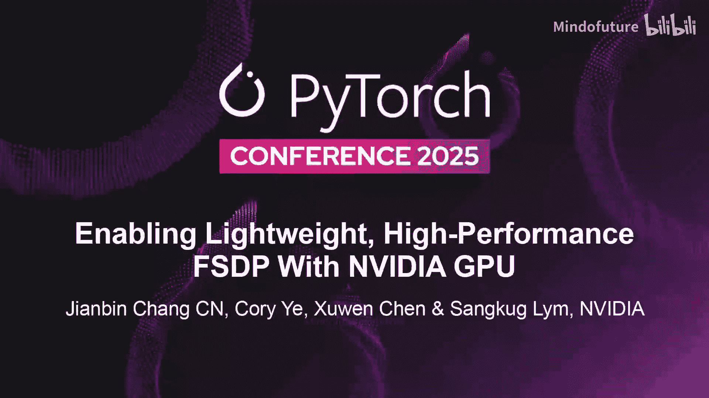
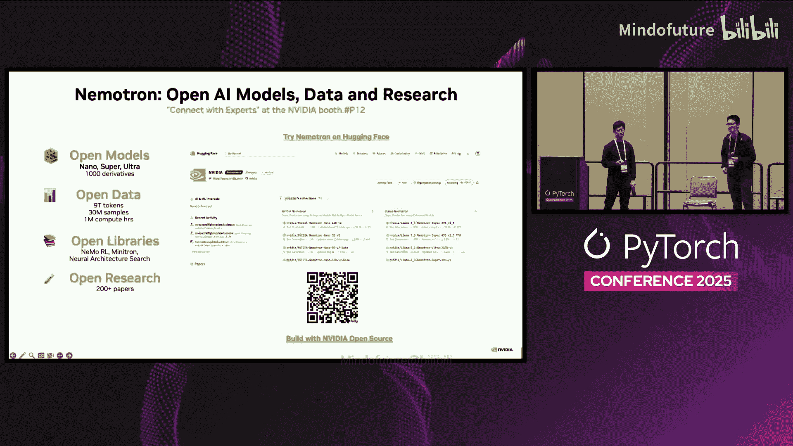

# 2025 Pytorch大会 ｜ Pytorch Conference 2025 p34 P34_基于NVIDIA_GPU实现轻量高性能FSDP-J._Chang_CN__C._Ye__X._Chen__S._Lym -BV1b8kRB6EJG_p34-

Yeah。

Hello， everyone。So we are going to present megattro SDP。

 I think know there are already many talks about PSDP today。

 but we are going to share in really aside side of the story how we optimized the performance of the fully sharded data parallelism。

All right， so talk is going to go over a recap of FSDP already you guys are familiar with a lot of talks today。

 but we are going to do a short recap and then we're going to talk about part megat FSDP as an overview and then go over many of the optimization we did to improve the performance of it to actually accer accelerate large language model training。

And then finally， my co presenter， Corey， today is going to talk about the API details。

So this is a collaboration with many NDF folks here。

 So I'm going to just have a brief moment to acknowledge their help。

And then let me talk about what a SDP is。So the idea of aDP is basically sharding model state of the model across the GPUs and then the model states here basically include parameters and the gradient and then optimized state and depending on what precision you're going to use for the compute there could be two copies of the parameter so they basically look like this and then compared to the baseline data pedal training that actually replicate all these model states across GPUs FPSDP basically keeps only a unique copy in each GPU so keep the per GPU memory usage low so this is a very important thing to actually train extremely large team learning model like a general B in a large scale system。

So how it works。This whole moral stage sharding happens at the beginning of training。

And then this sharded parameter is supposed to be on sharded， other word。

 like or gathered before competition in both forward and backward competition。

 and after the backward competition， the gradient computed supposed to be resharded or reduce scattered to actually keep the per GPU memory usage low。

And then the key of this FPSDP to make it performant。

 all this competition is supposed to be hidden on their competition， as shown in this diagram。

 So this happens by using two different streams， and then we basically co allocate and then keep all these communication hidden on their competition。

So why people like FSTP， as you know， there are a lot of talks already。

 so it's much simpler compared to the you know complex 3D parallelism。

 which usually refers to cancer parallelism， pipeline parallelism or extra。

You can basically think about only one dimension to deploy your GPUs。

 I mean your model to GPUs and secondly it's more compatible than compared to the pipeline parallelalism。

 so it can be used for hybrid model that has a different architecture in different transformpoal layer and then also you could forget about the load balancing with the transformpoable layer embedding and then lost function。

 so it's much simpler。And then the question here is actually， if it is performant。

 So this is a moivating motivating data that I want to show here。

 So this is the result of Lama 345 billion training on 64 NviDdia G200 GPUs。

 So there are three bars and the y axis here indicates theterflps per GPU and then blue bar on the left most side is the 3D 3D parallel training result using demomo framework from N mediadia and it uses tensor per S 4 pipeline parallel S of 8 and context per side of 2。

 which is basically data parallel S 2 as well。But compared to that， our baseline FDP performance。

 which is from torch Titan using the torch compile， got about 13，40 telelops。

 which is about 20% slower。 So we basically question if it' its best。

 so we did a lot of optimization and we got finally the green bar here as a motivating number as a 2020 telelos。

So this is the Nemo framework using FDP， basically the megatron FDP。

 So today I'm going to talk about what he actually did to actually achieve this number。

So let me get to megatro pressDP。So megatron FDP is all about performance so we did a lot of work。

 but all these optimization fall in these three hable categories。

 so we improved the collective communication performance and basically making the communication low ratency and also uses less resources so basically having all the competition under op lab with the communication uses more resources to make it faster。

Secondly， we thought about the more lightweight proper management between communication and then competition。

 and lastly but not least， we also made the memory usage more efficient for which has also contributed to the performance itself。

So today we mainly evaluate our megatro PhDP on Lama3 family， especially Lama3 45 billion。

 the largest model， but it doesn't mean like it only works for it。

 we already have it working for you know the auto models including the MOE。

 but it's going to show up soon maybe within a month。

And then the data we are going to show are evaluated on MBDA P200 and GB00 GPUs at various scale。

 and then we use F8 because that is more efficient for F SDP as we can do the parameter or gather in MP8。

So let me first show the sharding structure of FSTP comparing it to the one of the FSTP2。

So both FSDP2 and megat and FSDP does the communication by the grannuity of a module here。

 the module is transformable layer to make the communication more efficient for bandwidth utilization。

 however their sharding structure is not the same so the bottom left figure show how FSDP2 does the sharding and basically is aard per parameter sharding and this toy example shows that there are three parameters and by different color and then we shard them into two different GPUs and it basically shard each individual parameter uniformly across two different GPUs。

But in megatCP， we shard the entire parameter within a module with kind of on uniform way。

 We basically flatten all the parameters in the module and then sh。 This is more like， you know。

 how the FTP wanted did， but we chose this option because its gonna be more it is more perform efficient because。

If your layout in the communication buffer and then how it is used in the computation is not the same。

 you have to do an additional copy of data between the computation to the communication buffer with a permutation when we found that it causes extra about 10% and to an overhead。

 so we chose aDP to make it more less overhead and then this gives a signal performance boost。

And the next problem we look at is the repeated collective buffer creation in the communication and to show it we have a toy example here in the you know as an FSTP routinein in the back propagation。

 so at each back propagation for in the transformpoable layer you are supposed to or your parameters and then the parameters will be used for the competition and the result of the back propagation will be basically the gradient supposed to be reduced scattered。

And then every time you call these communication calls， you are supposed to put the data in the。

 I mean， temporary buffer。And then how the baseline appDP does it is basically using the caching allocator。

 which is readily the torch empty API。Using it is not a problem if you have ample memory left in training。

 but if your remained memory is very marginal， then it basically needs to delocate some of the small tensors and then create the big tensor to actually put the result of the communication。

 So we found that this causes some overhead。Not some of at big overhead so we what we did was allocating persistent buffer at the beginning of training using we basically we basically use two buffers so we top of buffer and then just reuse them across the entire training so every single communication call we just reuse one by one one and then the other one I mean interchangeably so we remove all the overhead from training for this。

So for Lama 3，4 vi， we got about 1。5% speed up。 But this is the case we have an ample amount of memory left。

 But if you don't have that much memory left， the performance gain is much bigger than this。

The next problem we look at is the collective performance itself。

So baseline epistpic communication like Orgaer reduce scatterter has a lot of problems。

 it basically uses about8 to 32 stream multiprocessors from you know the competition so competition kernels are supposed to much slower while they are overlap with the communication and I have two GPU traces in here so both of them are from the Lama45 billion and then the left side is four transformer layer forward and the right side is the backward。

So for all the， you know， except for those boxes in the red and then purple color。

 those are communication calls， the rest of them are computation kernels， and as you can see。

 they are all overlaplaped， pretty much all overlapped with the communication kernels。

So making them slow since they are losing about many of them to for the communication。

And then another problem we see is the extra latency to copy the data between the current and the user memory。

 so this is a repetitive overhead， and then finally the baseline kernel。

 baseline communication kernel uses a slow ring algorithm and this is a hub latency bound。

 so if your message site is small or if your training on a large I mean network domain。

 then basically your training is going to be more network latency bound。

So we use Nikel Yu job offerss。So we basically you know use the capability of nickel to register user defined couda memory and then we basically avoid any need of copy and make the proper itself to be self contained for sound and receive and operate so this enables a general copy so we remove all the overhead for the extra copy copy latency。

 and then this enables the capability to use more features of MBmbD andBlink and imp event。

 such as multicast that needs only one to4 Ss compared to8 to 32 Ss。

And then sharp tab basically overload your reduction operation from GPU to the network switches。

So the speed up is shown in this graph。 So with the ML M Li and then imppin Ben Sharp with the you know Nel Ujo offer registration。

We got visible speed up， so we have two data here using 64 B200 GPUus and 64 G200 GPU。

And then their network topologist I mean， their network structure is different for B200。

 the M link domain is only eight， so we do switch M link Sha in the H GPUs and across the other remaining H GPUs we do impippen Sharp。

For G200， it has a 72 GPUs connected by M buildinging。 So we just do the M buildinging sharp。

 So in both result and post GPUs， we get 5% and 8% speed up respectively。Right。

So let me just sp a rid of bit。Okay， so the next problem we look at is the need of copying your gradient after your backdrop to the communication bump。

I already mentioned at the beginning of this talk that theSDPSDP2 needs an additional copy of data with a permutation and that causes about 10% overheadhead and that is shown in the small core snippet at the bottom left so for FSDP module like a transformpoable layer you have to do all for each parameter in the module you have to do gradient computation and then the output gradient supposed to be hoarded in the temporary buffer and then finally permitted and copy to the reduction buffer。

But megattro andDP， we don't need the permutation， right。But baseline， our。

 our baseline implementation still did the copy。 So we basically removed the copy by providing the。

 you know， the pointer to the reduction buffer directly to the competition。

 So the competition result can be directly written onto the reduction buffers。 So all over is gone。

 And that was actually  two% extra benefit here。😊，So in megatron FSDP。

 so we don't do any extra proper management in training。So。

Another problem we look at is the large memory need for hiding the FD B communication so。

The model ofDP is basically hiding all these communication under computation， but this is ideal。

 not all time is actually happens。 So in reality， you can see what what's shown in the bottom left。

 If your competition volume is not enough。 your communication is supposed to be exposed。

 and this computation volume is proportional to your activation size， such as your sequence lens。

 microbech size， to actually hide it， you're supposed to increase your microbetch size per GPU or reduce the tensor pedal size。

😊，So you can make the your figure looks more like a right side。 However。

 that needs more a GPU memory。So what we explored is uploading the activation stores to the host memory。

 CPU memory， and then perpeing it back to GPU。This is not a brand new idea。

 this has been there for a while， but then this was not that popular because the connection between CPU and GPU was very slow via slow PCIE。

 but now this is now becoming more realistic with the help of the Grace N BDI GPU system that supports up to 900 gig bidirectional cheatter chip andus。

So I have two GP traces here again。So it looks the same as the what I showed before and then there are two additional information so the pink color and then the green color are the know the time。

 the bubbles taken to overloading your activation to GPU IC and then prefetching it from CPU to GPU so website side is for propagation right side is the back propagation So as you can see since the bandwidth much faster all this uploadloading and prefeching can be hidden under computation and there' is no impact to the computation on the op lab。

So in Lama3，4，5 billion training， we were able to overload 76% of the activation to CPU and bring it back to GPU。

 and then we were able to remove all the unnecessary recomitation， keeping about 25% extra speed up。

So this is the last problem I want to talk about and this is about the making the memory efficiency better for hybrid FSDP。

 so hybrid shared data parallelism is the idea。Of keeping your communication costs lower in exchange for your external memory usage。

So the top side in the figure is the baseline of SDDP。

 and it charges your all model state across the entire GPU。 So if you have a four GPU。

 you shard them across four GPUs。But hybrid appsDP shard within a partial domain in the GPU。

 for example， in this figure， we have two GPUs to shard and the between the other two GPUs we replicate so since we have a fewer number of GPUs for sharding the communication such as orgaer and reduce scatter gap much faster and especially if you are able to limit this sharding domain within your fast in intra node network is going to be much faster so this is well used to train large large language model。

But the problem is now you have to care about the memory usage。

 So you have to juggle how big the sharding domain has to be。

 Otherwise you' are going to hit the auto of memory。So what we basically did was。

Optimizing the hybrid FDP， doing the full GPU sharding for the optimized state。So bottom left figure。

 the top one is what you just for hybrid FSDP and the bottom figure shows what we did。

 So for compute parameter and ingredient we do hybrid sharding。

 but the optimized state we do full sharding so this has this basically you know does applies the full sharding to 70% or even more of your model state。

 so this can give you more scalable memory saving at the larger scale training。

But the good thing is that there's no per loss in doing so。 It's just more memory saving。

 but there's nothing you lose。And compared to the baseline of SDDP， let me explain how it works。

The right side of diagram is the timing diagram for F SDP and hybrid F SDP with our optimization。

And based on APSDP， we have the basically this is the backdrop。

 so we have a back computation and there is a reduced scatter and or that happening at the same time。

 right？And then if your communication takes longer， they are supposed to be exposed。

So in our advanced hybrid FSDP， you do the reduce scatter in the sharding domain。

Because your chargingard domain is smaller than your full domain。 So and in our case。

 we assume that we can remit it within the F MB link domain。

 So it's going to be much faster compared to the baseline reduced scatter。

And then after the reduce scatterter， you are going to have a smaller message size after the reduction and they are supposed to be reduced again across another the replication domain sorry not replication I mean across the other remaining domain of the full sharding so that's why you have another reduced scatterter and that happens after the first reduced scatterter and since they are not overlap up in network resources。

 you can actually overlap up with the parameter or gather in the em link domain so this is how it looks like so you can make your baseline communications faster and there's another communication that can be totally overlap up with the other communication so basically theres a speed up and then theres a you know also memory saving。

So I went through all the techniques we did and then let me close the performance section by revisiting the performance Re that I showed at the beginning so we basically achieved 2020 teleflps。

Using all the techniques that I talk about today， and then that is about 70% speed up over the best 3D parallel mapping and 50% speed up over our baseline FSDP。

Right， that's about the performance section。 And then my co core is going to talk about the API details。

AllI'm going to fly through this。Yeah， so we just talked about how megaron FSDP works and I'm going to talk about how to actually use it so megattroron LM's training framework already natively supports megatron FSDP。

 but we also support a fully shared interface for using models outside of megatron LM so all you have to do is fully chart your model and optimizer either together or separately and the megron FSDP will schedule your model state behind the scenes。

The API does explicitly ask for a few things such as the device mesh that I'll talk about soon。

 but specifically what you want to know is how to do how to set up the FSDP and HSDP sharding strategies so we have basically these zero zero redundancy andumerated argument01 to3 where you can set if you want to configure sharding for your optimizer your gradients or your parameters and for both the inner and outer sharding domain so the outer sharding domain can either be the sharding domain for optimizer state full sharding or it could just be replicate like in classic HSDP there's also an argument that's really important where you can configure the module classes that you want to shard and synchronize as or sorry sharding communicate as a synchronized group and this is really interesting so we call these unit modules but these unit modules or choosing these unit modules comes with a lot of nuanced trade-offs the goal really is to maximize memory utilization while minimizing the amount of nickel calls and larger communication groups actually reduce the amount of nickel calls。

But also increases the memory floor of allocating these layers into memory one by one。

 So you have to consider how your unit module sizes trade off memory and nickel calls。

 and also that further affects compute collective overlap and also the micro batchch size that you can fit on your GPUs。

And also speaking of performance， we have a wide variety of performance switches as well。

 so like you can configure nickel user buffers when you're using megatron corere。

 you can choose whether you want to synchronize gradient reduction or outer data parallel communications every single step。

 or only on optimization steps， and then finally also basic BF16。

 FP32 mixed precision options for optimizer。I'm also going to touch on the device mesh。

 so Megatron FSDP's device mesh fully describes its distributed environment。

 which includes the outer and inner sharding dimensions for data parallelism。

 context parallelism and tensor parallelism， we also support expert parallelism using an auxiliary expert data tensor parallel device mesh to support MOE models that will be testing with our clients next month it's an MR it's like in the CICD chain it's going to be merged really quickly very soon。

 but yeah we went with device mesh because it provides a really intuitive user interface for managing parallelism and it's also a vehicle for users to integrate their custom distributed environment into megatron FSDP seamlessly and through the scaffold that device mesh provides we actually support both megatron and detensor based parallelisms and you can actually check out some of those recipes in Nemo auto model or just hook up the device mesh that megaron FSDP uses with the device mesh that's used in detensorbased training frameworks like Torch T。

I'm going to quickly touch on checkpointing， pretty simple。

 modern and optimizer checkpointing are supported， we use Torch distributed checkpoint for saving and you can also convert distributed checkpoint into either uncharted torch save or even further into hugging face safefe tensors for sharing with other people。

 and finally you can load torch safe checkpoints before fully sharding or load torch DCP checkpoints after fully sharding so there's a lot of flexibility when managing your pretrained state。

And yeah， just to wrap things up， megatron FSDP installation is really simple。

 you just install megatron FSDP from pipepee if you're already using megatron LM。

 you don't need to do anything because it's already FSDP is already a submodule of megatron core megatron FSDP is St integrated into the Pytorrch and Nvi ecosystem so we support both compute in both BF16 and also transformer engine current scaling delayed scaling FP8 while MxFP8 and FP8 weight support will be promptly tested and supported in early 2026 day zero support for megatron FSDP is in megatron LM megatron bridge。

 Nemo auto model and bionemo recipes and I've also casually tested megatron FSDP and torschine。

 the huggingbased ecosystem lightning and native Pytorrch。

 so it's generally compatible with most training frameworks。Yeah。

 and we definitely encourage open source contributions so whenever you guys find a bug or want to give us feedback。

 just open issues or PRs into megatron LM and just keep in mind that we're still in the alpha and beta stage of megaron FSDP so definitely expect some bugs or friction before I end this I'm going skip through the appendix slides as I want to mention that NviIDdia has a lot of events this week at open source AI Week so don't miss it there's a QR code that I'm going to leave on the screen for as much as I can and then also Nemoron which is an open model open data open libraries and finally also open research you can check out all of NviIDdia's open source libraries and that QR code and I'll open the floor to questions。

I think this guy raised his hand right here。嗯。I just。Yeah。Yeah， just speak up yeah。So。think。

For example activation ofloading comes from like say GB200 activation offloading comes from GB200 sharp basically comes from like the switch infrastructure I guess and the variable sharding that you set up for parameters or optimize the state I'm assuming it' just as much work to set up de detens as well so if we just did the work like how much of that gap will to titan bridge do you think obviously you can't do the flat parameters for instance because that's pretty significantly breaking for to titan but how much do you think will carry over。

dog you That's great。 No， so the question is can we upstream any of these features FSDP2。

 the answer is we're definitely willing。 This is mostly our research code to be clear。

 So we kind of wanted to mess around with a bunch of different optimizations。

 And that's what megaron FSDP ended up being but we're definitely open and willing to reach out to the FSDP2 team to upstream some seizure。

 I think to answer your question the fully sharded optimizer state。

 that seems like a potential opportunity to upstream because it's literally just establishing a view into a fullyarded fully sharded view of the model parameters and also the gradients as well。

 So it adds an extra all gather extra reduced scatter only before and after the optimizer step。

 so that can be upstreamed As for the other stuff definitely can be much harder because we have our own stride charting configuration。

 we have our own uneven detensor kind of management for dealing with flat buffers since we don't actually split every parameter evenly like FSDP2 does。

 But like good question。 there's a lot of debate to be had。 I think。😊，In my mind。

 the optimizer sharding would be the easiest。Maybe one more question。 or yeah hey， really nice talk。

 I just had a quick question。 You had to do a lot of optimization in order to get this over the line right。

 So I wanted to just get an idea like。😊，How much of those individual optimization contribute to that performance。

For example， mainly I would like to understand like how how is the sharp。

 especially from Infin band Sha， How is that contributing。

 how much does it contribute to the performance improvement？ Yeah。

 basically in each slide I put some number like how much they contribute it。

 but you know if you want to make the full step bar。

 I probably we need to like rebuild the whole thing like because we know basically that improvement happens in different configurations So you know to actually get the full step bar。

 we need to just look our Yeah then we already have some numbers so you can prove that how much they contribute thank you。

One more question。What's what's the defensive of placement you invented in order to represent。Yeah。

 so Jack would be a great person to answer this， but the idea is simply just we write in torch GP metadata so that when we write out the uneven detensor data。

 we write it correctly， unevenly to shards。 but basically what you need to know is like with uneven detensors like the quirks are you'll sometimes get empty tensors in your detensor local tensor。

 So that's something you have to take care of and when you're all gathering you want to make sure if you find an empty tensor just either concatenate it or like if there's no emptysor if there's no tensor at all。

 you just have to ignore it and whatever ranks actually have those tensors。 but yeah。

 we have all these utilities。 its basically all baked into Pin install megaron FSDP if you want to all gather these uneven parameters into one uncharardted parameter we have utilities for that。

 So it's complicated。 but we have the API。

Good great question。