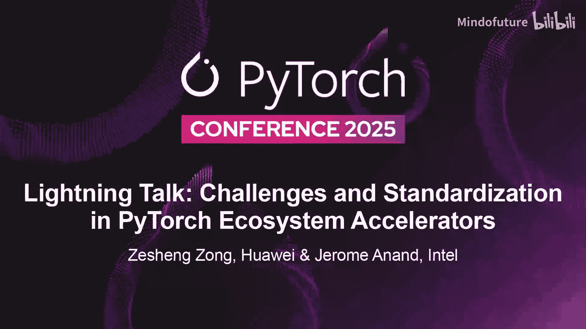
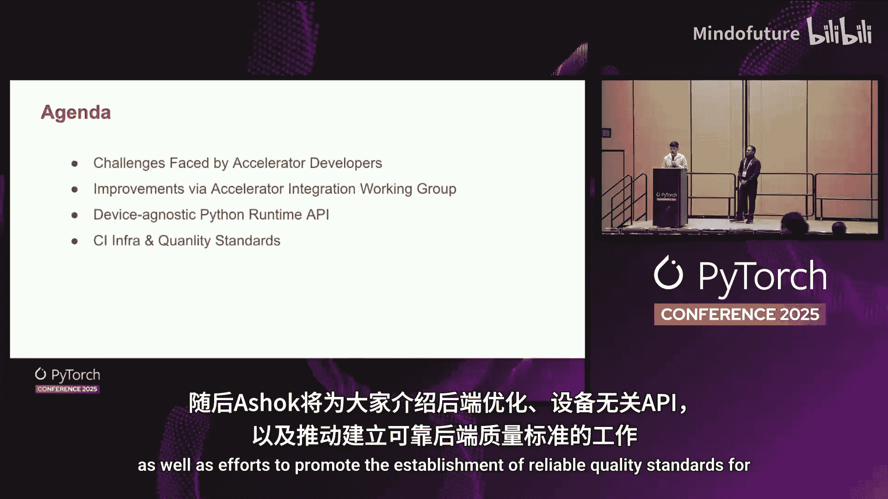
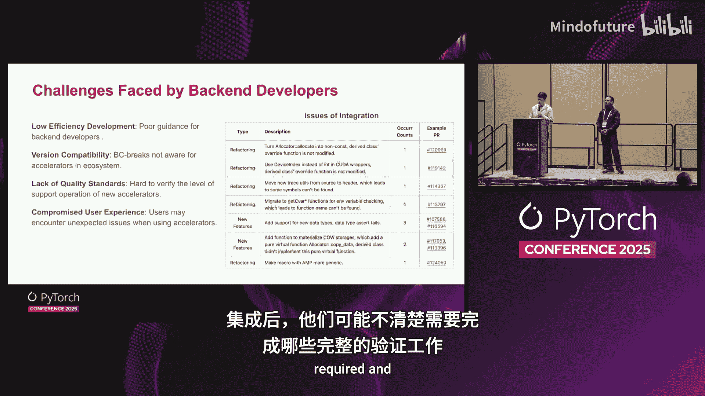
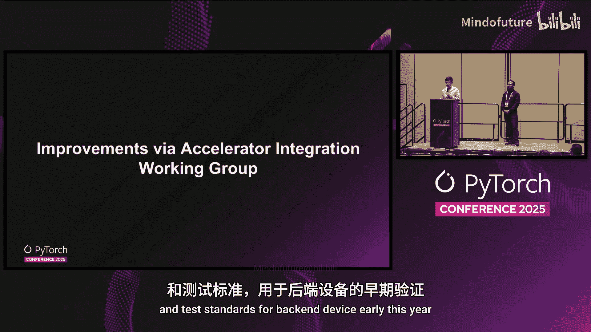
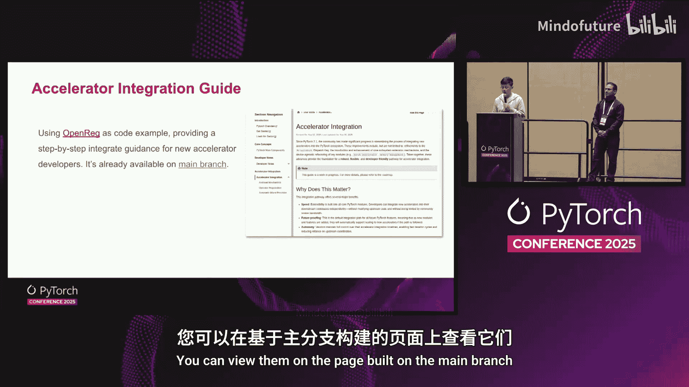
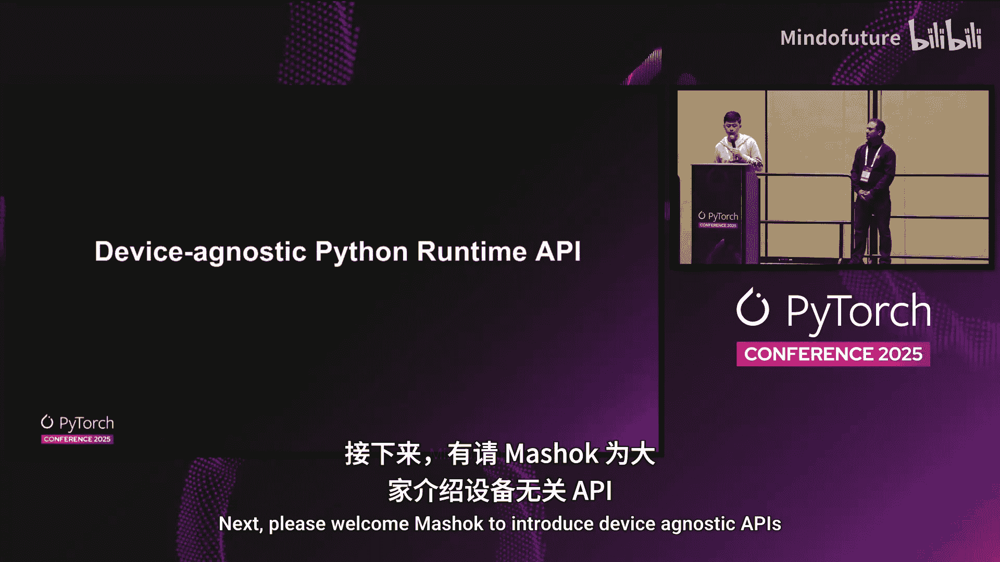
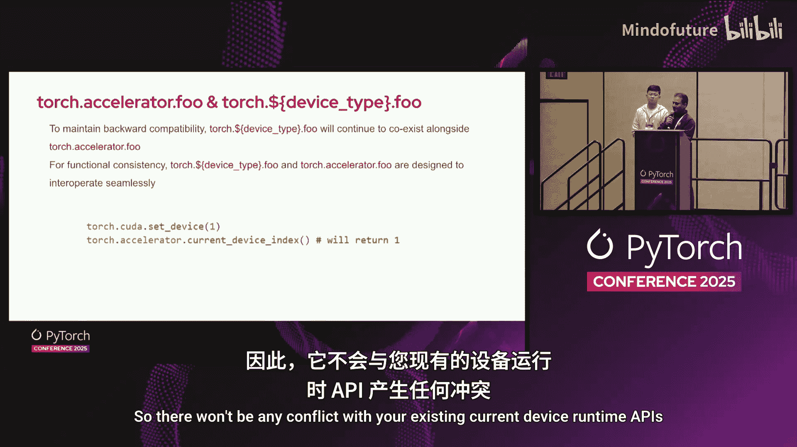
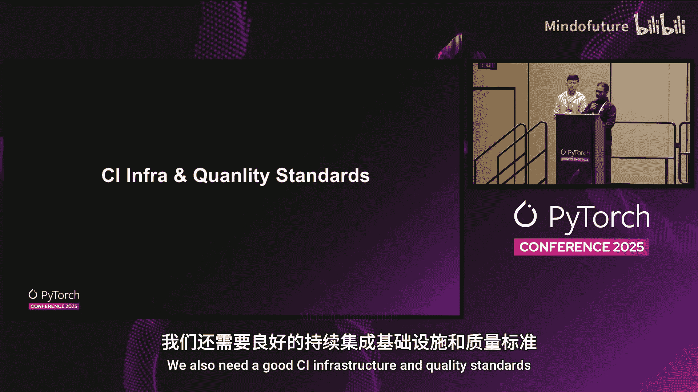
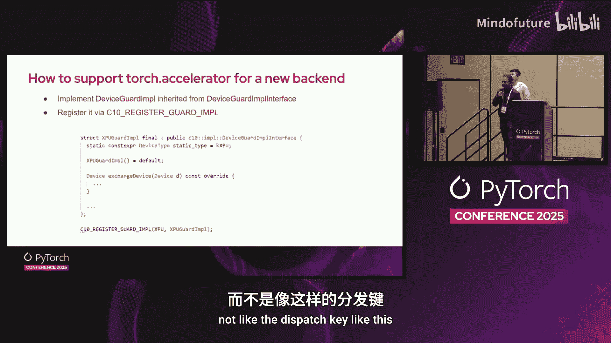

# 2025 Pytorch大会 ｜ Pytorch Conference 2025 p35 P35_闪电演讲-PyTorch生态的挑战与标准化...-Zesheng_Zong__Ashok_Emani -BV1b8kRB6EJG_p35-

Hello everyone。 my name is Z Sheng In this topic， Ashsha and I。

 and willll share with you the challenges and solutions we have in the field of accelerator integration with Ptorch。

The agenda starts from the problem we encountered in our solutions。

 then ash will introduce to you the backend optimization， the device agnostic APIs。

 as well as efforts to promote the establishment of reliable quality standards for backends。

 so let's get started。

Anotherable trend in AI framework is when projects like Petorch in their early stage。

 they usually integrate device related code or logic into the main repository to enable backend device support。

This choice is speed out development， reduce the workload of project setup。

 maintenance and distribution Patch incorporate a dispatcher mechanism that assign a unique key to each backend。

 however the total numbers of available key limited and integrate new backend changes code across multiple modules which increase the development and the test workload of the core logic so Patj is now using previousvis use one as a common dispatch key for plugbased accelerators。

Also in this year VRM reed its backend logic and launched the V architecture。

 which now enable connectivity with more device wire plug bit system。

 this development shows that the plug bit access has emerged as a practical way for AI framework to support an extended hardware ecosystem。

But they also introduced some challenges。The first new backend developers have no clear guidance I may not know where which part they should get started with second upstream community lack version vision of downstream so upstream feature development or reflecting often cause incompatible changes after integration they might not be aware the full scope of verification required and which spec specific level their integration work actually belongs to for users there is no clear guidance that code running smoothly on one device will work on another。

To address this gap， we propose a suggestion to the community to establish the unified integration and test standards for backend device early this years。

In January the community established an exploratory group in charge of this topic。

 in June we accomplished the improvements of SA testing infrastructure for Toch NPU and In Gaudi and established a formal working group。

Currently， flagagGms has also joined to build the test process and upper layer application like To2 Tor Titan has also integrated to the end to end tests。

At present， the work of working group mainly focused on two aspect。First。

 reduce the complexity of backend access， including any more device agnostic APIs。

 second ensure the quality of accelerator integration via SD。

Provide an official step by step integration guide and incubate quality standards of accelerators in the Pytor system。

The integration mechanism， based on Pri use One dispatch key。

 we have achieved comprehensive capability improvements for multimods such as AMP Autograde and distributed。

 now after new accelerator completes the access work。

 they can basically obtain functionality features support like other entry backends。However。

 after that， users still need to explicitly import the backend accelerators in the code。

 such as import Torsch and P， but some users doesn't want to therefore has implemented an auto load features when users import torch the system will automatically identified corresponding backend this feature has already released in Pytorch 2。

5。TheIn terms of quality， we have split the job into two parts。

 one is unit test that merge into the community's core repository and the other is the end to end for integration testing in an independent one。

 we have developed the open rack as a mock based on the CPU backend and implement some mandatory constraints of the backend accelerators unit test running with PR checks。

Whenever PR is raised， the test will run automatically to prevent destructive interface changes。

We have also used OpenR as a code example to provide developer with comprehensive integration guidance。

 standardize the petchback and access method and APIs used Some chapters has already been launched。

 you can view them on the page built on the main branch。

Next， please welcome Mashq to introduce device agnostic APIs。

So as you know， the PythOS device runtime APIs are。

Very device specific if you try to write code that supports multiple hardware packets。

 your script will quickly fill up with these E blocks that are hard coded to Quda or XBU。

So you know it's hard to maintain this code and also if you have a new aelator backend you need to port it right it it's very tricky to maintain this existing APIs so since 2。

6 there is a new generic allator API that has been introduced。啊。As you can see in this table。

 the goal is to provide a single set of APIs for common runtime operations。

You know the idea is to eliminate those effects blocks so that if you call。

 you know instead of calling Tordot XPU set device。

You can simply call Torch dot accelator set device， similarly synchronize couldud dot synchronize。

 you can just call accelerator dot synchronize。And as you can see the function name and arguments match their old device specific APIs。

 so it's much easier to port your existing code and also the code is simpler now with this allator APIs。

So this is just not just a Python level patch， there is also C++ APIs under 80 allator nabspace。

 so under the hood the entire system is built on device guard impple interface。

 this provides a clear registration mechanism for out of three devices。

This is what allows new hardware vendors to easily and cleanly plug their backends into this new unified system。

So the core design philosophy for this is based on three simple rules first the device agnostic APIs that work on all devices。

 including CPU。s as Tort empty you know the take a device parameter will remain in the torch name space second device agnostic APIs that are only for aelllators will be under Tort allator namespace。

These APIs take a they don't take device type parameter。

 they automatically use the current active accelerator。

 and third all device specific APIs will of course remain in their own modules。

 looks like we have one minute I'm just going to quickly go through our CI infrra and quality standards。

Here is an example on how you can actually enable this bring your own accelerator。😊。

It's pretty straightforward， you just have to implement this device God impple interface。And。

Once you have that， your allator APIs should be available。And one last thing on this。

 these allator APIs are backward compatible， so there won't be any conflict with your existing you current device runtime APIs。

It's not just enough to have this integration， we also need a good C infrastructure and quality standards。

So。You know the core problem we are dealing with is these are out of three devices that means the code base is not on Pyth's Github right the code base is on their own Github repositories so the problem this leads to several problems like if you make a change。

I guess so。Hello， can you guys hear me？O。😊，So。So we are building a new In year infrastructure that provides proper integration tests and end to end model validation this is our basis for new aelator quality standards。

 this avoids you know version conflicts inconsistent testing and frustrating user experience。

Here is a simple Github actions workflow on the left。

 you see developer opens a new productlist on Pyotch GitHub。😊。

This will automatically trigger a repository dispatch event which kicks off a separate workflow in the plugin or the allator repository。

😊，And this CI system then builds a Pytorch and all the participating out of three backends like Torch。

 N and Intel Gaudi。It runs the standard test， including compilation， unit test。

 and most importantly the attachmentment validation so that we know that there is nothing broken or performance is consistent。

The most critical part of this design is that it does not block the main Pythot C。

 which is important for this out of three backends。😊。

And this new CI system is the technical foundation for our new quality standards we have created a new compute platform quality criteria proposal its being trackracked in the allator working group。

😊，This allows us to create a scoring mechanism where we can classify different levels of allator support and it gives users much clearer idea of what is what to expect from a given back end。

😊，So what's next， first we are going to continue refining these quality standards and enhancing the CI workflow。

Second we are focused on finishing the comprehensive allator integration guide。

 this will provide a step by step tutorial for hardware vendors to onboard their new devices you know using our openre reference backend please check that out it is a very good reference backend design you can follow。

Third， this involves all of you who will be working to migrate the ecosystem over to the new。

Allator API so please you know try to migrate your existing code to use this aelator API so when a future backend becomes available。

 accelator becomes available， your code will just work。

This is a communitywide effort so if youre in a hardware vendor or just interested in making Pytorch work on more devices please join us the best place to get involved is on PyTOch Slack in the Axllator integrationeg workgroup channel。

And thank you。 And we have some。If you have any questions， please。Yeah， please go ahead。你这话怎从来没一句。好。

Next one。我觉只剩个一方。あと。嗯。做这块。要。好好。过去。I can't hear you sorry。😊，保公司。Yes。Wch。So in this example。

 XBU is a dispatch key。That's all you need to follow。

 implement that interface and the Python API and the CP API that we showed will automatically work for this。

Oh， yeah， pirate use one， yeah。I think that's what they are recommending everybody to use actually the private use one。

 not like the dispatch key like this。😊。

