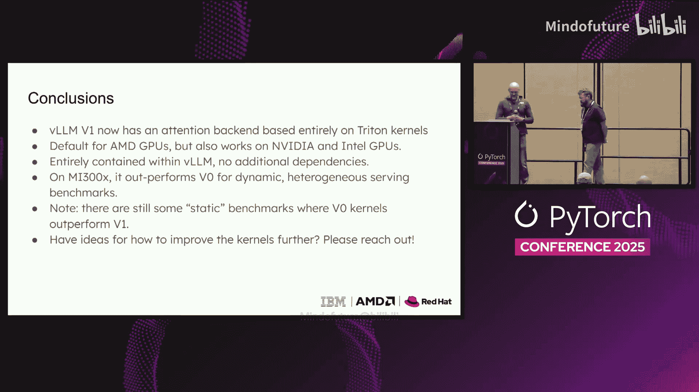

# 2025 Pytorch大会 ｜ Pytorch Conference 2025 p36 P36_通过Triton在AMD_GPU上启用vLLM_V1-Thomas_Parnell__IBM_Research__Aleksandr_Malyshev -BV1b8kRB6EJG_p36-

Hi everyone， good morning， my name is Thomas Ponell from IBM and today I'm going to be presenting this together with Alexander Malishsha from AMD。

And we're going to talk about our work to enable VLM V1 on AMD GPUs with Triton。

 and I just like to say this is joint work between IBM。AMD and Red Ht。Okay。

 so just to give you an overview of what we're going to talk about today。

 we'll start by explaining the title， what is VlLMV1？

Why did we need to build a new attention backend for it， and why do we use Triton for that？

 Then I'm going to get into some。Basic terminology。

 which will help to understand when we present the details of these kernels。

 and I'll talk about the baseline that we used as the starting point for this work。

Then we're going to go pretty deep into like how we optimize these kernels， what worked， what they't。

 and we'll close by showing you some。🤢，Very recent performance benchmarks comparing VlMV1 against V0 on MI 300 X GPUs Co so let's get into it。

What is VLM V1， so this goes back to， I think January this year where the VLM team announced a complete redesign of VLM's internal architecture。

So from the outside for like users， nothing changes。 It's identical， but the internal changed a lot。

 So why did we do this， I think the。The goals of V1 were threefold。

 one is to make the VLM code much more simple， like V0 have become a bit of a mess。

To make VLM easier to extend and like plug custom behavior in。And most importantly。

 to make VL more performant， so in V0 we had lots of different optimizations like chunked Prefi。

 spec D codes and many more。😊，But these optimizations didn't necessarily work together。 In V1。

 We want to make these optimizations work together seamlessly and enable them by default。Since then。

 like that was in January， V1 now has many more features related to performance like zero overhead automatic prefit caching。

Integration with Torch compile， which we heard about yesterday and stuff like PDD desegregation and many more。

 So V1 is awesome。 we want it。So the next question is。

 why couldn't we just take the attention kernels we use for V0 and run them on V1？嗯。

So there's a bunch of reasons。The first is that V1 requires the attention kernels to support all these different optimizations like chunk prefil。

 prefitx caching， spec D code。But also， it's important to understand that V1 changed the way that we like batch together requests in V LM。

 So in V 0。We always distinguish between a prefi batch where we have like。

A collection of prompt which are all prefill requests and a deco batch where all of the sequences in the batch are like in the decoding phase。

So in V1 a batch can comprise both and like other cases which I'll talk about later。

 so like a batch contains lots of heterogeneous requests in different states and that batch also doesn't enforce any order。

 so like sometimes you get the des in the beginning and then prefis but that isn't guaranteed。

So why do we use Trirightton？So when V1 was first released in its alpha in January。

The only attention backend that really supported all of this use cases I described just on the previous slide was flash attention and in particular。

 the couda like variant of flash attention。 So of course that implies that V1 was only supported on NviDdia GPUs。

So how could we get this working on AMD？ I mean， one option is to say let's take the V0 backend and port it know if you want。

With that V0 backend used a lot of custom hip kernels， which you know。

 I don't know how to write that， that makes it， you know it takes more time to adapt those kernels to this V1 use case。

So the team across IBM， AM M D and Red Hat decided to try and build an attention an attention backend for V1 using Triton。

 So why， why Triton。Triton is super easy to be productive， right， You can write the kernels quickly。

 prototype them and benchmark them。 They're also flexible。 So when like new models come out。

 you can adapt those kernels if necessary。 and the Triton kernels are also portable across different platforms。

 And my colleague Board is going to talk more on that topic later in this session today。😊。

So before we get into like the guts of the kernels。

 I just want to introduce some basic terminology that I think is needed to understand them。

So there's three important quantities to understand the context length， the query length。

 and the sequence length。So the context length is like the number of old tokens。

 this is like the number of tokens in previous forward passes that you've already computed the KV Ten4 and stored them in your page Kv cache。

The query length is a number of new tokens， like the number of tokens in your current forward pass that you want to compute the KVs for and attend them to the old tokens。

 and the sequence length is the sum of both of those。

So just to help understand you can think of some like corner cases of this thing right so if the context length is zero。

 so you only have new tokens，This corresponds to your standard prefi operation where you're just prefiling the whole prompt。

If the context length is nonze， so you already have some page Kvc that you've computed in previous its。

 but your query length is like 1k， 2k， 4K， this is what we see when we do chunk prefill or prefix caching type opts。

In the lower left， you see a Dcode。 So that's again， a very， you know。

 well known up where we have like the query length is one。

 and we have a lot of context that we've built up from previous iterations。And finally。

 spec Decode looks a lot like Decode， except that query length is not one。

 it might be three or four tokens， something like that。Okay， so now getting into like the baseline。

 So this was like， how do we just bring up VLM V1 on AMD GPUs？As quickly as possible。

 so actually this was kind of easy， so we had an existing kernel that came from this light LLM project。

😊，Called prefix Prefo。So this kernel supported all of the stuff I just described so it can support all of those four cases and everything in between。

 so this was a super cool way to get started。But we found the performance was really bad so it was actually six times slower than v0。

 which defeats the whole purpose of V1， so we got to fix that。So in order to fix it。

 we first had to understand like what the problem was right。

 so this slide is a bit complicated but I'm going to walk you through it。

So this figure shows like what one of the programs of prefix prefi is really doing。

 So when we launch this Triton kernel。You specify a grid right and that's shown in the bottom here。

 so it's a 3D grid of batch size， number of query heads。

 and then query length divided by a block size block M。

So what this means is we're going to parallelze all of the work across these three dimensions， right。

 So each program is completely independent， doing its own work。

And what you see in this figure is what that program does。

 And I don't show the first two dimensions here。 I only show the。

Query length in the vertical axis and in the horizontal axis is like the sequence length。

 And this is the dimension along which。The kernel does like the online Somax algorithm。

 so it's basically the same algorithm from the flash attention to paper where you iterate tile by tile along the sequence length and compute online Somax so that each box you see here is one tile like I001 it's just a full loop basically。

So what you can see here is that we have two different block sizes。

 the block M runs in the query length dimension， and it's set to 128。

And the block N runs in the sequence length dimension， and is's set to 64。So。What's wrong with this。

 why doesn't it work？For decodes， the query length is one right so but we've hard coded this block M to be 128 tokens。

 so that means for decode sequences。Each program in every tile is doing like 100 act more work than it really needs to do。

So you will look at this and say that's done， like why don't we just tune block M。

 why don't we make it smaller， why don't we set it to one even？But， of course。

 doing that will ruin the performance for the other sequences。

 So we need to launch the kernel for like the whole batch， right。

 which is a heterogeneous batch containing prefis and decos。😊。

Setting block n to one might work well for decocodes。

 but it's going to mess up the performance for prefi， right？

So the kind of zero thought solution we came here， came up with here was to split this。

 so we launched prefix prefi。And for sequences with query length one， we just terminate it early。

 so those programs stop。And then we launched a second kernel to process the decode sequences。

And that's what I will describe on this slide。So on this slide I show the kernel that we use for decos。

 I'll start on the left here。So let's see how the launch grid changed right so on the previous slide I showed a 3D launch grid。

 this launch grid is only 2D， has batch size， number of query heads and the query length dimension is gone that's because it's just one right so we can collapseapse it down。

And what is showing the figure on like the vertical axis we have the number of query heads and on the horizontal axis is the context length。

 and again we're just doing tile softm， tile by I1， I0 I0 I1。

 so already like along the horizontal axes。So the difference here is that the tile size in the context length dimension is 16。

 that's aligned with the default attention block size in VLM。And in the vertical dimension。

 the block size in the query heads is one， so each tile process is one query head。

This worked great for models like Lama2 which don't use GQA grouped query attention。

 but of course all of the new models do use that。That's what we show in the figure on the right。

 So in order to get like the best performance here。

 we needed to introduce a new tiling in the vertical dimensions in the query head dimension。😊。

And we changed the launch grid， so we only launched this kernel for batch size times number of Kv heads。

So each program for a KV head will read the data for that KV head and process like all of the query heads which share it。

 and that's why you see this new block size in that vertical dimension。

So this improves the performance because you have less data to move。

 but it also improves the performance because we can do a trick where we pad up that tile size in the query head dimension to 16。

 which forces Triton to use the。Matrix caused on the GPU and we see a big boost in performance from doing that so with all of these optimizations for like GQA based models we now see that we're 4。

7 times faster than the baseline prefix prefo kernel and this point I'm going to hand over to Alexander。

Yeah， thank you for a great introduction and basically sharing the problem statement for the attention kernel that needs to handle both decode sequences and peripheral sequences in the same batch。

And complexity and basically developing one kernel for everything。However。

 I wanted to just a step back slightly into what we started in MDD in parallel with the IBM research。

 so we took that pre pre field and basically the kernel right from the way it used to be was assuming lots of how to say easy steps to do it in nice optimizations at first。

 so for instance， as the first step。For the kernel， when you run a benchmark。

 basically January when when you run the write compiler and see what the。

Assembly goes out and what the speeding rate is， originally it was using like8 vers per compute unit。

 which assume that it will be two war per SMMD because every computer unit has four SMMT or steaming multipro if you're talking about 10 media。

And as more war we have as more。Number of vector registers needs to be split on so for instance in this case when we have two work SMT so 512 vector register needs to be split and that is why most not most of the time for that particular case it wasn't enough and it was a really high spilling rate and it was a killer for theagon performance so the first and this step was like to reduce a。

Number of verbs from8 to 4 and basically give every verb to to use all 5 to12 reactor registers。

 which kind of。Increased be performance by by two or three。 and it it was。

 it was a really great start。 so it it kind of unblocked lots of experiment to go with the I D hardware。

 So second step was in when， when we reduced a number of wars， then it become one word per S empty T。

 So the prioritization wasn't great and。😊，The kernel was was I I I started reflectingracing for for the kernel basically to ex to provide more parameters for the after union and that was the goal is to reduce the amount of memory need the kernel every instance of the kernel needs to handle in order to increase word polarization back to it。

😊，That's the second step。This third step is the it was from the looking from the as assembly。

 So there are different ways to access memory and on， on N GPS。

 It might be singleingle element access， or it might be viized access and。Yeah。

 when K kernel has has the vectorized access to memory， basically the load is the most efficient one。

 However， for Tri kernel to figure out if it' allowed to do a vectorization for， for the load， it's。

 it's， it's not easy。 And that is why it requires to to generate blocks of offset。Is。

How to set it as more clear as possible， using all the constant。Variables， right。

 so with so they they they known in in compile time。 So that was the second。

 the search step basically is to instead of。A lo in context from the several TVV Air blogs， right？

And not aligned for the block size。 it was reffactored to access only onekiwi cache block， right。

 because VLM is is a block structure for for Qwi cache and once it the alignment was was organized then it it。

It opened a way to do a。诶。To do a loop。Unrolling because every loop was like independent and every loop was working with just onekikiwic block。

 And as long as the Kiwi cache is not huge， right then。

Several loops might be unrolled into into one kernel。 Then again， the fact that online soft mis。

 for some reason， it was implemented in the way it done on paper。

 but there there were ways to to reduce a number of computations and as it happened in the hot loops。

 it was really nice first improvement that reduce amount of vector registers needed and compute as well。

And the last step is also pretty obvious。When we do lot of store in the loops， right。

 most of the iterations we don't need to check for the age cases right this needs to be checked when the iterations gets to a bound。

 basically once you remove it， you'll get a performance。嗯。Then in IND we thought that heavy from V0。

 we have really nice and optimized kernel for the decode and basically that decode kernel implements flash decode attention。

 which parallelizes the context onto blocks and then do action。It was。W it reasonable to。

Took that piano from， from Viro。Refactor it， and。adapptted to V needs so that it can handle on decocode sequences in in the batch while the Triton kernel will handle chunket peripheralfi or speculative decodian sequences from that kernel Basically that happened and it gave another performance boost which gets as closer to the goal is is to get more or less on par with the and video attention that was used for realLM that time and on the slide you see lots of tune that you can find in that kernel as well as a link It's implemented in+ pass。

While the while kernel is great it again has lots of tricks and even for the person knowing C++ it's not very easy to understand it takes a while and then to extend it to a new features like。

😊，Window， sliding window， like alibi， simply man there or Sins， the de one in Jupy says。Right。

 that is why。 and also it's， it's not very easy to port and to enter an architecture。 For instance。

 recently， we how to say the I switched from M3 calendar to my T 50。

 slightly different aerator with lots of。New， nice features。That was the problem。And that is why。

IBM and then。ID pick up an idea to， to do a development for a unified attention kernel。

 which basically gets all the ideas altogether。 And right now we have， I don't have my much time。

 sorry I need to skip couple， couple of this。Right now we have 2D，3D。Attention kernels。

 And the the idea is that22 d is mostly used it for pre prefi heavy kernels and 3D for。

 for decocode heavy kernels。 they， they have different characteristics。

 have different optimizations for it， depending on the peripheralfiural decode use， right。

 for instance， for decode use。 We don't need to use cache at least one SVA is applicable only for for prefi。

 right， because for for decocode kernel 3D， there is no enough priorization for it and so on and so on。

 yeah。Speed up a little bit。And we are completing our presentation by。M B H marketer that we did。

 we tried to compare what we zero with the V1 we currently have。 unfortunately。

 we zero nice support stopped somewhere in summer long time ago。 V1 is is the main mainline for now。

 right and。😊，We try to。To do as honest as possible， right， because we zero as Thomas said。

 there was no by default chunk peripheral field and the number of sequences in the byte was also different and whatnot right And we took a Mial 24 billion basically provided the commands here if we want to reproduce it and in the end。

 we。We see that around 10% we get better time to first token。

 inter token and the throughput in general， if we compare V1 with be0。On top of that。

 just want to repeat what Thomas said originally with the V1 we are getting into Pytht ecosystem with the touchrch compile with all the passes of touchrch compile。

 we are getting cutgraph autobox support and more and more really nice。Features that。

Either developed or soon will be developed。And done。 Thank you。晚上。Any questions。Questions。好。

If not now， feel free to come to us and basically ask later。 Thank you for your time，😊。

