# 2025 Pytorch大会 ｜ Pytorch Conference 2025 p37 P37_Transformers——PyTorch生态中的模型定义标准化-L._Debut__A._Zucker -BV1b8kRB6EJG_p37-

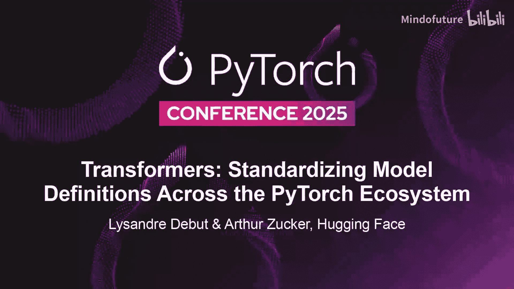

Hey everyone， thanks a lot for coming。It's nice to see you all。

 we're going to talk about transformers today and about how we are trying to standardize model definitions across the ML ecosystem。

😊，So I'm Lyander， I'm the Chief open source Officer at Huging Face。

 I've been a core maintainer of Transformers for the past six years or so and I'm here with Arthur。

 I'm Arthur， nice to meet you all thanks for coming I'm the head of Transformers and have been a core maintainer for the past three years of the Transformers library。

😊。

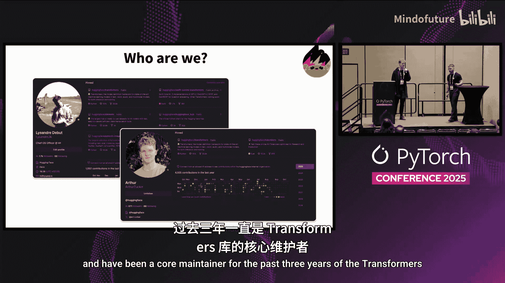

So today we want to spend not a lot of time， but a bit of time talking about what is transformformers today。

 just to make sure we are all on the same page， then we'll talk a little bit about the origin story of transformers and then we'll talk about the most important announcements which is that transformers is going towards the version 5 and we want to talk about what we're doing for that and how hard we're trying to establish good standards。

And so the first step is to take a look at where we stand right now。

Like what has transformers been doing over the past few years that brought it to where it is today。

And so if we take a look back at the past few years。

 actually version1 up to version4 happened very quickly over the span of about a year and each of those major versions was prompted by one specific event at that time so for example V1 is when we started introducing more models to the library before that there was only Bt so it was called PytorchfrtrainBt V1 introduced a change towards Pytororch transformformers V2 was when we introduced Tensorflow and JX to the toolkit and so from Pytororch transformers it went to become transformers and finally V3 is when we started introducing new APIs new APIs that required a few breaking changes compared to the previous versions which prompted therefore a major version。

And the same was for V4 where we introduced rust based tos and we put those as the default going forward so we're getting closer to the time where I started working for hegingface and maintaining transformers。

I'm very happy because I was able to see the number of models we support going from around 20 to what it is today。

 357 or something and we're now standing right now at the version 4。57。

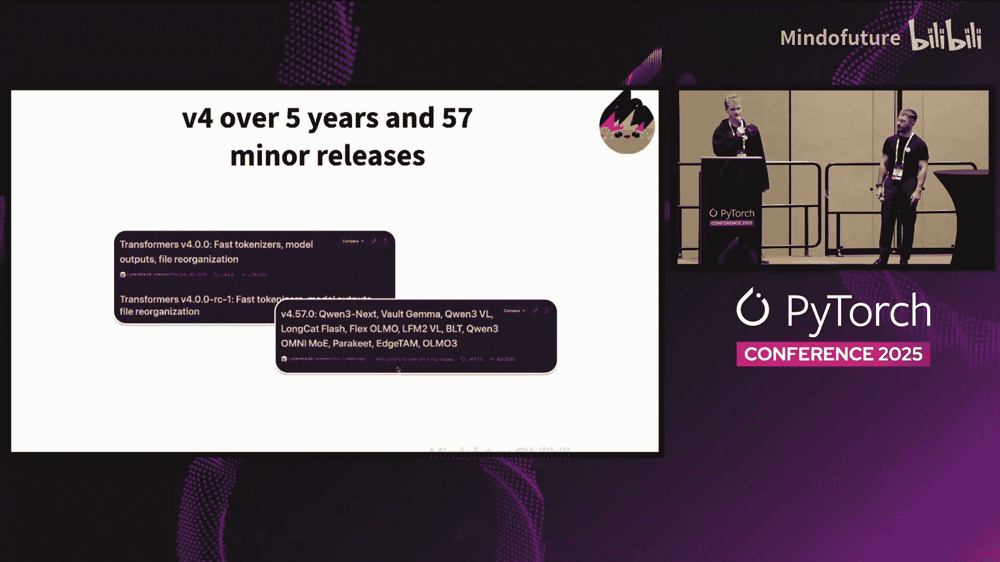

Right so if we take a look at the span of downloads over the like since the beginning of transformers。

 we see that all first four versions are really packed over one year and it's really after that before that we really start seeing usage。

 so this is P installs download over time， it's really not the most interesting metric in terms of usage because it's super easy to game。

 but still it shows a bit the adoption across the ecosystem。😊。

And for anyone that is able to explain the insane， huge bike here。

 we're very happy to hear about that because we haven't explained that。

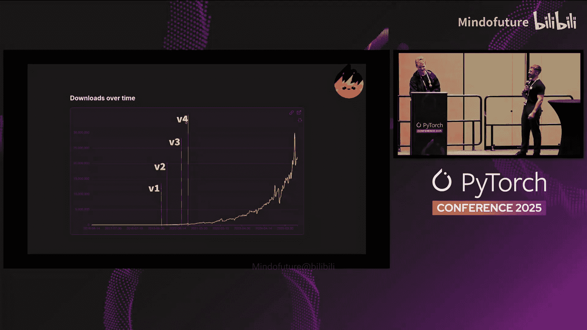

We are also very happy about the amazing ecosystem and the amount of models that are compatible with performers first。

 so this is about 700 k today on the hub and I want to take a little bit of time to thank every model provider and every person of the community that contributes to that I think it's very important and sometimes we do forget about them so thank you everyone。

😊。

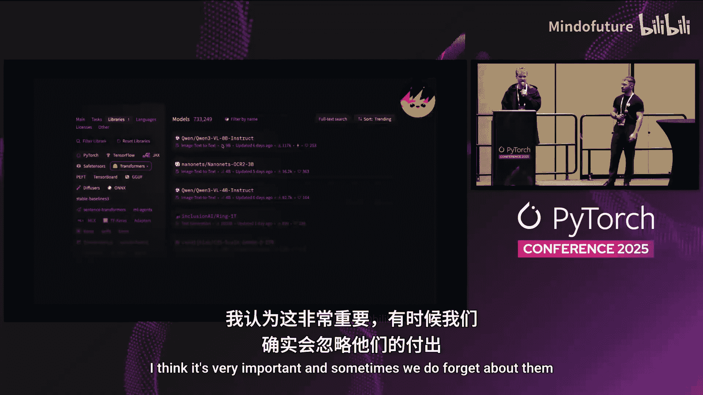

And so if we take a look back at the origin story， just to understand what were the pillars of transformers。

 what' made transformers what it is today in order to understand why V5 is necessary and why we're heading into V5。

So when we originally started with transformers with just Bt， GPT2， XLM， the very first transformers。

 we understood that as new architectures came，They would come in different repos。

 they would come with their own APIs， they would come with their own environments and requirements。

 and so if you wanted to switch from one model to the other， you would have to clone the repo。

 do a Python environment， install it， etc it just wasn't extremely convenient so what we really wanted to do is to do an API on top of all of those models to enable switching from one to the other and so this is the very first pillar of transformers it' to be a modeling toolkit。

 so a common API on top of different model architectures and such model architectures that we tried to add quickly to the repo as quickly as possible basically。

So building from that we started to add new malls to the library and for some of you who recognize the graph。

 this is from the black post， maintain the un maintaintainable。

 so it just shows the number of lines of code that are shared by different modelss across performers with the architecture that we chose to be the good standard。

And so when you're a maintainer and you're faced with this。

 when you realize that many models share a lot of similarities。

 you have two choices so either you go with an abstract way of writing your models so you use inheritance。

 you use all of that or you go with repetition and transformers is an opinionated library and we chose to go with a single model single file policy I've talked about this already but the thing is we wanted to make sure researchers first we able to just copy paste the entire code and use it without having to understand abstract concept or abstract definitions that are from the library that we chose we also wanted to make sure that people were able to contribute to the library and that means adding a model should be very easy so today adding a model is just you create a new folder and you're dump in all of your code and then you get reviews and that's it and we wanted the code itself to be like ready for researchers to just read them。

Understand them and simple， and all of this led to a core principle of the Transformers library。

 which is that code is a product for us， it needs to be understandable， it needs to be simple。

 and it needs to be readable。And so if we take a look back at 2019， 02020。

 the size of the models that were released then were about between 100 and 400 millions of parameters。

 which seems really small in comparison to the models that we have right now。

 but back then training or fine tuning such a model was still a bit complicated and pretraining was just reserved to the bigger labs。

And so understanding that fine tuning and training would be something interesting as。

Like base models were being released but not necessarily all fine tune versions。

 we decided to offer some training primitives to enable training for models on top of transformers。

 which was the trainer API and the accelerate library and so now we have a few toolkits or several toolkits based on top of those like URLL and Sw Axotl that we really like which are based on top of this trainer API for example and so this became our third pillar。

 training primitives offering the ability to fine tune on top of our models。

And finally we saw that as additional models got merged and so now as Arthur was saying we're about 350。

 360 different architectures and transformers， we saw the need for model agnostic utilities to come。

 and so the best examples of that are probably the from pretrained and safe pretrain methods which allow serializing your model to disk。

 but there are many different APIs at different levels of the stack like the pipeline API for example。

 on top of all models of a given modality or the very recent transformers serve serving option。

 but even lower down the stack， for example， we have an attention interface that interfaces with all decoder models to enable switching one attention to the other or the cache mechanism allowing you to manage your Pasky values or caching mechanism across different models。

And so this led to the fourth pillar that we have here， model agnostic utilities。

 and all of those four pillars are a bit what really paved the way for V4 to become what it is。

 all of those were existing at the version 4 and still exist for version 4。57。😊。

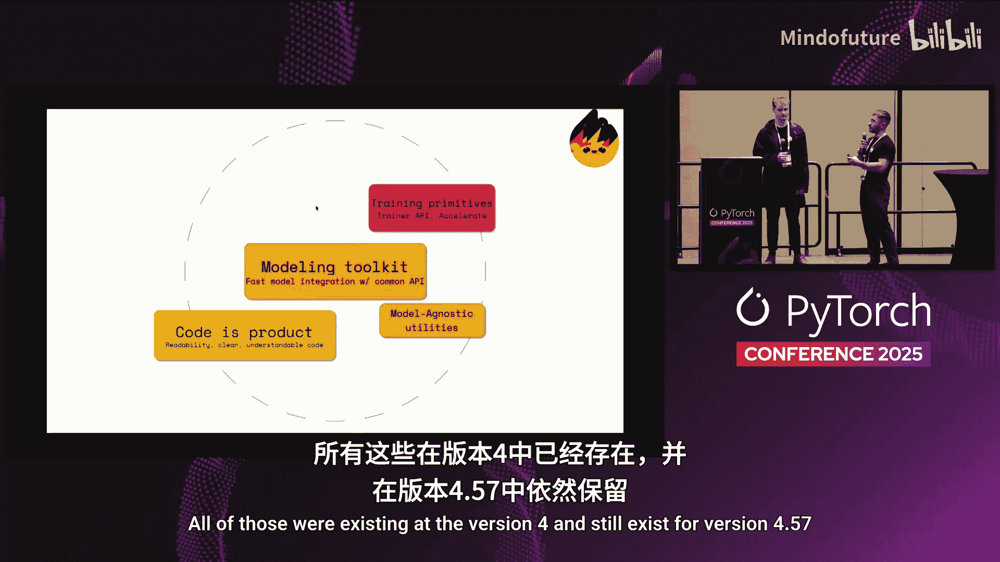

And now we are announcing that we're moving towards the version5 of transformers。

 this is a pretty big milestone for us because as we've been saying the V4 has been stable for a while now more than four years and so it's kind of a bit of a risk because we have to change some stuff but the AI ecosystem is evolving so fast that we just end up not having a choice right there are many。

 many things that the community wants from us that we couldn't do and couldn't have done without having a breaking release and that's why we're moving forward to the V5 so we're spending a bit of time here explaining what are these kind of new focuses that we're going to have for the V5 of transformers。

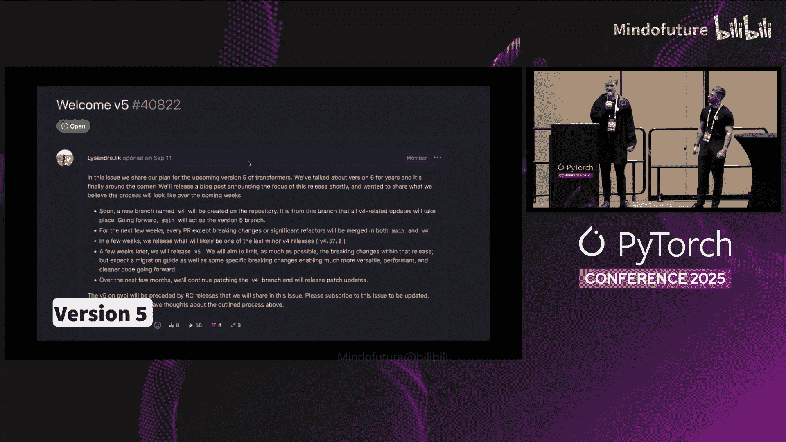

The very first one is going to be simplicity， we always have wanted for our modeling files to be understandable。

 for someone to be able to inspect them and to see how they're designed。

 but we have had a few issues along the way which is even if the modeling file is simple the rest of the components aren't necessarily so one example of this is that we used to have torch Tensorflowlow and J's implementation for each individual model and this while a good idea in principle makes it very hard to maintain and even harder to contribute so we starting with version 4。

45 I believe we've started deprecating the Tensorflowlow and Js models and starting with V5 these are completely removed from the toolkit。

😊，Similarly for the tokenization aspect of transformers， historically we've had two big version。

 the slow version and the fast version， and we're slowly moving away from these definitions。

 we want to use the tokenizer's library， just as we're using torch for the base model we use this for the base tokenizers so by default we will have the backend that is the rest backend but anyone will be able to register your custom backend as long as you maintain the API contract that we have developed with the tokenization。

And one advantage of using only torchbased models is that we can really depend even more on torch itself and the best example of that is probably for the processors。

 those processors before they were basically in Nmpy because they needed to be used for Jtensor flow torch now going forward as we're only using torch we can use torch vision instead which is much much faster for their use cases that we're seeing now and so those three are just three examples of simplicity oriented PRs that we have pushed forward。

 but there are many， many more if you take a look at the issue that we posted a bit earlier that we can show again at the end。

 you'll see all the breaking changes or all the changes oriented towards increasing simplicity。

Towards the V5， and so this is being added to the code is the product pillar of transformers。

 we want simplicity to be a focus of the V5。😊，Now， given what I've said about adding new models and the fact that the library used to repeat itself a lot。

 for the amazing people that think this reminds them something last year I did a talk about this at the Part conference about modularity in transformers。

 this was the big announcement， and this is something that we indeed have shipped and is now part of the library where we drastically reduced the number of lines of code that you have to understand and that you have to write to contribute to new models。

 and so if you look at the graph you can see that since we adopted the modularity approach。

 the lines of code has drastically reduced， as I said。😊。

This is part of the modeling toolkit idea where we want to make sure that people who contribute models。

 but also people who build on top of transformers as the modeling toolkit have an easier time finding out what are the differences between this new model。

 the QN for example， and Lama and if you just look at the new modeling file you can just add glance。

 say okay the differences for example， there is a query Q later norm or there's something like that。

 this is very important for us because we know a lot of people cannot just use the Python code。

 but are inspired by the definition of the models。

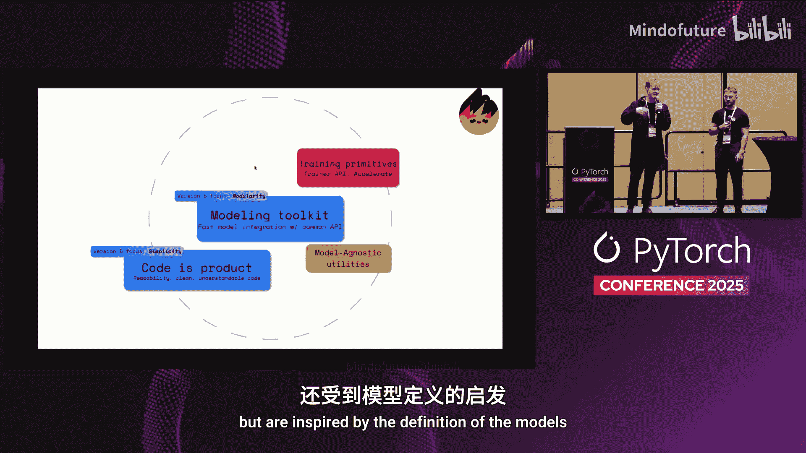

And a new topic that we've never focused on with transformers until now was to really be performance oriented and so to try and have model definitions that aren't simple to use and simple to understand but also pave the way towards better performance and so we introduced the Colels library recently which allows。

Using precomplied kernels dedicated to certain hardware and certain software versions directly within the Transers toolkit。

 those kernels are being precomplied and uploaded to the Huging face hubub and can be used as is shown on the right side with the quick start this allows using some precompiled kernels on specific hardware like for example AMD GPUs and VDdia GPU but also like Intel XPU got the engines with much better performance than if we were just using Torch eager and for anyone who has been having issues downloading and installing flash tension2 I think there was a lot of memes on Twitter about that this kind of solved the issue because it just download something that's ready and that for you and we've been defaulting to that if you haven't flash tension installed in transformers but you still want to use it。

And it's working very well for those of you who think I love MOEs， you should do better， I hate MOs。

 but the community has been very critical of the transformers implementation of MOEs and so we just don't have a choice what the community wants we have to implement。

 so we have refactored all of the MOs implementation of transformers to make sure that they can support exactly these efficient kernels。

And finally， we also wanted to make sure working with the VLM team that the MOs and transformers are usable through the transformers backend and usable in VLM as well。

😊。

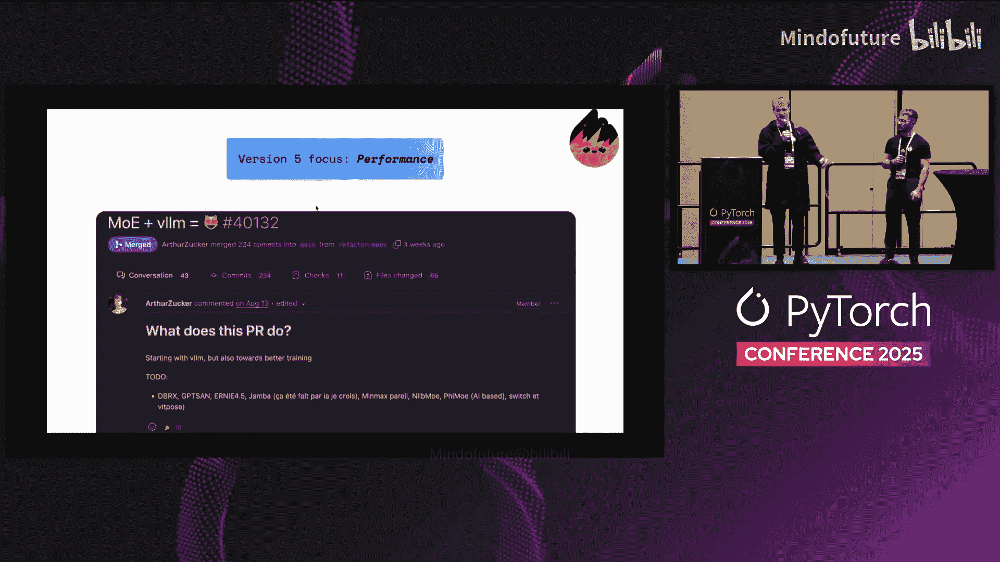

And lastly， I think a lot of you have heard about the troubles people have when they're doing training with mostly RL and then DRPU techniques。

 TRL and a lot of these where you have to train a model but also generate a lot and it was mentioned that most of the computer is then spent during the generation and so there have been many techniques to send like you have to have two models。

 one is for training， one is for inference and you send the weight update to the model that is doing the inference and we know that's a problem and in a way we were the problem。

 so we decided to implement this very efficient the continuous batching so the idea is just to get up to date with the standard。

 this is something probably not new for everyone， but it is new for transformers and it is now available in transformers and specifically for the use case of training in URLL。

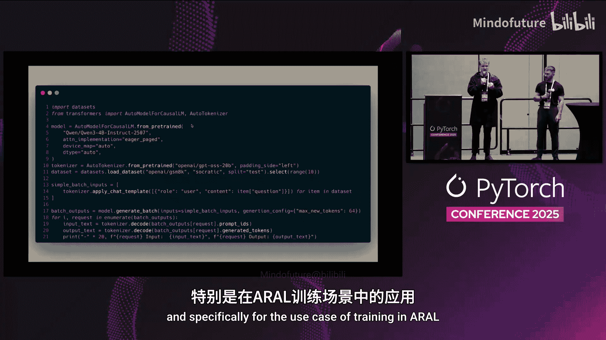

So this gave birth to basically a new pillar of transformers that is very important for us because it's very important for the community。

 and this is basically there being performance enabler and defining goods standardsed about how to use kernels and where to place them。

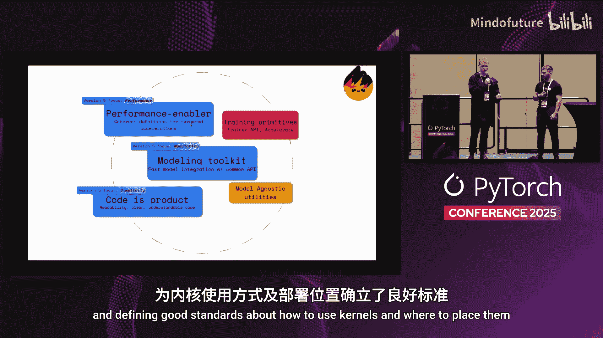

And so all of this creates a new basis for V5 on which we aim to build in order to establish new standards or to reinforce the existing standards for the rest of the ecosystem to be able to depend on our model definitions。

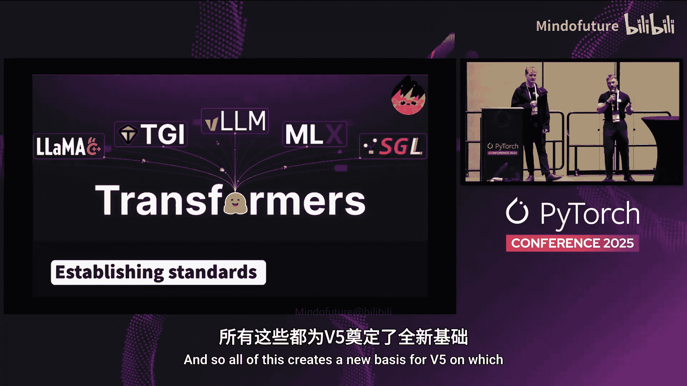

And so this is the tagline that we have right now for transformers if you visit our GitthHub。

 so it transformers the model definition framework for state of the art machine learning models。

So the thing we've been developing for the past year is you just start with a model that's defined with transformers。

And you want to do a heavy intense pretraining， so you take the modeling code that you've defined and you take it to your favorite pretraining framework。

 so for example' say Torsch Titan， which is very popular or deeppe or NVDAs Nemo or Nattron。

 we've worked with all of this team to make sure that the model you've defined with transformers is compatible with their API so you can trade them all at scale。

And so as long as you respect the contract that its transformers compatible。

 then it will be directly compatible with all the fine tuning libraries and the Pytorch ecosystem as well。

 so un Xotl TRl， and factory or the very recently released Torch forge as well。

 the model you have just pretrained that just serialized on disk as a transformers implementation is directly available for use and for fine tuning with all of those tools。

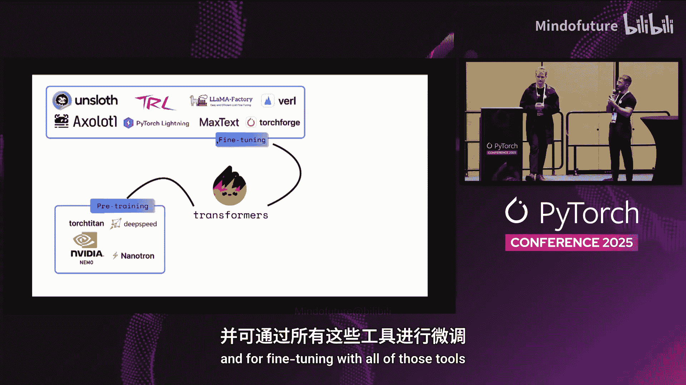

And so now that you find tune the model you're very happy about it， you have good es。

 it's probably a state of the art， you know you've trained on the test set but it's not a problem for you。

 you still want to put it in inference right and at this point you can choose your best favorite inference providers and we've worked a lot with the V11 team for example we're very thankful for that SGlink as well to make sure that the same model again is usable and you can put it to production and with this we believe that weve kind of solve a problem where you would always have discrepancies between training pre-training fine tuning and inference so you just take a single contract a single model and transformers and you can go from training to production with very much simplicity。

And finally， if you don't wish to deploy it at scale， but you want to deploy it locally。

 then there are many alternatives that you can use for local deployment。

 one of them is of course Executtorrch， we've been working really hand in hand with that team to ensure we have really good support of our models through Executtorrch。

 congratulations to them for their1。0 release yesterday。😊。

But also if you want to deploy in different optimized environments like Lama CPP or MLX or even Cand and rust。

 then we have been working quite a lot with the maintainers of those tools to ensure that if the model is serialized as a transformers's model。

 it's extremely easy to export and to use with those libraries as well。😊。

So we go back to the initial story， the model definition framework for state of the art machine learning models。

 if you are compatible with transformers。What we want is for you to be compatible with the entire Pytorch ecosystem。

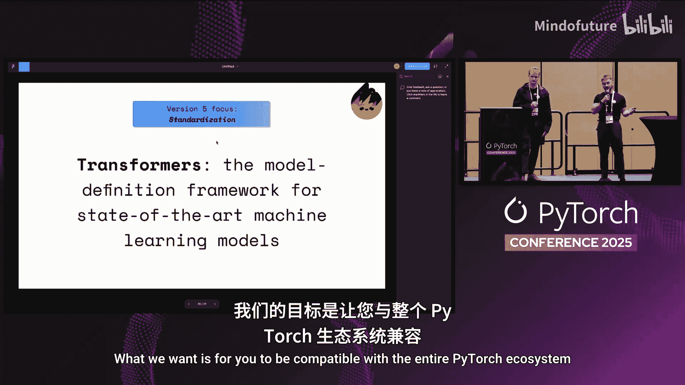

And with this we have a call for action， of course since we are in the middle of shipping V5 we'd be very happy to hear about your feedback。

 the community's feedback， so if there are stuff you've been very frustrated about in the Transformers library and you think is worth the change should be changed。

 you're very much welcome to comment here and we'll have a look at every single comment there。

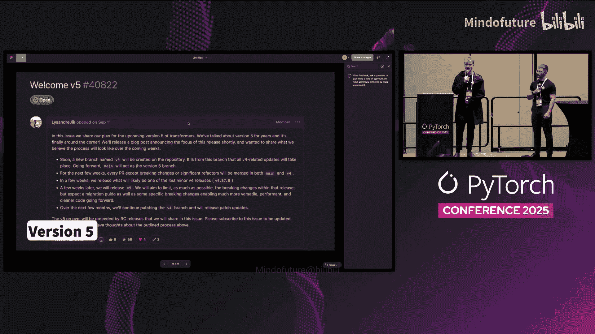

Thank you very much for your attention， please follow us on the hugging face。Yes。😊。

Do the microphone still work？Yeah。So。So like like when the the people try to deploy the transformer models on like during for particular inference engine。

 I I know that like VRM S G， they have their own modeling files。

 So is that the V5 plan So so that these can be consolidated that those inference engine can leverage transformer models。

And to deliver the best performance via that model， Yes absolutely， so it's already the case for VLM。

 for example， in SGN， where you have a model that's called transformformers model。

 which uses the transformformers model， the model defining transformformers。

And so the performances are almost on par， it's not exactly the same。

 but its like you have maybe 2% or 5% or something like that。

 but we're really working towards having this push to exact same performance but sometimes transformer models are not written in a way that can deliver the best performance so do you have the plan to amend those models to to make it like best performance so one big feature of the Transformers V5 is that we are going to allow refactoruring these models are not necessarily well written so I think MoOEs are the best example of that and we are doing this like we are focusing on performances and refactoruring the models that are not on par and so new models are coming up with a new like attention layers for example。

 so do you have plan also to make the transformer models moretensible， for example。

 I know like extension layers。Now can be easily extended and customizable from the third party so do you have plan to make it like more extensible so that third party can easily plug in their optimal kernels or layer implementation to make it fast。

 Yeah absolutely especially for the attention we've seen the rise of hybrid attention multiline attention and different variations of attention So in many ways we don't have a choice and we're also happy to do that。

 so we are making sure's it's extensible。 Yeah Yeah。

 yeah I think it is better we can have a good abstraction like the standard attention abstraction so that it is easy to customize。

😊，Thanks。Any more questions？Hey， great talk， I wanted to know about what sort of graularity the Colnell Library offers。

And if it also offers the opportunity to fuse certain ops for the whole model or is just about kernels for a specific layer or a specific class of the transformist block。

Yeah， so you can do whatever you want with the kernels so you can definefusesed operations。

 the main concern is whether you where do you put the kernels in transformers you have a decorator that we use to replace for example。

 a class and you can also replace functions， you can replace whatever you want so basically you're free to replace whatever function you want and this way you can directly fuse yourself if that's what you want to do。

 you can do it with the kernels。Yeah， thanks very much great talk guys。 Good question。

 What are you guys doing to make sure the model sources are compatible with full graph capture of Torchdo compile Oftentimes we find we run the model sources from hugging and face transformers and we get these graph breaks and it just kills our performanceers whereas the V alum guys have done a lot of work to make sure they're not those graphics So if we're combining these sources are we making sure that we're not getting the graph breaks in the hugging face version。

😊，It's a very good question we do work a lot with the Torch team and basically they help us make sure that we test all of the models to make sure we don't have graph breaks。

 we also work with EAM team specifically regarding the performances for example。

 where we want to make sure that if you fall back if you use the transformerss model definition。

 you don't end up with having graph breaks and we are also as we mentioned like we are heavily focused on performances and going on edge and for example with executors who need to have something that has full graph compatible。

So we're just having like we have a lot of CIs and a lot of people just working only on this。Amazing。

 thank you。great presentation， so my question is around the trainer API。😊，So two questions there。

 the first is are there plans to simplify this usage in TRl？So as I see now， for the SFT。

 it uses the trainer loop from the trainer transformer library。😊。

It's like kind of like an abstraction over abstraction。

 So are there plans to move the trainer API completed to TrL SF trainer and then simplify the code there for Vfi。

Can't tell you an answer。Sorry， we have a co is the TRL maintainer so yeah yeah the maintain of T so yeah as soon as it is compatible with transformers。

 it's compatible with TRL as well because TRl is just like some kind of wrapper around transformers so when you load the model you can just specify the kernel and actually there is zero modification on the TRL code base to make it compatibleible with transformers thanks to the great work of these guys。

😊，YeahThank you。 I think we have no more time for questions， but thank you all for coming。

 It was great having you guys。😊。