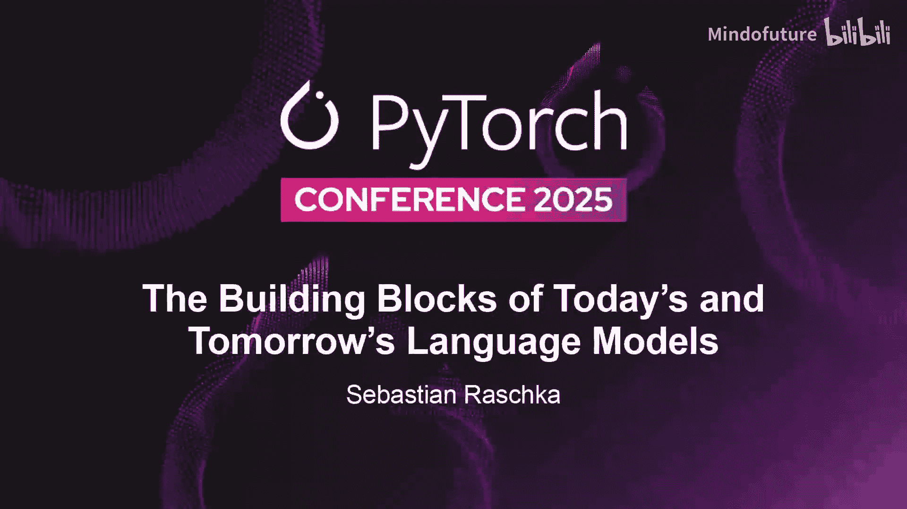
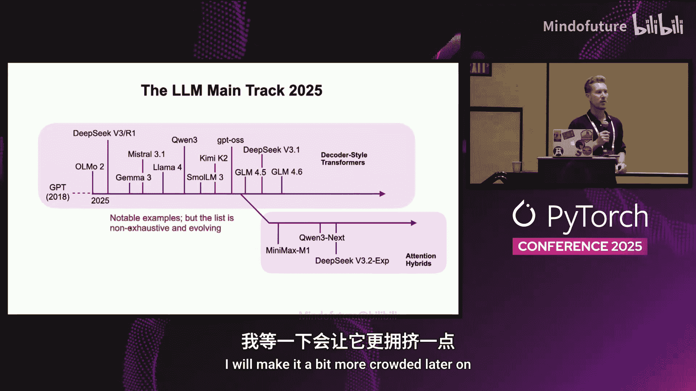
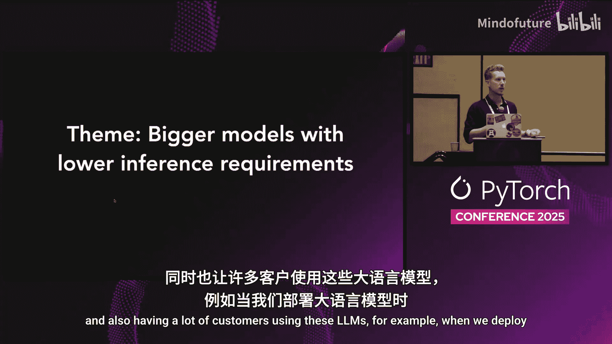
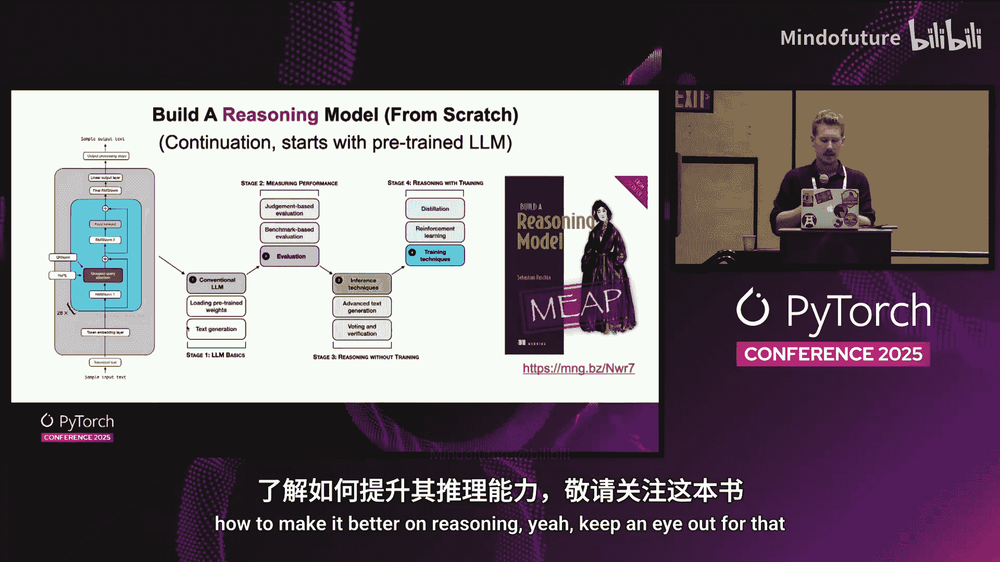

# 2025 Pytorch大会 ｜ Pytorch Conference 2025 p38 P38_当下与未来语言模型的构建基石-Sebastian_Raschka__RAIR实验室 -BV1b8kRB6EJG_p38-

Yeah， hi everyone， thank you for coming Yeah， I know there's been some rescheduling of this talk so I'm glad everyone made this and yeah I'm happy to be here finally I'm a bit late but better late than never。

😊，So yeah， I'm also a bit rusty it's been a year since my last talk so I hope to make it interesting though so today I wanted to talk about the building blocks of today's and tomorrow's LLMs and so this talk is 25 minute talk so I can't cover everything but I thought the goal of this talk is to catch you up with all the let's say the main interesting building blocks of LLMs this year so what has happened this year so there's a lot going on as you know when you go on social media on the news there is almost every a newM a new method coming out so I try to focus on the most essential ones so here in this talk I will first cover the LLM landscape in 2025 just focusing only on this year mainly because yeah otherwise we would have like a week long session so I try to capture the development。

In a graphic here so the main LLMs since earlier this year I'm cheating a little bit because I'm also having almost two here and deeps version 3 on the left hand side and they came out end of 2024 but it's like roughly let's say a year from today and these are also just the most notable LLMs today the openweight LLMs that most people use from let's say almostmo and deeps version3 up to GLM 4。

6 Of course maybe there were already some new models coming out yesterday that I missed but these I would say are the most interesting most widely used ones and then I will later on also talk about some alternatives so this is almost like a very empty slide I will make it a bit more crowded later on。

But。Yeah， so the main theme this year in terms of LLMs what LLMs are focusing on in terms of the architecture is yeah making the models bigger so for example the trend was almost started with deepseig version 3 going to 671 billion parameters and then Kmi K2 with a trillion parameters and so forth so making models bigger but then at the same time people you know like more and more people use LLM so the focus has also shifted and more towards how we make them more efficient like lowering the inference costs to be able to use models with trillion parameters and also using like having a lot of customers using these LLMs for example。

 when we deploy LLMs so I want to introduce some core building blocks。

 one of them is group query attention so this is an older technique that came out in 2023 this was already used by Lama2be then。

So it's not a new technique it's just here as a gentle introduction to some of the motivations of some of the other building blocks。

 so I highlighted the LLMs that are using grouped query attention here from GeA 3 to GM4。

6 so it is still a pretty widely used technique。And where it sits in the LLM so this is a very crowded image ofQu3 LLM I just picked one of the many LLMs but the structure of the LM is almost always pretty identical and in the center we have this transformer block that is repeated a couple of times and in this transformer block there's this attention mechanism multi head attention and group query attention or GQA is essentially an alternative to the standard multihead attention block again not a new technique just a gentle introduction to how we can make things more efficient so in the left hand side it is a regular multi head attention where we have queries keys and values so because it's 20 minutes I wont go over let's say the details of how this is internally computed what we do with the keys and values and queries but the message is here that we have a value and the key for each query and then group query attention is an。

It's like how can we let's say I wouldn't say cheat。

 but how can we approximate this a bit to make this more efficient for example。

 instead of having a key and value for every query， we only for example。

 on the right hand side have a key and value for every second query So here we are now havinglving the numbers of keys and values and the idea is essentially nowadays almost every LLm in inference mode uses something called a Kv cache and the Kv cache is caching all keys and values from previous words。

 So LMs are generating one word at a time and to avoid recomputing redundant keys and values that we reuse we can store them in a cache and this cache becomes really long at some point if we have these long inputs So the idea is how can we reduce the Kv cache so and that is by sharing more keys and values among these queries just one little trick basically。

And if we do it just right， so we could go to an extreme case where we have only one key and value for all the queries。

 this is would be called multiquery attention， but this is almost too extreme because then the model will perform worse it's too much of an approximation So there is in practice like a sweet spot between how much do we want to share but also how much do we want to approximate it's like a tradeoff between compute resources and modeling performance essentially and so here I plotted this it's maybe a bit small so basically on the y axis what we have is the Kv cache size and gigabytes and we want this to be small basically to just safe costs in inference mode and so the blue at the top of the blue line。

Graph is the regular multi head attention mechanism。

 how much it would cost with increasing sequence length。

 So the Xx as we make the sequence sequence length longer。

 and we can see it becomes much more expensive as we make the sequence longer and with group query attention there different hyperparmeters different group sizes we can lower this Kv cache size。

 So that's one of the many tricks that has been around for almost maybe two and a half years now people are using that。

 It's not a new technique。 but it's I think a gentle introduction to the idea how we make things more efficient。

 And so another idea was multihead latent attention。

 So this is something that was introduced by deepse version 2 So before version 3 version 2 came out in 2024。

 And instead of using this group query attention mechanism the deepse team came up with multihead latent attention and Kimmi K2 is another LLM using that。

And so here， this is also the same idea。 How can we reduce the KB cache size。

 but with another approach， basically。 So here， what we are looking at is。On the left hand side。

 the deepsig version 3 architecture and on the right hand side is just like for reference the regular multihead attention module where we have an input and then for each input token we have transformation a query key and value matrix that computes these query key and values and this is just how regular attention works。

 we have these three weight matrices in multihead latent attention we have four weight matrices now so it sounds like okay we are making things more complicated and more expensive by having yet another transformation but the trick here is and so again the idea is to reduce the Kv cache size So instead of having these keys and values that we add to the Kv cache we now have in blue in this center here we have this compressed version like a latent representation that is smaller。

And then we store only this latent representation in the Kv cache size and during inference when we then generate the next token。

 we have these additional two weight matrices to up project to reconstruct the keys and values。

 It's almost if you're familiar with a technique Laura。

 it's kind of like a similar idea where we have we project something into a smaller space and then up project it again。

 So it's like a little trick to reduce the thing we want to store in the Kv cache here。

 the latent representation。 It's like a compressed key and value and similar if we look at a chart similar to group query attention。

 we can bring down the Kv cache size with this technique and I chose the hyperparmeters here。

 So if you would take the previous plot， you can perfectly overlay it get exactly the same savings。

 So I wanted to show this is is essentially an alternative to using group query attention。

 interestingly， you could also combine those two。 so you could use group query attention and ML8。

Together， I mean there's no reason why you couldn't it's two how people say orthogonal techniques。

 you can combine them and again， it's a hyperparmetera how much you want to compress。

 how much you want to save The interesting part though is in the deepse version three paper。

They found， for example， that if you use M L A with a similar compression or similar savings as group query attention。

 the modeling performance will be better。 The tradeoff is。

 it's a bit more complicated because we have these intermediate state。

 So you have to rewrite a bit of your inference pipeline because we now have to store this latent state instead of the regular keys and values。

 But an interesting alternative to the group query attention mechanism。Another one。

 another trick is sliding window attention。 So again the idea is to save costs also again。

 reducing the KV cache size and so here I highlighted also only two models， Gema 3 and Mi all 3。

1 and Miral 3。1 is not as far as I know even really using that So if you go to the hugging phase model hub where most companies these days upload their open weight models。

And if you go to the Mial 3。1 model， you will see they have an option for sliding window attention。

 but it's disabled by default。 So there is also though G G U F weight version of that where it is enabled。

 So it's hard to say whether personally， I don't know whether they trained with sliding window attention or not。

 And you can use it。Like it's your own choice if you want to use it or not So what is sliding window attention so here it's on the left hand side the classic causal self-at mask of the multi head attention mechanism where each token attends to the current position and everything that comes before it so that's how you come up with this auto regressive causal mask basically where you generate one token at a time but the model can't look into the future。

With sliding window attention it's the same idea， but you additionally restrict how far back the model can look so you have like a band here where you can say okay each token can look back not to the very beginning but maybe only a certain number of tokens on the right- hand side it's three tokens so instead of looking if we look at the bottom row instead of looking at all the six tokens we only look at the current token and three two tokens before it and so it's again like a trick to reduce the compute cost but it's again also an approximation so we are basically trading off but the model can see with computational complexity。

Here is a chart where I plotted it again in terms of costs at the top is again multihead the regular multi head attention mechanism and then I don't know if you can see it but there's a dotted line the blue dotted line so they are dots and you can see this is like the sliding window attention version of this multi- head attention mechanism and it is saving again kvc storage and another interesting thing to add here is you can also again combine this with group query attention and that is for example what gemma 3 is doing so an orange here that's the group query attention mechanism and the orange dotted line is the sliding window attention together with group query attention so it's yet again another trick and I should maybe also say in addition to that you usually don't only use multi head attention or sliding window attention in these architectures in Gema 3 for example they had。

5 sliding window attention layers， followed by a regular multi head attention layer。 then again。

5 sliding window attention layers so。Going back one slide。

 so most of the time the model has a limited context that the model can see。

 but some of the layers can see everything。 And so in this sense。

 you can still capture the whole context。 and based on ablation studies in the paper。

 they found that this gives you almost the same modeling accuracy as regular multi head attention。

Yeah， and so I should have maybe included more slides to make this more let's say obvious。

 but it is a 20 minute talk after all so I try to focus maybe on the main ideas here and maybe the most important idea of this year or didn' it wasn't invented this year but the most prominent technique that everyone almost everyone adopted this year is a mixture of experts so I highlighted in bold all the models that use mixture of experts modules and so this is again another trick to save inference costs on the left- hand side I have an architecture that roughly resembled deepseig version3 but I made this up because this is just regular dense model so dense means it's not using mixture of experts and so what I highlighted here but this box on the right hand side is the feed forward module of this architecture and the idea in mixture of experts is to。

Replace this feed forward block by many feed forward blocks。 So in deepse version 3。

 they replaced one feet forward module by 256 of them。

 But so you're making essentially the model larger。But even though you make the model much。

 much larger， you try not to increase the number of parameters that is used in each inference step so the idea is during training。

 the model has now more capacity to take up more knowledge from the training data but you still keep the inference cost the same as with the model that doesn't use mixture of experts So on the right- hand side even though the model has now 256 feet modules。

 you only use nine of them in each step and so there's a router module and based on a given token the router it's a little multilayer perceptron it learns which which of these layers to use and in this case in deepse version 3 they used one shared expert that is always active plus8 that are selected。

 So the idea of the shared expert is to avoid learning redundancy So for example。

 the expert might learn how to process well。To interpret language， for example。 And so in this case。

 if you have a shared expert， you avoid each other expert to relearn the same knowledge and the other experts。

 they can specialize， maybe one expert is more geared towards to code tasks。

 One is more geared towards， let's say， Spanish。 One is more for。For math。

 it's implicit so it's not like an explicit expert that is only doing coding。

 but the idea is essentially that the router can decide given the task what to route for in this sense we can increase the capacity limit without increasing the inference cost for example in the bottom right the numbers here are in deepse version 3 we have 671 billion parameters in total。

 but at each inference step， only 37 billion parameters are used。

 so it's 20 times less of the parameters are used than are available so the main idea basically and here I did another plot for example the straight line。

 the horizontal line here that's the active parameters in each inference step。

For the dense layer and also basically how many， let's say， how many parameters this model has。

But then if we use mixture of experts， we can see we reduce the number of active parameters。

 the more experts we have basically so it's like an idea if we have a fixed number of experts that we use8。

 but we increase the number of experts in total we bring down the number of active parameters so it's one of the most widely used techniques this year so I realize so this is only a 20 minute talk so we can't go into all the nitty gritty details in terms of ablation studies and different design choices and everything but I have a block article where it's probably too many words maybe 8 9000 words where I was elaborating a little bit more with figures and numbers and paper references so if you're interested I also made a short link ahead of AI docom which just fours to my block because it's easier to spell than my first and last name so yeah if you want to read more about these different architecture designs this year can find out more in this block。

ど？And yeah in the talk abstract that I submitted to the Pyarchch conference， I also mentioned。

 I wanted to briefly mention some other alternative architectures。

 So so far we covered broadly these models at the top。

 these are the conventional decota style transformers and today if I were to implement an LLM for an important application even like a chatbot for a customer I think I go to would always be one of those models still they also come in different sizes because they are the ones that so far stood the test of time they perform very well and you have a range of different model sizes。

 So that's something I would always consider as the first thing and then if you are feeling。Like。

 oh I should do some experiments， I should compare it to some other models。

 maybe make things more efficient， make the accuracy better。

 there are some interesting developments that are may be worth taking a look。

 they are very experimental at this stage， but I'm just saying there are people working on things that are not these classic decokota style transformers I just talked about。

So for example， just off the main branch there are a few flavors now that are very similar。

 so they're still Dakota style transformers， but they have a few tweaks， for example。

quin3 next is a model that uses a gated deelta net and I think in every other or it's a three to one ratio layer where they have a more efficient alternative to the attention mechanism。

 for example， or deepseig version 3。2 experimental is another architecture that came out recently where they use a sparse attention mechanism and the idea I mean the models work。

The same as the other ones， except they are even more efficient。

 Sore trading of some absolute modeling accuracy by making things more efficient by approximation。

 So these are some that recently emerged Que3 next and deepseig version 3。2。

 I also was tempted to put deepse O CR on there， but you know it's not really I would say an attention hybrid model that would fit in here。

 but it's another interesting development no more like for research purposes， so。

Another hot topic was basically the hierarchical reasoning model and so this made a big splash because it achieved really good performance on this Arc benchmark it's basically a puzzle almost like an IQ test these types of puzzles where you have to arrange blocks given some examples and there was recently a new version of that or like more a simpler and more efficient version called a tiny reasoning model and this also it was a very very popular model that was discussed everywhere I think it's a really cool direction but。

One thing I wanted to highlight is it's something worth looking into。

 but it is not a language model in that sense， I mean it's a transformer。

 but it can't parse language， at least not yet it's more for puzzle special purpose。

 and I can see these models being used at some point as part as part of other models when you do function calling when you have an LLM and you want to solve a specific problem you can use a calculator you can use a search engine and I can envision these tiny reasoning models。

 hierarchical reasoning models being like one of these models that are being called as part of an ensemble of other models basically。

World models， so world models started out with in the vision domain computer vision domain basically。

 but there was one model， I think it was earlier this year even code world model but I think it was by meta and this was also a very cool approach where the idea here was essentially instead of just training a code model so world models are simulating the world as they see it or process it in a sense it's like an abstract simulation of let's say physical world in this case it would be specific to code where instead of just doing next token prediction。

 the model also looks at code traces So if you have code you have intermediate variables and so forth。

 the model also learns those it adds a bit more complexityly during training but the paper was very promising it's a very new approach I think there's only one model out there right now 32 billion parameters but this is I think I would bet it's one of。

The more interesting ones to pursue， it adds more complexity。

 but I think it looks very promising to make， let's say， transform us better on coding tasks even。

Text diffusion models also a hot topic。 So there were lots of papers this year on text diffusion models。

 an alternative to the autoregressive language modeling instead of generating one token at a time text diffusion models they generate all the tokens at the same time essentially but then there are iterations like you probably know diffusion models from stable diffusion this was like a company and they developed openweight models that made diffusion models popular a few years ago where you have an image and then you dennoise the image and this is the same idea for text except that text is discrete without having a figure here。

 I think the easiest way to think about it is if you are familiar with masked language modeling like in Bt the BERT bird model youre masking our tokens and then youre trying to reconstruct it and you do it in this diffusion case you do it in multiple times it's like doing bird multiple times with this masking you generate all the tokens at。

sameme time， which is great because it sounds like， okay。

 we are now parallelizing the text generation， which is usually pretty slow in large language models。

 but then the downside is， for example， you wouldn't be able to take advantage of things like reasoning where you have a reasoning chain that can enhance the modeling performance because you are generating everything in parallel。

 I realize I only have one minute left。 So I wanted to just highlight a few others liquid foundation models based on partial differential equations。

 Transer R and N hybrids。 that was just a new RWKV paper。 it's like an R N transformer hybrid。😊。

And then， of course， all the state space models。 It's also very important interesting direction that the state space models coming from。

Pure state space models are kind of being more hybrids now also with our attention mechanisms。 So。

 yeah， there's a lot of interesting stuff going on。 Also， even LSDMs got new revisions like X LSTM。

 which is。Not quite as good as transformers， but is very efficient for for example。

 on device applications。 So each of those could be essentially another 20 minute talk。

 maybe two hour talk。 So I don't want to keep you too long because I oh yeah。😊，Yeah。

 so I wish though could I mean I was planning with 25 minutes I had then more figures and images so but I think yeah this is just highlighting the ecosystem。

 the ecosystem this year and all the interesting alternatives that are being developed like I mentioned before personally I would still start at the top with one of those models and then if you are experimental you know looking a little bit beyond the usual suspects there's a lot of also interesting other work going on。

😊，Yeah， and so I was planning to also write this up nicely as maybe a longer article because yeah it's only a 20 minute talk so maybe in the upcoming weeks when I'm back home in my office I will work on writing a block article so keep an eye out where I will go into more detail in terms of how these other modeling variants work I wanted to say also the Pytch conference is organizing a book signing session and has a bunch of books here on site so I'm honored to be invited to sign them so if you are around and you are interested in a copy of my book build a large language model from scratch it will be in the Expo hall at 320 pm so maybe a bit earlier even let's say three20310320 pm I will be there signing a few books if you are interested in that so the book is about building a large language model from scratch a very small language model but it is capable it's a real language model same architecture that I showed you。

It's like to basically understand really how it works because yeah building something is in my opinion。

 the best way to make sure you understand compared to just looking at images doing the actual work and code is the real thing basically I'm also working on a new book built a reasoning model from scratch which is essentially a sequel of the previous book it works as a standalone book but it's essentially starting with a pretrained model and then implementing evaluation methods。

 inference scaling and reinforcement learning for building reasoning model so if you're interested it's currently also available in this early access program here at Manning so yeah if you are interested in something to read after building a large language model how to make it better on reasoning yeah keep an eye out for that and with that yeah this is everything I had for today I think we have a few minutes for questions if the organizers on kick me out here so yeah。

Thanks everyone for attending， and I will also be around later at the book signing session。 So y。

 thank you everyone。Yeah， so the question is how I see the training stack being different from the inference stack and then from the reasoning stack。

 I think， yeah， the training is also getting more complicated， multiple stages pre training。

 mid training， post training， lots of things。 But in the end。

 you get a model that you can then use during inference。 and。The difference is， for example。

 inference， you have a lot of additional techniques。 for example。

 the KV cache I mentioned many times before in the talk。

 this would be something you don't worry about during preturn。

 but it comes in then during during inference and then quantization。

 a lot of different techniques you apply to the model to make it more efficient。

Reasoning is interesting because reasoning you kind of have to decide where you want to start。

 you can start in training stage， you add another training stage like reinforcement learning with verifiable rewards its the most popular one right now to make the model into a reasoning model for example from deepse versions3 into deepseq R1 it's essentially just more training but then you can also not worry about training at all and you can do inference time scaling there was last week an interesting paper based on MCMC that found that with the right inference time scaling so what data is something like beamM search but with resampling you can get the same performance as with reinforcement learning but you don't have to reinforcement learning then it's tricky though because I think which one you want to do depends on what your application is because your trading of training time with inference costs so。

Reasoning is usually making the model more expensive because it generates more tokens or you have more sampling going on。

 And then if you are a company， you have millions of customers。

 it might be easier and cheaper to just train the model more。

 and then don't do that much inference time scaling。

 in addition to that because inference time scaling like reling add costs in each iteration。

 If you are small lab， though， maybe you don't have the budget to do reinforcement learning。

 So you do this reling during during inference。 It's like interesting interplay。

 And I don't think there's a right approach。 It really depends on the context。 But yeah。

 good question， Don't answer I hope that answered it though。Yeah， so I saw the first hintt here。

Gt can be hosted on like。Yeah， so the question is if there are examples of small models that are being trained on device？

To be honest， I don't know of the top of my head。 So I know， for example。

 Apple is using these very small models on device and they have been trained with Laura。

 So they have like these Laura adapters， but I don't think they update them on device。

 They are just swapping out Laura adapters。 And I mean， there are lots of models that are very small。

 for example， there's gemma3 version that is only 270 million parameters and there's mobile L by meta。

 which are very small。 they can run on device， but I don't know any application that updates them on device。

 So sorry it's also these days you only really here about the research papers。

 which is usually not applications。 and the other is rest is usually proprietary information。

 So I don't know for sure。Yep， good question， though。Yeah， you were also raising hand earlier。そと匂ませ。

Mos like。直接搞一。So is it like。我的你话。see now is it mainly related because we are looking at very long context I know like the new state of I most of the architects are now up to like1 million contexts then but what is the context in that we are looking at and do you see like the attention especially right because will it survive or will we move to pure like SSMs or。

Yeah so the question is most so because you had the microphone only for the second half I'm just repeating sorry so the question was basically why there's so much focus on that is so much focus on the inference part now and does it have anything to do with the inputs getting longer that was many what it was about right so yeah I think it's because more LLMs are going into let's say production from pure research and yeah you want to scale up the customers basically how many people can use the model without you know like melting your GPUs basically and then the challenge is essentially the tokens you have the bigger your Qb cache size becomes and that's where you want these alternative attention mechanism so a lot of people invest into hey how can we get the same modeling performance but saving basically the first stage is always likey that's built the best model and now that we have a good model there are two branches one is making the model even better so that's one。

The engineering team and the other part of the engineering team is like hey do we take the model and make it cheaper I'm not affiliated with OpenmiI for example but I would say as an outsider like observer that the recent models and OpenmiI for example have been more focused on making things cheaper also for example I remember last year there was GT4。

5 which was a bigger， more expensive model but then they went back to G5 which is cheaper so there's a lot of engineering focus on this and we don't know what attention mechanism they use there are lots of variants and now Quen3 next with the Gta Deltanet or the sparse attention in Deepseig version3 so there is a lot of focus and the other question was related whether state space models will replace that I honestly don't will replace attention mechanism I honestly don't think so because then more meeting in the middle now basically so because yeah early state space models didn't use attention and then we have on the other side。

Attention and then they kind of converge， we have these hybrids。

 So I think it's more going towards this deepse version 3。2 sparse attention。

 not tricks basically I would say， but I don't see full SMs replacing attention not yet at least so but you know this is like short timescale maybe one or two years you know because the attention mechanism just works too well still you know compared to anything else。

有。嗯。Mine is just a request。 I think it's connected to what he asked。

 Can you just include maybe a blog post on having a fine tuning done based on the Me model for like let's say 1335 B or something like that。

 sorry， did I understand correctly blog post on the mixture of experts Yes Yeah。

 this would be an interesting point because I think the methods I showed you like sliding window attention group query attention multi latent attention。

 you don't really have to change your training pipeline。

 but with Moe you have another the Z loss you have other lost terms So training mos is trickier。

So it is， you have to make a。That but the the model doesn't render itself right So like basically on the dense model。

 it does work。 training pipe does work。 But the moment I switch that model to M sort of a thing。

 then it things start breaking I was just looking for some guidance there Yeah。

 maybe one day I have it on my list to training in。 So right now。

 I only implemented M like the Qn3 from scratch is from scratch implementation for inference。

 but I don't have any blog post yet on training。 This is an interesting one。

 I have it somewhere on my list after the reasoning models。 it's just a request。 Thank you。Thank you。

好。When you're making some of these architectural decisions。

 are there any special considerations over like classical approaches to hyperparameter search？

So you mean essentially when you come up with an architecture as how why you would decide to do this certain architecture and not other architectures like other flavors。

 yeah， it's interesting it's I think I would say what's a bit different from traditional hyperparmeter search in deep learning is that transform us with this large data is are more robust to variations so I would say。

Theres whether you use gallu or silu activations or get glue or s glue or whether you use one or more transformer blocks or thing or whether you use arm as norm or layer norm。

 it almost doesn't matter that much。 It's like tiny differences where。I think most。

 I would say most developers they stick with like they have almost like a style。

 like a certain flavor where I think Google's Gema still uses Gelu or Gelu because it was like the paper they had so they could just stick with it。

It's more almost like a historic artifact， for example。

 when I looked at the GT OS paper theI open source model they use for example。

 still the bias term like in the linear layer so instead of just doing matrix modification they have the weight mor plus the bias vector which is not I mean there were a lot of paper saying it's not required。

 but I think they still use it because they used it back in GT2 and I think in G2 they used it because it was just the default in tensor flow so it's more like an historic artifact。

 there are a few things though that do make a difference for example。

 I mean unfortunately people don't share many aation studies anymore。

 but the almost two paper is actually pretty nice they rearranged the position of the layer norm so some to post norm but a bit different from from the original transforma。

 they put it before the MLP I think。I would have to look take a look but they arranged some things and then also they added QK normm。

 there other models like Quen3 that also uses QK normm。

 but they did it like they explained why because they saw spikes in the loss without it。

 so that is the only thing to go by they basically look at the loss。Early in training。

 And then you look whether it spikes or not。 And if it spikes or something you try to mitigate it。

 where in traditional deep learning， you would almost finish the run， right。

 You would finish the run。 look at validation test accuracy And in L L Ms。

 it's more like almost like early intuition。 Okay， this is not worth doing because it's too expensive。

 that's cut it off and try something else。 I think it's more like even more gut feeling if that makes sense here。

Carry over to the different attention mechanisms that you presented that the overall model ends up being fairly robust to like reasonable inclusion。

 Yeah I think so everyone I would say that was a point almost everyone uses group query attention because it is basically almost the same as multi head attention and Google I think still uses sliding window attention in addition becauses what they've done in Gema2 and they don't have an MOE I think it's I'm not affiliated but I think。

That's still why they have the sliding window attention instead of using an M Oe。

 Everyone else uses Mes。 And they oh let's do sliding window attention。

 That's my as an outsider what I would think why they did that。 And with multi had latent attention。

 there was there was a figure in the paper where they did compare and say。

 okay if we use M multi had latent attention instead of good career attention。

 we get better modeling performance basically So there was like a reason in terms of on the data sets they do get better performance。

 Otherwise， I don't think I mean， other things you could change up what's interesting is also。

There have been a lot of these linear approximations to attention for a long time since maybe 2019 or something they get proposed in papers but it never really get used in practice it's just this year where people like deepse version 3。

2 with a sparse attention where it gets traction maybe it's because now it reached a point where it's you know actual money where these companies spend millions of dollars and then it does now make a difference before it was oh it looks nice on paper but we are still doing short context whether I spend I don't know like $50 or $60 for my training run in a small academic project mean maybe more five or 600 it does make such a big difference but if it's like $50 million versus 100 million that makes a bigger difference maybe's motivating that basically this year I guess yeah。

嗯。Yeah。A three short question。Sorry， you spoke about。was like yeah。

 you spoke about diffusion models for text generation， and I'm wondering how。

These approximate to the discrete space of tokens and text。

 whereas diffusion models essentially you know through noise you're approximating a continuous space。

 like I think of them as pixels， is there some way of like almost snapping it to a word embedding or something like that？

What I understand correctly is how to make it instant or like how to get the text immediately like no well so text tokens right and tokens is a discrete space because every token has embedding attached to it or some sort of discrete representation whereas diffusion models typically have continuous operates in the continuous space like does you know how do you reconcile with that。

I would say it's， yeah， it's definitely different loss in a sense， but I think it's。

The termt diffusion models is maybe it's suggesting it's using the same pipeline。

 but I would mean there are many， many papers。 I will maybe go back and rewrite this up in a blog post more nicely because I have only glance at them but I think it's quite different It's more like how a birdt model worksRT back then when you masked different works and then you are just trying to predict the missing token basically know it's more like it's more like masked language modeling than anything related to images basically and in that sense just a chain of these unmasking steps So you could technically use the same approach as in Bbas。

 It's my understanding but this is one thing where I'm not an expert in text diffusion models I focus more on the transformers but this is something where I will sit down and go through the papers at some point and maybe write up something to reconcile that。

Compare， yeah。嗯。Yeah。your perspectiveCan you share your perspective on model trip co design。

 given all these different model architectures in the last。Years。

 so do you think it's necessary or not。 So the question is， if I could share my like， but I how to。

 let's say how to put them into action， like how to reconcile these， all these different。

Do you think it's necessary to do the code design or not， or if it's necessary to do the coding。

 you think or the sorry， So model chip code design。And someone are doing the。

Specialized chips and powers for the models。 And， but given all these different architectures and。

How do you weigh in the trade off it's so how do like these custom chips， to be honest with you， I。

 I mean， are lots of custom chips， I think。I mean， again， I'm not affiliated with any company。

 so I don't want to say they are good or bad or anything like that， but I think there are。

 I mean there there are different layers where for example。

 TpUus are really good at matrix multiplication basically what I think it's trickier to do other things beyond that I think different chips have different strengths and I don't know in terms of。

 I never worked with TpUus because they are proprietary to Google I heard they are going to sell them at some point to other cloud providers but in that sense。

 you for example， have specific software that is specific to that chip and then there's the model on top of that also and I don't know honestly how。

How specific these chips are for certain flavors of attention they are mostly about matrix modification another an interesting development is。

 for example， memory bandwidth for example， I think that's I don't have a DGX spark but that's what a lot of people talked about where also it makes more like of a difference how big your model is if you have a bigger model you move less data around。

 there's more computation then something like that where you have more flops benefits from a graphics card it has more memory bandwidth and I think it's more about that at the moment where for example。

 the open weight models is like deepse， the developers still figuring out how to do things with let's say lower end chips or new chips and how to connect the chips together in an efficient way and then maybe maybe this motivated the design of these attention mechanisms because in that setup it's even more beneficial but to be honest is a hardware is something that is a bit outside my expertise to be honest。

With you。 But good question， yeah。YeahThanks for your presentation I wanted to ask adding explainability for elementss now because there's so many parameters now we might go to penar if we are currently at trailing parameters but we might go further and they become more complex and in traditional black box model we used to have like algorithms like sharply line to explain and I think for some reason I think chain of thought was supposedly a good way to explain like can do you have any insights on。

Like explainability and how we can like， or is it even useful for LM work。 Yeah。

 I it's a good question。 how we explain these models when they get bigger。 Yeah， I think it's。

Getting trickier also because it's more expensive。 It's， yeah， they are getting bigger and so forth。

 but also like。It's almost like for a normal person not even affordable to I mean。

 most people can't even I mean， so a lot of models are also proprietary。

 so you can't even look into anything beyond input and output and even then it's also very expensive。

 for example， there are like costs like 00，$2000 just to run it on a standard benchmark。

 And then now imagine you had to do something with gradient approximation or anything like that。

 it's very expensive and think most I don't I think you I mean。

Maybe we'll see this more in multimodal language models。

 but I don't think there's much emphasis anymore on understanding things。

 it's more in terms of what the internal layers are doing。

 I think there was an interesting blog post by Claude。

 they looked into this they like a blog post looking into intermediate layers。

I read this like last year， I think it was but。Yeah， there are like tips on tricks and workarounds。

 and I don't know how much of that is really reflecting。What the model is doing。

 It's trying to maybe find a way to explain it。 But I， it's tricky。 And it's like。Yeah。

 I think what makes more sense almost is to focus on custom evaluation methods。

 like to related to a business problem。 How well is the model solving the business problem。

 Why it is solving the business problem if it solves it well and it's reliable。

 I think that's more like the focus right now。 I don't see much work on understanding this unfortunately。

 but there might be a lot of work I'm not aware of though good question I wish I had a better answer。

 But I think no one has at the moment。 So it's I would say a black box in a sense that there are so many layers。

 but。I think also at the same time， though， language models are easier even than other types of neural networks。

 I personally even find it easier than almost convol networks。

 like looking at a attentiontention mechanism。 and it's like this same block repeat it so many times and in so many architectures is almost the same pattern like a cookie cutter。

 where in that sense， this part becomes easier。 Yeah， but what the model does， Yeah。

 it's big model that does a lot of things internal turn a lot of numbers， it's hard to yeah。

 to reconcile this in a human interpreter way， basically almost yeah。Thank you。Yeah。

 thanks again everyone was fun， I think we went way over but it was a lot of fun chatting with you all and yeah I will be around again later at3 and Expo hall you know so I yeah if someone was planning to go I would love to chat more and yeah enjoy the rest of the conference。

😊。