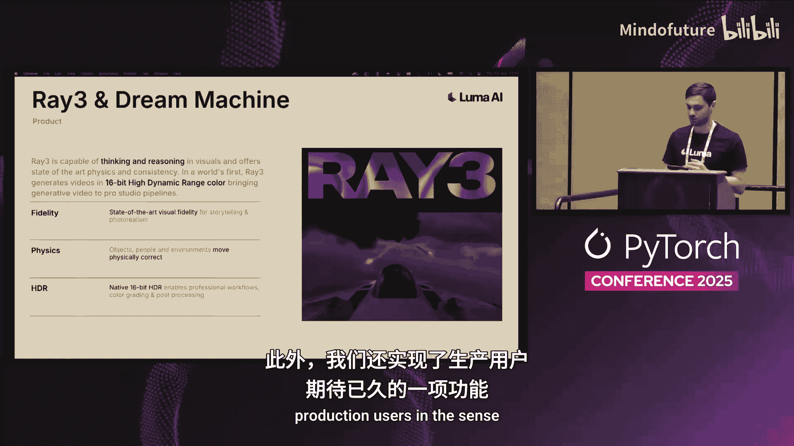
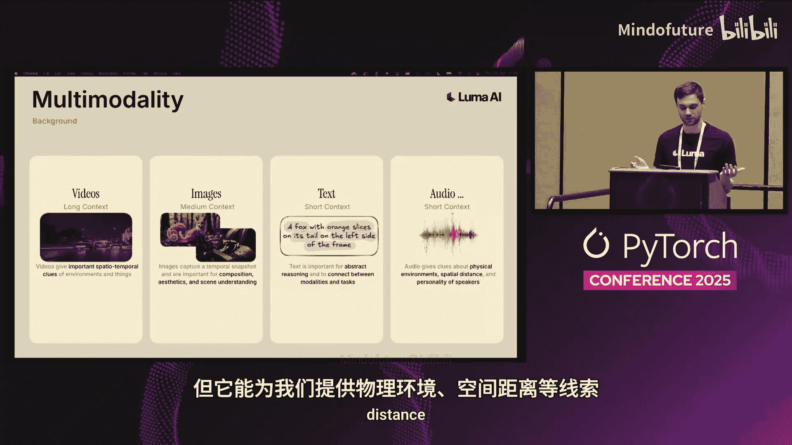
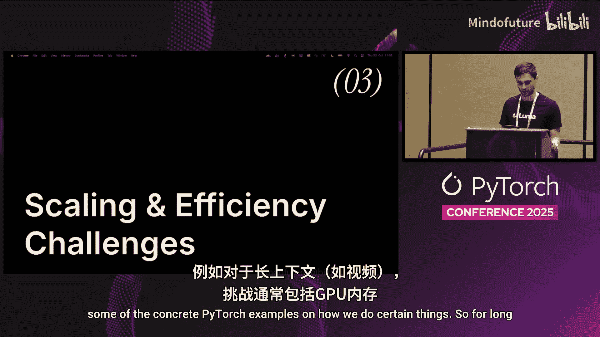
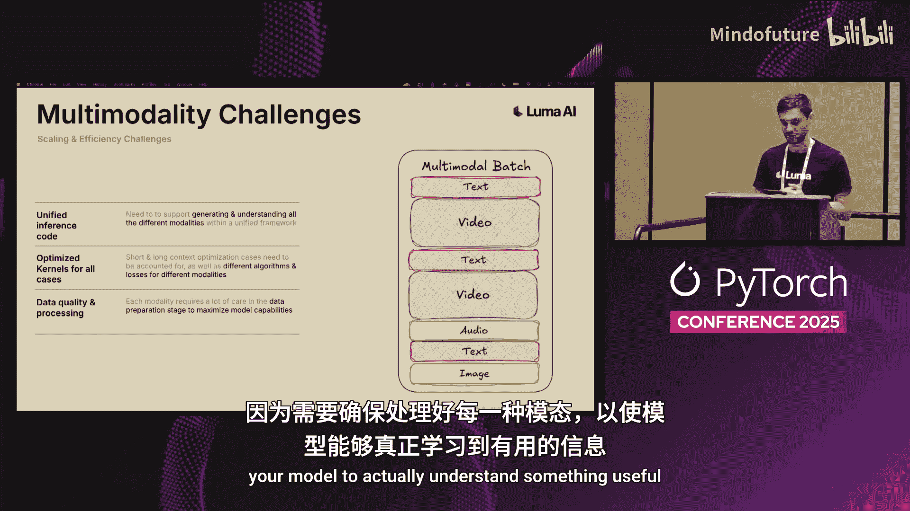
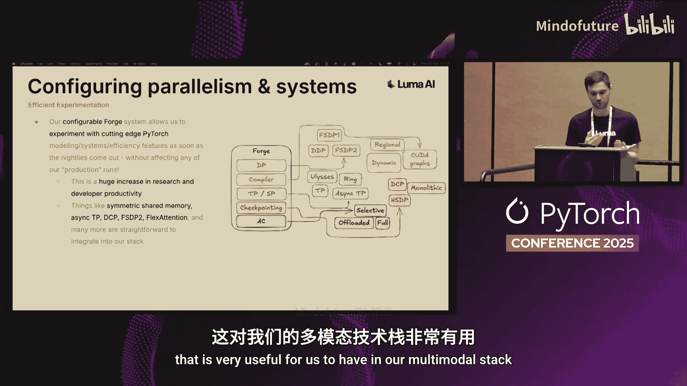
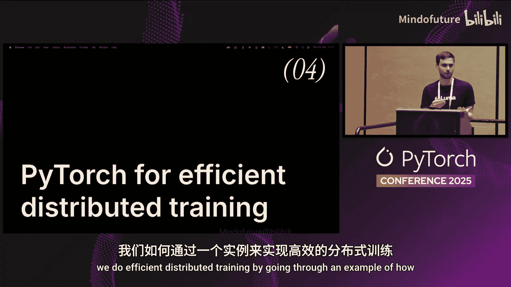
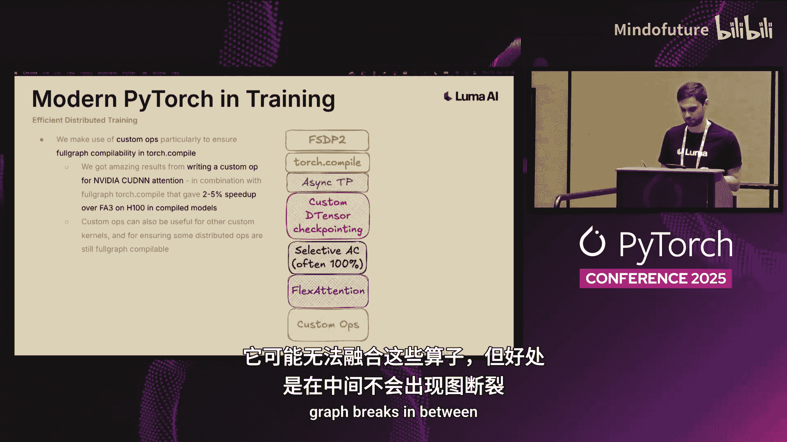
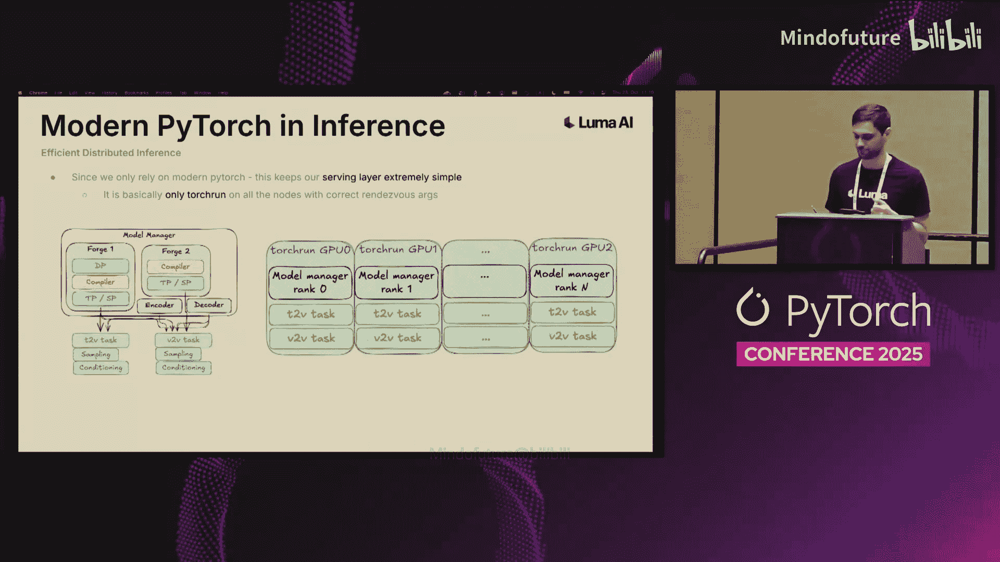

# 2025 Pytorch大会 ｜ Pytorch Conference 2025 p40 P40_现代PyTorch如何助力Luma_AI实现多模态训练与推理升级-Thomas_Neff__Luma_AI -BV1b8kRB6EJG_p40-

All right， welcome everyone to my talk about how we use PyTorch for multimodal training and inference at Luma AI。

 so I'm super excited to welcome a bunch of you here and I hope I can share some interesting insights on how we scale up our training and inference runs with PyTch。

First， I'm going to be talking a bit about what we do at LuMma AI so you have a bit of context on the challenges that we're facing。

 I'm going to give a brief background on some of the specific challenges for multimodality when it comes to scaling and efficiency and then I'm going to go through some examples of actual things that we are doing to efficiently experiment with Pytororch to run distributed training efficiently and also to do distributed inference efficiently。

So first， what do we do at Luma our mission is to build multimodal general intelligence that can understand。

 generate and operate in a physical world， kind of enabling a new intelligent， creative partner。

 so we are focusing on multimodality because we see the most potential there to actually unlock new creative models。

About a month ago we released Ray3， which is our state of the art video generative model and we integrated that into our product dream machine if you want to check it out。

 feel free to do so later but ray3 is interesting because it's the first of our models that is capable of thinking and reasoning in visuals and offer state of the art consistency In addition to that we've also like put something off of the bucket list for our production users in the sense of that it now allows for HDR content to be made in 16 bit h dynamic range color so we have made some advancements here in terms of fidelity in terms of physics and also in terms of HDR so that's kind of like the background of some of the things that we have recently released Now what do it mean by multimodality。

When I talk about multimodality here's some examples for it， so we can have， for example， videos。

 images， text， audio or even more different modalities and all of these bring something different to the table for the model to learn and stand from for example videos which are typically very long context they give important spatial temporal clues of environments and things and anything really then we could have images which are kind of like medium to shorten context depending on your resolution and these capture things like composition。

 aesthetics and seen understanding。😊，Then we could have text in our modalities which is usually very short context。

 most of you are probably familiar with that in the LLM land and text is really important for things like abstract reasoning and connecting between different modalities and tasks so in this example here like text gives us important clues about the subject。

 about how the subject looks about where the subject is placed and these kind of things tie certain other modalities together pretty nicely and the final example here is audio which is also at least compared to video and images。

 often very short context but this can give us clues about things like physical environments。

 spatial distance and also personality of speakers or things。

Now， I want to go briefly over some of the challenges that we face in all of these different modalities in terms of like scaling and efficiency before diving into some of the concrete pytor examples and how we do certain things So for long context like videos for example。

 challenges are usually things like GPU memory quadratic compute off attention and things often being very much compute bound I'm pretty sure most of you have seen a graph on like on the right here or something similar before where at a certain point。

 attention just dominates everything in the compute if you're using full self attention So for these kind of like long context things where we are trying to train and run inference on for example videos。

 one of the most important things is that we have things like an efficient attention kernel that deals with the fact that this is just a substantial amount of compute that we have to deal with。

。For some of the short context things like text， this is very much something that is also applicable to things like LLMs and like autoregressive or nexttoken prediction models where if you have something like a causal and model which is often the case in text you need to have things like kv caching to prevent like expensive recomputation and your attention you want to make sure to take a look at compute and communication overlap because for short context given that your compute is so short as illustrated on the right-hand side here if you have some communications in between that can end up like stalling your compute。

 you can end up introducing a lot of bubbles in that and that makes your GPUs usually not very happy and for these kind of cases you often are very much latency or memory bound so this is a very different like optimization regime compared to the long context case and now if we combine all of that into having different modalities so for example on the right- hand side here you can see a multimodal batch that could include text video audio images and maybe other things well。

Then this makes things quite tricky。 We kind of need to have a unified inference and training code that can understand all of these different modalities。

 We need to have kernels that understand these different modalities and are maybe optimized for certain cases and also things like data processing and quality at scale is very tricky because you need to make sure to take care of each of these different modalities for your model to actually understand something useful。

😊。

So with these kind of like background things out of the way。

 let's chat about how we use Pytorch for things like efficient experimentation。

 which is one of the core strengths and why Pytorch has become so popular in the industry and in research So at Luma the life of an experiment can look something like this we do all of our configuration and definition of experiments or classes or modules in Python data classes that have a setup method So on the right side here you can see we might have some configurable class and that class has an inline class that we usually just call config and that is a data class where it can set some arguments in this case here we might have an integer argument。

 a string argument or something that is even a callable and when we call do setup on this configuration object it returns the parent class so it returns the configurable thing in this case and with this kind of pattern that is usually just something you can whip up in a couple lines of code this becomes very powerful So for example we can make use of strong typing compared to like textbased configuration。

F we can version control everything and we can even modify configuration files almost in kind of like a meta programming style。

 like you can run loops over your configs， you can change configs dynamically。

 not that you necessarily should， because that might end up giving you nasty bugs。

 but you can do it if you want。And on the right hand side here， we can see， for example。

 an M trainer job， which also has a config and in that config we have a trainer。

 which again is also a config， so you can see this kind of like configuration system change changes itself through to all of what we do and it makes us able to or it allows us to experiment with things in a pretty efficient manner。

On the bottom here you can see that like an example of how these configurations are instantiated and used where you can first create a config。

 then maybe you want to swap out the network config by something that has a different number of channels。

 and then you can run this job after having instantiated the job config。And everything we do at Luma。

 almost everything follows these design patterns so that includes things like model architecture definitions so in this case we have a class for like a neural network and in that we can have this nested config class that is a data class and you can see here that is something where we could define the number of hidden channels for a neural network and then as the init method is called when we call that setup on the config we can see that we can make use of the hidden channels to define our neural network in this case this is again like a super simple dummy network that we use for like a dummy MN training job。

other than that， it's a regular N dot module， it has a forward function。

 you can do things like compile it， the only other thing is it kind of has this nested config within it that makes configuring it pretty nice。

😊，And in the same vein， we also use this kind of configuration system to configure our parallelisms。

 to configure our systems， to configure checkpointing， compilation initialization and more。

 so we have an internal system that we call forge which at this time I guess is a bit of an overloaded name but with that kind of system we can do parallelism and comp compilation strategies and that is inspired strongly by torch Titan which has also kind of this pluggable and apply system of applying these different things。

 So on the right here you can see we have things like the optimizer and initializer which we use the meta device in it for then we have data parallelism which could be FSDP or HSDP and then we have a compiler。

 we have checkpointing we might enable EMA and that is kind of our ones stop shop to define a unit that can be trained can be optimized。

 can be compiled and can be sharded。Okay。And here's an example of something that could be a bit more sophisticated in this case。

 this could be an example of how we apply tensor parallelism including things like async TP so again this follows the same configuration structure in this case there might be like some additional things like the head dimension or the number of a number of heads in query and key values and if we want to enable async TP or not after we initialize it we create our device mesh which is also one of the features in Pytorch now that we use very heavily and then as we call this parallelism scheme we apply it on top of a module so we create our tensor parallel plan we call the parallelized module function and then optionally we apply aync tensor parallel。

And here's an example for how we do things like HSTP， which follows a very similar pattern。

 so in our configuration we might have the intra node shard size where the name might be a bit confusing。

 but it's essentially just like the device mesh dimension for the sh dimension and in the end we create our device mesh。

 which is split into replicate and sh for HSTP and then we just call fully shard on the module that is passed and that allows us to kind of do the same thing the torch tightentan us but in a unified framework where our users like researchers and engineers they have a unified system of what they can expect when they try to shard and configure their modules which is very flexible and very cool。

So our configurable forge system allows us to experiment with cutting edge pytorge features in terms of modeling。

 systems efficiency as soon as the night lease come out and that is something that we have done quite often which is like oh。

 there's a cool new feature in nightly， maybe there's a new modular compiler API we can build something in forge that just applies that but doesn't touch anything else in the rest of the code。

 which means it doesn't break any production training runs。

 it doesn't break any inference and it's basically completely isolated。

And that's a pretty huge increase in research and developer productivity。 So on the right hand side。

 you can see a bunch of like these building blocks that we can merge together into one forge instance。

 and that includes things like symmetric shared memory， async TP， distributed checkpointing。

 FSDP2 flex attention and all the modern pytorch goodness that is very useful for us to have in our multimodal stack。

😊。

So now with that configuration system out of the way。

 I want to chat a bit about how we do efficient distributed training by going through like an example of how we could configure such a forge and what that means for our training runs。

So usually our first line of defense for sharding and for efficiency for the training case。

 given that we usually rely on fast interconnect is that we strongly recommend starting with FSDP2 and that will actually go pretty well long like for a very long time like you can scale up your models to hundreds of billions of parameters in FSDP can be fine if you make sure to adjust your batch sizes。

 Tensor parallelism size and things like that。 So it's by far the simplest solution to deal with weights and optimizer states and you're ever only one pytorrch profile away from checking that you're fully overlapped or not So if in doubt just grab a pytorrch profile and if it's not fully overlap you can tweak things the next thing is we also heavily rely on torch compile for training that is both for dynamic and for static cases you can imagine that for things like videos there's different aspect ratios。

 there's different resolutions there's different frame counts so that is like a very dynamic case and for some of these we do rely on torch compile。

Dynamic for some of them we compile multiple static graphs but the gist of it is we rely on torch compile to do a lot of diffusion for us and that has been working out pretty well for us we use Redis cache to sort deco compiled artifacts which is also something that was introduced a while ago and we make use of regional compilation to make the compilation faster so instead of compiling the whole model we compile for example in a transformer each block and that almost always gives us basically the same performance but compiles much faster。

Then we compile auxiliary parts like losses， the EMA update during training。

 and of course things like flex attention mask functions to make sure that this is running efficiently and not blowing up memory and depending on the task。

 like I mentioned， we use either dynamic compile or we mark certain dimensions as dynamic。

Now for other certain tasks， we sometimes use TP and an async TP and particularly the torch API for async Tenense app parallel is very nice to use like if you have a use case where you benefit from tens app parallelism。

 I would really encourage you to just enable async TP in some of our cases we have seen upwards of like 10 to 20% improvement and efficiency by just enabling async TP。

 so if you also compile your models which async TP also kind of relies on that can often be free lunch。

Then the next thing which we have in our stack so we can support things like distributed checkpointing。

 loading from monolithic checkpoints。 What we do use is we actually have a custom detensor checkpointing that we specifically tailor to us using FSDP2 very often So an FSDP when your model is sharded you have these detensors that are spread across the short dimension and what you can actually do is you can just save these detensors via Tor do save on every rank that you want to save on and later on you can load them again。

 you need to do some metadata hacking， which I'm not sure I want to recommend but it does work and it's a very efficient way of saving and loading these checkpoints because you saving is literally just to save of your rank and your loading is again the same thing you just load the checkpoint into the rank that needs it so that's basically the simplest most way you can do and of course resharding is something that can be a bit more complicated and that is something where it would recommend DCP or other solutions but for us if we don't need to reshard too often that is actually a very convenient solution。

Then the next thing we often use during training and especially in the long context cases is of course activation checkpointing so we do support selective activation checkpointing。

 we often just have it set to 100% because well even just like having one block that is not activation checkpoint and it can often blow up the memory with minimal gains in speed so that is something we usually keep on and make sure that we fit things into memory that way and we can also support things like async CPU offloading with activation checkpointing so I think that is something that was or is in torch tuned but isn't in torch main。

 but essentially if you know like which block you're gonna be loading next。

 you can also make sure that the checkpoints that you store in activation checkpointing are offloaded to CPU。

The next thing that we heavily use depending on the use case for experimentation。

 especially and especially for complicated multimodal attention schemes is flex attention and that allows our researchers and engineers to write their own mask and score functions completely independently without having to write kernels which is again like a huge increase in productivity of course flex attention is bounded by at most being as good as flash attention too depending on your sparsity so if you have something that shows promise in your experiments。

 then there is something where we can make custom kernels or ops later。

 which is another point that we make frequent use of so making custom ops can be really useful in the regime where you are relying on torch compile very heavily so for example we got amazing results from writing a custom op for Nvi co andN attention on H100s which makes it full graph compileilable and in combination with full graph torch compile that sometimes gave us between2 and5% speedup over flash attention3。

Which is pretty good， given that that is kind of like the state of the art。

And custom ops can also be really useful for， of course。

 other custom kernels and also for other things that just to make sure that like torch compile can be full graph compilable。

 it might not be able to fuse these ops， but it's still nice that you don't have any graph breaks in between。

Okay。And then in our training loop， we also have like a pretty tight integration with the torch profiler so by just like passing an argument we can automatically capture a torch profile on a given rank and also a memory profile we can upload that directly into perfeto with some deep linkss so we can easily investigate and analyze what the performance of our training looks like and we can see if there's like any issues with kernel launches with bubbles like synchronization problems and things like that and finally one thing I just wanted to mention Torch Titan also does it and I'm sure a lot of you are also familiar with that but please also make sure to call the Python garbage collector manually periodically if you don't do this you will end up having some very strange and erratic differences in step times and that is something that took us unfortunately a long time to figure it and we then saw that like torch Titan also did it so if you're not doing that and you see like weird variances in step times that might be the reason。

And now for the final part of the talk， I'm going to be chatting about some of the things we do for distributed inference。

 So at Luma， we need to ensure we have efficient inference across different hardware vendors like AMD and video and different generations of chips and at the same time as a research lab we're constantly experimenting so we need to be able to ship an idea from research for production really quickly sometimes。

And we mostly here as well rely on torch compile and some specialized ops and kernels to do deal with that。

 so in this case maybe you have a transformer， the block is compiled and then there might be like an attention op in there that is a custom op that is different between Kuda and Raham。

And we also share our paradigms and patterns between training and inference。

 so we use forge the same system that I showed before to define our inference parallelisms compilation and also declare how checkpoints should be loaded。

 so we can end up like doing sequence parallelism or tensor parallelism we can compile things and it uses the exact same interface between training and inference and so easily share weights between different functions or tasks for inference we have something that we call like a lightweight model manager that essentially just keeps a bunch of models in memory and then if we have like a text to video versus a video to video task these can independently fetch the models so we can reuse the weights between different tasks which keeps our pipelines both nicely decoupled but also make sure that we're not wasting any memory by keeping duplicates of models in memory。

And since we rely only on modern pytorrch， that keeps our serving layer also currently extremely simple。

 so it's basically only spawning a bunch of torch run workers on all of the different nodes。

 making sure that the runndezvu happens， and then everything else is just running our torch compiled models with whatever tasks that we have configured。

😊。

And with that， I'm at the end of my talk， if you know anyone interested in solving multimodal intelligence。

 we're hiring across the snack， we will be around here like a bunch of us from the team are here。

 please reach out if you want to chat about anything and everything and I hope you enjoyed it。

Are there any questions？嗯。嗯。Have you considered how to reorganize your stack and FIG。

 et cetera for RL？Yeah， that's a great question that is something we're like deeply thinking about right now both in terms of like reorganizing the stack for RL but also reorganizing the stack for multimodality。

 like a lot of what I've showed has worked well for things like long context and is also working well for some multimodality but we are thinking deeply about reorganizing the stack for example。

 sharing like model weight between like training updates and rollouts in RL is something that a lot of the stack that have that I've showed does work with but we need to think about more of the orchestration and how that will interact with things most of which will still apply but there's some things that we are currently thinking about on how we will change or how we will adapt。

Hi， love your talk。 First off。 my question was basically about your distributed training set。

 You mentioned that you use a Redis cache。 Yeah， so what kind of impact does that have on。

 let's say your I speeds Well， I guess the Redis cache we only use for the compile artifacts。

 So that is basically just if we launch a bunch of like training workers so that we have a warm compile cache and we don't have to like store it on disk or like on some our network storage So that's basically what we use the Redis cache for Got it。

 Thank you。Okay。Is there gonna be like a framework like BLLM or something like that for video generation Many chance or is it being built I'm sorry can you repeat that Is there gonna be like a framework like VLLM or I think similar for video generation what do you think about it You've been in the space for a long time。

Is the question if we're using VLLM or I'm asking if that is oh they're going open source Yes。

 so that is that is definitely something where we are。

 I guess kind of like building towards internally is like having something I guess the stack that we have right now is something like that。

 but more focused on like some of the video use cases for now。

 but there's definitely like some things that we need to build that are trending towards some of the things that are in VLLM or SGling and things like that。

Just one more question how good are diffusion models in this space right now？Can you repeat that。

 I'm sorry how good are diffusion models？In this space right now。

 we just explore like transformer based models right， or already we explain。

 So how good our diffusion based models right now， are they like very good not。 Well， yeah。

 at least for the the slide that I showed early on for like ray3， that is a diffusion transformer。

 So most of like the image and video generative space is diffusion based at the moment。😊，Yeah。

 so I had a question about inference with your T2 V or V2V models。

 So one problem I encountered in production is I did the profiling。

 I found that so if even if we reduce the model size or context that model or do a lot of acceleration however。

 it is still quite slow， it is not better than if we reduce the number of inference steps So I'm just curious did you encounter similar issues and how do you solve the problem that by by all of these tricks and it does not accelerate the sampling inference times a lot。

If I understand correctly， the question is about the most of the benefit being from like reducing the number of sampling steps and like how to saturate the hardware。

 is that right， Yeah exactly So the profiling results shows that most effective ways is to reduce the number of steps that of doing anything else。

 Well， I guess if that is the result that you have。

 that means that your pipeline is already in a decent spot like there's no bubbles like most of the time is spent in kernels at that point。

 you will need to look at things like inside systems or inside compute on or like the equivalent on different hardware to see like if there's improvements in kernels you can make like using kernels or finding like I mentioned a better attention kernel for example in our case。

 with a good attention kernel， the long context case is basically fully utilizing the GPUus with like 100 percent power utilization almost always So there's definitely ways to make that work but it depends on your use case。

Yeah， thanks。 Just a quick follow up。 for your last question。 So you。

 you're saying that your flex attention goes with flash attention。

 So did you observe that running time it goes to the n square if you scale up the context length or it's like it in practice is less than this number。

 in practice is， of course， a bit less like I guess， asymptotically， it goes to n squared。

 like as you increase the context length。 but yes， that's definitely something we can we do observe on like the long context side。

😊。

Got it， thanks。