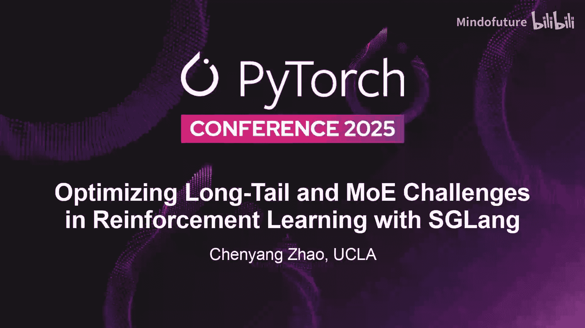
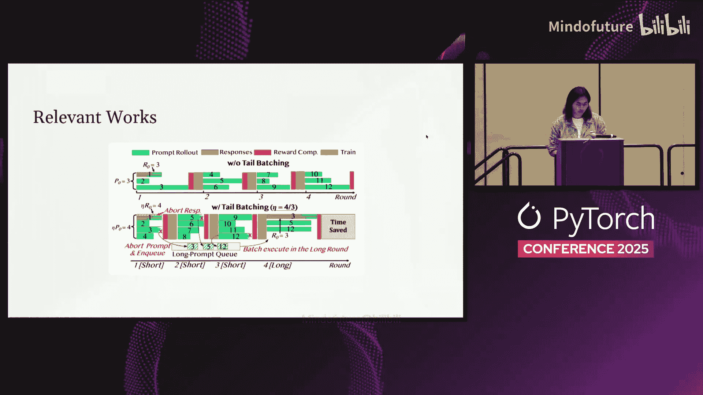

# 2025 Pytorch大会 ｜ Pytorch Conference 2025 p41 P41_基于SGLang优化强化学习中的长尾与混合专家难题-Chenyang_Zhao__UCLA -BV1b8kRB6EJG_p41-

Okay， yeah， it's starting to count it down。 So it's my session begin。 Thanks so much for coming。😊。

Yeah， and yeah， I'm the first speaker of today's。 I mean in this room。

 and I'm the first one to introduce what is RL to everyone。

 So I do a favor to the following speakers。 You guys do not need to introduce what is again so today my topic is optimizing large scale with S at this title。

 what is large scale。 when we are saying about training we say large scale is like gigantic model data complex use usability。

 Yeah， any kind of thing you can imagine regard large scale will happen in the large scale。 Okay。

 so that's the topic today。 we got to cover we are using industrial level large scale and we want to introduce features that opt the and pipeline。

 and thanks so much for listening to the introduction。

 Yeah and introduction myself is that I'm Che right now Im a student and and working on。😊，R hell。

 maybe for our is specifically our systems for over one years。

 and we got to cover four critical system optimization today。Yeah。

 so before I dive into the optimization， I want to do a quick survey。 Okay， look at these words。

 The first thing， have any of you guys tried to launch your I jobs or just an example for maybe right。

 Maybe a of you guys know the concept of search R one。 Have any of you guys launch the。😊。

Example of search1 with your I frameworks。 And the second thing。

 have you heard about the words like the reward function and have you ever tried to modify or customize your own sampling sampling logics。

 and the final thing。The fantastic words all the sorry， A fancy words， like important simply。

 Have you guys heard about these kinds of concepts。 And the third thing。

 have any of you guys tried to customize your model， like。

 say you have a Lama model and you have a model。 Then you， maybe you change some of the。

 You change some of the architecture of that model。

 Have you tried to set up your Is architecture and train your customized model， So。😊。

If you have done any kind of thing in these three points。

 you must have hit the ball of the performance。 So if you have done that。

 have you profiled why your I O seems to be slow or no efficient and yeah。

 and maybe your reward collapse。 have you tried to debug with your I systems and try to say what is the bottomneck。

 So for these four points， if you have the all of it， you are an expert and I as it。

 So you can so you should come and join us for the open source community。

 But if you haven't done any of this。 But hope we can expand our idea to you and getting some insights today。

 Okay， So。😊，This is the five parts I got cover。 Okay。

 the first thing is the incorporating S with R L。 so let me get you through the feature of R systems and before that。

 We can see right a quick introduction of what is an systems。

 here are this several of these kind state of systems。

 the first one is maybe from maybe three months ago。 and this one is the I think it's a real。

 It looks quite structuralized。 Okay， and this one。 Okay， this one split frameworks into blocks。

 and they have the storage。 and they have the data flow。

 And the final one maybe the most simple straightforward one。

 It's just a loop across bunch of concepts。 So what is a typical R lifecycl。

 at least five concept in the traditionally。 The first one is rolling out。

 this is I think its a terminology。😊，I， but you can just imagine this is inference。

 You have an inference engine and you use and you use the model ways to generate answers to the prompts。

 But in the scale of large in the scenario of large scale。

 the else is isn't just a prompt and answer since the answer should be quite complicated。

 for example， this slice is， this slice is generated by the gamma， right。

 gamma is somehow like an agent。PowerPoint company or whatever。

 So if I want to generate if I want to generate a PowerPoint with Gamma。

 it shall first see what my concept is and generate some generate some tool maybe for picture generator and generate some tool code maybe for it ther to make sure it's lines properly。

 So take this example， a single prompt maybe results in tens or tens or even hundreds of tool calls into one single request。

 And each tool call will to the corresponding to and wait for it to return and interacting with you again and and again。

 So this rolling out is quite like you are diving into a deep research agent It's not just the chatbo yeah。

The second thing is evaluation is covers like the reward value div and advantage。

 You do not need to know what in detail they are。 but they are critical for you to calculate the rules for your training。

 And the first thing is the storage。 okay typically people do not have a storage layer in the frameworks。

 but I here since and I said the rolling out is quite complicated。

 may not always have the time for your rolling to finish So in a lot of scenarios we may stop the rolling out and specific points and maybe later we got we got generation。

 So we have a storage layer that to this kinds of unfinish or even finish for you to reuse and to debugging。

 Okay， that's storage layer。 and the training of course， the or or Titan today is conference。

 So you guys may familiar with this kind of concepts。 Yeah， it's just the training。

 And the final thing isitit is。😊，that I tend to use。

 but people may have something like the weight updates。

 I personally think that refit is the most accurate words to describe。

 because if you saying its the weight update， it looks like you are training the model。

 But the model have already been trained。 So the wordit means after the the model have already been been trade in your training backend you want to copy the model weights back to the inference。

 since we are doing online and on policy training。 if you are using if you are using the wrong。

 if you do not update the weights in your inference engine。

 you are not sampling with the latest model， Yeah， that's not in our assumption of our current style。

 So the wordsit copying the ways from training engine back to the inference engine and another round another round of rollings。

 and in the cycle， have these four parts together。 have this five parts together。

 we have the lifecycle。So remember this R lifecycle。 we can take back to this to this picture， right。

 I think is's exactly what I'm describing。 So this is the rolling out part is using S learn to do to get samples and get a sequence。

 And this is this is like the the evaluation part。 And this is data storage。 And after that。

 we have the training part。 And then we copy the weights back to the inference engine。

 So that's the R lifecycl。 exactly speaking that every picture here is doing in this five lifecycl。

 But they are picture in their architecture in different ways yeah。😊，So given the concept of I。

 why we are advocating astrona for your I life cycle management， from my point of view。

 I think the best to have is that astrona is the library for you to do your I job。

 It's not a framework。 say I heard the words from deep mind that we to make a library but not a framework。

 for framework ands trying to teach your users how to how to do some rigid things。

 And if you do not follow the frameworks requirements。 you might get something wrong。

 But for library it customizable and easy to use and open to use and give you the freedom to implement any kind of your imaginary utilities。

 Okay， say and5， we have detailed concepts。 The first thing is open to use repeatit functionality。

 just as I said， to copy the ways back to the inference engine。 We have three methodologyologies。

 and the second thing is easy to postpone generation。Again。

When we have some for large scale rolling outs at some point， we may want to stop our generation。

 So astro gives you the API， then you get easy to stop it at once。

 And the first thing is the fine agency wake up。 I got cover it later。

 It just means that we have we have the we have the switch technologies to facilitate your okay And the fourth thing is the training alignment。

 for example， if your company is using to your online your online jobs it's better to have both for the training and both for the serving that makes your and training aligned。

 the model you see during the training is the model you use for your and the final thing is the router。

 that means for this kind of complicated rolling out。

 we have unified and single endpoint for the generation。

 you do not need to care about in detail which。Where does the request go to each of the worker that makes you。

 your job quite complicated。 You just need to send to the route and route controls all the generation。

So yeah， let me first。 this is the introduction parts。 and I have two。Pas for the， yeah。

It's much easier to understand。 The first part I want to introduce is the partial rolling out。

 taking the step back。 Just as I said， if we have an agent and agent shall generate maybe tens or even thousands of tool code to the。

 to the environment。It's quite slow， right。 maybe some two they just broke down。

 And and you cannot get the response in one minutes。

 So how can you make sure that your generation is efficient。

 So that's the idea of partial rolling outs。 can imagine that imagine that in this kind of scenario some of the is and maybe as are normal and quite quick。

 So we have a picture called we have a picture to demonstrate how what's the diversity of the responses。

 when you look at this picture on the on the left。 this picture is the CF of the response return time。

 That means maybe we send 100 request to the environment sorry to the to to the generation to the rolling out time and how quick the response will be finished。

 we found something interesting that 80% of the response will return just in the first50% of time。

 That means for the left 50% of time。😊，We just finish。 We just used it for the 20% of request。

 So take these things in mind。 it's just like the 20 and 8080 low common use， right。

 most of requesting finish quick。 But some of the requests they are slow。

 And since R L traditionally， we need to we need to。

Wait for all the requests to finish and then going to the next step。 How can we optimize this。

A basic idea is， overse。It just means like if the first 80%。

 if the first 80% of requests come back so quick， why cannot we send more requests than we expected。

 And we get the first return once to us。 And then we use these once for training。

 So that's the chief idea of partial rolling out and a lot of words you have been hurry。

 we do an over sampling。 And when the request， when the request return to us to a specific point。

 We postpon the the unfinished one。 Okay，The most direct idea is that we can through this unfinished one and training with these kinds of returned ones。

Yeah， you， we still have adequate requests to train our model。

 and a more dedicated usage is like we use this kind of unfinished one。 Ca them onto the storage。

 And in the next time， we first pop this， we first get these unfinished ones from our cache。

 and we let these cache these prompts in the cache to finish first。

 So that's idea of overs and partial rolling out。😊，Yeah， this picture explain it in the clear way。

 on the yeah， in the upper bound， we see that all the engines they are waiting for the response seek to finish。

 But if we're using partial rolling outs， we can just， at some point， if the request is adequate。

 we just stop all the generation and load this kind unfinished one in the next parts。Yeah。

 that's the first part of partial rolling outs。嗯。And another hitting points I've been。

 I've been hearing these days is training in mismatch。 Its quite like a favorable of fashion words。

 So first， let me first describe what is training in mismatch。 training in mismatch means that。😊。

The log probability for given string inside the inference or the rolling outs should be different from that inside the training。

In another words， if you give the same prompts to elon and give the same prompt to Mron。

You get the same you guess log probability。 ideally speaking， they should be the same。

 but technical speaking， they are not the same。 So that's the training inference mismat。

 and training inference mismatch is causing a lot of jobs to fail these days。

 And we are using important sampling to fix it。 And after I describe what is training inference mismatch。

 We can imagine what's the reason behind this。 Well yeah， ideally speaking。

 everything should be exactly the same right。 You have the exact， you have the same model parameter。

 You have the same problem to the model。 Why they are not the same。We have several concepts to share。

 The first thing is the non associatedciative float point arith adding。

 we all know that a plus B is not always equal to B plus a for float， for floating points， right and。

We know that for the in， for the for A M， or reduce is commonly used。Or reduce is commonly used。

 If you have four GPUs for the model， you first reduce the GPU 1 and GPU 2。

 reduce GPU 3 and GPU 4 and you reduce them together。

 It maybe the results may be different than reduce first one and the third one and the second one fourth one。

 So this kinds of reduce order would introduce like the same like nonassociative flow the flow point adding and layer by layer maybe you are using different ways of you have different ways of or reduce。

 So the difference just gets accumulated。 And finally。

 we found that the log probability has slightly different。 And the beginning。

 people think that these kind of slightly different may not be a same。 but to some。

 we found out that for extreme tokens log probability could go to something we cannot cannot sustain okay。

Yeah， so another point I want to point out is， just as that said， for M O E models。

 these kinds of training inference mismatch is rather worse。 since M O E models。

 they have their gating or the router The router should design which expert in this layer it will go to So the slightly different maybe in the expert selection layer by layer also introduce another another kinds of the training inference mismatch。

 So also that's the result of training mismatch and behavior。 yeah， after described this。

 we found it's a pure system problem。 because we are using because our kernels are not aligned maybe in the training in the training and inference。

 So we have this kinds of misalignment。 How can we fix it。

 The first that directly in the system side。 So we have a bunch of words coming from the from the community。

 The first idea is that for the thinking machine lab， they introduce the concept of the kernel。😊。

So the determin this kernel is just， as I said， they want to。

 they want the results to be in to be fixed for the or reduce order。

 So in whatever ways you want to do the or results will be still the same。 So that's amazing job。

 And their results turn to be they can make the same deterministic。

 But it's far away from the training first mismatch。

 So how does it it' like the non deterterministic just means if you give the same input to the same engine。

 maybe you give the same input to learn and you get the results twice。

 you found that these two results are not the same the same as FSDP give the same problem to FSDP and forward it for twice。

 but these two log probability may not be the same。

 So deterministic kernel just means that given the same model， given sorry， given the same engine。

 given the same。hardware， hardware system and given the same problem to get the same results。

 If you do not using the same engine， it does not give you the same results。

 And if even if you use the same engine， say you use Macron on a 100 or you use Macron on H 100。

 the results will still not be the same。 So as far away from solving the problem of training for mismatch。

 yeah。Another way is like。If the difference is， is between meron andlon。

 why cannot we using for training or why cannot we using micro for the inference。

 I just take a electron for inference， for example， it's not possible since inference and training。

 they are quite different for training， no one ever using K cash Your motor is frequently be updated。

 Your will be easy to be。 So the training and inference is quite like its quite different for Ls。

 but maybe for diffusion model they are not the same。 But since we are we only discuss the training。

 the area of the L Ms。 So it not it is really hard for you to using or using to do other guys work。

 Okay， So that's not even possible for the that's the two solution on the system side。

 And we found its not the perfect one。 And we still go further。We don to do it。

 We want to fix these problems on the algorithm side。 So let's introduce the concepts of the。

Of the important sampling iss a commonly use methodology in the scenario that were just using the probability of the sampler as the yeah under the probability of the actual learn yeah。

 So that's the so that's the solution of the important sampling。 Yeah。

 we can see that we can imagine that if we want to writing kernels to fix the problems。

 which are introduce maybe tens of thousands of lines。

 But these kinds of important sampling looks quite elegant right。 And in in detail。

 we do not we need to write no more than 100 lines to just fix the problem。

 So personally I love this kind of algorithm algorithm solution。

 And there are some good points for this this solution in that we found it for low preion training for F8。

 if you usingron forwarding F and backwarding F。 the important sampling will be even better。

 It can make your dead job alive quite interesting。😊，Right， we are still working on this。

 And hopefully we got to， we gotta have some results。

 technical reports with our col term in by dancing in and both in the open source community。 Yeah。

 and that's the training for mismatch， so。😊，This is the second part。 Okay。

 and I still have four minutes to go。 So we want to。

 So let me introduce another kind of easy to understand concepts。graph aware wake up。

 So what is way to wake up this for the we have inference and we have training could we always put the inference and training on the same GPU like we put like we have an unlimited GPU right put GP and we put on GP and let it always forever and possible actually not first we do not have this kind of unlimited GP And another is that for inference side we to expand the K cash as large as possible to speed up the inference。

 So if we just give a small amount of GP for the the inference would actually be too slow。 Okay。

 so that makes us we cannot feed them on the same GPU。

 So the first idea is that we have to switch them in the inference launch。😊。

And in the training we launch FSDP or metra。 but is it really that simple。

 So we can imagine that just Q and rela takes takes really a long time。

 So does for So the concept is like and relaun。 But we to make further optimization for this。

 And we dive to find what is actually causing the time forloading and uploading and we found concepts is a of weway and cache they are quite quick。

 But for the the we once break it and you rebuild it it takes really long time。

 So what is a in one lines of explanation is is GP trying to remember the data flow the data flows direction it should remember the address of the data flow flying from this point to that point。

 So the address of the virtual memory address is center to make sure alive。 And that's。😊。

Point we wants to when we are doing the context switch， we want to make it quick。

 and we want to always keep our chograph alive。 So we need to keep the virtual memory always unchanged。

 Let's introduce our job。 We call it a torchment receiver。 Torch memory receiver。😊。

It creates a region for you to do the， for you to protect the tensor。

 And once you release the tensor's physical physical allocation。

It will record the virtual memory address of that tensor。 And again。

 when you recreate this tensor back。 the physical address will be changed。

 but the virtual memory address will be consistent。

 So as long as your virtual memory address is consistent。

 yourgraph the address remember is still the same right。 So that's the perfect thing we have。

 So that's the point is thegraph aware waking up we use memory saver to protect the virtual memory address of serving model and K cache。

 So we have this PowerPo on the first stage is the rolling and after rolling model as cache and we are doing the training remember the the of is still here and after the training。

 we wanted to do theit。 So we have to uploadlon model and cache back。

 And we gradually copying the training models parameter back to the serving models parameter。 Yeah。

 So that's。 And after theit。😊，Fow the training model parameter。 And when we do the generation。

 we do the rollout again。It looks perfect， right， We have the photographgraph。

 and we have a dynamic offloading and uploading。 But what's that。😊，We can see。 we can see the red。

 We can see the red parts here， right， the red parts cannot be used， why。It's quite yeah。

 it's quite interesting because if we want the K cache to expand to occupy the red parts。

 its virtual memory address will be changed。 The size of K cache will be changed。

 So the virtual memory cannot be protected。 So our top memory save will be yeah， will be invalid。

 So that's the， that's the that's the tragedy we， we do not want to make。

 So if we wake up the serving mode parameter and the K cache at the same time。

 we cannot use the left part for the K cache。 So that's introduce another stage of the optimization。

😊，We wake up the TV cache and the serving model parameter separately。Okay。

 see the difference on the on the central line。 We first we up the mode and do the refit。

 And after the ref， we off the training model parameter。

 and then we upload the K cache through the whole process， the K cache will never be expanded。

 So its size will not be changed。 So so the virtual memory address will be still saved。

 So that's a good point。 We can using the full memory both for training And both for the inference。

 and we always keep thegraph alive。 and the rolling out is quite quick。

 So that's the optimization we made through the journey。 Yeah， thanks， and I made the points。

 Okay yeah for the left it won't be today。 but I'm happy if you have any question regarding the points。

 and it's quite a optimization is can for any framework or any other any jobs。

 So hope this can facilitate through your job。😊，Thanks。被人家。Have a lot of jobs per training batch。

 Then the strgg is should take a less percentage。 So I'm just curious about like how many jobs you're putting there in the。

 in the， you know， whole R L framework at the same time， like， you know， as an epo。Your question。

 like how many jobs we put in the I in the Yeah it's quite confident。 Okay。

 so the actual thing that for specific company they are training their their training their their model as agent for thousands of steps and across thousands of GP for over。

 I think over 3000 steps。 So the training is really at a large scale。

 it may it takes maybe a whole week to do the training。

3000 steps means like 3000 turns right So one agent program runs 3000 turns the step is the training the step is the training is for the training。

 but for the terms。 I don't remember the exact term requirement。

 But you can imagine that there will there will be hundreds of turns for a single interaction， yeah。

Oh yeah， yeah。 but Ill saying like if you only have two requests in a in epo， then like the。

 the longer request is always the struggler， right。

 So I'm just curious about like how many requests you're putting there。 But like。

 do you have an estimate for the scale or maybe it's hard for for me to review this。

 we we can talk often Yeah， thanks。哦， please。Sorry if you are just dropping the long tail like rollout。

 the easy password as it's going to affect you， it's actually the long tail rollout is actually finding the rewards。

 great points。 Yeah， there's no free launch for the for this kind of long tail for this kind of long tail effect in some in some specific use case。

 we did not need this kind of long tail one since we will always no no reward for this long tail。

 So it makes sense。 but if this kind of long tail long tail sequence。 You got to give long rewards。

 we still have ways to opt we still have ways to optimize this like the like the PowerPo at this here。

This is the packer。 I think it's the， it' the ro packer for from the Alibaba team。

 So their idea is that they did not。 they they cash all the long tailed prompts into the cache。

 Remember， then they did not they do not recall the already generated one。 They just discard it。

 So they have a batch。 So gradually， they will have a batch of long long prompts。

 And for some specific step。 They get all the long long rollouts out and then do the all the long ros on and that steps。

 So that's their methodology to mitigate the same as you speak， yeah。Thanks。

