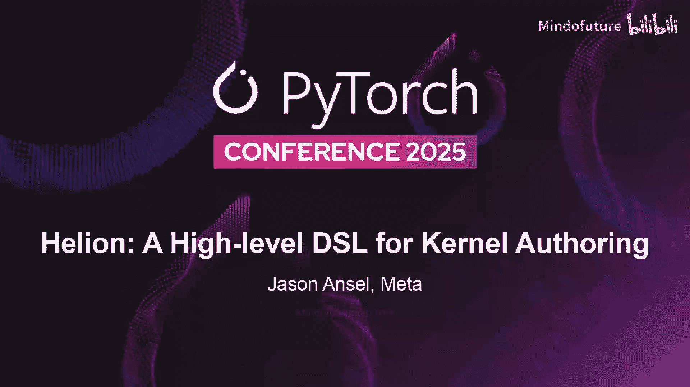

# 2025 Pytorch大会 ｜ Pytorch Conference 2025 p42 P42_Helion——面向内核开发的高级领域特定语言-Jason_Ansel__Meta -BV1b8kRB6EJG_p42-

Thank you for coming everyone， I'm Jason Ansel and I'm going to talking about Heliian which is a new high level DSL for kernelel authoring。

So starting off with the motivation， heliian is a new DSL that sort of exists between the levels of abstraction of Pytorrch and Triton。

 so it's lower level than Pytorrch， higher level than Triton and one of the big motivations we saw working on Pytorrch and torch compile is a lot of users were asking for more control they wanted to say exactly which operations got fused into a specific kernel and for that they were often switching to kernel authoring DSLs。

 but they didn't want to go go as low level as something like Triton or Ka instead won something a lot closer to the level of abstraction of Pytorrch。

 so you could sort of think of heliian as Pytorrch with tiles。

 it's sort of like a Pytorrch to native way of authoring kernels。

And then looking at it from the perspective of Triton。

 heliian automates a lot of stuff that is manual and Triton。

 so a helium kernel should be less code than the equivalent Triton kernel and heliian has a embedded autotunr in it and the design of the language is tightly coupled to the design of the autotunner so we took some inspiration from languages like haide which have a split scheduling language and semantics language and so you could view sort of a helium DSL as the semantics language where we try to keep all the hardware details out of the language and then there's this autotune configuration that specifies all the hardware details and how to map that computation to the actual hardware and we generate these configurations using an autoter and you could view this autotuner as sort of a way to take a lot of the effort of optimizing kernels and shift it from the user to the machine so you can。

You can replace a human effort with auto tuning time。

So here's an example of what a matrix multiply looks like in helium in this kernel you have basically two main sections。

 you have this outer section which is just regular pitorrch code which runs on the host it allows you to allocate output tensors do size computations etc。

 and then you have this inner part which is bounded by this HL do tile loop and this gets mapped to the device within this HL tile loop you can use standard pitorrch operations and and they get automatically mapped to a single output Trident kernel。

 the outermost HL tile loop becomes the launch grid of the kernel and then inner loops become device loops in the code。

 so the most critical language construct in helium is this HL do tile construct which takes in a multidimensional size。

And it subdividdes the iteration space into tiles， so the exact way that the iteration space is divided into the tiles is up to the auto tuner。

 and it often is really important to subdivide the iteration space differently on different devices to get the best performance。

 and so by making thisling details of the tiling up to the auto tuner。

 things like tile sizes and iteration orders， even flattening can be tuned by the auto tuner。

So now I'm going to go over the configuration space， and this should give you a sense。

 especially if you're familiar with both Pytorrch and Tritan it should get you a sense of what heliian is doing。

So the first type of choice that the audit tuneer is iterating over is iteration or indexing choices so in Triton there's three different ways to specify indexing you can do it with pointer math。

 you can do it with block pointers or tensor descriptors which are more structured ways to do it and in heliian indexing is done in a Pytorch style way so you take your tensor and you index into it either with scalar values or with these tile objects that you get from the HL tile loop in your program and when you index into a tensor with tiles you load an entire tile out of the underlying tensor and what we find is that the best type of indexing often depends like often what we see is tensor descriptors are better for larger sizes and pointer indexing is better for smaller sizes and in Triton switching between these is pretty tedious but it can be automatically done。

I the Heliian audit tuneer。The next type of choice I'm going to talk about is implicit block sizes。

 so in a lot of lower level languages like Triton you need to manually manage block size information。

 so I've sort of highlighted all the places in sort of the equivalent Triton kernel where that block size is handled。

 you need to lift it to an arc， you need to do grid computations to figure out what your launch grid is and then there's just a lot of work to manage block sizes and this is all automated in heliian where in heliian you just say HL do tile and the language manages block sizes on your behalf。

And one of the big advantages of having the language manage block sizes on your behalf rather than specifying them manually is we can do things like loop flattening。

 so there's a configuration to flatten loops， and when you do flatten loops。

 we take that same input source code and instead of mapping it to two tile sizes which with a square tile we flatten the iteration space into one dimension and just have a one dimensional tile。

😊，And this gives the auto tunener a lot more choice that would require program rewrites in a lower level language。

😡，The next thing I want to talk about is reduction rolling。

 so if you have a reduction here where you're taking a 2D tensor， you're summing up the rows。

 there's actually two different ways to do this in a lower level language like Triton。

 you can just do the regular load as you'd expect， but the problem there is that if your row size gets larger than what fits comfortably in an SM。

 then you'll either get spilling or just have failure to compile entirely。

 and so the other way to do it is to create an accumulator and loop over your data and we're automating this transformation in helium and can autotune between these two different types of choices。

The next area that we're tuning over is PID types， the program IDs in the output code。

 so when you're launching a program or a cota kernel。

 you have this launch grid and you can either sort of set the launch grid size dependent on your data。

 or you can use a fixed size launch grid basically launching one program per SM。

 and then iterate over sort of virtual program IDs。

 and these different ways are often significant rewrites to kernels but to get the best performance。

 sometimes you need one， sometimes you need the other， so it's a great thing to auto tune over。

We can also change iteration orders and loop ordering。

 so we you can reorder loops by specifying loop orders and we basically just swap the dimensions of the iteration space。

 you can also specify more complex optimizations like L2 grouping。

 where we introduce subtitling in the iteration space to improve cache utilityity。

 which is an optimization we can automate。Then there's lots of tuables in Triton that we just basically pass through to the auditHer。

 and while Triton exposes a lot of these knobs under the hood。

 most people aren't tuning these or trying to optimize these by hand and so by exposing them to data tuneer。

 we can automatically search over a wide space of available programs。😡。

And then finally on the settings space， we do automatic masking。

 so masking is something that's subtle and can be hard to get right。

 especially if you're not testing with nonpower of two inputs。

 and so we make masking easier by automating masking choices。Yeah。

So next time I'm talk about the auto tunener and the auto tuneer is a really key part of the heliian language and so the auto tuneer typically takes about 20 minutes to search 1200 candidate Trident kernels and today we have some relatively simple auto tuning algorithms built into heliian we have a pattern search sort of nearest neighbor type search we have a differential evolution which is an evolutionary algorithm but in the future we're really excited about especially machine learning drivenn ways of driving the search so we could possibly you have an LLM guided search where we ask an LLM what are the connects configurations we should try and then there's other other sort of machine learning driven approaches like reinforcement learning and so I think this is an exciting area of future work to look into more sophisticated autotning algorithms but our basic auto doinging algorithm is working pretty well in practice this is what we call pattern search way。

The way pattern search works is you start with an initial population of just 100 random configurations。

 these are taken uniform randomly across the search base。

 you then select the five fastest configurations， you hill climb by looking at nearest neighbors to local minimums in each of those five points and then you select the fastest one。

 and this is a pretty good baseline algorithm it's relatively fast and is showing good results so far。

😊，So one thing that's a challenge in any language that uses an autotunr is deployment because auto tuunning takes a long time。

 you don't want to be running your auto tuneunr in your production cluster with hundreds of thousands of GPUs and so the way to deploy a helium program is ahead of time autotunning you run the autotunr once in either a development or staging environment with representative inputs and representative hardware and then you can deploy that autotune configuration to your cluster and so the simplest way to do this if you want to just use one configuration for all inputs is you can just copy and paste the output of the auto tuneunr this is what it looks like into your program and then at that point we won't run the autotunr anymore we'll just use the configuration you paste it in for more complex setups you might have multiple shapes you care about so in this example we have a small shape and we have a large shape we run the。

Ter twice， once for the small shape and once for the large shape。

 we save the configurations to disk and then we add two configurations to the decorator of the helium kernel when you specify an explicit list of configurations to the auto tuner。

 what we do is whenever we see a unique input shape。

 we try them both and we pick whichevers fastest and so this is a very cheap algorithm because you only need to run compile twice and run twice and but it gives you a case where if you need different configs for different sizes。

 you can get good performance for both。And then for even more advanced users you can do manual routing。

 so I've done an example here where I ship I flip static shapes to false so you get a single kernel that can work for lots of sizes and then ahead of time compile the small kernel and the large kernel that we generated in the previous slide。

 and then you can write your own custom routing function and this custom routing function。

 it basically says if the nul is small， then use one function otherwise use the the other one and this allows you to skip that even even skip that that small like run the two and pick the fastest one step。

 you can just you can just have the kernels ready without any runtime tuning at all。

And then the last thing I'll mention on the auto tuner section is this register tunenable flag。

 and so we have this powerful auto tuner that allows you to search over lots of configuration spaces。

 most of the configuration spaces that we're searching over are implicit where you write HL tile in your program that implies lots of choices around how your program is tiled。

 but sometimes there's choices that are part of the algorithm where maybe there's two different algorithms you use。

 maybe you want to do a split K versus not a split K。

 and so for these types of things you can register a custom tuneable。

 you describe what that type of tuneable that is， is it an EnNum， is it an integer， etc。

 and then the auto tuner will be tuning these user definedfined parameters simultaneously with the ones that are implicit in the language。

So now I'm going to talk about performance so for performance I'm going to first walk through three different case studies and then I'm going to show some sort of wider performance numbers that span across a large number of benchmarks。

 so this is comparing attention performance on an NviIDdia B200 that's down clocked to 700 watts and we have three different versions of Heliian here we have heliian combined with stock Trident。

 we have heliian combined with the Facebook experimental branch of Trident where we've implemented a better warp specialization algorithm。

 and then we have combined with advanced compiler configurations which are more complex settings for PTXA that get better performance。

And as a baseline， we're comparing this to Pytor eger mode， a bunch of different versions in Trident。

 so flex attention， and the tutorial version of Triton。

 and we're also comparing this to glueon and Coudian N。

 and we can see here that Heliian has roughly similar performance to glue on。

 but there's still a small gap to the performance of CoudianN。

So this next case study I'm going to compare it to T Lang， this is on the Mombatu chunk scan kernel。

 which they presented in their paper， and here we can see that heliian is outperforming tile Lang on all the shapes that were chosen in their comparisons。

And then for the third case study， is a comparison to cute DSL。

 and this is a kernel from the quack Library， which is a library of QD to DSL kernels for RMSorm backwards。

 and we're comparing to eager triton and torch compile。

 and we can see here that torch compile is pretty good on the smaller input sizes。

 quack is pretty good on the larger input sizes， but heliian and also the fuseed Triton。

 which is sort of equivalent to the Triton code that heliian is generating。

 are both giving robust performance across all sizes。

So here we're sort of zooming out one level and we're now looking at lots of different kernels and for all of these kernels we're showing the we've run each kernel on a number of different sizes。

 we've taken the geoine speed up over Pytor Gger mode so1x means running the same speed as Pyro Gger and higher is better and we can see that that across most benchmarks。

 heliian is outperforming both torch compile and handwritten Triton and even though that heliian is generating Triton。

 we're still able to very consistently beat handwritten Triton code and the reason for this is our search base is larger。

 so when a human is optimizing handwritten Triton code。

 they might try 10 different ways of writing their program if they're very persistent while heliian is trying thousands of ways of。

That same trend program， and that larger search space means that very often heliian is able to find better。

 more optimal ways of writing the kernel。😡，So this is the same type of numbers。

 but now on MI 350 X from AMD， and we see a very similar story。

 and this really highlights the performance portability of heliian。

 because often when you're switching between hardware types。

 you end up needing to make changes to your Trident kernel in order to get the best performance。

 but the auto tunener is able to squeeze more performance out automatically through tuning。

So Heliian also works on other hardware， so I've mentioned NVDdia and AMD results。

 Heliian also works on Intel XPUs and MTA， which is Meta's custom accelerator。

 and one big advantage of heliian mapping to Triton is any hardware which has a Trident backend works well with Heliian just out of the box and but over time。

 especially to get the best performance， it's important to add knobs because every hardware has some hardware specific knobs that sort represent those hardware abstractions。

 and it's important for the auto tuner to be able to tune over those knobs that are important for each hardware and so as sort while sort of the first step of just getting things running is pretty easy。

 it's always important to take that sort of second step which is to expose knobs。

In the auto tunes that we can get the best performance robustly。

So getting close to the end I have one slide to sort of talk about the internals about how the helium compiler works。

 so heliian is a Python embedded DSL and so we start with a Python AST we then annotate that Python AST with types and metadata we then convert this AST into an Fx graph one FX graph per basic block and every node in this Fx graph that we create is annotated with the corresponding inductor IR。

 so torch inductor is the compiler that backs torch compile by default and helium reuses large parts of torch inductor in order to map Pytorrch operations into the output Triton code and so doing this without torch inductor would have been really challenging because PyTrch just a lot of operators more than 2000 and。

Having a robust base compiler that can do this that can handle those Pytorrch operations allows the heliian language to basically include most Pytorch operations as legal operations in the language so we have this IR。

 we do a bunch compiler passes on the IR then finally we do cogenn。

 the Cogen incorporates the configuration and so we only use the configuration during cogenn so basically everything on the left of this can be cached and is just run once while things on the right are run once per per autohoning instance。

And then we also take the host code， which is just standard Pyr code。

 and for that we just do an as rewrite， so we take the loop that's in your helium kernel。

 we replace it with a function call， and then we generate that as output。

And so with that I'll take questions， Heliian is out in beta now， we'd love for you to try it。

 we love to have some feedback in bug reports which really helped shape the language and if you want to connect with us we have a channel on the GPM mode Discord and we're also running a webinar Q&A in December。

Here， any questions？Okay， thank you for your presentation。

You mentioned that we can add new backend other than Triton， for example。

 like Mojo or Q tile or like Q or anything else， but I wonder if we have any requirements for those backends to be compatible with he autotning mechanism。

 so is there any requirements for like your backend if you can add them。

Yeah so it would definitely be possible to add other types of backends for it if you want to support sort of custom hardware there's a few different ways to do it。

 one is you could add a Trident backend for your custom hardware we've seen that work for now I think more than 10 different types of hardware that work with Trident so really Triton has sort of become sort of the common language that spans across a wide variety of different accelerators。

 if you want to put in additional work， you could add a nontrident backend to torch inductor torch inductor already has five different backends backend languages at this point and then after you've added your custom language as a backend torch induct。

 you could then extend heliian to support that custom language as well there's a few of those that people are exploring but currently all the backends are Trident-based。

I guess thanks for the talk。Just can you provide some details on the Triton comparison so you had some pretty good numbers where you're getting 10x speed up What is the human missing and then secondly。

 like who are actually where did you get those kernels from like from your production GPU team or so most of the baseline Triton kernels were taken from liar which is an open source kernel library that's used in a number of places these were basically taken these are real kernels from the wild a few of them were taken taken from other places I'd say like 80% of them were from liar and basically like what the users missing depends on the kernel like in some cases you know they got the block sizes wrong in some cases you needed to do a persistent kernel in some cases you needed to add cache eviction annotations and the user didn't do that in some cases you needed to add the loop un rolling flag to teal that range and so just like。

Sort of what the user missed is sort of different for every kernel。

 but we're able to consistently beat handwritten Triden just because we're searching such a larger search space。

😡，So阔心。So basically， so we see that healing shows very good performance。

 but in some cases in the table， torch compile still beat the healing， right in these cases。

 Do you know why and what's missing from a he side。😊，Yeah， so in some of those cases。

 torch compile includes optimizations in the code the he kernel doesn't have。

 and so heliian is tuning over sort of structural like how to schedule an algorithm but in some cases you need different algorithms in some cases the heliian auto tunener just missed and so because it's a stochastic autotning process。

 sometimes it doesn't find the global optimum and so in those cases we need to improve the auto tuner but in most cases we're seeing when we are a little bit bit worse than torch compile we're usually pretty close。

 so in some cases it's also just random noise。Hey Jason this is super cool I'm down here in the middle this is super cool how does it deal with Tmas and other things that Triton isn't always great at is there hooks into that you say the exposed more hardware details up。

Yes， so in Triton you need to explicitly do TMAs， which is really annoying because especially for hardware that doesn't support TMAs your kernel end up not being portable at that point and so because we're doing indexing sort of with Pytorch style indexing where we have rich tensors and you're trying to load a tile of that tensor it's a lot easier us for us to automatically generate TMAs a bunch there's a bunch of cases where TMAs have weird restrictions like this thing must be greater than 16 or this thing must be a multiple of eight and we have a bunch of passes that basically just check for that and disable TMAs if they're not there I think we have like one or two cases where we're doing code rewrites to try to shoehorn stuff that like TMAAs don't want to support and force them to sort it by introducing us a join or slit and that's something that can be。

Sor ofDS probably troublesome， but hopefully the heliian language is automating most of that for teaer。

Yeah， right here。I' think the last one is I think they're giving me the zero minutes question。

 go over it。 I want to ask really quickly。 Thanks for the talk。

 A lot of the knobs that you like expose and then the config specifies and you auto tune over like they're global right So they're like once per kernel。

 whatever you have multiple loops that you want to like control how they're unrolled or like multiple loads that some might use block pointers and some shouldn't like is that have you found that to ever be an issue that you would want to specialize into different ways for single knoob and do you envision any good abstraction interface to let people you do that。

😊，Yeah， so most of the configurations that I talked about are lists， so if you have multiple loops。

 you'll end up getting different configuration flags for every loop and so the auto tuneer can decide to do different stuff on each loop。

 there's a few ones like like tens or descriptors where there's just one flag because we haven't seen cases where there's really a big need to mix them but if we find those cases we can change them to list。

 but for the most part if you have 10 loads in your program。

 you're going to get 10 cache eviction policies exposed to the auto tuner and the autoter can independently set them all as well all right。

 thank you so much。

