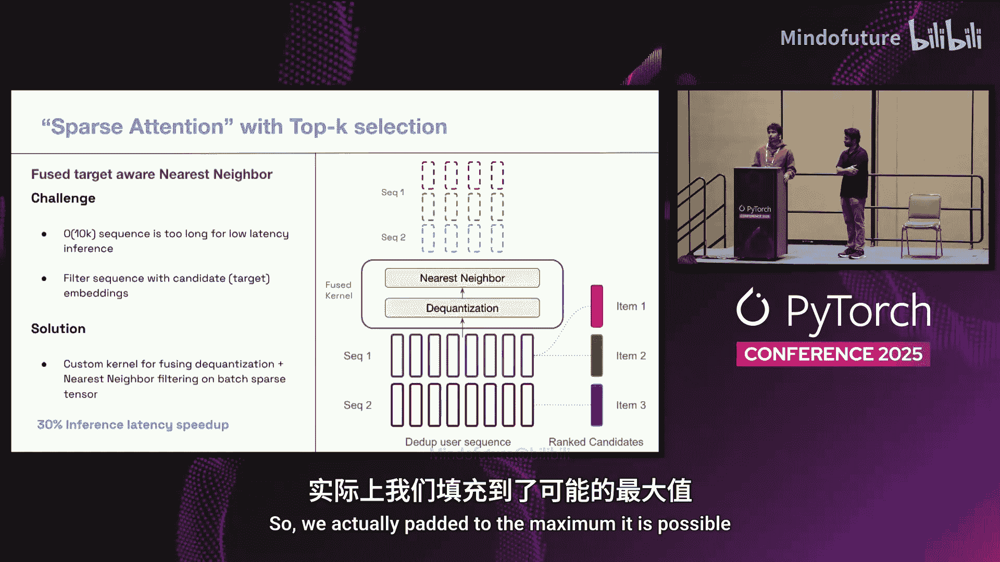
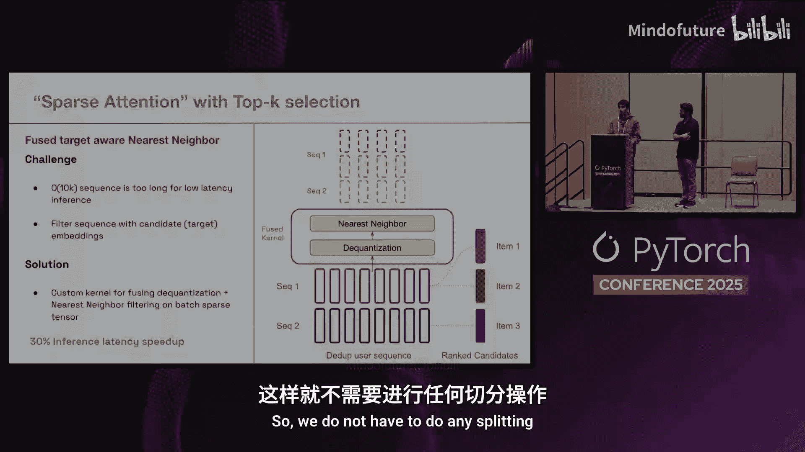

# 2025 Pytorch大会 ｜ Pytorch Conference 2025 p43 P43_使用...扩展O(万)级序列推荐模型推理-S._Joshi__K._Rajesh -BV1b8kRB6EJG_p43-

Hello everyone， thanks for coming my name is Sub and my Co speaker is Koshk was an applied scientist on avent and we are here to share a little bit about some of her recent work on scaling the inference of like order of 10。

000 lens sequence recommendation models using autograph and Triton kernelnels。😊。

So just a quick like segue into like what we are going to talk about this is the model that we actually shipped on home feed so what is that like homefe is actually our primary product surface it's the first page that people land on it's a feed recommendation system and just to give you a sense of scale like this model is used by about like on the order of 10 million inferences of items per second for ranking and we need to do this at extremely low latencies of less than 50 milliseconds P90 latency。

The problem formulation looks something like this， you are trying to predict the probability of some kind of action like maybe a click。

 given the features of a pin， some context about why you are trying to rank this item and the activity of the user's history of what the sequence of activity look like。

And the key challenge that we are trying to solve as a part of this problem is how do we do a low latent serial time GP inference of this system and particularly we want to focus on the user activity sequence and in this specific model we were trying to scale the user activity sequence by almost a magnitude of 20 x compared to what we had before and so now we leverage activity sequences of length 10。

000 for our recommend models。Just a quick segue into the history of how this model evolved the graph that you see here like every column represents the engagement volume increases and is as you can see like we started very early on in 2016 with like three-based models and so on and then roughly around the middle which is like 2019。

 2020 is when we move to Pytch and so all of the remaining compounding ones that you see from the middle are basically all coming from the Pytch ecosystem with Ka graphs and GPU based inference and so on。

嗯。And in the recent past， we have actually scaled this quite a bit like we have started leveraging transformer based models even for recommender systems。

 so we'll talk a little bit more about that in the next slides。

So what does this model actually look like right it's like a typical recommender model architecture。

😊，Just to give you a quick glimpse of the characteristics of this model。

 this model consumes about like hundreds of thousands of features。

 this model does use like very large ID embedding tables and just to give you a sense of scale。

 the model if you combine all of its parameters is nearly on the order of billions of parameters and the architecture is what you can see in the diagram。

If you look to the bottom right of it， you can see that there is a section which says sequence features and those sequence features are actually is what gets consumed by the sequence transformers that sit above it。

So these large sequence features， its not a single feature。

 there are actually a collection of different sequences and all of these are represented using the sparse sequence sensorsor formats because the user activities can be a varying lens and so the types of sequences that we actually work with are sequences of embedding sequences of different actions that the user took or the sequences of timest。

😊，And there are two different architectures for this model。

 the first one like I both the papers here， the first one is what we shipped in 2023。

 it only uses the real time activity sequence of about order of 500 events and the latest one that we shipped last year uses a batch plus real time sequence of like the order of length 10。

000。So I think the interesting part about this specific problem is what happens when you try to scale this user activity sequence by almost 20 x in size and so before that like let me just give you a quick glimpse of like what the user sequence processing in the inference server actually looks like。

😊，The inference server that I'm referring to is our own C plus plus build inference server。

 we use start script， we use Kudagraphra and the GPUs that we typically rely on are ANG or L 4TS。😊。

So these are typically the five steps that happen in every single recommendation model that uses the sequence processing paradigm。

 So the first step that you commonly see is the densification step if you look at the first diagram on the right it's as simple as basically expanding the variable length user sequences into a fixed dense shape so that you can actually pack it into a mini batch and run inference on it。

 So this is very synonymous to how you do padding in LLms you basically want all the sequences to be of the same length and then you can actually perform inference on it so that's first the first step is the densification part this second step is the broadcast part which is the second diagram below this is very peculiar to ranking systems where you typically have a user's request and you're trying to rank many items for that same user So there is this broadcast operation where the sequence or the prefix or the context is actually shared by many items that are getting ranked。

The third step is something that happens across many different kinds of models。

 which is you typically have many different individual items or things you are trying to infer on and you perform this batching operation and these batches are typically present on your pageable CPU memory and then you are trying to transfer it over into the CPU memory and into the GPU memory for inference。

The last two which is the fourth and fifth is what actually happens inside the model so once the batches are already in the GPU we do this sequence sub selectionction like as I said before。

 like we need to run these models at very low latencies so it's extremely hard to scale the transformer processing to nearly the order of 10000 length so what we end up doing is like we do this sort of a trick of doing a sequence subse where every single candidate that you are trying to rank subse very specific segments of the sequence that it can use for its own ranking。

And then the last bit is， of course， the transformer execution。

 and Kahi will dive into a lot of details about the fourth and fifth part。😊。

But before that what I wanted to highlight is this is the part where like the model infrra kind of needs to evolve together because to ship something like this you will encounter bottlenecks at nearly every single step of the way so you will see bottlenecks across all the five parts and so Ill try to just cover the first three which are more systems oriented。

So what is the key challenge that we saw right the first is when you look at the first two steps。

 which is the densification and broadcasting steps。

 the issue is like very simple like you end up having very large malllos and copies。

And the reason for that is if you look at the length that I'm describing here like 10000 length imagine you just have one sequence feature which is an embedding of size just 32 and you are trying to run a mini batch inference of size 256 if you just multiply all of those what you'll find is a single mini batch during inference and just this one sequence feature can be 80 megabytes of payload this is a very large memory allocation and copy problem and the reason why this gets even trickier is because recommendation systems are trying to do this at very low latencies and there are multiple CPU threads that are actually performing and running these things in parallel to kind of create the batches for inference。

😊，The second thing is also related to systems in the sense that when you are trying to perform inference。

 you are trying to batch multiple different items that you are trying to rank together。

And once you have this batched tensor for all the features that you need for your ranking model。

 you need to do this like multistep copy and the most expensive part here that we found for our use cases was this multistd copy from like pageable memory to pin memory and then into the GPU memory。

And the way we run our inference servers is we typically run a parallelism of8。

 So there are eight parallel kuda streams that are performing inference in parallel。

And because of that this for this specific model， what we saw is if we started using these features for online inference。

 we nearly 100% saturated the PCI bandwidth itself。

 So like no matter what kind of optimizations you try to do in the model。

 you basically just can't get the data fast enough to the GPU。

 so it nearly saturated all of the 16 gigy per second on 800 GPUus。

So what did we do so we did two kinds of optimizations here the first is request level sequence due to applicationplication like conceptually all of these sounds simple so I'll just try to quickly go over what they do so if you look to the diagram on the right this is a very typical scenario in ranking systems so you have a user request say first user request is trying to rank three items and the second user request is trying to rank four different items。

😊，What we can do is instead of actually broadcasting the sequence multiple times。

 you can just keep one copy of every unique user sequence that you see so instead of actually maintaining seven copies here we just have two copies one representing every unique request。

The benefit here this kind of looks something like prefixes in LLM where you want to minimize the preprocess of those shared prefixes over and over。

 so what we do is like we just maintain the unique copy of each。

And so the nice property here is now we can completely skip the broadcasting step。

 which is a very large malloc and copy operation。😊。

But this is not as simple as it looks and the reason for that is your model still cannot distinguish which items belong to which sequences and so what we had to do is actually rewire our entire training pipelines。

 data generation pipelines to the inference feature formats and the inference engine itself to now actually make the model accept two different inputs so it accepts every unique sequence and along with that it also accepts a broadcast offset what that broadcast offset tells the model is okay these three items belong to the first request these four items belong to the next request。

And the benefits of this property is like each sequence is now processed exactly once。

 so every unique sequence is batched exactly once and it's copied from CPU to GP also exactly once so this substantially reduces the pressure on PCI bandwidth and it reduces the minimizes the amount of bytes allocated and copied and the last property that this enables us is now we can introduce custom model kernels and the reason for that is we exactly know which ranked items belong to which request so we can efficiently directly index into them without ever broadcasting the user sequences。

The second optimization that we did is that of pin memory arena。

 The idea is like very commonly used in systems where you basically pre allocate a giant chunk of contiguous block of memory。

😊，And then you just rewind and reuse it across different inference requests and the idea is simple like if your batched tensor requires batching or any other operation requires a slice of memory。

 you just advance the pointer and return back the slice and we actually allocate this arena beforehand so as the server boots up we preallocate this entire memory chunk and you automatically estimate this based on the batch size that you are trying to run and the feature shape。

And when you combine this with Kagraph， what this effectively means is throughout your entire end to end like batching GPU inference and returning back the outputs。

 you never allocate any CP GPU memory on the fly like everything is pre allocatelocated and this is a very nice property for low latency inference systems。

😊，The other thing that we did is instead of backing this memory by pageable CPU memory。

 we directly back this with the pin CPU memory so there is no pageable to pin memory copy anymore and the pin memory has a nice fast copypy path into the GPU This is the same as the torch pin memory that most people end up using。

😊，And so yeah， I think the benefits here are like we skipped the on the fly allocations and we skipped a giant copy from pageable memory to print memory。

😊，whyhy have I spent so much time talking about this it's because like usually when there is inefficiencies in the system during inference we tried to like first target the bond but here we first tried to optimize the system itself and this is the result right if you look at the two different diagrams。

😊，The x axis is the different batch sizes， which is 1282565 and2 which is typically what we used during inference and the y axis is the time or the latency and there is a lot more details in the paper but what you can see is with these two optimization stacked together the total batch preparation and the copy time reduces nearly 85%。

And the actual end to end batch P19 and latency reduces 75%。

 this is a huge drop from where we started， and this was a critical part of actually optimizing just the systems part of it。

😊，So， Ill take a pause there and I'll hand it over to Koshk who can cover the modeling level optimizations that we did next。

😊，Cool thanks sir so I'm going to dive a bit deeper into the model side optimizations and as you know we use Tritan kernels for this and we rewrote our transformers using some custom Tritan code so before I go into the details maybe Ill start by convincing you all by we need to use custom Tritan kernels here。

So the first reason is that recommended systems are very latency sensitive and any increase in latency results and measurable engagement drops。

And as we scale a sequence length from 500 to 16，000。

 we introduce several bottlenecks which blow up our latency and costs and simple compiler based fusion cannot leverage model patterns that you as a developer would know about your model。

The second reason is because of user sequences and some properties of user sequences。

 such is that they follow power laws， so a few percentage of users have much longer sequences than the median sequence length。

And so yeah， and as sort of mentioned， user sequences are shared across multiple items that you are ranking and we also store them in quant formats。

So we can actually come up with customs par sensor formats that are more efficient for storage and processing of these user sequences。

And on the model side to deal with this customs spa sensors， we have triton kernels。

 custom Triton kernels that work directly on this format without going through any densification step。

And the final reason is that Triton supports AO compilation and this is really important for us because we use C++ inference。

Ttscript and this integrates very nicely so like this is how the flow would look like the we write triton kernels in Python then we use the AOT compiler available in Triton to compile it to Cuban and this is then linked as a custom operation in Tot script。

This is then used in our inference server directly packaged into the model。Cool。

 now that we have covered the reasons， maybe we can go into de transforms。

So I'll walk you through like a case study of two kinds of transformers we use in the home feed model and how we leverage different particular optimizations for these problems to build kernels so the first transformer is what I'll call a lean transformer because its it uses a much longer sequence and it captures longer term history but uses much smaller embedding dimensions like 32。

And these embeddings are usually content or engaged in based pre trained embeddings。

And the second transformer is going to be a white transformer also referred to as a TcaAT。

 this has a much higher bigger embedding dimension and captures short term interest of the users。

And this one uses N to end learned I embeddings and we store both of these embeddings in quantized formats either N8 or N4。

So starting with the lean transformer I'm going to draw a parallel to how flash attention works and compare like what particular advantages this has so as I mentioned the embedding dimension for this transformer is very low so what that allows us to do is leverage the GP Ram much more effectively。

So if you look at flash attention， the key advantage is of tiling and you tie your QKV sequence tensors and you load each tile into your GP RA and compute your output block on the fly and this allows you to not materialize the whole QK transpo tensor。

For our case for SkuUT， since our weight matrices are really small。

 they can all fit directly into SRM， so we have the five weight matrices。

 QKV weight projections and the two weight matrices from the feet forward of the transformer and we can load all of these directly onto SM and instead of using three sequence tensors。

 we directly load the X input tensor compute the projections on the fly and then compute the output block directly。

So this basically makes everything in place and instead of loading these three large sequence sensors you only have to load at once and this resulted in significant latency improvements for us around 6。

66 improvement compared to flash attention to。But of course。

 this is targeted at very small embedding dimensions of 32。So yeah。

 the second step is even though we have this sufficient transformer implementation。

 we really can't use the whole context length of 16。

000 for real time inference just because it's too long for a low latency inference。

So we have some kind of sparse attention implementation that uses a top case selection。

 so this is pretty similar to how deep Seq implements the sparse attention。

 but instead of it being learned this uses precomped embeddings to do top case selection。

So as So mentioned we have these user sequences and we have the candidates that link to particular sequences and we have a fused kernel that directly goes from a quantized format for these sequences to deco quantantized FV16。

 then computes the nearest neighbor with respect to the target or the candidate here。

And doesnt implicit broadcast inside the kernel， and youve materialized these three nearest neighbor like or sequences。

So implementing a custom kernel for fus all these operations together allowed us to improve our inference latency by around 30%。

And without， we didn't have to materialize or densify our already spae tensor formats in this。

So now moving on to the second type of transformer， which is the wide one also called dec。So。

 this leverages our de duplicateuplicated user sequences that we do on the server side。

 so traditionally in recommended systems the candidate embedding is usually fused with the user sequence either by concatenation or adding directly to the embeddings。

But the problem with this approach is that each sequence in your batch is now going to be different and this does not allow us to leverage a key optimization here。

 which is we can break our transformer into two steps， self attention and across attention。

So this is kind of inspired by KV caching and I'll go into more details on how this works now。

 so if you take your user sequences which is much less than the number of candidates you're ranking you can compute the self attention on them and get the KV cache from it。

This KV cache can then be broadcasted across your entire candidate set and since we know which candidate belongs to which sequence we have the information necessary to do this broadcasting in a kernel。

And once we have this broadcasted user sequence， we can compute the cross attention with respect to the candidate embeddings and get the final ranking results。

And this we do this both in training and serving， and this allowed us to significantly improve our overall throughput of the system。

So summarizing all the improvements we covered so far。

 we started off with this very unoptimized long context model that was blowing up our latency。

 we reduced it by 75% using memory arena and request e doping。

 then we added stacked our custom triton kernels which reduced it by 30% and then 30% further with our SkuUT implementation。

So overall， this resulted in around 250x P99 N to end inference latency reduction and significant intra cost reduction for us。

So what are the takeaways from this the first is that model server co optimization is crucial。

 our optimizations targeted both of them and this was really helpful for stacking all these gains together。

And second is like in terms of finding these bottlenecks。

 we use a Pytoch profiler to iterate delivery profile and find these bottlenecks in the model。

And then third is that there are you can leverage optimization specific to your problem。

 the implementations out there like attention is targeted at a wide range of models。

 but your specific problem could have key key observations that you could leverage for particular optimizations。

And lastly， Pytch is really nice and that it can be easily extended with your custom implementations or custom kernels。

And Trirightton is really definitely， we massively reduced our development time when going from Kuda to Triton and this is also easily easily integrates with our inference server and has AOT compilation support for that。

That I think is the end of our presentation， these are the two papers that we cover the material from and yeah we can maybe take questions now or do it offline。

Oh， I have a quick question， so yesterday the torch team mentioned that。

Torge script is moving to deprecated status， how do you see the future of export？

Yeah so I think sorry of can take that Yeah I think we also saw it during the presentation still thinking about how to approach it。

 I think what we saw if I'm not wrong yesterday is like I think the NviD GPU support is still work in progress it's not G yet so I think we'll probably work closely with the Pytor team to figure out the next steps I believe like in the presentation they mentioned that they will potentially deprecate it in Pytor 2。

14 you're currently on PyT 2。6 so we have some run way we probably need to figure out the next steps here。

Does it help。Yeah。How do like。ニスに不さ。Just。没事来。The entire sequence is going to be the input input single criminal。

这个专家里要。家里。And feels online everything。费用后期。Yeah， so this is done on the fly on the GPU we don't use any distributed computer here。

 so we load the whole sequence on a single instance and then the fuse kernel without broadcasting the whole sequence does the nearest neighbor search on the fly。

Yeah， good question， so for training， we log the nearest neighbors only。H， no question。

 like what are the hands of PCIA bottlenecks。Sorry how did you know that you are bottleneed by the PCIe。

HowMem transfer like cost device transfers。 Oh， how did we know we are boly the hands of it also Sure。

 So I think the way we figured out is。We use DCGM metrics I think which automatically exports the PCI bandwidth usage we monitor this for both training and serving and we started seeing this effect where like the inference latencies were relatively low when we were trying to scale up but like something between the like we also have timers for like the CPU to GPU copies and those started like elevating that's when we figured out like the PCI bandwidth was getting saturated if it helps like one interesting part that we found out of this is like。

Given the PCI configurations for these devices like we expect about 32 gigtes per second of throughput。

 but it actually saturates at 16 Gb based on the cloud that you use。

I had a question about the densifications piece， so usually like the sequences are fairly variable length。

 so like how did you use curgraphs for like variable length sequences and like？😊。

RightYeah good question so yeah so we cap our sequence length at 16。

000 and for some of us past tensor formats we store them with some padding so based on some p99 metrics we estimate the maximum sequence total sequence length that can exist in the batch and we pad it of that length。

本議から。Yeah， so we actually pad it to the maximum it's possible。 So we don't have to do any splitting。

