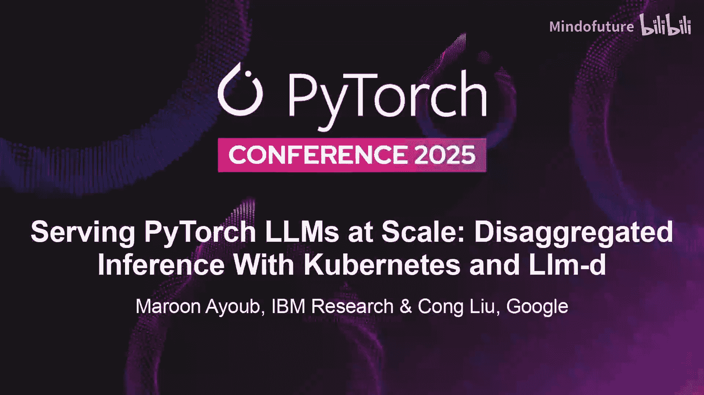
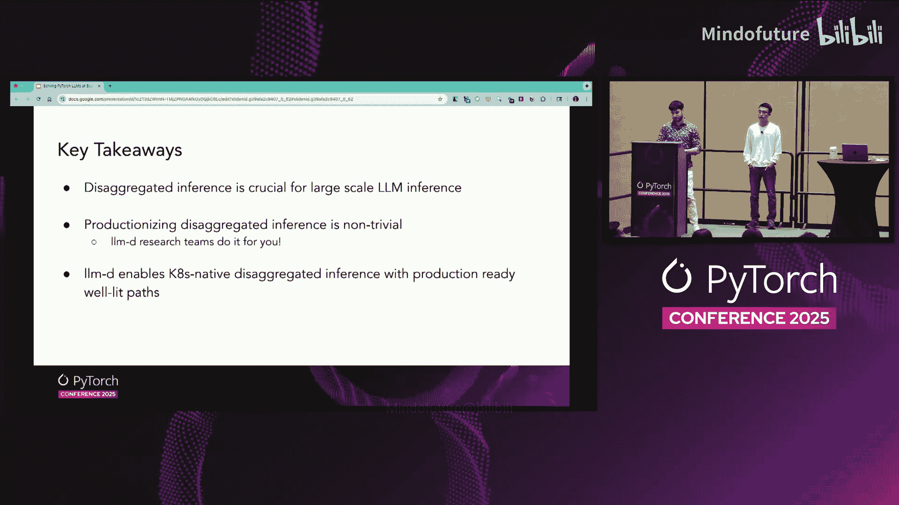
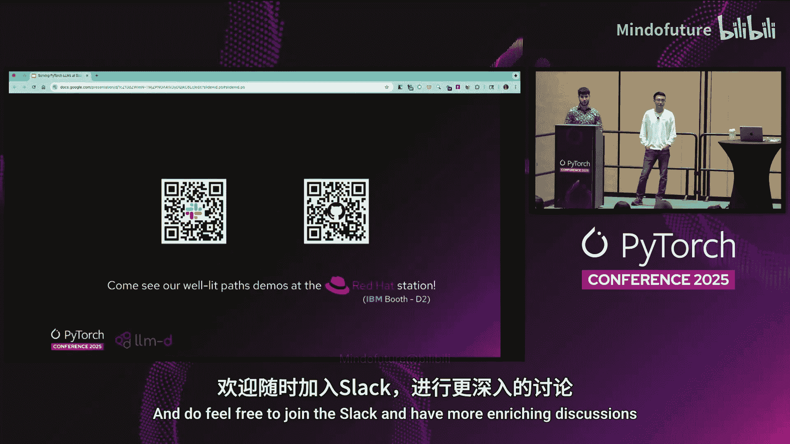
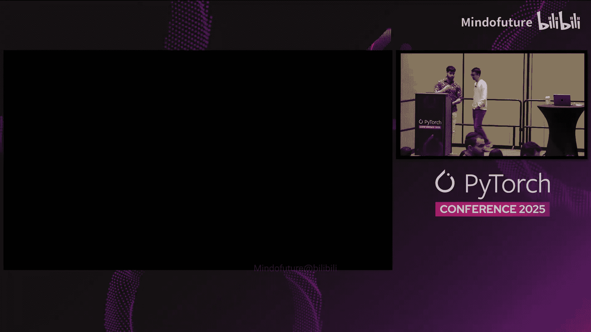

# 2025 Pytorch大会 ｜ Pytorch Conference 2025 p44 P44_大规模服务PyTorch_LLM——基于Kubernetes与Llm-d的解耦推理-M._Ayoub__C._Liu -BV1b8kRB6EJG_p44-

Hi everyone。 my name is Song。 I'm a software engineer at Google。

 I work on Kubernetes and inference and work very actively in the LMD community。 I'm D Mar。

 I work in IBM research。 I'm leading the KB disaggregation work stream in LMD。

 and I contribute to the overall project。😊，And today here。

 we are excited to show some of the awesome work the LMD and teams have have done on the PDD disaggregation。

😊，And here's a brief outline of today's talk， we're going to cover some background on the LMD project and P disaggregation。

We're going to dive deeper into the implementation in LMD and follow that with benchmark results。

 and we're going to wrap up with some key takeaways。

So what is LMD so Simon covered L&B a little bit in yesterday's talk。

 so L&B is an open source K native accelerator Ggnostic inference stack。

 It offers you with streamlined well past user guides to get it started with reproducible benchmark results。

So on the right side is a high level diagram of the L And D architecture。 On the top。

 we have an infant gateway that is capable of doing intelligent infant scheduling。

 such as load aware scheduling and prefix cash away scheduling。On the bottom left。

 we have the inference pool， which represents a pool of computer resources to serve your your models。

 And this is backed by popular inference engines such as Vm。And on the bottom right。

 we introduce a new what we call wearing autoskiar。

 which works seamlessly with the inference scheduler and the inference pool and takes into signals from those components and worked with seamlessly with the Kubernetes about horizontal power autor to scale your inference pool。

So why LM D， So LMD is not yet another， just yet another inference stack。

 We truly believe LM D is the most open and brings the most stand standardization in the ecosystem。

 So， for example， we try to reuse as much as possible。

 The existing mature components in the Kubernetes ecosystem as much as possible。 For example。

 the Kubernetes gateway API and those API gateway API providers。

And for the new components that we have to build， we truly advocate for open protocol and open APIs。

 For example， So we proposed this endpoint picker particle in order to implement the intelligent request scheduling in the inference scheduler。

 and we work directly with the Kubernetes gateway API community to have this native support。

 So youre not replacing your inference gateway， your traditional Kubernetes gateway with a new gateway or low balancer。

 You extend your existing gateway to have the inference scheduling capabilities。And we proposed the。

Inference pool protocol with。Cilities like loadware scheduling and PDDD S aggregation。

 And we work and contribute to the V M community directly to enable this support。And with all that。

 this means you will get the the latest and the greatest features of all these open components in the throughout the stack without being locked to a specific version of a specific implementation or a vendor。

 and this also means that， you know， the entire stack is highly customizable and composable with your existing infrastructure。

😊，So with L D， we truly believe that you not only get the。You know。

 streamlined deployment in day one。 but you'll continue to be able to evolve to customize and to operate effortlessly from day to and beyond。

Okay。对。So some of you probably know that。Running a production ready inference stack is not that easy。

 And that's where， you know， LMD well passes come to help。

 So the well passes are streamlined user guides that and， and。

 and recipes with all the best practices built in。 and we regularly test validated these well passes with C ICD and benchmarks。

😊，So in each of the wallet past guys， we will。Document in detail of the preres of the infrastructure。

 for example， what， what are the， you know， accelerators。

 what are the network requirements in order to get the best performance out of this。And we offer。

 you know， general high level tuning guidance on some of the key parameters you can tune to get the optimal results。

 And last but not least， we offer the recipes such as hammerchar。 and you know。

 we are Kubernetes native。 So we love Yamos。 those， those Yamo recipes。

 You can get streamline deployment in like minutes。

So here I will walk you through some of the wallet passes we have today and。You know。

 feel free to check out LMD dot AI and you will see these guys in this website。

 So the first while let pass， we call it intelligent infant scheduling。

 and this will get you the intelligent scheduling capabilities such as load aware Kiv cache awareware scheduling and prefix cache aware scheduling with little to no tuning。

 So I highly recommend you try this out。 like you will get the performance boost like adult box。

 And under this intelligent infant scheduling while it pass。😊。

We have a more advanced feature that is the precise prefix cache aware scheduling where the infant scheduler will talk to the Vm or you know。

 any models you know model servers that emits the QV cache events and builds a precise index of the caches and raw requests to the pod that has the highest highest cache hit rate。

And another valid pass， which Maroon will adapt deeper into is the PDD disaggregation in this wallet pass。

 we present with the Lama 70 B model and running on H 200 GP Ps。 we actually demonstrate that。

In this valley parts， we have different paralleluralism configurations for the prefi and deco workers。

 This is one of the benefit you can get from this aggregation。And our latest Valpa。

 this is the white expert parallel or Y E P deployment with the deepse R Y model where you can get a multi host inference with leader work set。

😊，And yeah， shall we start talking about PDD disaggregation。 So in La inference。

 there are generally two phases。 And the first phase is called prefi and followed by decocode。

 Prefi is the process that the inference engine takes in the prompt and generates the first token and and also generates the so called TVV caches for each of these tokens。

😊，And this phase directly impacts a。Important metric called time to first token O T T F T。

 So this is a time that you watch the screening wheel of， you know。

 Chad GBT or Gemini and get the the the first word output。嗯。And in the decocode phase。

 the inference engine will generate the output token one by one by taking into consideration of all the KV caches of the previous tokens。

And， and this directly impacts another metric called time per output token or or Tpot。

 These two phase have very distinct characteristics。 The pre phase is generally compute bond。

 and the liquid phase is generally memory bandwidth bond。可以了。

And disaggregification is the idea that you can run prefi and decode in。Different instances。

 And why would you like to do that， you know， given the different characteristics with PDDDaggregation。

 you can tune and optimize and configure the peripheralfi and decocode independently。 For example。

 PD DD segregation allows you to run different accelerator。

 heterogeneous accelerators on the P And D and D workers。

 It also allows you with different parallelism configurations。

 which we actually demonstrate in the LMD PDDDaggregation while pass。 Now。

 I'll hand it over to Maron to diveve deeper into the some of the aspects of the implementation。Yeah。

 so this part will be slightly more technical。 Everything I'm about to show is well documented in the LMD dot AI website and Githubs。

 so feel free to check it out there。 We' go over LMD's implementation of theaggregated inference So LMD provides a unable PDD aware inference scheduler。

What that means is the scheduler is aware of the disaggregation。

 It plans the orchestration accordingly， and。Hs the execution。

 The execution is is done by a routing sidecar proxy that is deployed alongside every decode instance。

And internally， the communication or the transport of the KVs is done by utilizing the VLM Nixel connector。

 which I'll slightly get into in the following slide。

 but I think if you stay here for the next session you'll get much a better deep dive on Nixel。

So how does the inference scheduler work or the PDFware inference scheduler work？

We have a concept of scheduling profiles that in which you can configure the scheduler to how to make it select and rate the available pods。

In this scheduling configuration we have three profiles。

 one being the PD scheduling orchestration profile which orchestrates the other two and the other two being the prefi profile and the decode profile so the orchestrator begins with by well it orchestrates the two and the decocode profile makes a prefix cacheware selection of a decode pod so the pod it selects it selects it both on load metrics and prefix cacheware metrics。

 but that means it knows how much how many new tokens it will have to prefill and if the number of the new tokens is bigger than a configurable threshold then it activates remote prefiling。

By activating the second profile， which is the prefield profile and selecting a pod。

A pre po based on load characteristics。The execution of this orchestration is done by the decocode sidecar and it sends I get into that in our coming slide。

 so the scheduler orchestrates the selective PD disaggregation。And the sidecar executes it。

So we have an example of one flow here， so if the number of tokens to prefill is bigger than the threshold。

 we make this selection， we send it to the sidecar with a few headers are'll get to the prefi worker makes the prefiling the returns the request and the decode continues。

We see that in this diagram where you see the request coming to the sidecar。

 it sends the request to the pre field worker or the VM worker。

Responsible for pre fillinging with a special hither， which is Du or decocode， Max tokens set to one。

Once the prefer is done working， it returns the response to the sidecar at that point the sidecar continues to the VLMD code worker。

Also with special headers being do remote prefi the remote block IDs。

Of the KV blocks that it needs to fetch。And the engine to the engine I to identify the pre field worker once the de worker begins execution。

 it doesn't block while getting the KVs。It continues serving other requests while fetching the KVs in through an Excel connector in a GPU direct manner。

 so GPU to GPU， once the KVs are fetched， it serves a request and starts streaming the response back to the scheduler。

A bit about the routing sidecar， so it's a proxy we maintain in LMD。

 it's deployed with every decode pod， not with the peripheralfi pods。

If you're not using PD disaggregation， it will do nothing。

 it's just a proxy that that request will go through in disaggregation mode does what I just described。

Also a bit on the KV transfer process， so the Nixel connector is an implementation of the V KV connector interface that Simon mentioned yesterday。

 if you were in his talk， and the Nixel connector is anviDdia Dynamo contribution。

 it stands for NVDdia inference X library， which is a library for accelerated peerto peer communication in an inference stats or frameworkras。

Today it's used for PD transfer。But we're working on evolving it to a general peer to peer transport for peer to peer ca cash sharing。

 which is a feature I think we'll have LD in the coming months。

I'll go through some benchmarking data， but the overall consensus is。

It's tough to tune and it's not something you'll use for all your workloads so what we see here is benchmarking data we put out in the 0。

2 release， you can find it to depth on the L&D website on the blogs。

 so this is a standard Peretto curve on Alma4 Sc deployment。

It's deployed on two H200 nodes with infiniban RDMA enabled。

 it compares a standard deployment to poology of four pos of TP4 tensor parallelism set to four and a disaggregated deployment of four prefi instances with TP2。

And2 d instances with Tp4， the scenario covers representative workloads。

With input to output ratios of 10 to  one and 100 to one。The X axis measures the per user throughput。

 the Y axis is the per GPU throughput。 We can see that at both ends。

 both deployments perform similarly。But in the middle there's a clear and significant advantage to the PD deployment because at these concurency configurations。

 so the points are concurrency， I didn't mention that。

In the middle we see the scenarios where the contention between peripheral and decocode stages makes a significant difference。

 so PD exposes these saturation points and unlocks headroom for better performance。These。

 these insights are very critical too。Future work for better auto scaling for workload aware。

Roole assignment so you can auto scale your pre field workers or increase their numbers if you identify that your workload is prefi heavy and vice versa。

So are these benchmarks and these insights are essential for unlocking better performance in inference in the future。

This is a second set of benchmarking data on inferior or more inferior hardware and here we don't see a significant advantage to PDD。

 we do see that it performs overall better and especially at local currency points。

 if you look at the bottom right corner。But the point here is that getting value is not so simple that it's not easy to tune or easy to figure out how to get value out of these deployments and that's exactly what we do at LMD。

 we have these well lit paths， we have the PD well paths that look into these deployments。

 we research these configurations and provide both data deployments and insights。

That you can use in your production environments。So these with two PDD paths we have are the PDD standard path that I just described。

 There is the more advanced YDP well path that covers。Se， large ME architectures。

We do have good data there as well， and we'll be having more in the coming months。

So I'll go over the distillation of our PD work， best practices we gather over the past few months。

So PDD disaggregation is really not a target for all workloads。

 you generally should use it for large models， 70b plus and not like 8b or 1b。

Long input sequences on long。Both input and the output sequences， so think 100 and not hundreds。

And sparse ME architectures。Where it gets a bit more complicated。

 Susng talked about specializing P&D workers。For compute bound against memory bound workloads or hardware。

 but in wide AP it gets a bit more complicated because you'll have to efficiently load balance your workloads across your data parallel or expert parallel ranks。

 so you wouldn't want some of your ranks doing decode and one doing huge prefilent locking all the rest。

And there are also implementation details where you have specialized and optimized kernels for each stage。

 for example， in VLM， there's a memory footprint versus ka graph usability tradeoff where you can have either a smaller memory footprint and no ka graphs or high memory footprint and ka graph support and naturally these fit like one fits for prefi one fits for thecode so you have to disaggregate the two in these deployments so that they don't content and you'd have the specialization per year。

So key takeaway， dis aggregategregd inference is crucial for large scale inference。

Getting it to product or to your production environments is not trivial。

 but that's exactly what we do at LMD， our research teams do it for you and provide the data continuously。

And LMD enables Kubernetes native disagreeag inference with production really well path。

Thank you for listening we have if you scan these QR codes， you'll get to our Slack and our GitHub。

 LMD thrives on community contribution， we invite you to look into our GiHub。

 pick any good first issue and join the discussions。

We'll also be running some demos of our wallet pads and the red hug booth。At about one today。不这。

Questions。Okay。Hello thank you very much for the talk that's great so I have two questions which are essentially related The first one is that what is the motivation behind going Kubernetes native and the second one is about how do you compare LLMD to the alternatives such as SG link which also has PD desegregation KV cash and traffic survey routing Thank you。

Yeah so okay， I'll take this one。A lot of users already have their inference or their production environments on Kubernetes and Kubernetes really excels at providing these capabilities。

 So LMD being Kubernetes native makes the switch seamless and easy so you can scale up or get a better deployment with LMD simply by deploying with your Kubernetes cluster。

 maybe as some input here being from Google。 Yeah I also also want to highlight that some the components。

 they are built with Kubernetes native in mind， but a lot of these components like the inference scheding where you can actually deploy that as stand sameone components and getting kind of inference inference intelligent inference scheduling capabilities out there。

 So I think in a way， it's not like locked with Kubernetes。

 but we definitely want to make Kubernetes are first classes in this ecosystem。

Your second question about Ashland。So。We。So we have this sort of like inference pool kind of protocol that as long as the inference engine speaks this language and emits certain metrics about your load doing PDDG segregation and then understand those you know headers that you know。

 Morron talks about。L NV works with the inference engine。 Even it's your custom inference engine。

 We currently are well passes。 We have Will La tested and verified。 We actually， for example。

 have verify the inference scheduling with S。 it works really well。 So so we work with you know。

 we actually work with the in tried to you know， inference engine。

 So as long as they speak this protocol and they they， they work seamlessly。A question。

 I was just wondering when you think about Kubernetes， it's a container。

 So I was wondering in each Kubernetes， what is all included in that container And all。

 all Kubernetes having the same content or they are different。 Second question is。

 you talked about prefi and Ecode， And you said this plate enables accelerators to play。

 Can you give an example of what kind of accelerators to play in prefi and what kind of accelerators to play in E talk。

但是。Yeah， so I'll start with the second question， maybe you can take the first one。So。

We have more data in in our documentation on the Well path， but it's， I think it's more about。

Optimizing the deployments。 So Decode being memory bound。 youd， you'd want higher TP。

 So you'd have more available KV cash to or memory to pull into to pull your KV caches into。

While prefi you'd want。More replicas lower TP so it's。There are all。

 I think we also have data on specific。Hardware recommendations。

 but for that you'd have to check the website。w get the first one。 Yeah， also on the second one。

 I think one of the interesting data point。 we don't have it today。 but at Google， we try to do。

 know， we have TU at Google and we try to kind of mix them as Ts and GPUs and get some results from P the well allows us to do that on the first one one of the principles we have designing such large scale systems to have modules and components and with well definedresponsibilities。

 And look at LMD is not like a mono container or or chart that deploy it composes of multiple components。

 So concretely this means for example， the inference schedule it is a we that test that and can deploy and container and you can deploy standard Kubernetes deployment or multihost scenario use leaderwork。

Which is also a Kubernetes native primitive we can use for multi host deployments。

 It's not just works for inference。 It worked for any kind of multi host。Deployment style。

 So in general， it's， you know， multiple components they compose together。

 And we offer you with the recipes with Yamos with how much chart you can deploy。

 deploy them together。 And you， you can switch in and out， for example。

 if you want to use an land no La。 and you can use that。 You can do that， too。We're out of time。

 we can take questions on the side and do feel free to join us slack and have more enriching discussions。

Thank you。 Thank you。

