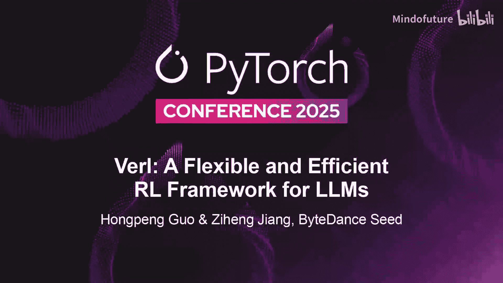
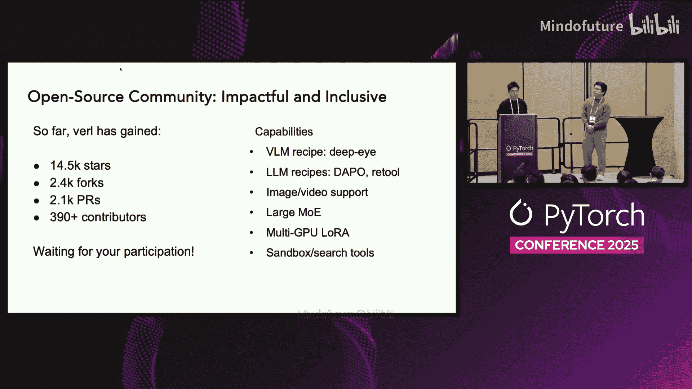
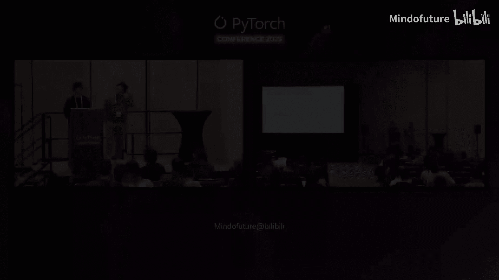

# 2025 Pytorch大会 ｜ Pytorch Conference 2025 p45 P45_Verl——面向LLM的灵活高效强化学习框架-Hongpeng_Guo__Ziheng_Jiang__字节跳动Seed团队 -BV1b8kRB6EJG_p45-

Hello， everyone。 I'm Zhenng Z Jia and currently a research scientist at Bad seed working on the L M systems today。

 Hongg and me are going to present our reinforcement learning framework。

 including its key technical features and recent updates。 So in this talk。

 we will work over the following four parts。😊，Firstth is why large scale reinforcement learning is important。

 and what are the system challenges towards large scale reinforcement learning。

 And then we will show the key technical design over to show our ways of handling large scale reinforcement learning and finally some of our recent updates and road maps。

So here comes the first question。 Why is life scale learning important。

So large scale reinforcement learning really shines because it pushes the models to reason much better。

 For example， without reinforcement learning models like G 40 hiter selling on the mass and logic tasks。

 but with large scale reinforcement learning， like in open eyes O1。

 the performance jumps dramatically almost double the AME and close to 95% on the mass data said。

 So the takeaways is simple reinforcement learning at scale is a key ingredient that unlock strong reasoning。

 and it is becoming more and more important in the time in the time of test time computing and tasks。

😊，Now that we know why large scale reinforce reinforcement learning is important。

 The next question is， why is building a system for it so challenging。

The main reason is that reinforce reinforce learning isn't just one model training loop is a complex data flow that connects multiple models。

 The policy model we are training the reward model that gives feedback and the reference model that prevents the policy from drafting too far and the critic that estimate long term value on top on top of that。

 we have multiple workloads happening at once。Like generation influence。

 training and synchronization or tightly coupled。And when we scale this up to large language model。

 each of those steps， like actor generation or reward model inference。

Becomes a huge distributed job on its own。 So instead of a simple training loop。

 we are really orchestrating a set of life scale distributed workload that all need to run smoothly together。

So now the question is is， why do we need war for reinforcement learning for with large language models。

 The short answer is because it' is both flexible and efficient。

Before we dive into world system design， let's revisit some of the classic design choice。😊。

In a single controller system， which follows the MPMD model。

 one centralized con controller manages all the workers running different programs。 This。

 this approach is very simple。 example includes like Ten flow1 and Ray Ray I live， On the other hand。

 in a multi controller system， which follows the S PMMD model。

 Each worker has its own controller and runs the same program on different data。

This is much more efficient。 And you can see the design in frameworks like Py and Jx。 However。

 this programming models makes it very difficult to support complex and data flows involving many models。

In， we propose a new paradigm called the hybrid controller。 The idea is simple。

 Com the best of the world。 A central controller manage the algorithm logic。

 while multi multiple controllers handle a large scale para ex execution。 This way， we。

 we get both efficiency and flexible flexibility at the same time。😊，From a developer perspective。

 we keep the interface simple。It still looks like a single controller。 You can write the。

Entail reinforcement learning loop in just a few line of code。

 While take care of the heavy lifting underneath。 as shown in the code example。

 a developer can simply write the code algorithm logic in a simple。In a simple process。

The complicated distributed training is abstractly away。 On top of that。

 is support a wide range of algorithms from P， PO and GPO to neural method like primem and D APO。

And for efficiency， we fully leverage the multi controllertroll paradigm under the hook。

 This means support for advanced training back and like FSDP， Macron and cutting edge。

And cutting edge generation backend like V M and G land。

 it also integrate with modern parallel strategies like tensor parallel。

 parallel sequence and even expert parallel。 as well as optimize kernels like flash attention and touch compare。

 This makes ver both scalable and future proof。😊，And next。

 Hong Peng will take over and walk you through like our recent updates and what's going on on the roadmap。

Hello， everyone。 thanks to Hongng for introducing the fundamentals of world。 And I'm Hong Peng。

 I'm also a research scientist at Bidenance。 And also。

 I work on world following I will basically present recent updates and show you what are on our road maps recently for world project。

So the first update that I I want to share with with you is about the A RO training。

 So basically recently， you can see that there is a growing and growing interest from the crowd that using RL to train all Ms to have the a tool using capabilities。

 So what's the difficulties of training such a tool using agents。

So let's compare the two differences between a traditional， let's say。

 R H chef style reinforcement learning， comparing with the agent tool of using training。

So in the traditional RHF style R L， basically the policysy model。

 it will just generate tokens and mostly just text tokens。After it generates text tokens。

 all these responses will be forwarded to a reward model。

 and this reward model will give you scores with the scores。

 you can pass all these information to the trainer and the trainer will train the model。

 update the bases。 And finally， you will have a better one。😊，However， in the era of a RO U thing。

 the host story is a little bit different。So the policy L O M， it will not only generate tax tokens。

It can also generate some more informations。 For example， it can generate some contexts。

 some special tokens。 It can sometimes also generate some tool using syntax like it can generate codes。

 So for such scenarios， after the code is generated， let's say you are training a coding agent。

So all these informations will be forwarded to a evaluation environment。

 So it could be a coding sandbox where theres a compiler and unit test in there。

 And this environment will give you feedbacks。 whether your code is correct or not。

 although your compilation is successful or not。 And with such kind of feedback signals。

 when the L O Ms getting such kind of information， it can decide whether I want to generate another run and another run more。

 only after a few such kind of runs， the final trajectory can be confirmed。

 and then all these information will be forwarded to the reward model and then for training。

So as you see from this figure， you can， you can definitely understand that。 While。

 the agentantticarrow training is pretty complicated， especially comparing to the traditional R。

 RHF style。It makes L O Ms really powerful and useful。 However。

 it also generates new challenges for us for the world framework。

 So how can we handle this problem and train real tool using agents from from the ground up。

So I want to share some of the basic differences when you are put all these information into the training frameworks。

From the previous description， we can understand that the biggest differences actually lies on the road parts。

 So for the traditional R generation， the ro actually takes a batch of prompts and you put a batch of prompts into the L O M。

 It will give give you a batch of responses。 And you're just working on the batch of responses。

 and you can wait for the latest one of the batch and you get a batch of results。

 and then you do the rewarding and training。However。

 the real differences between agent and a batch version is。In the a scenarios。

 if you still put a batch of prompts into the LO M and waiting for a batch of results。

 it will take you too much time because every single sample。

 it may have really different like timeline mechanics。 For example， one sample。

 it can only interact with the environment for one run and it got a pretty working code。

 However another sample， it may interacted with。A lot of more wrongs。

And if you are still in handling the alarm generation in a batch manner。

 it will generate a lot of bubbles， just like the top figure shows。

 Like if you're always waiting for the slowest one， then naturally。

 you can see a lot of bubbles that you' are wasting your GPU and you' are also wasting your CPUU that is supporting the sand boxes。

So to handle this problem in war， later， we introduced the async server mode of generation。

 where in this mode， we can handle the prompts in a sample by sample manner so that each single sample can has its own timeline。

So it's just as shown in the second half is of this picture。 you can see comparing to the above。

 a lot of the bubbles are disappeared。 That means we have with this programming model， actually。

 we can reduce a lot of the bubbles and we have much higher hardware utilizationilization for both GPU and also CPU that supports the sandboxes。

And wrapping all these together， actually， we wrote we presented a programming framework that is talkingken in talkingken out agent and loop interfaces。

 So basically， it is a programming model that is ripping what we just presented。

So in this agent loop， world will handle it is basically creating a interfaces that is acting just like a bridge between the LOM and the environments。

 And world is still handling all the logics。 but it also utilizes the inference engines， for example。

 the VL M and S G La。 you can still using their server mode。

 like the generate API to generate responses for any single prompt you get。

And also in this Gente loop interface， you can also specify whatever customized agent tool calling logics。

 For example， you can define which hardware sendbox I wan to use。

 how many number of turns I wna set as a max。And eventually。

 you can using this interface to have a very smooth bridge between the LO M and also the environments and boxes。

And one more thing is that in this programming inter programming interface， actually。

 we are using the Asynnc API to define a lot of the functions。 And the good point is。

 with this kind of functionality， we can support high concurrerencies so that that will help us having a even better hardware visualizations for both GPU and CPUs。

😊，Well， this is the first recent of this。 and the second is the second efforts that we are currently also doing is trying to push the world to support training of large models or even huge models。

 for example， the deeps V3 model that has three 671 billion parameters。 this is a huge M E models。

 And currently in our ripple， we actually already have a working recipe to train this huge M O E models。

 and one of the example can run it just using like at least 96 H100 GPus。

And we are training it using microtro training back in and using inference with cross node tensorpoli strategies。

And we also having some verification results that show the loss curve is pretty good。

 The performance is really decent。 and we also having some ongoing infrastructure performance optimization。

 For example， the lower bit transition draw to even improve the performance of its whole training process。

😊，So given this recipe， we can say that this world。

 you can train something like deeppsyick V3 into some more interesting reason model like deepyick R 1。

😊，And if you are interested about these efforts， feel free to check our Github issue。

 There are much more details there。Except the first two efforts that I mentioned。

 which is agent tool using capabilities as well as a large， huge model supports。 actually。

 I wna mention one more thing that in my mind， it is even more important than the previous two features that is we are currently doing a thorough reuring of the world library。

 So the overall ultimate goal of this reuring is to transform world from a framework into a more and more usable standard standardized reinforcement learning library。

 So basically， we try to split world into a few very modules that each of them will have really clear and well definedfin APIs。

 So that as a user， you can import each of them and customize them to build whatever reinforcement learning framework and workflow as you want。

 So this is our ultimate goal to making world much easier to。Use by all the developers。

 So to be more specific about this， you can look into this figure that we trying to gr factor world into the following 5 key components。

The first is a route engine， which is handling the trajectory entries generation。

 And also second part is a model engine， which handles how do we define and how do we load and save the model and also very important。

 how do we train the model as well。 And the third component is something lying in the middle of this two。

 that is way transfer engine that is doing a very efficient which which think from trainer to general from time to time in every step。

Besides these three， another two components is the agent loop that we just mentioned in the previous updates that is a bridge between rott engine and the evaluation environments。

 And finally， it is a data transfer system that can handle and manages the RL data flow。

 which is much more will will be much more efficient than what we are having right now。

And I think there are a few time。 And I， let me show a few more details about the detail design details of the five components that I just described。

So definitely ultimately， we want to make world a compatible and customized library for standardized reinforcement learning。

And for the first part， the ro engine， we will fully embrace the the native server mode generation。

 The native server mode generation is just something like we have showed in the a tool using scenario where it can take each single sample and general results。

 There is no components of them。 And another very good point of using the native server mode generation is it will provide a much clear separation between ro parts and modeling training parts。

😊，This clear separation gave us a better capability。

 if we let's say if the advanced inference engine community， say VM and and S G long。

 they have any new features with the server interface will it will be really easy for us to adapt all their new features without too much modification。

 I think that's a really key points to improve world in a long run。 and the second part。

 I want to mention is a model engine。 for the model engine we wanna provide a set of really clean and really well definedfined interfaces eventually we wna making the model engine can run as a service。

 So a few of the example API that we are providing for the model engine training。

 including like model for backward steps optimizer steps learning scheduler steps。

 So if you ever had a chance to see a blog post from the sync machine apps that。

That is their first product tinker。 It has really similar API as what we are define here。

 So basically， ultimately， you can we can imagine that eventually。

 you wantna make world also having such kind of really well define API。 And as a user。

 you can define your like training O P in our functions。

 And eventually you can launch world and run it as RL service。

So except from the route engine and model engine， there are also three components。

 which is the weight transfer engine agent loop that we just mentioned and also the data transfer system。

 I think all of these are really interesting。 and there are a lot of very good designs。

 We don't have time to go over each of them today。 But if you are interested。

 please we you are very welcome to check the Github issue in the bottom of it。

 we will have a pretty well documented design docs for each of them。😊，Yeah。

 so except the three updates that I mentioned， definitely there are also equally important recent updates on our road maps。

 which includes the partial rollout and fully acing training pipeline support。

And also lower B quantization， optimization for rollout and potentially also for training。And also。

 similar to the previous speaker mentioned， like the deterministic of training and abroad is also something in our mind。

And except that we also have plan to providing more agent R L training recipes as as well as better supports for multimod R training as well。

 So you are always feel free to subscribe to the Github and also you are really welcome to scan this Q R code to join our slack channel。

 Yeah， you are really welcomed。😊，So here this is a last slide。 So for world。

 it is already has been a really good and active open source community。Since it was first released。

 basically this time last year， until now for the whole year。

 we have grown a lot due to the contributions of a lot of open source contributors。Right now。

 we have more than 14 k stars， more than 2 K forks，2 K PRs。Roughly 400 contributors。

And world has grown so much。 It's all because your contributions。

And because we have a lot of the recipes and a lot of the capabilities。

 you can see currently you can using world to train all kinds of R models。

 all kinds of algorithms probably all kinds of models and capability as well。 So in the end。

 I just wanna say we always welcome everyone's contribution to world。

 We are always looking forward to your next PRs， next issues。 and the next bug youll find。

 you' are always welcomed。 Thank you so much。 That's our presentation today。😊。

Yeah， I think we should have a few minutes for probably one or two questions。Oh， yeah。哦。

OhThank you for the good presentation。 I think as many of us may be knowing like for the Ral training。

 the generation time is the most consuming。 it's like 80 person。

 And I think you already said like you're looking at F8 generations。

 So when we do this F8 generations。 is it like also important。

 like the models should also be training in F8。 I mean。

 the actor should also be running in F8 because if you're running actually that in B f 16 you'll be again typecasting downcasting。

 And you know， therell be some memory overheads that time also。 And yeah。

 I think that this is one of the key questions which I have right now。😊，Yeah， actually。

 this low precision。Like whether it should be enrolled or training， actually。

 it should be in a whole design space， right， And also did some exploration。

 So our experiment is like the road part actually impacts a lot， right？

 So if you go from the B of 16 to FP8， it definitely will impact the。

 like the final model accuracy a lot。😊，And for motor training， actually， it， it will impact less， so。

In our exploration， we actually use like more fun grand quantnotization method for the road part。

 but more like cost grandnotation for the training part。 And of course。

 you can got some performance again。 if you align thosenotization strategy， right？

 but in our exploration， we found like the model cast cost actually doesn't occupy lot in a whole training loop。

 So basically I would say is actually a large。😊，S strategy space。

 And you can explore like which one is best for your model， yeah。Thank you for the great talk。

 I have a question with regard to the primary agent use case that you support。

 I'm curious to learn what is the primary agent that V is supporting the train。

And what's your take on tinker， Because it's equivalent essentially exposing the it's。

 essentially exposing the model engine API that you have and hiding all the other comp as complexities。

 And how far do you think that agents training will go successfully for the for their users。

 Thank you。OhYeah， thank you so much for the great question。 I think for。

The what type of agent tools tasks that we are training。

 I think the majority of them that that is the most common of them is currently it is coding agents。

 I think it is a most common  one。 I think somehow it is due to if you wanna train some agents。

 definitely you should have some。evaluation environment that is ready to evaluate how the agent is working。

 I think for coding， there probably there are a lot of such kind of very established environments that you can use。

I think probably internally， there are also training of browser or the research kind of tasks。

 but I think the whole thing like the interface itself is pretty general for any kind of agenda tool using。

 but what we have seen probably just these。 But in the future。

 if there could be more evolve environments being ready。

 definitely we can using the agent loop to train much more type of agent tasks as well。

 And for the second part， I think probably we can discuss offline because the time is up。Thank you。

Thank you， everyone。

