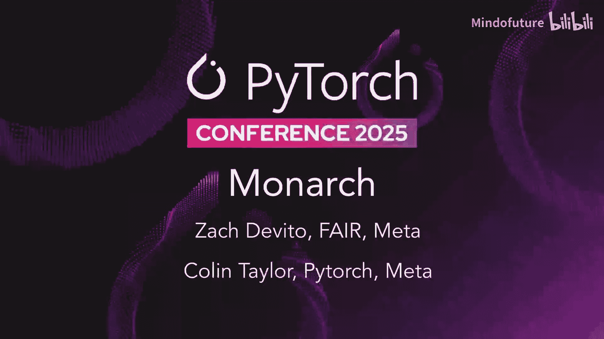

# 2025 Pytorch大会 ｜ Pytorch Conference 2025 p47 P47_Monarch——PyTorch分布式执行引擎-Colin_Taylor__Zachary_DeVito__Meta -BV1b8kRB6EJG_p47-

Hi everybody， welcome to the session right before lunch， we won' take too much of your time。

 so I'm Zach， this is Colin and we're going to demo for you Monarch。

 which is our Python native distributed programming framework that we created as part of the Pytorrch team。

So I think you've been hearing today and it's probably been your experience over the past couple years that training models at large scale has a lot of unique system challenges if you're doing something like pretraining。

 it requires careful coordination of potentially tens of thousands of GPUs and when you're doing this the strategy to efficiently use the GPUs is going to change as you change your model size or your data center size and once you get big enough a failure of a single component since you're all carefully orchestrating things together can just end up deadlocking the entire job。

This doesn't get easier with post training because post traininging basically combines the complexities you had with pretraining with then a complex asynchrony of many different components。

 so you basically just take whatever your pretrainer was and that becomes your learner in a post-training model。

 but now you have generators producing new trajectories for training you'll have environments which are going to be doing pretty arbitrary stuff like browsing the web or coding or simulating a game and you have to move weights between these things so you have parameter servers to quickly transfer everything and keep things on policy。

And you know I think the competitive advantage in this space comes from being able to program these setups really quickly and try out new ideas to help with this kind of problem we've created this framework that we call monarch and fundamentally monarch is a Python API for building distributed machine learning systems and it's an imperative API basically we took the fundamental design principle that everything should be a Python API this is basically how PyTtorch was founded and we want to take this into the world of creating distributed systems for machine learning so when I say everything is a Python API what do I mean。

 I mean it's a Python API to acquire machines to launch processes on those machines and then have them quickly communicate with each other using actors or remote direct memory access RDMA so the idea with monarch is that a single program defines the entire ML system and doing this is going to help maximize research or productivity。

By making it really easy to try new ideas， it's basically like programming cluster as if it were a single machine。

 and this lets you do things for instance， like run Monarch in a notebook like it is running here for this presentation。

So what does it look like to actually use monarch so here's a snippet of sort of like hellello worldld monarch code and what we first do in monarch is we basically acquire machines here we'll just use my local dev server essentially and then we'll call this dev server trainers even though there's only just one host right now and we can take these trainers and then launch processes on them using a Python API so here we're launching eight GPU processes and on each one of these GPU processes we drop a learner actor that's going to do the training on that particular thing for right now we're just going to pass a fake data loading in as well and you can see I started this up and basically we have eight processes they all started they just reported some logging。

嗯。And so。So basically， this gives you an imperative API to launch the actors onto hosts。

Messaging is pretty familiar to any other kind of actorlike system you can invoke a method that you have on the actor here I'm just going to call one step the interesting thing about monarch is that you're never only talking about single actors when you're talking to them here we launched eight processes so we actually have eight actors and they're all going to respond I'll talk a little bit more about that later if we look into what this like actor class looks like it should be familiar to anybody who used actor kind of things in any framework。

 you have a class that just is a subclass of the actor class and you can write initialization for the class and also define what we call endpoints things that you could message the actor about step was just one of those endpoints。

So one of the unique things about monarch that I already sort of previewed here is that we don't do anything as singletons。

 you're not sending single messages instead basically everything in monarch is a group of entities。

 so you have groups of actors， processes or hosts we call these groups meshes and they're basically multidimensional arrays with named dimensions it's sort of like a tensor but your tensor is containing hosts or processes or actors now so you might have a hierarchy of actors that looks like this where you're launching the learners with a couple different processes on a couple different meshes and so you end up with this like two-dimensional learner array over your group of hosts。

And because things are implemented with these meshes。

 it makes it really easy to transition a monarch program between one and many hosts because you can simply just ask for more hosts when you define the job。

 so before I was using an API to just attach processes to my local machine。

 but if you're working on a cluster maybe you have a scheduler like SLRm so we also have APIs that let you acquire hosts through SLm so instead of using a local job you create a SLm job and now we might ask for 2000 GPUs and then when we get the job we now have a host mesh。

 a mesh of hosts that's 2000 long and you could basically pipe that into the exact same program you were using before and it's going to work on those hosts and it still can be in a notebook you still could be running locally here the only thing that changes is where you get the host and I think this is a very powerful demonstration of what you can do when everything is just a pipethon API。

Okay， but let's say we switched to 2000 hosts if you just naively implemented this。

 you'd be in trouble because it's very difficult to tell 2000 hosts to take a step from one machine that would take too long for it to be practical so as part of the mesh implementation we have we also have optimized messaging for meshes so meshes enable scalable messaging by essentially using like a log and broadcast tree for all the messages。

 the top levelvel client is only going to send a constant number of messages and this is going to tree out。

In addition to this kind of broadcast of messages we have aggregation of results that can also be lo in a lot of the time when you're trying to coordinate stuff you're saying take an entire step of your model or hey this is the right time to update your weights from your learners to your generators and I need you to acknowledge that like you did it correctly but it's always the same value and so we aggregate using compression on the way back common value so we could also make the response to the client log and as well。

 so this basically let's monarch messaging scale to thousands of actors but primitives like barriers you don't have to like use kind of awkward barrier prims。

 you can just define everything in terms of messaging and waiting for responses。

So all of these objects we've showed you before as part of the Python API like host processes and actors。

 they were like firstclass objects you can send them in messages so basically you can move them around the system and what this lets you do is let you build actors that can be moved around in a composable way without leaving a notebook or a single process so for instance in our example that we showed before we had like a fake data loader but if you wanted a real data loader you might like you might define an actor that does data loading and you might spawn separate processes for that data loading and then because the data loaders are first class you can just drop the call to the data loader into the。

Callback that we originally passed the trainer to load data and then pass it into the trainer and you'll notice in this case we didn't change the trainer at all。

The trainer doesn't even have to know that there's an actor participating to load the data。

 and what this lets us do is create much more complicated process diagrams。

 just making local edits to code。So we can put all of these abstractions together to build entire RL training systems。

 so this is sort of some example code here for what that training system I presented at the beginning like an RL training system might look like and it closely resembles torch forge which was a training system built on monarch that we announced yesterday。

 so you'd ask for hosts of different machine types for instance。

 the replay buffer maybe or CPU machines and you allow SLlumM or another scheduled or scheduled them。

And then you can start launching your processes and actors in different places。

 so we might launch learners like we did before， but then now we're going to pass the replay buffer。

 which is another actor to the learner so it can grab new trajectory or grab new samples whereas like a generator will push into a replay buffer and a scorer is going to pull from one and push to the other and actually provide scores for the particular trajectories so this python code here essentially just produce this system diagram and if it turns out the performance of this system diagram isn't quite what you want it's really easy to just move stuff around after the fact。

So once you have this system diagram， what we built into Monarch is a bunch of stuff that's really nice to have when you're building these RL systems。

So that you don't have to think too much about the common problems you get when you're at scale One of the major problems at scale is fault tolerance your job is going to break in various ways。

 especially if you're doing like arbitrary environments like those are going to commonly break and you don't want your whole job to stop so we've created this system of actors and these actors are created hierarchically you saw that there's a top levelve client that launches more actors they may launch lower actors and processes this basically produces a hierarchy of actors that have launched other actors and we handle fault tolerance through this hierarchy as well So the idea is we have what we call progressive fault tolerance if you don't do anything what's going to happen is if a learner has an error it is going to bubble up this tree almost like an exception bubbles up in code and if there's no handling it's going to。

Reach the root actor and your job will stop This is already better than your like a common thing today where if you're using like torch multiprocessing or something。

 it's easy to get a generator somewhere off in the corner to fail and just have the whole thing kind of deadlock instead of reporting like something's not right。

But this kind of like restart everything is not very efficient if you think of something like a scorer that's just like running a model on top of trajectories to produce scores is not really stateful and if it breaks you can actually keep training so in these cases we let you。

Customize how you want to handle error messages， you can define a special magic method called supervise that if defined on the parent actor。

 will essentially catch the exception。And this lets you know that an exception has happened and then you could provide your own policy for what to do about that exception and in this particular case what you do is decide to just abandon that scorer but launch a new one in its place and have that continue this will then stop the error propagation and the rest of your trainers can continue。

So so far we've talked about the kind of core monarch system where we provide scalable messaging via actors and fault tolerance。

 it turns out that these two key components are the things that make building a lot of powerful services a lot easier。

 so I wanted to talk about two powerful services that come with Monarch now that we have this messaging system。

The first of these is what we call point to point transfer of data via RDMA or remote direct memory access。

So this service in monarch can turn any CPU or coa memory into zero copy RDMA buffer handles and any actor that has one of these handles can just read or write that memory remotely so what does this mean in terms of like a system diagram let's take the example of learners passing weights to an inference engine at the beginning of the run you could make RDMA buffers out of all the weights the learners have and then send references to these RDMA buffers to the inference engines。

 these are just handles to read or write from that memory。

Along with those handles you might also come up with a plan in other words like where should each inference engine read so it's well distributed among the learners where they're getting their weights and how to update the weights and then later in the training you're going to just broadcast a message saying it's time to synchronize your weights and at that point the inference engine can use an RDMA read to directly read the weights out of the learner and it doesn't have to like coordinate addresses again it can just like immediately hit the network card and start doing this and I think compared to something like nickel there's a lot of advantages to doing things this way so first of all these transactions are one sided if you have a reference you don't have to have the other side issue ascend you can just read or write from that data as long as you have the reference。

Because you don't have to like coordinate the startup of these things via nickel。

 we can make the setup fast so there's like a setup of like new connections is like a couple milliseconds and there's no need to preallocate communicators across things and memory registration is similarly very fast where it'll become amortized essentially free over the lifetime of the process。

And with this you still have speeds that are like comparable to nickel and things that come before。

 I'd also say that this is like has a better fault tolerance properties because you don't like break a process group if one of the things breaks。

 you just simply can't message the broken device anymore and those transactions won't complete but you have like working transactions for everything else。

And so we hope that like。We hope that this is like the beginning of being able to provide core services to build more efficient RL things。

 and we've already seen some examples of this in Torch Forge where we have like a distributed object store built on this RDMA technology。

The second kind of feature that could come or service that could come out of monarchs messaging things is single controller distributed tensors。

 so monarch's really good at broadcasting messages to a bunch of places。

 so what that allows us to do is instruct a bunch of different processes to do tensor compute so if you were to spawn processes in。

In monarch like we have these two GPU processes here and then you call this context manager called Activate now any torch compute that happens under that context manager is going to happen on every device。

 every process that you have in this mesh and so this RA thing here is actually a distributed tensor with one instance of the tensor across the whole compute and you can then follow that up with built in like collective ors not collective because there's only a single controller but like reductions across things like doing an all reduceuce across the GPU dimension of your mesh right now this is very much a thing that's useful for debugging and trying things out in the future we hope to improve its like performance to the extent that it's suitable to writing entire distributed training stacks just with the parallelism algorithms defined on this tensor type。

So just to recap I went through a bunch of different monarch like features of monarch。

 but what we think truly defines like what we're providing here is the ability to build distributed ML applications via a Python API only from a single process and uniquely I think as a components of that we provide things like scalable messaging via meshes so you don't have to worry about how many actors you need to communicate to built in fault tolerance through our supervision trees and unique services like point to point RDMA transfers and single controller distributed tensors。

So I'm going to hand it Hi everyone， I'm Colin from the PyTtorch team here at MA and we're excited to be here。

😊，嗯。So Zach， hopefully， Zach's presentation gave you a good sense for the， for the。

Program model with Monarch。 And I'd like to talk a little about some of the examples we had。

 as well as some of the the benefits in terms of benchmarks we've done。 So， first of all。

 Zach talked a lot about Monarch's R D May。 This enables。Direct memory access between actors。

 whether on CPU or coupa memory。It's like Zach mentioned， this is zero copy。

 one sided and fully asynchronous， meaning that any actor in the actor mesh with a handle to a RDmaA buffer can directly read or write into the memory of another actor without CPU synchronization and Zach covered some of the benefits that provides so what we do see is that we see essentially 995% of NIC performance。

 whether this is GP to GPU on the same host or across GPs or across hostst in the same rack this makes it ideal for applications like weight streaming。

 parameter sharding or service interconnect。And we're very happy to allow users to treat this not as a distributed systems problem。

 but simply as another actor call in monarch via this data flow。😊。

So one of the first things we wanted to do is integrate with a very popular async RL framework today called Verl。

 who I believe are at the conference and many of you might be familiar with。

We wanted to validate the monarch could easily orchestrate the control flow in this asynchRl framework。

 so we used it to trainquinn 2。57B， which is a math reasoning model using GRPO。

 We scaled this up from 16 to 2048 H200s。These runs were stable and achieved comparable throughput and convergence。

 and in addition， like Zach mentioned， because Monarch has this supervision hierarchy and scalability benefits where we see this login broadcast。

 as well as aggregation from the results， that's a big benefit of using monarch for the communication。

Additionally， as we announced yesterday， we're very happy about a torch forage as the team who gave a great presentation yesterday。

 which is the Piytorrch Open Async R Library that's built natively on monarch from the ground up This includes a couple of important monarch primitives。

😊，And I think the key idea here is no coordination code， no retriries， no explicit message passing。

 just pure async Python。Under the hood， Forge uses two primary things from monarch to orchestrate for the control flow。

 as well as for the data of flow control flow wise。Forge uses every R component as a service。

 which are implemented on monarchs actor meshes。 They enable load balanced fault tolerant components and the coordination between them。

They also the Pythtors team also built Torchdo， which is a distributed key value store。

 primarily used for tensors， which is backed by Monarchs RD Ma and the RDma buffer。

So if you haven't seen them， we encourage you to check them out on GitHub on the blog post， and yeah。

 they'd love your feedback as well。This is a brief system well， not。

 a system diagram that I'll go over briefly of forage and all the components that they allowed。

That they built， each of these components is an actor meshen monarch。

And this allows for things like the mesh of trainers。

 as well as the mesh of generators to be supervised， to be scaled。

 to be coordinated and designed independently。As well as the data flow。

 the parameter server component here， like we've been mentioning。

 is built on top of the RDM buffer with with the RD May under the hood。 So definitely again。

 encourage you to check them out。Another integration we did with monarch is with TorchfT。

 So as many of you might be familiar with at large scale。

 hardware and network failures are not just are not rare。 they're very common。

 So Torch fT helps to solve this problem to make training resilient。

 They do this by splitting the job， the training job into independent replicas， and across replicas。

 the gradients are synchronized with an all reduce， but importantly， upon a fault。

 each replica acts its own independent fault domain， which enables good replicass。

 healthy replicas to make progress even when one of the replicas fails。

Monarch plays nicely with this in that we can detect the faults very quickly。

 isolate the failed replica group， and restart just those processes。

And this is all made possible via Mac monarch's hierarchical supervision hierarchy。So experimentally。

 we're in a 30 node， 240 GPU training job， training Quinn，3，32 billion via torch Titan。

 We injected 100。Failures of classes， including Seg faults， process kills， nickel aborts。

 and even host evictions。 experimentally we saw in 92 recovery for these process failures and 2。

5 minute recovery for the machine failures， which is about 60% faster than simply restarting these via SLm and is this type of strategy is critical once you see the 10。

0000000 K plus GPUs。Finally， we monarch is not just about orchestration and scale and fault tolerance。

 It's also about developer experience。 One of the integrations we'd like to highlight is the。😊。

Integration we did with lightning AI studio where you can launch。

 monitor and debug 128 GPU jobs right from your notebook。

 Monarch provides the persistent compute allocations。

 so Uni notebook disconnects your cluster stays alive you can stream logs。

 you can stream metrics and you can said distributed Python breakpoints inside of these actor codes inside of the actor code all from the notebook and you can changer code and relaunch instantly on the same resources so we have an example that we trained Lama 3。

1 8B with Torch Titan and monarch studio that we will be linking later and additionally we have a Pytorch tutorial that's hosted at Pytorch org where you can see a very similar setup but using the sLm scheduler and with very similar developer experience and so we definitely encourage you to check that out and is linked。

And finally， we'd love for you guys to try Monarch today。H。

We have a here we go here we go check out the QR code which is links to our website。

 you can see Python APIs， you can see a bunch of examples linked to the blog post。

 we have some great rust dos and a rust book that our team built to help you understand what Monarch is doing and many of the examples we cover today are either linked there or there directly so we encourage you to check it out and finally we would really appreciate all of the contributors that contribute to monarch。

 names are probably too small， but you can see some nice commit histories from each contributor and we're grateful for your work here。

😊。

Thank you。