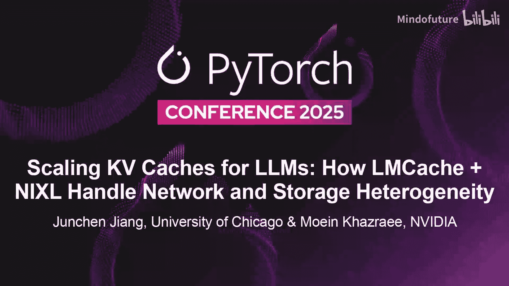
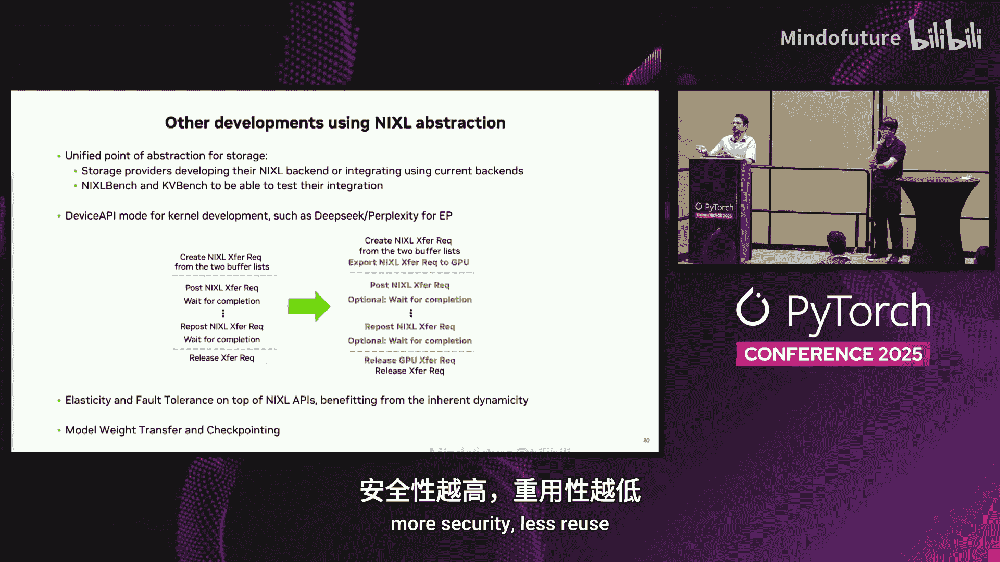

# 2025 Pytorch大会 ｜ Pytorch Conference 2025 p48 P48_LLM键值缓存扩展——LMCache_+_NIXL如何应对网络与存储挑战...-_J._Jiang__M._Khazraee -BV1b8kRB6EJG_p48-

Hello everyone， I'm Moine from NviDdia and today with Junchen we are going to present to you scaling KV Cas for LLMs。

 how LM Cash and Nixel H network and storage heterogeneity so let's start。

Welcome， everyone。 I'm Juin Chen。 I'm a faculty member at UCh。

 but also I'm the faculty lead of Arcsh labb。 recently。

 we also have a startup Tensor mesh based on this open source project。

 and Arc project solves a key problem in today's large scale Ar M inference。 I will explain why。

 But we also have a booth feel free to drop by our booth to talk to our engineers to try it and experience the speed up and booth is next to where you pick up your free shit。

 in the export hall。 So feel free to go there。 now。😊。

The importance of Ar cash really stem from this fact that inference is going much。

 much bigger than training。 every everyone knows these days that only a couple companies make a handful of companies care about training new models and most of the companies will be running inference of these models be serving these models。

 Most of applications。 Microsoft， for example， forecasted like hundreds of millions of applications this year will be running AI inference。

 mostly large language model inference of certain kind。

 And everyone in industry realize that it's insane for applications these days to not have any components based on large language model inference。

 Now， that's the applications side。 That's why the market is so hyped up about large language model inference。

 large language models serving。 But from a system perspective， right， I'm a system faculty。

 I do computer system research and system research， Why system faculty。

 Why system researcher engineers care about this so。😊。

Much is because inference of large language models make the system million times more complicated。

There's a very complex system behind serving these large language models pre traineded or trained from for all kind of purposes。

In particular， a reason for this large language model to be so interesting from a system scalability perspective is so calledled lung context inference。

 Now， what is lung context inference， long context inference is the whole reason why these large language models can survive in the wild。

😊，Think about this。 Why the， people want to use large language model because it's not because of this bigness。

 Okay， it's because the models has ability to learn from anything you provide。 you ask， ask it to。

 to read。You can provide a long document as the context for the model to read before it answers any question。

 You can ask it to process a big code repository before you ask it to write a test case。

 you can ask it to read to watch all the videos you have collected so far in order to generate some summary。

 All multimodality all these kind of things， it all boils down to long context inference。

 model has the ability to understand long context。 and people， good engineers。

 context engineers will will use up sort of up use the context window。

 But the result of that is you have long context。 and the longer the context the the more challenging the system problem is particularly longer the context。

 slower the inference and more costly the inferences slower because the more bit。

 the more tokens you have in the input that means more， more processing， more。😊。

Tsion to be computed for those extra tokens。And more compute。

 more expensive because well you need to have more GPU cycles to process all these input。

 and to make it even worse， long contexts， by the way。

 long context of how large language models process all these contextual information。

 and to make it worse， the model has to do the preview phase before user can even see the first token generated by the model。

Okay， so this really， really ridiculous problem because the longer the context the more useful the model is。

 but the the， I mean， the slower， the slower the response the user can proceed。

 can proceed from this processing so。😊，That's what we call time to first token and to make it even worse。

 think about this right if you are running a large scale inference service。

 you have multiple inference engines。😊，Running in your system。

 And let's say you different users come in for different queries and for different context。

 For example， every time you you you， you let the model read the context。

 it's gonna take several seconds to tens of seconds。 Okay。

 and this ist vary as you watch this animation。 right， This is really， really slow。

But once you realize something， right？These contacts can be shared。 Oftentimes。

 the same document will be asked to will be used to be used as the context for different queries。

 The same videos will be used as the context for different queries。

 The same user history will be used as the context of different queries。

 And this context can be shared。 and that makes it possible to shoot intermediate data structure。

 the intermediate data process result across these engines across these queries。 Okay， in particular。

 what we're talking about this thing being shared is KV cache。 KV cache。

 by the way has nothing to do with key value store。

 K V cache is two big tensors called K tensors and V tensors， and they are big tensors。

 and they need to be， they can be reused across different queries。😊，think about this。

 If you have the KB cache stored for the for the shared context。

 for the same documents that being used repeatedly over time。

 and that K B cache can be directly sent to the engine。

 and the engine don't need to process the contacts anymore。

 It directly load the KB cache into GPU memory。 if you can do it well， It can be very fast。 Okay。

 and boom， all these requiries can be done very quickly。

 If you have KB cache delivered to this GPU GPU memories very efficiently。😊。

The slogan here is the bumper sticker version of this is you only preview once。

 you purfuse something， and then you reuse this KV cache across quas across engines。😊，Now。Obviously。

 for a system researcher， for system engineer， you will obviously ask the question how do you how to move the KV cache across these engines。

 And if for experts， you gonna ask even deeper question。 You know， this these KV cache is super big。

 Okay， How do you move them efficiently between different devices between different GPU memory。

 different CPU memory and so on and so forth。 And this is actually what's gonna happen what's happening in industry right now。

 the trend is traditionally， KV cache is created internally by the large language models and discarded after every query。

 And this limits the scope of KB cache storage in GPU memory in this time span of one query only。😊。

The trend is to move out the GPU memory for various purposes。

 There are optimizations to store K B cache in CPU memory in in disk in local storage。

 sort of the same model。 same engine can be can reuse it later。

 They are optimization to share K cache over the network across different engines。

 They are also crazy optimization。 people here probably heard of P disaggregation。

 Pre decod disaggregation。 We don't have the time to to talk about detail。 But the idea here is you。

 you share KB cache between two phases of the same query。

 You have KB cache delivery between two phases of the same query， but running on different engines。😊。

What it all require from all this optimization， the common requirements across them is a semantics to enable KVC to be shared distributedly across different locations。

 it needs to enable GPU to GPU transfer， and it need to enable GP to CPU offloading。

 needs to enable CPU to CPU across storage offload。😊，Visually。

 this is what it look like and to have a layer， a C layer that enable communication between inference engines。

😊，Enable communication between inferences， GPU memories， GP to GPU and through CPUU。

 through Enet through RDM and so forth。 and also to communicate to share KB cache to to be a sort of a layer in between all these fascinating stories devices people have storage services and these engines。

 Okay， so vertically and horizontally you can see their。

 their semantics needed to support KB cache optimization。

 and A cache is one of the the popular libraries these days and probably most widely used。😊。

And it's being widely used for different engines。 It supports VM。

 it supports S supports all these engines， I inference frameworks up there。

 And the projects now is also a Pyto Foundation landscape project， very recent news。

 and it's also a lot of companies are using it in their production environment， not just testing。

 but also in production environment。 Okay so。😊，Now， why we're having this conversation today。

 I want to talk particularly mean this。 So Mo and I want to talk particularly about a challenge facing this kind of library in in the wild。

 which is not necessarily about speed， but about compatibility。

 because this library doesn't exist in vacuum。 It needs to work with all kinds of engines。

 It needs to work with all kind of network devices。

 It needs to work with all kind of storage services。 Okay。

 and they need to be a unifying solution for this library to work perfectly smoothly with all these environment and all these ecosystem components。

 Okay， and that's what noise's gonna talk about。 and。😊。

So as mentioned with this heterogeneity of devices across network and storage and so we saw the new challenges and requirements for inference so first of all not only we have heterogeneous for example memories or we have a different storage it might be also heterogeneous compute for example different version of GPU so we were looking for a resource dissegregation and as he said we need a unified API that we can go across all of them with a unified API and remove the burden and then so it could be across network and we link storage and so forth on top of that there is a new need for inference specifically that workloads are very dynamic for example the user demand can change over the day and then different users for example in the middle of some runs we see okay the prefi nodes we need more prefil nodes or we need more decode nodes and we want to dynamically adjust。

So we need fine grain resource allocation and auto scalinging and the usual suspect we have the massive scale as always。

 so we have millions of users and requests and hundreds thousands of nodes we want a distributed computation that has low latency and high resolution for that we introduce N video inference transfer library NxO that achieve the high performance and low latency with the unified API for this heterogeneity and support for fine grain dynamic escape。

To be able to go to massive scale and be performant what we did is we made everything to be asynchronous nonblocking so you can overlap compute and communication and also we support non contiguous memories and zero copy meaning for example you can do a read or write directly to the other node without the need for an extra copy for example in the kernel buffers so now let me talk about the Nxel design how we provided a very simple abstraction that encompasses all of this so what we do is we with the buffer list primitive as simple as possible so what you have let's think of for example you have8 GPUs you can say for example in this GPU dis address these links this GPU dis address these links and if you have a list of them you can describe memory GPUs similarly let's say you have some files you can say in this file dis address these links so we came up with this。

Per list primitive What you do is let's say you have several processes across several nodes。

 you instantate a Nxel agent on each of them。 It could be one GPU several GPUs and then within think that Nxel agent you say hey this is a buffer list for GPU this is a buffer list for CPU and then when you give two buffer list to Nel one for example from the local agent and one from another agent。

 you can say hey I want to do a transfer between them As I said everything is asynchronous so Nixel would give you as synchronously a transfer handle back to you and then now you can post this which means I start the transfer and then check I need asynchronously when the transfer was done We separated this one reason being for some workloads。

 you might want to update the same location in memory we don't need to recreate a transfer we call that repost and another thing is we also have some APIs even if you want to get an estimate for the transfer to decide should I recompute。

Or if I should the transfer， the operations are read right， and then when we do redwrite operations。

 one side you are checking when the operation is done。

 the other side optional you can send a notification that the operation was done。

With this abstraction across all different heterogeneous devices， that's。

 for example how LMC uses NxO， but now let me dive in a little bit on how Nxel works under the hood。

So we have two main components， memory section for local registered memory and bookkeeping and metadata handler for remote agents。

 that's how we enable the dynamicity to easily add and remove notes。And how we do the transfers。

 how we achieve the efficiency is we stand on the shoulder of giants so we don't reinvent the wheel we already have some libraries that can do a speed of light for example let's say UCxreb that they are already implemented efficiently the point is you have what we do is we write a light plug like a wrapper for those libraries that prepare the transfers for that specific library and when it comes to the time of transfer we tell the library to do the transfer for us at the speed of light here I'm showing the current transfer backs available is open source on GiHub and then the ones that are coming soon。

Here the UCX， moon cake and lip fabrics are for network， for example。

 if you want to do deaggregation across prely nodes and decocode nodes or if you want to update your model for example for RL we also have device API for UCX for other ones we are working on it。

 the idea is if for example you want to even do something like DP or so and you want to run things on the GPU another model GPO we also support GPUO if in subdevice API you want to do a streaming GPU initiated。

 we support that and then finally we have several storage ones。

 projectss to go through the Linux GS GPU director storage。

3 FS object for objectject store and a3rDA and block storage are coming up Also some of the partners even they might want to have a custom backend for their use case still they can use the Nixel library。

With that said， now let me go a little bit about memory section and abstraction。

 so registering with Nixel， if we don't allocate memory， we just register。

 meaning you have access to use this memory and we have five types of memory spaces。

 DM for hostt memory， VRA for GPU file NVME and block for SSs and then object for object to store and then the abstraction that I mentioned here we can see it。

 let's say we have block VRA and DRA， the volume ID， the GPU ID and then for example。

 before hostt we can use zero or if you want regions assigned some numbers。

 that becomes a device ID and then address and length would be how you specify which location in memory。

For file and object， for file the file descriptor becomes a device ID and then for object the key becomes the device ID and then you have because there are higher level abstractions you have two modes of using them。

 one mode is to put the address and length to zero。

 which means I'm just going to append to the file at any arbitrary location。

 or you can say I want for example from this offset and then with this length to be able to only access that part。

 as I said with Excelel registering is giving the access。

One more point is during registering we have an extra info sometimes you need some extra information。

 for example， for file， let's say you want to pass the pass the path of the file and then let's say for the。

Objects is so， you have many buckets in each bucket。

 you have some objects which have multiple keys and each of the keys is long。

 let's say one to and eight bit or so what we do is the device ID is a 64 bit value what you do during registration you pass that 64 bit some value which could be for example part of the actual key and then you say hey a full key is in this bucket this object this key and the long key just when I want to do transfers that's how I refer to them so this abstraction can cover all these different types of memories and then the nice thing is you make a buffer list for example for each of them for GPU memory host memory SSD or network of storage and then when you want to do transfers you just use two of these buffer list and you say go and then nicely you can make a multilevel caching possible one point to clarify is Nxel does the transfers for you。

The data transfer library， something like LmCsh decides what needs to go where。

We provide the abstraction across all these type of network devices and storage。

The next important piece would be the metadata handler how we enable the dynamicity so let's say two node want to talk to each other what I need is some connection info and then the registered memory information if I want to do it write or be to somebody else I need some keys I don't want arbitrarybitr people to be able to write so what we do we abstract all of the necessary information into something we call the metadata and then simply let's say agent A wants to talk with agent B what we do is we get after registration we get the metadata from agent B we give it to agent agent A can't talk to agent B and we can say forget about agent B it cannot talk anymore we call this the direct path and as a chrry on top you have to other mode sockets。

 you can say listen on thisport when you want to communicate metadata across agents or ETCD if you want to go to a central location for example we use it for our test engine。

And we have the consideration for minimal information exposure if OneNote is only a fun agent talking internally。

 we don't expose that information externally or if we have support even for guard if you want to just give access to part of your memory to a specific agent。

I'm going to go over two examples， for example， let's say we have two nodes and UCX as an example。

 your iniate agent， the agent name can be anything is a string and then。

You essentiallyate the backend you register giving them access after registration as I said。

 you just get the metadata， give it to the other agent and then also send for example what is the data location to be received and you create two buffer list and then you post them。

 you wait for completion let's say we are using the same transfer handle we can repost and wait optionally have notifications one nice thing is on the other side for get notifications you don't even need to know who is sending you the data just you call getnotives and the name of the agent who send you data shows up you don't have any central need for synchronization and at the end you can release the transfer deregister and invalidate not that the load of the other metadata and invalid can happen anytime during the runtime that's how we have easy elasticity in NixO and also as I said everything is asynchronous so you can have multiple transfer requests going on at the same time。

Yeah。When we go to a storage， we didn't want to revent the bill and also imply that the storage。

 the storage they have to have a Nxel agent on the storage point。

 so what we do simply we have already distributed the storage。

 we mount it locally and then so same as before， we just this make a file towards the distributed the storage。

 and then we say copy form for example， GPU to that file and under the hood because of using the distributed the storage。

 it will go directly to the distributed the storage， same exact API from the user point of view。

Now going back actually we have an integration to L cache and simply in the config file you can other than chunk size and so that you set。

 you can say or the buffer device which is CPU or if you use GS could be GPU， you say hey。

 enable mixxel the storage I'm going use that and then for backend I'm going for example use Pos with pool size of 64 and then the mount point is in that location。

 or if you want to use object to storage say I want the biend to be object and then you can pass the access key。

 secret key， the bucket and region to that simple as that you can connect it to the storage device you have。

And to show some results， we ranQu3 without the prefield cache on 100 GPUs and vascular storage。

 even at 1KISSL input sequence length， the time TTFD。

 we see benefits of going to a storage as Joan Chen mentioned。

 if I already have the result for 1000 input sequence length already I'm winning if I have a very fast storage and then as I increase the ISL it becomes even better。

Other things that we are considering with Nixel and work in progress is first of all， as I said。

 it's a unified point of abstraction that with different storage providers we are working either they make new plugins for us or use our current plugins to access that and we have Nixel benchch and KVBch for them to do some initial testing the device API mode for example deepse for EP actually yesterday we opened the PR for them。

 so again very similar API just you export the transfer handle to GPU and then do the post and other works on the GPU itself as I mentioned we have the inherent dynamic in Nixel so elasticC and fault tolerance are doable we need some software support to just enable use oft for different platforms and then there are other other works such as model way transfer at the beginning or if you want to scale your model to more nodes or for checkpointing for all of these use cases you can also use Nixel。

With that said， I open the floor for any questions。To question to the person。

sense on top of L cash no below L cache， yes。So then for this for the queries。

 do you guys sort the query text or the or in。嗯。So AC store KVC data as data objects。

 but it also has an indexing system based on tokens and hash of tokens。

So the index will be used to used by applications to to look up a KB cache in the system。

 but the object being really stored as a KB cache tensors。Okay。Hello。Over here。I have two questions。

sorry I'll wait until the other questions Okay so you do you handle reference counting across processes and tools and and how do you handle in a multi tenantant situation leakage private data between two two tenants I can reference the first so the second question I got how how how do it deal with multitenent situation where Kaie catch a share between users what was the first question oh yeah do you handle reference counting so if I you know if it's a tensor object you know and it's a result of let's say。

You know。Applying the network and you're going to reuse that computation somewhere else。

 potentially in a different process is there any way to reference count across processess？Okay， to。

 to answer both questions， there is a mechanism for KV cache look called KV cash lookup right。

 with a user query， we need to look up which。how many tokens in its prefix。

Has have the KB cache already stored in the Ar cache system。So there need to be a lookup process。

 and the lookup key。 I mean， not a KB cache key。 just the lookup key will be the tokens hash values。

 Okay so you chunk chunk sequence and then you have a hash per chunk and then you look up whether we have in the system。

 KB cache for chunks whose hash is matches the one you in your query。 So that's the lookup process。

 Now to your specific question， when the same query is when the same context is used multiple times。

 that lookup system can identify it because when you look do the individual lookup operations。

 it will match the same KB cache in the system。 Now， the second question is very interesting。

 if you have multiple users using the same context do we allow them to reuse Kv cache across users right。

 I that a question。 So that is if that。😊，So that's something we can configure。For example。

 when you have a user I as part of the lookup key， then you you。

 you won't share cable catch across users， but we can relax it and remove the user I D from the lookup key。

 Then you can enable that。 So So it's， it's， it's simple to configure whether to enable that that's customer' choice。

😊，Does that make sense。 Yeah Okay， Thank you。それも戦ちょそ。さし。

feasible for the cache you support different block size across different block size。 Right。

 different KBC block size， you mean， yeah， so。The K cache block size is an internal config。

 internal parameter， but it's also configurable。 It's， it's something you。

 you can configure it when you launch Ar cache worker。 And now， of course。

 did there's a default value。 The default value is sort of some。

 something in between very fine fine grain and very coar gray。 But that's something configurable。

 You can choose it。😊，So when you con really like， say， if you're gonna compute hash。

 you're gonna find the best hash across the entire Excel question， excellent question。 So， so the。

The the granularity of lookup hash to create the lookup hash is separate from the granularity of Kb hash when you store it in a system。

 Now， of course， you cannot store things in a course of granularity than than than the lookup key。

 But as long as it's fine than that it's fine。 right， So these two things are different things。 Yeah。

 I do agree with you when when you do lookups， you want the hash to be as fine as possible because you cannot do partial harsh match at all。

 So so you want lookup key to be at a trunk graular granularity as fine as possible。

 But in the system， it doesn't have to be that in the system。

 you want the granularity to be big enough to saturate I speed。These are two separate configurations。

Thank you。啊算了O来休息。Thank you。I have a question about。The powder， for example。

 the user A read the file， A， B and C。And your cash out And and the second user use file B and C。

So the second user can reuse the cash for from the first user。 Thank you。That's， that's。

 that's a great question。 So， so okay， the model have， So first time model C Ch text chunk， A。

 B and C， So that does does have the K B cache of A and B and C。

 But the problem here is that the KB cache of B and C is sort of tainted by the cross attention with a。

😊，Right， and and the question is， how do we reuse KB catch B and C in the future if there's no a before that。

You can refer to a paper called Cashplan it's a paper we wrote earlier this year。

 it has a technique to solve that problem to put it very simply。

 you need to update certain and the KB cache value of certain tokens。😊。

So that you sort of remove the impact of the cross tension between B C and A from D C's KB cache。

 So that's sort of for you， you can， you can still reuse the KB cache of B and C。 Now， of course。

 this also， oh， the other thing is you have to change the positional encoding in B and C so that you sort of you know。

 position encoding is is a rotation thing you rotate it back to the okay。

 so that that's bit technical。 read the paper。 But the idea is this is doable。Thank you so much。

Cash currency or we can follow up I think。Any comments that you have on cash currency issues or security issues and larger deployments with respect？

Where you have done this in a kind of a broader scenario with L cashsh。

So I put two sides one point is the basic security needs like for example。

 as you see for object store we have the key access on all of those。

 so we have those security needs there in place， for example。

 when you want to access them but the side of LMC how it shares across users so that's a separate。

And I think assha mentioned， is kind of how you configure it because there's a cost， more security。

 less reuse。

