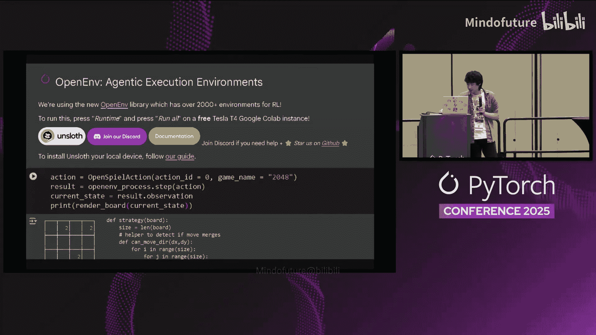
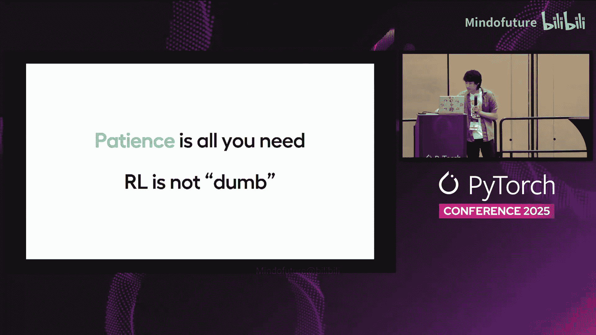

# 2025 Pytorch大会 ｜ Pytorch Conference 2025 p49 P49_强化学习中的运气最大化策略-Daniel_Han__Unsloth -BV1b8kRB6EJG_p49-

Yes， hello， everyone。 hello。 Yes， I'm Daniel from Unsloff。 You know， thanks so much for coming today。

 You know， and thanks for coming to the Pitch conference as usual。 Yeah。

 so today I'm gonna talk about maximizing luck in reinforcement learning。😊。

So for those who don't know me， yes， I'm from Unslve we help you to run and train language models locally and some of the work we do yeah so like we do upload a lot of models to Hing days we just got 100 million total downloads and Hingb。

 we have around 86000 models uploaded to a H days who train using unsoft for R and fine tuning and we have around 47 k Github stars。

😊，And also， you can get this special limited time sticker if you want after the talk during lunch time。

 If you want to chat。 theres a， yes， there's not that many left。 But if you wantna get the sticker。

 go ahead。 Yeah， just ask me。😊，We also help fix like a few bugs and training and open source models。

 For example， we introduced a gradient accumulation bug fix， which affected our training losses。

 we work with all the large model labs across the entire world。 and yeah， we work with Google， Me。

 Mral and many other like large labs to fix bugs and open source models。

We collaborated recently with Open AI during the dev day on the 2048 example。

 So you can do reinforcement learning to essentially make G S open open AI's open source model to play 2048 very well。

😊，Yes， today， I'm going to be talking about talking about maximizing luck in R L。

 So the main question I always have is like why the word luck。

 Sure reinforcement learning is not luck， right， You don't just sit there and just wait and just pray to the machine。

 The GPU gods to like randomly just wait for R to work。 So， yes， the R is not just luck。 However。

 it's a very good phrase to use。 because it kind of is like luck。😊，Yeah。

 so I'm not sure if you have seen this plot。 you know， AI has been know exponentially progressing。

 you know， on many benchmarks and， you know， the talks for AI that it can do is getting， you know。

 it's like an exponential trend。 right So like you know， G5 is a very powerful model called 4。5。

 But you know， if you you know， instead of doing an exponential plot， you can kind of linearize it。

 So like if you have a log scale。 then most progress does look， you know， on this linear trend。 Now。

 the question is， will this exponential progress continue going。 And you know， somehow， you know。

 continue taking off and go to an actual exponential trend and you know， never stop。

 or somehow what this stop。 So there is like many schools of thought。

 like you know some people think it's a sigmoid like it's gonna flatten off。

 some people think it's gonna be exponential progress continuously。 So it depends on who you ask。

Also， like you know you know， late last year， you know， Open AirI released01。

 which was which was actually quite a shock to the world because if you see on the left hand side。

 the performance of benchmarks kind of flatlined。 And so like base models actually did not get better。

 But then suddenly， when Open AirI released O1， you know you know。

 there was like some sort of this reasoning jump， which increased performance dramatically。

 And via R and reinforcement learning， you know， this is how they achieved it。 But the question is。

 was this jump just luck and by chance。 So maybe they would have never had this jump ever。

 So that's kind of the question that we'll be talking about。So firstly。

 what is the goal of reinforcement learning。 So normally I like to like use this example。

 It's a bit outdated already。 but essentially you know reinforcement learning at the very beginning stages of a pretrain model。

 you would ask the question， what is 2 plus2 at the very beginning。

 when the model doesn't know anything。 It will sp out gibberish。

 like cat dog Apple or Paris But by chance， you will get a number So what is  two plus2。

 it will say3。 And so if it see if you see3 with the R algorithm。

 you want to increase the probability of this three， because it's actually a。

 Well it's not a good answer， it's like better answer than the rest right and you want to decrease the probability of everything else that is bad And then by chance maybe if you wait 10 million years。

 obviously not 10 million years， but you might get for。

 the model randomly outputs 4 and then you want to increase this probability dramatically。

 because this is the correct answer。And so that's why the phrase where I like to phrase it is luck is all you need for R。

 But actually it's more like patience is all you need。

 So you don't like it's not actually you just wait there and sit for the R algorithm to like actually learn。

 You just have to wait long enough。 And then R will learn。 And so like， for example。

 the reward function for the what is2 plus 2 example。 will start off at 0，0，0，0，0，0，0。

 And then suddenly it would increase because it sees like a3 or a Cs of 4。 And then this boom。

 you know， of increase reward function is essentially the start of the reward the reward model and the R algorithm actually working。

 And then it's not like if it Cs 4 and then just forget everything。 And so R is not dumb。 Okay。

 so like you don't just wait there and sit and pray， oh， you know， let's wait for the4 to come out。

 It's not actually like that。So， for example， Andre recently， you know， talked about R O。 He。

 he quoted R O is terrible。 And then everyone stopped that sentence。 right。

 So most people are you know， misconstruing what he said。 The second part is he said。

 but everything else is much worse。 So like the main point is like， R O does not。

 it's not that efficient。 But at least it works。 right。

 It's better than everything else we ever have。So as a concrete example。

 assume this is like some sort of high dimensional distribution of all the possible outputs of the language model right So this could be like。

 like size of the vocabulary style or some sort of like infinite space right And at the very beginning of the pretraining phase。

 most of the tokens are a uniform distribution， right， So you don't know， for example。

 when you ask what is 32。 the language model doesn't know its's for。

 And so we just assign equal probability to every single possibility in the entire world。😡。

During the inference rollout and during training， you will get bad answers。

 And so the trick of R is once you see a bad answer。

 you should decrease the probability of all the bad answers。 right So like， for example。

 this uniform distribution will change because you decrease the probability of the bad ones and then you increase the probability。

 So you like reassign the probabilitybabilities back to the good answers。 But for now。

 there is no good answers。 So like we have to wait and wait and wait and wait and wait。

 the entire distribution is like shifting all of the bad answers are going to be decreasing probability。

 All of the possible other answers will increase in probability。😡，And then just by chance， you know。

 just by chance and patience， you will get a good answer。 And so once the good answer comes， your。

 your entire distribution will change。 And so the correct answer， which is4。

 will increase dramatically in probability。And just to note that this probability distribution。

 you know， it's， okay， I obviously， the graph is not My diagram is not very good。

 It's like some sort of high dimensional distribution。So now the question is。

 how do we actually maximize this lock process and how do we like not just wait there for the GPU and just like。

 you know， waiting 10 years for this。 And so there was only like mainly three things。 you know。

 better algorithms， better reward functions。 And yes， please be patient。So in terms of algorithms。

 for example， GP is a algorithm that was popularized by deepse。

 and it introduces with reinforcement learning with verifiable rewards。

 And the whole goal of this algorithm is you essentially make PPO， which is， you know。

 open AI's most favorite algorithm much more efficient。 We delete components of the model。

 And then this essentially saves a lot of memory usage and makes the process faster。😊，You know。

 recently， you know， most large model labs， they want to go for like， you know， extra things。

 for example， most people are trying to go for LLM as a judge。

 where essentially you can use is to judge the output of the model。

 And you there regular expression checking， format checking。

 And you can also execute code and check if the code was good or correct。For example。

 in the G S S case， if you want to play the 2048 game to make a good reward function。

 if the model plays the 2048 game and it never gets 2048， you should penalize this。

 If the game is played and you got like 1024， not 2048， you should like。

 you somehow rewarded a little bit。 And if it actually gets 2048。

 then you should maximize the reward dramatically。If the Python code to generate， you know。

 the game doesn't even execute。 I definitely minus reward on that。Other examples， like know。

 for example， if you want to do， know some sort of stock trading thing。

 then the reward function for this will be you know， if you want to increase profit， that's good。

 If you have some sort of loss then decrease your reward function。 know the 2048 game again。

 if you get an infinite loop that is definitely not good and stuff like this。 And for the maths case。

 know， if you get the correct answer to like a math equation， that's good。

 if you get an incorrect answer that's bad。 And so there's like many ways you can design reward functions to essentially help yourarrow process。

 know most large model labs would like maybe just assign one reward function。 like you know。

 has the game has the game being successfully played just 0，1， some binary reward。 But if you want。

 but then this problem is you have to wait for a very long time for the hour algorithm to actually learn。

 And so you need to help it a little bit。 But like adding more reward functions。😊，哦。Yes， okay。

 so the goal of large labs is they don't just want to do like you know， these basic games and stuff。

 They want to scale this， process to every single industry， every single task。

 every single game of the entire world。 And so like their goal is to make 10 trillion environments。

 automate the entire process。 like you can essentially call a language model to generate your reward functions to generate your environments and to generate everything。

 And in their view is you can reach AG like this。 So like their goal is like， know。

 predicting the weather， you know， doing computer science， everything。 And then they think， you know。

 by assigning good reward functions And through the So essentially。

 if you have more than zero probability of getting a good answer。 So if it's 0。

000001 of getting a good answer in theory， if you just wait long enough。

 you will get to you will sort that task。Another way to think about it is they want to like utilize this methodology to do automate AI research。

 And that is what is called the intelligence explosion。Essentially， once you automate AI research。

 you know， the capabilities of the models can continuously improve over time。 So essentially。

 the large language model will essentially learn how to optimize itself。 And it is maybe possible。

 you know， assuming we would just have to wait for them to train a model and see what will happen。

The other way to think about it for R to maximize luck is faster inference is you can wait less。

 So there is in the training process of R。 you need to first you do inference to first call the model to generate your answers。

 And then you know， then you can get the good answers and the bad answers。

 and then you go back to do training。 and then you do inference and then you do training and so on。

 I to this loop。 So currently inference maybe accounts for maybe 20% of all the time of R training。

 But in the future， it will increase to 99。99999%。 So like training will actually decrease over time。

 because you want to call the model many， many times。 assume you have 10 trillion tasks。

 youll be calling the model many， many times。And so the goal is you want to increase the inference speed in order to get faster R out。

😡，And so， for example， like you know， for GB S S， we worked hard to like make inference faster for reinforcement learning。

 And so like training is very good。 You need to increase the efficiency。

 but you also need to increase the speed of inference。Another one is， for example。

 another trick you can do is float8。 And so collaborated the Torch A team on this from Pytorrch。

 So essentially you can make training faster and inference all out faster and decrease memory usage。

Another quote that Ara likes to say is， you know， I from the podcast is sucking R is kind of like sucking supervision bits through a straw。

 We also have a sticker for that， if you want。😊，So what does this actually mean。 And so like。

 for example， let's say you ask a language model， What is the integral of some function， right。

 So you just ask that to language model Over time， it will learn， okay， the answer is G of X。

 like some sort of function， right， So like it will find the correct answer。

 But then during the reasoning process， it will say something， right。

 like by using or I can see or something， right， some sort of reasoning process。

The biggest issue is in large model labs or like during our training process。

 you will only reward the final the final token or the final like phrase G of X。

 right you ignore everything in between because it's very hard to calculate， you know。

 is by using a good like a good part of the reasoning process is you know， I can see。

 is this good or bad。 And so normally what people like to do is you can use LM as a judge So you call another language model to judge your output of the reasoning process。

 For example， another LM will say， okay， by using， is this good or is this bad。

 Re that Re the next step and so on。 And so this is called process supervision。You could， in theory。

 you know， get all the humans in the entire world。 You know。

 everyone in this room and label this data， right， say like this line is good。 This line is bad。

 This line is good and so on and so on。 But obviously， that's not a good idea。 Right。

 So like you should not be doing this for R。 And so that's why the large model labs view is you can like automate all of this by calling a language model to like。

 you know， do to do the labeling process。And that is also why， like Andrea said， you know。

 it's like sucking supervision bits for a straw because you only， once you do inference rollout。

 you only reward the final bit or the final answer。 And so like。

 you're kind of wasting all of this compute kind of。

Another good paper to read for making R much more efficient。

 you know matter release this paper recently。 the art of scaling Rs or know scaling Rs。

 And you know this the paper is actually extremely powerful。

 it shows that you can just change a few algorithms for example， like G GPO does very well。

 There other algorithms Cipo does very well。 And you can compare just by changing some algorithms。

 you can increase the probability of seeing good answers。

 And you make the R training process much faster。 You know， for example。

 another trick is you can do float 32 for the L M head。 And it somehow increases accuracy as well。

 So you know theres like many tricks you can do as well to make the process much better。😊。

Another one very interesting is like during R， long context kind of wins。

 And so on the left hand side， you can see there's like know the blue line is like know shorter context lens。

 And you can see at the very beginning of training， It does win versus like a long context R process。

 However， over time， once you wait longer， the longer context R training run actually defeats the shorter context training run。

 And so you know sometimes in short term scenarios when you do training for R。

 you can't actually see which one is good or bad。 know which parameter is good。

 is long context better， is short context better。 So unfortunately。

 you do need to wait as well for this process to come out。So， for example。

 for ultra long context training， you also need to make the process much more efficient。 So。

 you know， for example， Geminize 1 billion contact length。

 the goal of training is to make the context window of all models like， you know， nearly infinity。

 right So deep released sparse attention。 And so like the goal is to make the process much more efficient。

 And so like， you know， there are many ways to make this more efficient。

 by you offloading the gradients to CPU memory or something like that。

Another one that the scale R paper showed is， you know， large batches win as well。

 So if you see on the left hand side， if you do small batches at the very beginning。

 small batches seem to win in R， right at the very beginning of training。 But then over time。

 the large batch scenario takes over and wins over the small R case。 So like， for example。

 the green line surpasses small batches in terms of training in terms of accuracy。

And so like another way is you need to also reduce memory usage and make it more efficient。 so like。

 if you don't， if you want to run all these experiments， you need to makearrow efficient。

 And so you can run all these experiments all in parallel。And， you know， also。

 in order for training to be very effective， you also need to select the correct parameters。

 For example， thinking machines released a recent blog post on Laura without regret。

 They showed that if you select the correct parameters for Laura and R。

 you can also reach the same accuracy as full training。 And so like， you know。

 there are many parameters。 you have to set an R to make the process much better。 So yeah。

 thanks for them for collaborating with us on this as well。And yes， finally， the biggest topic。

 actually， that large labs always have you know everyones have sleep nights on this is whether reward hacking will take over。

 So during the reward during R， we don't actually know if the process is actually good or bad because we only know the final answer。

 right We're going to only reward the number4 as the final output there is no supervision。

 But we don't actually know if the model is generating gibberish。 For example。

 if you ask the model what is2 plus2， it might be doing some gibberish things。 And finally。

 it says the answer is for。 But this is actually correct。

 According to the reward function that you created， this is a good output。

 And so the goal is maybe the language model， if you do large R training runs over time。

 it will become gibberish。 And so like this is actually very problematic if you scale R to some gigantic know use many。

 many GPUs over time， maybe this might happen。 so like most large model lab are praying。

 this is not gonna happen so like the question is whether this will happen or not。

 And so that is still an open question。

We also recently covered the open environment you know， from Pytorch Open。 you know， we。

 you have 2000 environments recently。 So like， if you want to try out， you know。

 the best parameters for R and you know how to do like， you know， R。

 we have this new notebook with them， which we released today。 This is to play the 2048 game。😊。

And yeah， so like， finally， like， luck is not all you need for Ar。

 It's more like patience is all you need。 Plus some special algorithm tricks and stuff like that。

 And， yes， Ar is not dumb， right， So like， essentially。

 Ar does learn to decrease the probability of bad answers and increase the probability of good answers。

 I like， yeah， it's not。 It's not like， you know， just a waiting game to find， you know， the reward。

And yeah， definitely check out our， you know， Hoging face page for all the latest models。

 We fix bugs and all of them。 And， yes， check out Gitthub package。 And， yes。

 thank you so much for coming。😊，And yes， have a whole sticker collection if you want， yes。

And if you have questions you can ask during lunch。 yes， O， thanks。

