# 2025 Pytorch大会 ｜ Pytorch Conference 2025 p50 P50_从模型到信任——构建防篡改机器学习元数据记录-Mihai_Maruseac__Google -BV1b8kRB6EJG_p50-

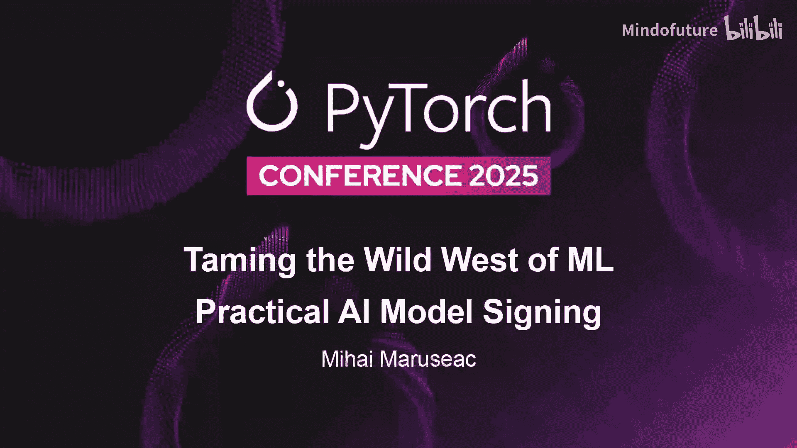

So hellello， everyone。 Welcome to this talk。 This is going to be another security and M talk like the keynote that youve heard from Donsng。

So I am Mihamarak from Ghost， Google Open So Security team。

 and I blog on my Hy dot page and I'm going to talk about how we can tame the Wild of ML。

 so the problem is that three years ago actually in a month and a week from now when ChagipiT got launched。

A lot of what we saw in future in sci-fi books and scifi movies became a reality。

 the future that we saw there became a reality。 We started seeing A models proliferating。

 being shared， being used publicly。 But there are still a problem。

 And I'm going to take an X K comic and start the top is all the cool AI projects that we have seen all all of these three weeks and three weekday days and all over the years。

 But that tiny piece at the bottom is the AI supply chain security。

 That's the problem that I have to solve here。 And Don S was solving the problem of how we useI securely in once we have it built。

😊。

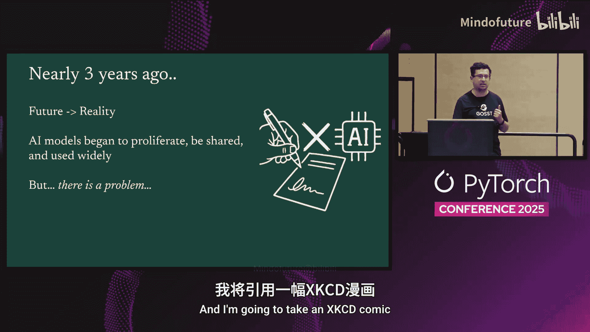

So why is this a problem in general when somebody uses an AI product into an application。

 they don't also train the model， fine tune the model and do everything there in general。

 you have big companies that are fine tuing a model。

 then you have a middle layer where some other companies or same companies are fine tuning the model for a specific application and then finally the model gets deployed into an application。

 gets elevated to a production model and put into an application。In between these stages。

 you have three separate teams and they communicate by putting the model into some model hubs。

 they don't pass the model between USB sticks within themselves。

So now you have people that own the storage， they could manipulate the model where it is there。

 people that fine tu model， they could inject malicious behavior during fine tuning people that train the model can inject malicious behavior if they are like nation states or paid by nation states to do that。

 so that's what we want to solve this。

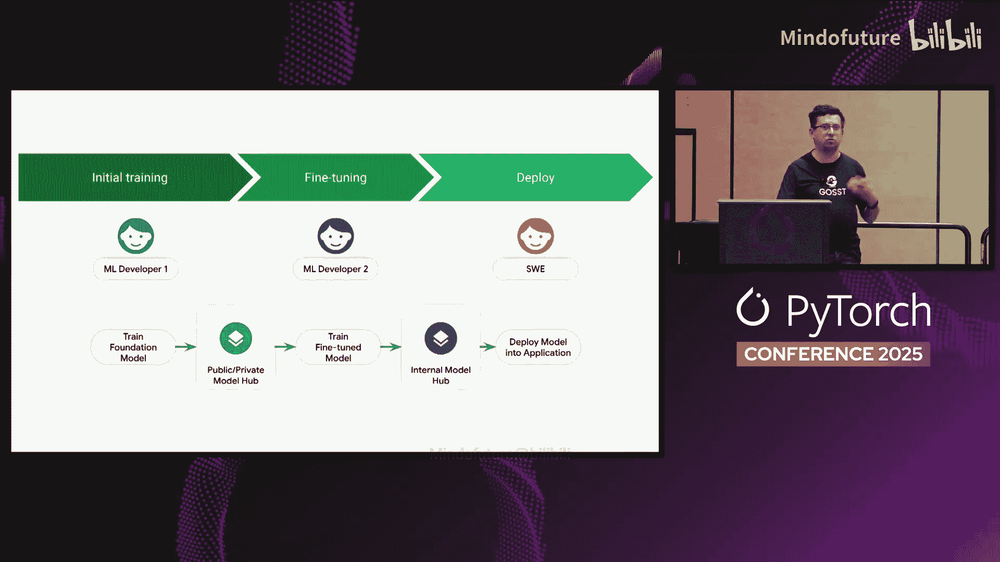

And I can do a demo for this。 Hopefully， it will work。 So I am a trainer。

 and I am going to train a simple。😊。

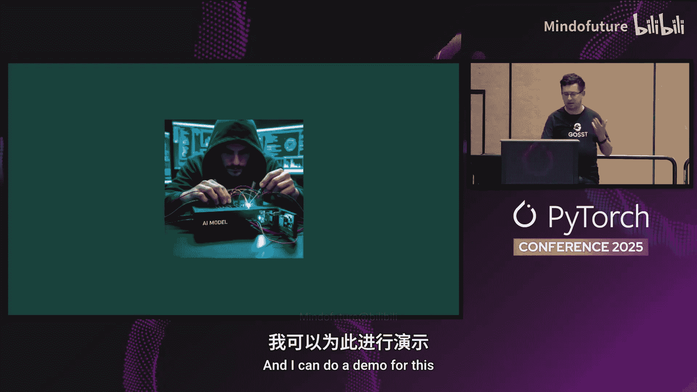

Pytorch model。By多。Okay， so this is a simple Pythtor model that does digit recognitions because we don't want to spend a lot of time in the demo training this。

 So it's just training the model 5 epos for doing digit recognition。 And then once this gets trained。

 I'm going to upload it to a model hub that I own to show you how somebody can compromise that。😊。

So two more epochs。Come on， run a little bit faster。Okay， and now that this finished。

I am going to run upload dot Pi。And the name of the model。To copy it to the hub。

And now that the model is in the hub， I can move to the user。Download the model。They 뭐 model。

And then， use it。拜灯。Use Pythtorch model。 Okay， so in this script。

 I basically take an image and I run the model to recognize what the dig is in that image。

 And because this succeeded， it tells me that the image is a 7。 Okay。

 so now because this is a model hub that I have access to， let me actually hack the model。 So Python。

Stash and then hack by torch model。So this one is while Im while I have access to the storage。

 I find the model to misbehave to actually do something more than just doing digit recognition。

And now， moving back to the user， suppose the user is just now downloading the model。

 They don't know that。 I compromise it。They got the model and when they tried to run it。

That data gets leaked。And the model still recognizes that the digit T 7。

 So everything works for the from the point of view of the user。 But the data got linkeded。

So that is a problem that I'm trying to solve。 And this is not just a scenario that I created here like a hypothesis。

 This actually happened。 So last year， Tiktk fired an intern because that internal sabotaging training processes to compromise the model that another internal was training just to get ahead。

😊，And this is something that happens in reality。 We're trying to prevent this from happening。

So even if you go on hiking phase， there are two providers for metama models。

 One of them is metaalma。 The other one is Facebook Lama。

 Only one of these users is real is the real meta company。

 The other one is some researcher trying to prove that just relying on the model name is not enough for security reason。

 So you can get compromise， you can get a model that doesn't do what it are supposed to do。 Sure。

 right now， if you look at all of the other metrics like number of stars。

 files that are in the model users and so on。 You can guess which one of these two models is the real one。

 But all of these other metrics are gamfiable。 So somebody could gamify them。

 especially nation states。 They could spend a lot of money to make you use their own model。😊。

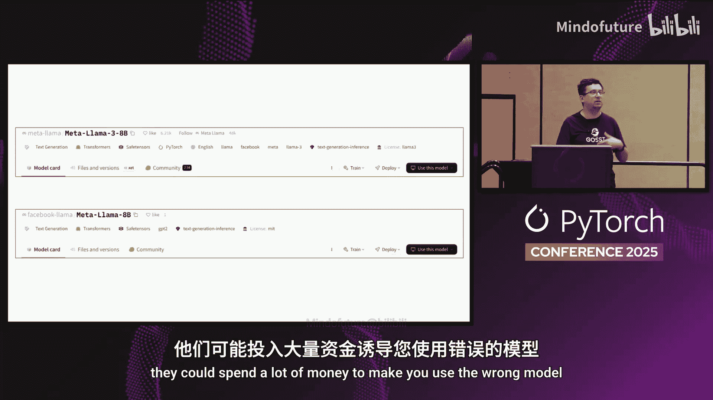

So the conclusion is that although three years ago。

 the future became a reality with the release of GDPGPT and then the explosion of LLMs。

There is still no way to verify the integrity of the models that we are using。

 There is no way to verify that the model that we we are using is exactly the model that got trained。

 And also， there is no way to verify the trust in the model producer。 we get a model from somewhere。

 but we cannot know that that identity that give us the model is exactly the identity that actually trained the model that they trained they did。

 So that's what we try to solve。 We also find out that traditional approaches don't work。

 And that is because models are a little bit different。

 models is not a model is not just on single file。 And there are also multiple formats。

 And in general as a trainer， you are storing， you are trying to store the weights in as many formats as possible。

 So P to save tensors， G G Uf tensor for maybe and so on。😊。

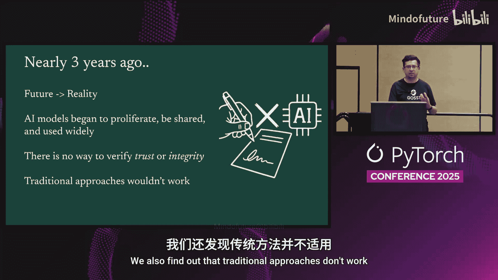

But as the user， you only care about the format that you are using。 So if Im using a Pytch framework。

 I only care about the weights in the Pytoch format。

 I don't care about the weights in all of the other formats。

 So in order to provide integrity as the trainer， you have to generate an integrity check across all of the formats that you are supporting。

 But as the user， you only care about a specific framework。And then also when the model gets changed。

 like fine tuning quantization and so on， only parts of the model change。

 And because in general models are large， you don't want to spend time computing integrity of the model。

 hehing it again each time only a specific portion of its changes。 So because of these reasons。

 we actually had to implement a different solution。

 And we started from ground zero with first thought of questions that we needed answers。

 One of them is who trained the model So we wanted to make sure that the person that claimed they trained the model is exactly the person who trained it。

We wanted to make sure if the model has been fine tune since it was traineded or not or it has。

 it has been temperamped or not。And then for all of these answers。

 we wanted to make sure that they are T proof that nobody could just make a claim that is just a line in a rhythmmi file that anyone else can edit later。

And we look back at traditional software， So software that doesn't use M L。

 And they have this concept of attestations。 Basically， an attestation is a claim about an artifact。

 And in traditional software， we have two types of claim。 One of them is the integrity claim。

 which in the world of M would be this model has this specific hash。

And the other one is the provenance claim， which in the order of M would be this model has been trained by this specific trainer on this specific data set。

 on this specific framework， I this commit this version， and this is the process that run it。

And again， you have the hat。For Ml， we have another types of attestation。

 which are generic level properties。 We can say that this model performed this performed this good on a specific benchmark data set。

 or the model card specific to a model is this one。 And once you make it temporal proof， you can。

 you can no longer alter the model card later just to make the model get more users。😊。

And for all of these claims at the basis of them， there is the part about this claim is attested by a specific identity。

 basically a signature， a cryptographic signature， and that's what you are trying to solve here。

 So looking back at how how a model is getting developed you start with data sets and you can iterate on that on them you can clean them up and so on and then at some point you start training a model。

 you write the model architecture into some Python file using an ML framework like Pythtorch。

 you might start from some pretrain models like especially if you're doing fine tuning。

 you combine all of these pieces together and you train a model。With integrity protection。

 this is where we want to sign the model。 So generate a signature over the model。

 hash the model just and sign the hash。And then that once the model is trained。

 the model gets put into a model hub to be used later， either in further rounds of training。

 or you can elevate the model to production。 So another team takes it up and puts it into production。

 And then it's being used into anl application for all of these stages。

 we want to actually verify the model integrity to verify the signature。😊，And on this diagram。

 we also have other supply chain risks that we are going to solve later into this work stream after we solve the model signing problem。

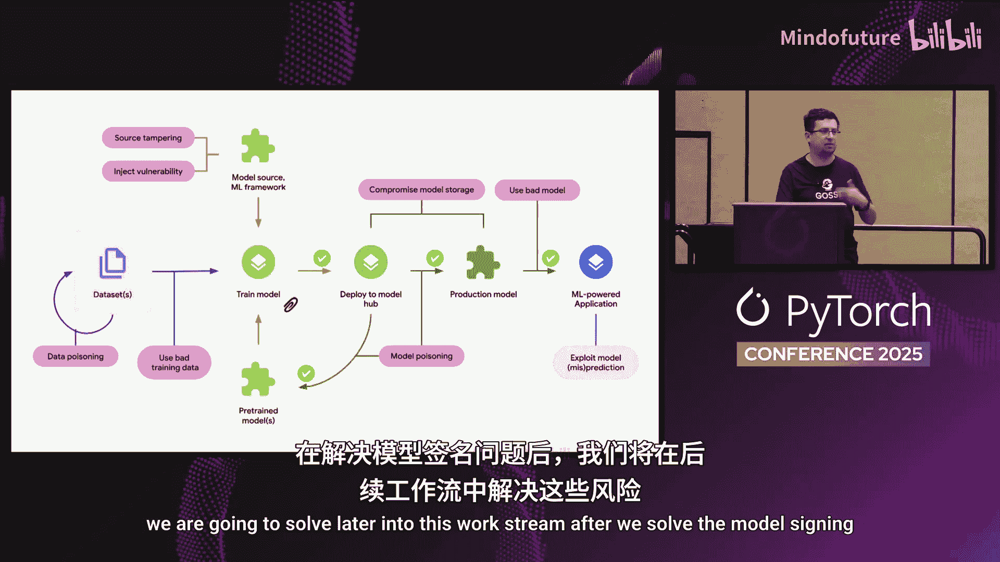

Okay， so now let's move on to where we are today。 So I said three years ago， C GPT started the world。

 Now， AI is an intrinsic part of most of our software development jobs and also signing and verification for modelsists is here。

 This is part of work done under open S open source Security Foundation in April we launched model signing 1。

0 and two weeks ago，1。1。 and also in May， we separated the model signing specification into separate repository such that people that are working on go and Cpl plus directly with models can also verify integrity directly rather than relying on a Python project。

😊，And this way， we can also build it towards provenance。 once you have a model。

 you can have an automatic lineage across all of the models that have been used before to fine tune to get to this model。

 all of the data sets that have been used before， all of the processes that you have used to clean the data。

And also compliance。 So like in Europe， there is the CR。

 there was a version of the AI law in the United States that required you to have an AI bill of material。

 All of this， once you have all of this automatic， it can be generated by toollink rather than you having to monitor spreadsheets。

 And when you get a request from legal department， tell me what you used to train this model。

 you can just run a process and itll tell you itll give us the entire specification。Right now。

 also need to drive adoption of this and then start building on top。So。Let me do a demo。

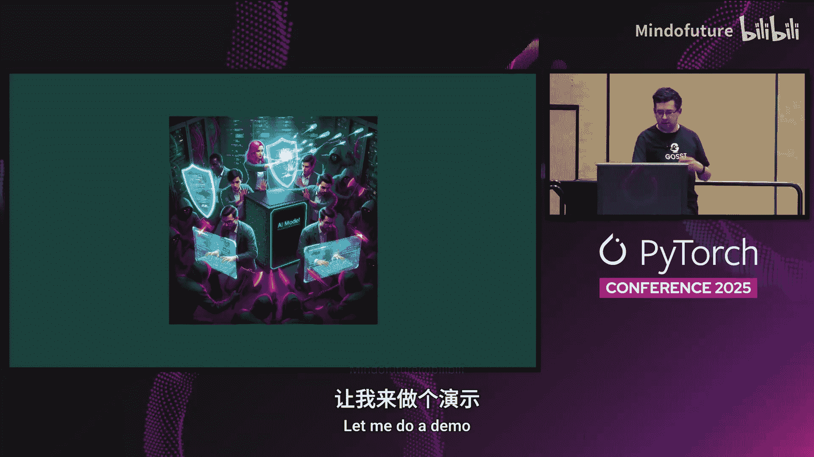

So going back to the demo， let me make sure that I'm on the trainer。 So rather than just。

Training the model。 This time， I'm going to train。And sign the model at the same time。So basically。

 what this does as part of the training pipeline。After it finishes training the model。

 it will connect to to CA， a certificate or。With the identity of the trainer。 in this case。

 because this is an not automatic process。 This is me。 I would have to do an O ID C flow。

 And once I get to that point， I'll tell you what it does。 Once I connect to that C， A。

 I get back a certificate that is valid for a short period of time。And with this certificate。

 I can sign the model。Okay， so now I'm doing the O YDC flow。 Let me see where my mouse is。 Okay。

 so I basically have to go to this link on the browser。And let's say log in into Github。

And I copy this code。And I go back and paste it here。Okay， and now the model has been signed。

And I'm going to upload。Up if I know how to type， upload demo model。

And I'm also going to upload the signature。And now， as the user， sorry， as the user。

I'm going to download the model。And I'm going to download the signature。

And then the next step would be to verify this。And rather than me typing everything。

 I'm just going to take a comment from before。 And one second， this should be the model not。

The data set。So demo model。 And then as the signature。sorryrry， this。Should be the signature。

Model dot seek。 and then the demo。And as the identity of who trained the model。

 I used exactly the identity that I used on Github when I did the YDCflow。

 So I passed my Google email and identity provider on the next row says its's Github dot com slash out。

And once I do this， it's going to verify the model will tell me the verification succeeded。So now。

 if somebody that has access to the model hub tempers the model。

 they can no longer generate a signature for that。 The signature verification is fail。

 Let's say they actually run the YDC flow and they sign a signature themselves。

 They'll have to use a different identity。 So I will catch that in here。

 So let's say instead of mymarac。 I'm going to use my Gmail account。Or let's put just a do in there。

 This time， you'll see an error that the certificates don't match。

 So this is how we are doing the supply chain integrity for models。

 And if I switch back to the slides。Which should be。These ones。

 So this is the workflow that I was running as the workload identity。 as the trainer。

 I sent my workload identity to a6 or C。 and I get back the certificate that is valid for a short amount of time。

 I use that certificate to sign the model。 and the signing event gets put into transparency log。

 This transparency log can be monitored but by trainers。

 So you would know if you know you released1 versions of the model。

 and then you sign find an 11 version in the transparency log。

 that means that somebody trains models into your name。 So you can declare this model is compromised。

 It's not mine。 but also you can be monitored by users。

 if you suspect that you use a model that is critical for your application。

 and you want to make sure that that model doesn't get compromised， you monitor the transparency log。

 And if you see there is a new signing event， let's say meta released a new Lama model。

 but there is also no accompanying blog post。 you would know that this model was actually not released by meta。

 but somebody their identity and start releasing models in their name。😊，Once the model gets。

 once the signing event gets put into the transparency log， you get back a log inclusion proof。

And now you can upload both the sign model and the log inclusion proof and the signature。

 You can upload all of this together to the model hub。And this is the second part that is nice here。

 The model hub can run verification for you。 It can verify the signature。

 And if the model is verified， the signature is verified。

 it can displayed a verified badge on the model。😊，And now as the user。

 if you trust the model hub and you see the verified bad。

 you can just take the model from there and you don't need to run the verification yourself。

 If you don't trust the model hub， you download the model。

 you download the tool link and you verify this signature yourself。 So you have an option to choose。

And I can do a demo for that too oh first there are some van metrics in here。

 the QR code goes to the library I'll also if you saw that there is a poster downstairs also with the same link but。

I leave it here。 you can install it People install model signing。

 gives you a CI that you saw as I was running here and also a library that we're going to use now to upload the model to Kagggle。

 So I switch back to to the trainer。And this time when I'm running the upload。

 I'm also going to pass in another flag that says Cagggle。 This time。

 I'm going to upload this model to Kagggle。 So what this does is actually assign the model。

 You will see at some point a model dot sig in there。😊，This one，m signing Do Jason。

You can't see my mouse at the bottom。 And then you see the link that the model get uploaded to Cal。

 So if I go there。Okay， so this is the signature that Kagggle generated for you。

And if I go to this one。Now on Kagle， you will see there is this six star status pending。

 This is Kagggle verifying that the model integrity is correct。And rather than waiting for that。

 let me switch to another tab。Where I have this order saved。This one。

 So this is a birth model that I uploaded a while ago。 and you will see here。

6 store status signed and the link on at station。 If you partially trust Googlegle。

 you can go to the station and run that。 If you fully trust Googlegggle， you just download the model。

 If you don't trust Googlegggle at all， you would download the model and inside it。

 there is this dot gagle folder， which has the signature。

 You can just validate the model locally directly。😊。

And the signature I'm displaying it here is a Json file that contains all of this information that we have built so far。

Okay。And let me switch back。 actually know while I'm still here。

I also want to show you in the signature that is this verification material so that you know how to verify the signature。

 And I have this st log entry。 This is the transparency log。And if I go here， and I copied the。

Log index， this number。I can actually go to this page record。And paste that number in here。

And select that。 This is the log index。And once I search for this one。

This is giving me exactly the inclusion proof for that signing event。

 Youll see here on the certificate。 I hope it's visible。 This one is valid for only 10 minutes。

 for only 10 seconds。😊，And what is also important at the bottom here。

 This is the user that signed the model。 So Kagle actually signed it in my name using my private user I at Kagggle。

And if you only expect models that are signed by specific users that are released by specific users。

 you can write a policy in your control plane that only accept sign certificates that come from these users or from this regular expression and everything else would be automatically denied by a control plane it don't in your infrastructure。

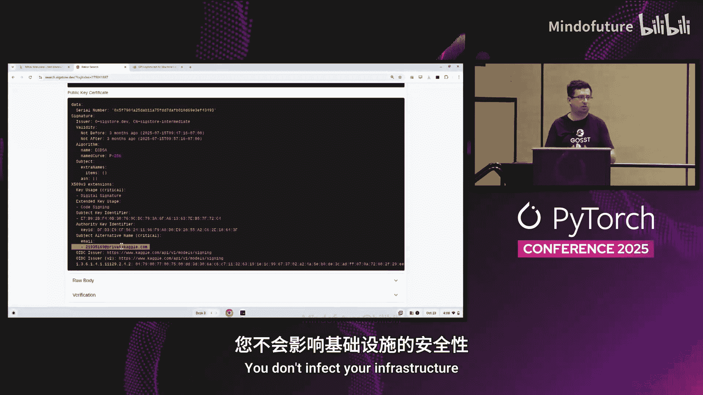

Okay， now let me go back to the slides。

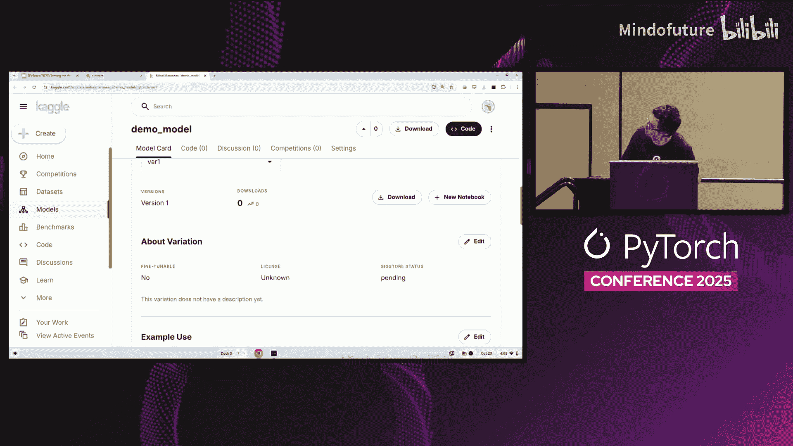

Should be this one。

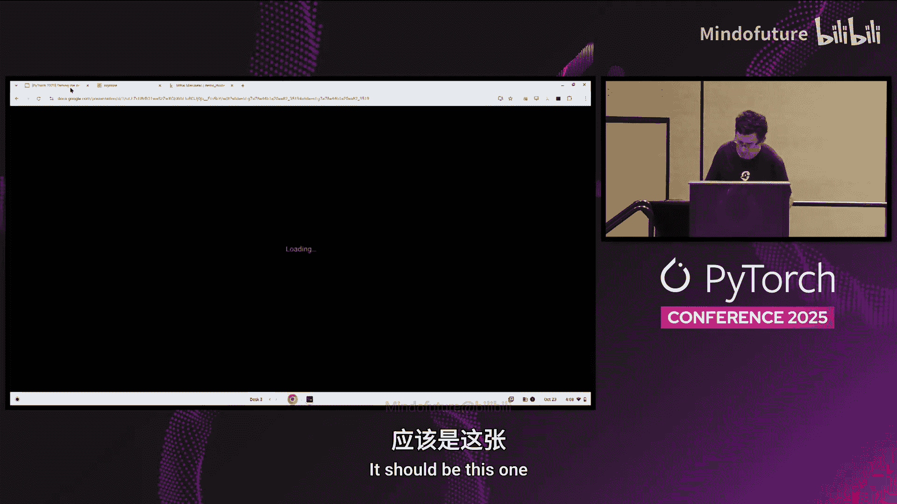

Okay。So right now， all all the demo that I showed you was signing using sixstore。

 Sixstore is a new way of signing certificates aims to be what let encrypt was for Htps rather than you maintaining your keys and you signing infrastructure and then having to run separate processes when the key gets leaked。

 Sixstore does this thing where you have a certificate valid for just 10 minutes and you have the transparency log the inclusion proof and everything else。

 But because companies are also having their own signing infrastructure。

 we also want to meet them where they are。 So we also support signing with traditional approaches。

 So with signing keys， signing certificates， P 11 and so on。😊，And also。

 rather than hunting every model format and integrating the signature into that。

 we are signing a collection of files。As a model。 So this also enables us to sign data sets because in the end。

 data sets are still files in the directory using the same library。😊，And if you scan this QR code。

 this will give you the report that has the specification for the signature。

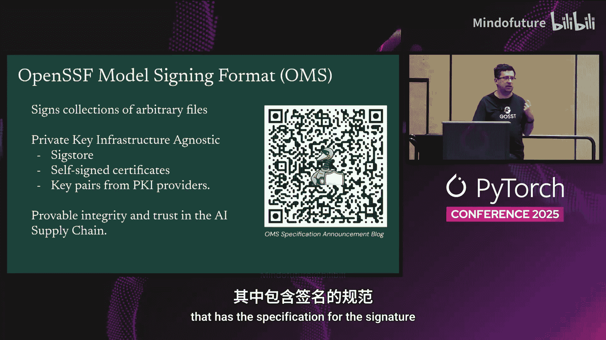

Okay。This is the demo that I showed you with Kagle。And also in Vdia。

 from the start or from the release， they also integrated model signing。

 They are signing with signing certificates。 If you go to the Nvidia model hub。

 you'll see that all all of the models released in April have this signed badge that specified that invidia saw signature and verified the signature of the model and the signature past。

😊，And if you don't trust Nvidia， but you want to run this youre on yourself。

If I switch back to the user in here。I can download the model。到。I can download the model from Nvi。

 So let's say I'm downloading dashg net。And once I download the model。

 then I run another command to get the signature， and then I can verify them locally。

 So this downloaded the model， and then download。That should。And I being get wrong。Okay。

 so I'm downloading the signature。And then the last part is to verify。The NviD model。

 So this time I'm verifying other certificates。 So instead of six。

 I'm verifying signature generated to certificates。😊，And I have to pass in the certificate chain。

 So the sign the public part of the Nvidia public signing certificate。

 which I get from the Nvidia website。Once I run this command。

 it's going to tell me that verification succeeded。

 This model from Nvidia has not been tempered with since it got put into the model log since it got put into the model hub。

And switch back to the slides。So where we at right now？We have signing for models。

 but we actually want to go into a future where we can sign everything that is generated by an ML workflow。

 So models， data sets， model cards， agents， agent cards， everything。

 And in order to do that to have to do several steps。 we have to first extend signing adoption。

 So both model hubs should integrate signing and verify if this model signs should verify the signature but also model framework。

 MLl frameworks should also support signing and verification。

 So as you save a model with torch dot save it should it should generate the signature at that point rather than you having to change your pipeline to generate the signature。

 when you load the model with torch dot load， for example， if the model has a signature。

 Pythtorch should verify the signature if it fails。

 it should stop loading the model and ask you if you want to continue pass an additional flag otherwise it will stop there so it will prevent compromises。

We also need to integrate with it pipelines like Jupiter notebooks and so on。So basically。

 want to meet the M， L developers where they are， rather than asking them to convert to more secure pipelines。

And then this goes also to the next step where we all want to ensure an ML supply chain transparency project where rather than just ensuring the integrity of the artifact。

 we also want to ensure the provenance。 So once I have this artifact， I know who generated it。

 how was it generated， and then for those artifacts， how are they generated and so on。

Because once you have all of this， you can have a transparency view onto the entire M supply chain。

 You can put everything into a tool called like Wac and you get a full telescope into the entire chain。

 And for example， if a model misbehaves into production to pick a Google example。

 If the model says that you should put glue and pizza you could automatically inspect how how this got generated。

 and find out that is because of reddit data set that has been used to train an initial model that got fine tune and and so on。

😊，And also， when you get a government agency asking you to generate an AI bomb。

 go with you run a single commandll generate an AI bomb for you directly。

 That's the future we want to build on。 And in order to do that。We actually need help。

 So if you are interested in helping， there are two working groups that work on this。

 One of them is called Open SF Open So Security Foundation。 It has an AIM L working group。😊。

And the other one is coalition for secure AI， I put the dates on the next meeting are for each one of them。

 Open SSFA working Group also has several AI and security related Ss。

 one of them is model signing that I just talked about。

 another one is Sa MCP for agent security and the last one is security for AI starting from the AICC finals Sa DRP now we're trying to use cyberisming systems to find vulnerabilities in open source to fix vulnerabilities in open source and so on。

And the QR code here at the bottom is a paper from Cosi about model signing。

 which also recommends this approach。And with this。

 I'll stop for one question because we don't have much time， but then we can also sync out outside。

I guess no questions now will'll think out outside if needed。 Okay， thank you。

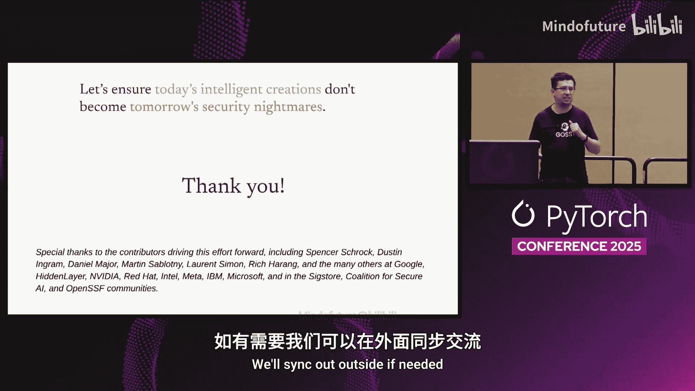