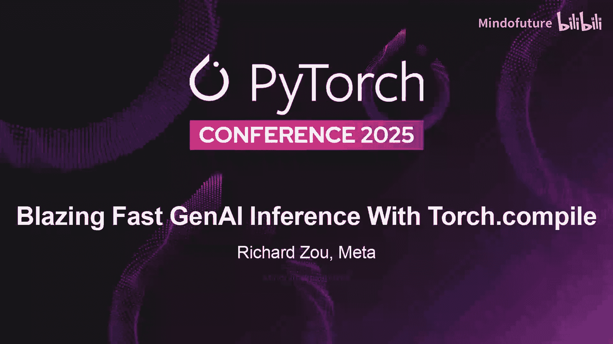
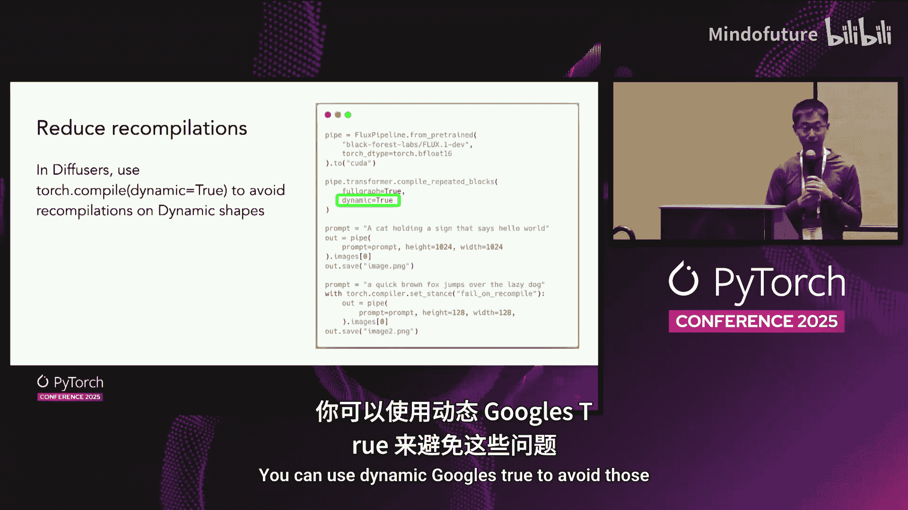
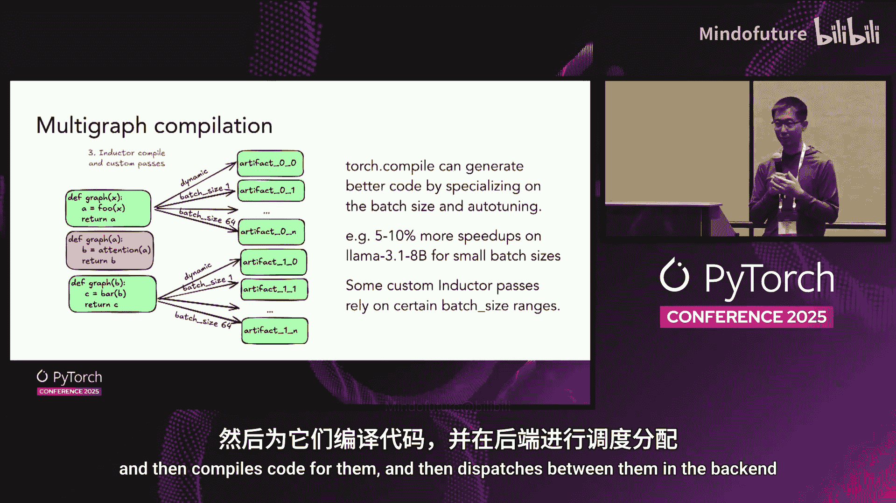
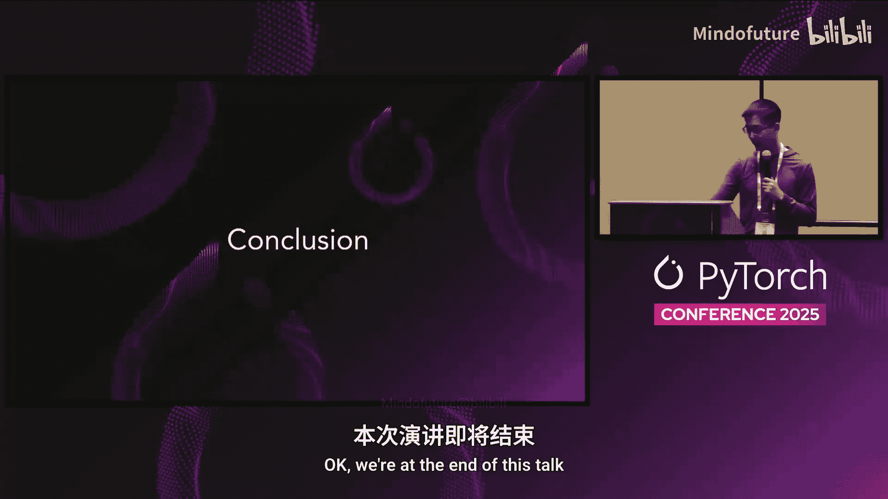
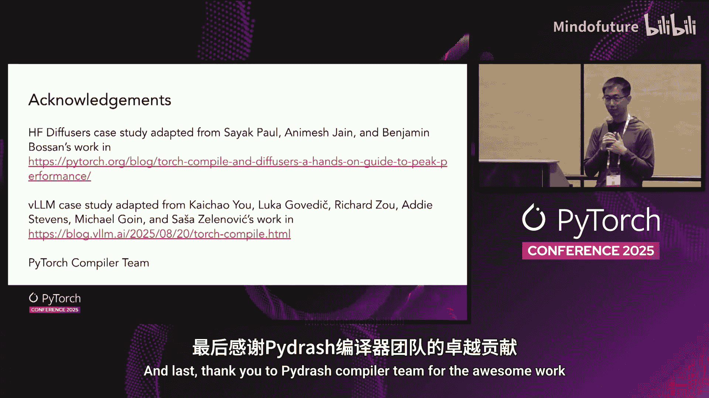
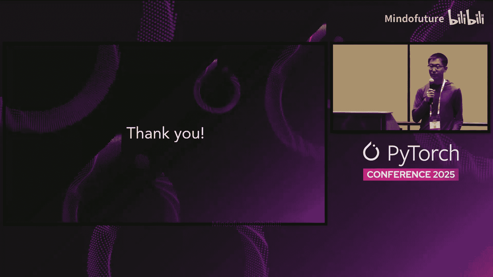

# 2025 Pytorch大会 ｜ Pytorch Conference 2025 p51 P51_使用Torch.compile实现极速生成式AI推理-Richard_Zou__Meta -BV1b8kRB6EJG_p51-

Hi everyone， my name is Richard O， I'm on the Ptrch team at Meta and today I'll be talking about blazing Fast Gen inference with torque compile。

So we'll do a quick introduction to Torch Comp first。😊。

So you guys have probably heard it talked about it a lot at this conference。

 but Torch compile is a just in time compiler， it captures straight line graphs that can be optimized so you can apply torch compile to a function it'll do a frontend capture of the function to produce a graph and then this graph is passed to our backend induct which will produce efficient output code in the form of fused Trident kernels and potentially other things as well。

So why use source Comp？😊，The value of proposition of torch compile is that it gives you fast baseline performance to save development time like from tuning model performance so I've got a flow chart here question is you want to spend a long time like handwriting。

 hand tuning your kernels。😊，If the answer is yes， like there's been a bunch of cases in the past where people have just handwritten in a kernel and tochium pile is still faster。

Okay， and some examples of performance， so on the bottom right， this was a recent X post。

 Twitter post in a last couple of months where they enabled Torsion pile on the Ge3 model in hooking F transformformers and saw something like a 60% speedup。

😊，At the top right， the Pyarch compile team keeps a benchmark of models and just a list of speedups in this table you can see something ranging from like 1。

02 x to up to like I think it's like 2。7 x which is a lot and on the bottom right we'll talk a bit more but VLM uses torch compile by default and this gives like we've seen performance numbers like ranging from like 1。

05 x to 1。9x。So in this talk， I want to walk through how like Torch compile generates fast kernels。

 lets you reduce CPU overheads， and also lets you sort of automate custom optimizations。

We'll start small from a simple like layer norm kernel use case build up to usingging torturer Island hugging face diffusers。

And then talk about a very involved use case for tax generation in VLM。Before we begin。

 I want to say that forch compile is a learnable skill， like you can use Fort compile out of the box。

 maybe without much knowledge， it may or may not make your code faster。😊。

To really like use To from Power well you have to learn to manage your compilation process in particular you'll need to learn about things like graph breaks。

 how to manage your compilation time。😊，Recompilations， dynamic shapes， and custom operators。

 and we'll see examples of these five things in the slides today。

So first case study is a layer norm kernel， we're going to talk to you like how to reduce this graphs。

 fo conilation and reconilations。😊，I like this example because it's just some really simple code。

 so Lirdim kernel， you've got some implant tensors， it's going to return an alpha tensor。😊。

And if you just apply torch compile to this。Like the regular call to layer norm is without torschm power in this example is 1。

4 milliseconds on my machine， if you apply torrsch compile power to this to the function it goes down to 0。

5 secondscond milliseconds， so that's a lot of speed up already， what else can you do？

The first thing is I kind of snuck this print statement into the middle of the layer norm function。😊。

嗯。Forction P front end Dynamo does this thing where it will break the graph。

 Itll create a graph brick on anything it doesn't support。And so like in this case。

 like Tortum Pa decides to graph brick on the print function。

So why doesn't Dynamo support print functions， the idea is that is just very conservative。

 like maybe Dynamo can move your print function to the end so that you can have like one big graph that it compiles Dynamo decides that。

 hey， okay， maybe you really want your print here so we're just going to graph break。

And so graph breaking here means that there's actually two graphs being captured， one at the top。

 one at the bottom， and these two graphs get sent to the back end separately for compilation。

So this is on the right is a like page from Tl parse。

 TL par is a tool where you can actually look at what is happening with Torch compileile。

So NL parse like very top font might be a bit small， but it's a link to the graph Rick。

And the graphic it tells you exactly what it is， it's a print statement occurred。

If you click through the compilations of which there are two。

 you can actually look at the inductor output code and for each of these graphs。

 inductor generates one fuseed trident kernel for each of those two graphs。

And so to make this thing faster， like this entire thing can be fu into one single kernel and you just have to remove the graph re and sorry before I go to removing the print statement。

 another way to figure out where your graph res are is you can call torch compile with F graph equals true。

😊，And it'll straight up error， like if it sees a graph break with have the same message that the T parse would have shown you。

So removing the for salmon gets you down to 0。25 milliseconds， which is great。

Everything's one fuse kernel， you're pretty happypy。Except for every convolations。

So one interesting thing to note about Torchmpi is that it really specializes on your inputs。

What this means is that like it will look at your input shapes and if you' like， okay。

 I'm going to compile a kernel or multiple kernels like for these exact input shapes。😊。

And this is not desirable sometimes， especially in like。

general a use case where like for like a lot text generation， you have like rearing varying。

Btch sizes are varying number of tokens for image like generation。

 maybe you have different image sizes。So in this later number example。

 like maybe we varied the dimension in the first dimension。

And so like when the shape changes for Champa recompile， recompilees are expensive。

 maybe you don't want that。And the answer to that is to just use dynamic shapes。

 If you know what dimension you're going to vary， you can tell To file using this Mark dynamic API。

 you can say， hey， To file， I'm going to change the first dimension， please create that dynamic。

And what torch compile will do is like Dynamo， like the front end will just createce out a graph where the shape of the like first input is an input hit a graph。

If you don't know what dimensions are dynamic or you just want something to work really fast。

 a user dynamic is true， it'll try to assume that all dimensions are dynamic。

This comes at the downside of like increased conilation time and torsion F will not be able to generate as good code if everything is dynamic。

😊，So that's layer norm， we can move on to something a bit more complicated。😊。

Which is hugging face diffusers。So diffusers is a library for generating images， video and audio。

 We're going to talk to like how to actually apply to compile in diffusers。😊。

We're going to talk about how to improve compile times and then we'll also talk a bit more about dynamic shapes。

😊，So when you're like trying to enable a Torch pile on something。

 like the first thing you usually ask yourself is where you should actually apply Torch pile。

Because of things like graph breaks and just like code out is unsuitable for torch comp being around。

 you want to like focus your effort on something that。Would have the most value。 And like。

 depending on the type of model you have， like， you will want to apply on something different。

For something like an image diffusion pipeline， like these things are not like one model。

 they're like multiple models stitch together， so let's say you specify some text like a cat holding a sign that says hellello world。

You want to generate an image， and what ends up happening is like you have this text。

 you send it through a text decoder， which encodes them to some embeddings。😊。

You've passed in beddings and a new latent tensors into a Dnoer。

 which will progressively denoise the image oh sorry， denoise the las。

And then you pass the final Lant sensor into an image decoder where it'll take the las and produce an RGB image。

And in the diff fusion pipeline。The diffusion transformer。

 the denoisor takes actually the most amount of the time。

 so that's the place where diffusers recommends using torch compile。😊。

So having face diffusers exposes to the fusion transformer as this like pipe dot transformer object in your pipeline。

 and you can just call compile that with Fgraph true。

And doing this like gives you some level of speed ups with one unfortunate downside。

 the convolation time is actually really high compared to like the amount of time it takes to generate one single image。

And so there are ways you can reduce your compilation time depending on how your model looks。

So I'll talk about one technique， it's we call it regional conilation。

 it's basically compiled way to repeated blocks separately like let's imagine you have a single model it has the same like block like repeated over and over again。

 a mod load the parameters maybe being different。😊。

Instead of compiling all of these blocks together into one like graphra。

 you should compile a blocks separately。And this lets us compile every block once。

 so let's say you have N blocks， you compile the block like the first block once and then reuse it。

And minus1 times。And to just show how that works， let's say you have a torschion pile on a model。

 T0 t1 t2 are literally the same block， just different parameters。

 instead of compiling the whole forward function， just compile the module separately。

And the first time you could do a compile， it'll compile to kernels。😊。

The next couple of times you do it， it'll just cache it on the structure of the graph and it'll just reuse the kernels。

And so theuser offers an option to do this， it's called compiled repeated blockslock。

 this is not a built in part for your API to just put this API into their random modules。😊。

And it just does just that compiles repeat blocks， and from this you can shave down to compile time a lot。

 which is really cool。😊，One last thing on dynamic shapes。

 the like if you're the prompts that you pass， let's say you're doing inference on multiple images is。

multiple text strings to produce multiple images， like if your prompts like vary in size or if the images you're generating have different sizes。

The different shapes will lead to recompilations because Sotm P specializes on it。

 you can use dynamicymic Google Str to avoid those。

Okay， we're ready to go to our like more complicated use case beyond。

So VLM is a text generation library， it's a LLM inference serving engine。

 which means you can start a your server。Pass it sumt。

 you' can ask it what the capital of France is and hopefully it'll tell you Paris V mute leverages torch compile by default。

 it uses torch compile for around 95% of its text generation models。

We see like some significant performance speedups with Torsion file on VOM This is from an older benchmark with some older models。

 but on these like the set of models from Lama Gema3 and Quin， like we've seen things like 1。

05 x speedups 1。9 x speed ups。😊，Using Torchment file versus not using it。

And so why does VLM use compileile？VM supports a pretty wide range of models and like there's a bunch of optimizations you can do to them。

 but it' would be nice to not optimize all of them by hand。That being said， like。

 we don't want to optimize some of these models by hand。

 and also like the stock torch And so that's why we use like torch and pile。 Unfortunately。

 stock torch and pile is insufficient for Vi's performance requirements。

That didn't stop VM from using Torch compile， though。

And so what ended up happening was like Von created a custom what we call a custom compiler that's leveraging torch compile components。

To build the compiler of your dreams， to optimize their courage。

And so I'll talk through how this integration works， we'll talk about like custom kernels。

 piecewise kgraphs， custom fusion passes， how VLM uses this integration to give really tight control over compilation time and reconilations and also multiple graphs for the same model。

😊，Okay， so this is an example of what happens when you compile a model in V on。😊。

We'll go through these steps one at a time。The first episode of graph capture， like you' got a model。

 you have some example inputs， we use torchn Pferen and dynamo to actually capture one single graph。

 one single full graph that is dynamic on the input back size。

Vion controls the model source code for all of its models。

 except for the ones that use transformers backend， but that's a different story。

 and so all of these models are handwritten to have no graph breaks and to work with dynamic shapes。

A side note on custom kernels。 Torsn power generates sufficient kernels for like。Our messor and rope。

But a lot of like to bem like。Operations like Madmal gems。

 Mos like require specialized hand turned kernels， torchment pal is not able to generate like good kernels photos。

Quite yet。And so a lot of custom operations slash custom kernels。

 like if they're written in C++ and you're just calling them from Python。

 Dynamo does not really know what to do with it， like Dynamo doesn't know if you have a side effect in them。

 if it's like not side effectable， like what the return like tensor looks like。

To avoid graph breaks like one to on custom like kernels。

 you're supposed to wrap them in a custom operator。 and that's what realM does at the bottom left。

 it's an example of like what the full graph actually looks like RealM like hides all of their attention operations behind this unified attention operator inside this operator there is a separate dispat layer to multiple different attention backends。

😊，Okay， quick side note on Cgraphs。So the problem is sometimes in element prints。

 you have a lot of sea view overhead。Like like you got C overhead because the Py framework has overhead。

 you get CP overhead from just running Python sometimes and so that's where Cgraphs is really profitable Cgraphs is this like technique that lets you capture you basically play a model and Cgraphs captures all the kernel launches。

And once you have captured a kernel launches， you can just replay them in the future。

There are some restrictions here like you can't capture everything。

 you can only capture ka kernel launches， you can't capture CP operations hence' the name kgraphs on the replay your k kernels will read from the same memory agricies as they were recorded。

 which means that if you have like different info data。

 you don't want to just replay the graph with the same data you want to rewrite your that address with new data。

And so VM does this interesting thing， like because not all operations are Ced safe。

 like especially the attention operation during like freefi for example。

 VM splits takes this photograph that it has acquired from Dynamo。

And then splits it into Cgraph graphs and Cgraph unsafe regions。

And so the Cgraph safe graphs can have Cgraphs applied to them Later on。

 the C unsafe like regions they just run eagerly without Cgraphs。Okay。

 so now that we have a bunch of split graphs， the next thing we do is we call inductor to compile the graphs。

So induct will just take the graph， maybe the graph has like I don't know the R storm or the rope operation it。

 and it will just generate an artifact that has a fuse kernels for them。

In addition to calling inductor， VM applies custom inductor passes， for example。

 some of the passes look like we fuse like si and quants。

 some of them will fuse all reduce an RMS norm operations into one big fuse kernel。

And so like instead of handwriting all of these like custom optimizations。

 like you could think about going into like each of the1 hundred models and just， I don't know。

 fusing them together by hand， VM does this as a custom induct passes and the customduct pass。

And so these custom and doctor passes unlock LLM specific optimizations over the entire range of models。

 they slightly right at once， reduce it everywhere。Finally at the end。

 we've got some compile artifacts， VLM's custom D backend just stitches and applies to crgraphers。😊。

So that's the Roman tour of VM convolation。 I want to go through three more examples of how like the VM custom compiler really controls the conilation。

😊，Okay， the first one is reconvols， likefovols are kind of annoying awesome times like you don't want reconfoils during serving。

 they will like make your legacy pretty bad。And so VM like really controls the compilation process。

 like in the first part， it captures graph like one single graph that can represent all the like sematictics they want。

 like prefill， decode， etc。But also like VM uses like custom Dynamo hookax to just strip drop all the dynamo guards that are responsible for recompilation so that it will literally never recompile。

Compvolution times， so VLM also saves compile artifacts to this。

 this is leveraging Torch compiles compiler cache。So right now， so on a cold start。

 you're launching machine， it will。Surve the model it will do like。This everything in this diagram。

Right now what is cacheable is just the backend compilation part。

 like every time you start a machine， even if you have run and V on this machine before。

 it still needs to do a front entrance trace， it still needs to split your graph。

But at least the back in compilation is cache。 The back in compilation is the largest part of a compilation time for Lama 3。

170v， like it's around 98 seconds compilation back comp compilation is 60 seconds。In the future。

 Pyrch is working on a new feature called AOT pre compileile that will let you cache even the front end compilation pieces。

Roughly how that works is that like given a model and some inputs。

 this new AOT per compileile API just gives you an single artifact。

And you can run this artifact on some inputs， you can save this artifact to disk。

 you can load it from disk。And there's completely like sidestep， anything， any comp you need to do。

 so it'll be able to give us near zero warm start times。Okay， multigraph compilation。

So real captures a graph with dynamic shift and then passes that to， doctor。

It turns out that this is pretty good， like in terms of performance。

 but we can also eke out a bit more performance on that we have measured smaller batch sizes if we actually specialize on a batch size。

And turn on auto tuning， auto tuunning is the thing where Torm power can generate multiple variants of the kernel and find the best kernel for you。

And so like in like this step， like instead of taking one dynamic shape graph and compiling it beyond takesa graph specializes it on multiple batch sizes that are provided by the user。

And then compiles code for them， and then this batches between them in the back end。

Okay， I want to touch on one last thing since post training URL。

 is becoming more important and the Mers are becoming more important in Topi。

 we're planning on offering soon a new run to run deterinistic mode。

And also a new mode for torschment pallet to generate efficient batchtion variantant kernels。

 So no need to eventually there will be no need to write these by hand。

 like Tortm power will just produce these batchtion variants is pretty important for VLM in the sense that like VLM can choose the battery data together differently and you probably want like the same result out。

 otherwise you get some weird behavior。Okay， we're at the end of this talk。

 I want to just like say some last parting thoughts we in the talk we showed how to compile works in a variety of use cases。

 of on and hooking face diffusers。😊。

For compile helps improve your performance and productivity via faster kernels， lower CPU overheads。

 and biodevelop velocity。And Part compilelir team， like as a part of the Hy Compr team。

 I think like we've been making an effort to really talk to developers in the community。

 see how we can integrate with their libraries， and just make them faster and more productive。

So thank you some agments， the hugging face users part of this talk was based on work by Saak Ganemesh and Benjamin who's originally a blog post。

 did from the VLM case study， was originally a blog post from Kaichao Luca Me and more folks over there and last thank you to Parts Comp team for the awesome work。

And that's all for me， thanks everyone。

