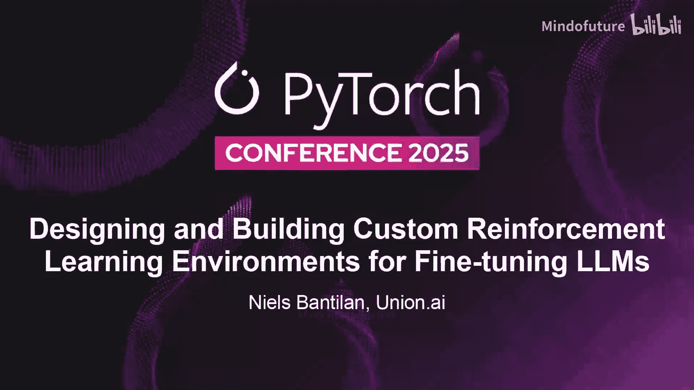
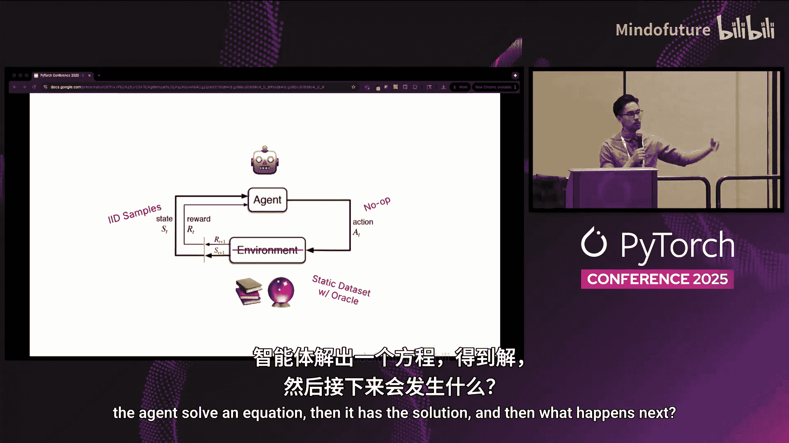
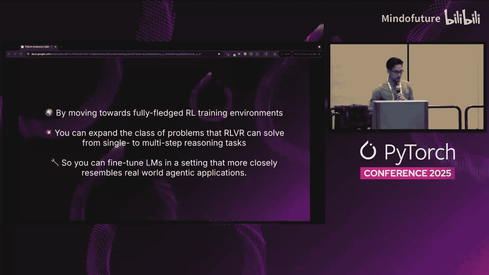
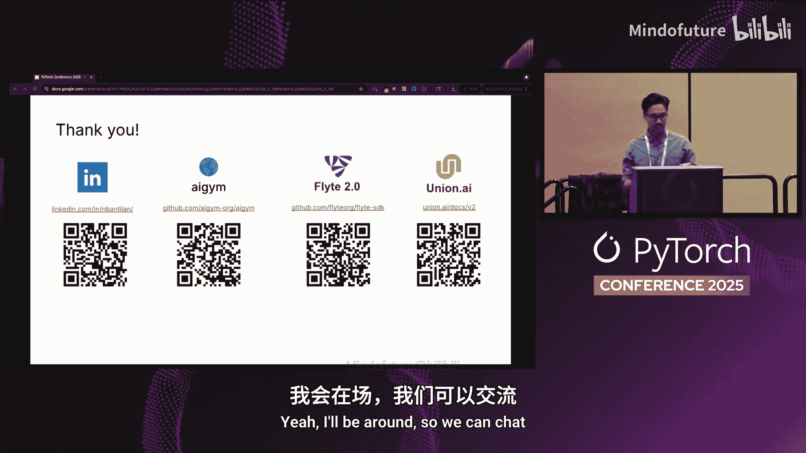

# 2025 Pytorch大会 ｜ Pytorch Conference 2025 p52 P52_为LLM微调设计与定制强化学习环境-N._Bantilan -BV1b8kRB6EJG_p52-

Happy Pycon， Pi torch con。 hope everyone has learned a lot。 I sure have。

 I was at yesterday's poster sessions at the compiler section was just。

Amazing what people are doing there。So my name is Niils Bentlen。

 I'm the chief ML engineer at Union AI， where I'm helping to build。

 maintain and commercialize flight， which is an open source ML AI orchestrator。But today。

I'm kind of putting on a quasi kind of research engineering hat and super excited to talk to you about sharing my learnings from designing and building custom RL environments for fine tuing language models to perform multistep reasoning tasks。

So it's crazy to think that Deepse R1， the paper and the model came out just in January and caused a lot of hububub。

 a lot of price fluctuations， as we all know。 But the one thing that it inspired me to do。

 I think is kind of captured in this post by Andre Carpati。

 which basically saying one of the highest leveraged things we can do is an open source M L RL AI research community is to build high diversity RL environments。

 And as he mentioneds here， this is a highly parallelzizable task。

 So I guess I'm one of the the units or one of the execution paths in that massive fan out that I think we're currently engaging in as a community。

嗯。So we have all this great， these great training tools and infrastructure。

 And I think we still face a major bottleneck to getting the most out of these， these R L， HF。

 R L VR systems and。😊，I think one of these bottlenecks is。

 as was pointed out earlier in the previous slide， the creation of diverse RL training environments that illlicit kind of like these multistep reasoning traces that will allow language models to do useful things in production at inference time。

嗯。And so。😊，One of the main points in my talk is that we're not really。If you。

 if you look out there in， at the， a lot of the the training frameworks and the the training code out there around RLVR。

 we're not really。Fully utilizing like the full RL API。

 this agent observation loop where the agent takes actions， which affect the environment。

 which then affects the next set of data points it sees， right？ So what we see， I think。

For the most part， not not all projects are like this。 but for the most part。

 we have these static data sets， these math dataset sets。

 these coding data sets with problem and solution pairs。 And if you squint and you look at it。

 It's essentially like I IDD data sampling from this data。

 The actions that the agent takes are kind of no ops in the environment。

 They don't actually change what the agencys next， right。

 you have these rollouts that you have the agent solve an equation that has the solution and then what happens next。

 really nothing， you just get the next data point。

So the crux of my talk is。

I kind of， it's kind of a call to action， which is by。

 by moving towards fully fledged RL training environments。

We can expand the class of problems that RLVR can solve。

Beyond math and coding coding problems to these basically single step reasoning tasks。

 to multi step reasoning tasks。 So you can fine tune language models in a setting that more aligns。

 at least with real world kind of agent problems。So want to spend a few minutes just to get everyone on the same page。

 I'm not sure how many of y'all have looked at GPO recently。

 but really the crux of it is when you compare it to proximal policy optimization。

 which is at the top。 you have basically three models， the policy， the reference in the value model。

 right So GRPO gets rid of value model， which substantially simplifies the training loop。

 and instead uses a batch of rollouts to get a bunch of rewards。

 which you then use to compute the advantages， advantages basically being how much better do you do for a given action based on some like mean action。

So if you look at the dataset sets out there， like the numino math data set。

You have problem solution pairs and you have a function， in this case。

 this accuracy reward function that's responsible for parsing the completions that the agent produces。

 parsing the solution， and then administering some kind of reward based on a match of a solution to answer。

So what are we missing in this setting， right， As I alluded to earlier。

 we have a static data set with an oracle， some kind of algorithmically derived or a human label。

 of some sort of way for us to write a function that says here is the correct answer， right。

 And you get a plus one or a 0 or a negative one based on the answer the correctness of the answer you provide。

Actions， as I said earlier， are no ops。 The actions at the end of this rollout trajectory don't actually affect what the agency is next。

And the states that the agencies can't really model temporal dependencies across actions and states because you're just getting these math problem sets or coding problem sets just sampled out of this static data。

So this work centers around the question， what might quote unquote。

 self supervised RL environments beyond math encoding look like。And so for this。

 we take inspiration from two things。 The first one is next token prediction。

 Let's consider for a moment the unreasonable effectiveness of next token prediction of producing these really rich language representations and then you have to do RHF to make it not act crappy or whatever right or spew out Internet speech But if we look at it right if you just you know look at the tale of two cities。

 the first couple of words just this text snippet， you can derive a whole bunch of training data samples just from that。

 right So this allows you to massively scale and trivially extract labels from massive amounts of data。

So what might self-svised pretraining look like for language model agents that do multiple steps of reasoning。

 multiple sets of actions that that gets more context into its context window than that does more work to solve a problem。

So the second source of inspiration is from the classical R L grid world， right。

 The states here are the local representation of the agent's position on the grid。 It only sees。

The what is in the block above below to the left and to the right of it and then needs to make a decision on where it needs to go up down left right in order to get a goal into to the goal state。

 And you might write a reward function， something like in a negative one for each time step that it's not in the goal function to incentivize it to。

 to get to that goal function sooner。And so for these two pieces of inspiration。

 I'm gonna draw on a third data point， which is the wki W Wikipedia citation graph。

 This is a massive graph。 Humans have been writing and annotating and providing structure to this graph and more broadly the Internet。

 right， But if we look at high quality sources， we can stick with Wikipedia。

 And I hope you can kind of squint and see where I'm going with this。😊。

Who here has played the Wikipedia game。So you start off in two random nodes that are kind of and how and hops away。

 And in this game， you could only click on the links on the page， right。

 So you have to claim a scroll。 You have to reason your way。 How。

 how does Titanic relate to zoolander， right？ How many， I guess there's 1，2。

3 hops away to get to there。So for a pretrain language model。

 it's already been trained on Wikipedia this， you know。Maybe a trivial task， maybe not， I'm not sure。

 but if you've ever tried this， there are several websites and it's actually kind of hard to do。

So Wikipedia as a RL environment is it's fairly easy to see how you can pull out like a self-supervised reward signal from this right so nodes are states。

 agents traverse edges through actions so they select URLs from the context window and rewards are shaped by the target node and here there's a lot of reward engineering that's more art than science and I'll share a little bit on that a little later。

Work has already been done on this。 Theres this paper here learning to navigate Wikipedia by taking random walks。

 This， however， uses transformers to create embeddings of nodes and links and then uses like this custom MLP to like produce probability。

 a probability distributions over the links。 So I kind of wanted to go for something more like generalizable and purely based on token inputs and outputs right so tokens are the state space and tokens are the action space。

And so if we go back to this agent environment loop diagram。

The state is the current state plus the target URL。 So you start in the Titanic page and you tell it。

 go to zoolander。The agent is a language model。And the action is a reasoning trace and answer to what link in its current context it should go to to get to the target page。

And then the action is sent over to the environment。

 The environment sends the next state and then a reward associated with。Something。

 maybe how close it is or or some set of heuristics。So。

This is a very simple kind of test bed for L M agent and fine tuning。 And it's。

 it's good to start simple to see if this even has any value or even works。

 So the prompt template for this， of which I I'll mention later took some time to， to converge on。

Is a minimal instruction set to give the agent enough context to tell it what should go into think and answer tags。

 And note here that the target URL is actually in the。In the context directly。 So you。

 you have to kind of shape the reward such so that you punish。It's selecting the target URL。

 If the target URL is actually not in the， the page content， right。

So reward function might look something like this， So you give it a negative one if it selects the the target URL。

 but the target URL is not actually in the context。If it spews out just random stuff。

 you give it a a negative five。 if it selects the next URL。

 which is kind of like the checkpoint on the way to the target URL that the environment used to traverse to the from start to end。

 you give it  point5 and then  point1， if it reaches the goal， right。

So the training architecture for this looks very similar to the GRPO。

 sort of like high level architecture that I showed earlier。

 This just gives a little bit more color of of what's going on， right， So the environment。

Produces per episode。 It， it produces some travel path。 So it。

 it plucks out a random node from the graph。 You say， hey， find。

 do random walk 5 hops away or 10 hops away or 20 hops away。

 And that is kind of a natural way to increase the difficulty or reduce or reduce the difficulty。

Of the problem， the agent starts on the the starting node。

 and then it generates a bunch of completions。 It goes through this whole update loop。

 The policy is then updated。Syns back into the， the the rollout phase and then selects the next action as well。

 And then this kind of loop keeps going until it can kind of reason its way into the target node。

So from an implementation practical perspective， because I work at union and we maintain flight and I get free GPUs from that。

 I use flight to as an underlying platform to kind of orchestrate all of this。

 Think of flight as kind of ray with a few differences where the devil devils in the details。

 actually， a lot of people use flight and ray concurrently。

And I'm actively actively developing a library called AI G where I'm just testing out these ideas。

 right， so it's an early project。 I'm just testing out this Wikipedia as a graphmas idea。

 but hopefully， and I'll mention the goals later that these can generalize across arbitrary graphs。

 graph structures。😊，Obviously， Pytorrch， this is Pytorch conf。

 also using transformers and peft just as a convenient way to load and save and do la adapters and stuff。

 And VLLM， which I haven't quite used yet。 I'm still kind of prototyping。嗯。And obviously。

 I'm using the union version of flight to make this all work。Just to give you a sense。

 I don't know if the text might be a little too small there， but。AI gym is a library today。

 You I think you can piip install it， although I don't think I've done the May latest release yet。

 I'll get to that right after this talk。 But basically， you。

 you write a policy that's kind of like your rollout function。

 takes an a prompt and it produces it in streaming mode。 It kind of yields text chunks， right。

 But it also works in batch mode。And you instantiate this Wikipedia gym end of class with N hops as a parameter。

And in this case， I think if you squint， it's going from this movie called the Primevals to the page for Minse。

 and it gets there in five hops。 So this is purely the rollout phase。 There's no policy updates here。

 it's just you're taking the base model。 I think here I'm using O Laama and GeA 3。

4 billion to just generate these rollouts to even test whether just like a frozen model can even solve this kind of task and it can。

In terms of the training stack components， AI gym is responsible for basically setting the travel path per episode and then determining the rewards and determining sort of the links between the nodes。

And。In terms of the policy and the reference models， basically note that。On the left hand side。

 there on the policy model， it， this is inference only， right， so no gradients need to be tracked。

 The reference model is always frozen。 So again， this completely inference mode。

Reward model can be a language model also， but is typically just a function that's evaluated。

 And the policy model in the middle there is where the gradients are actually required。

 So you need to keep track of the gradients there。And so this informs。

like the simplest setup for agent agent environment training loop here。

 this is just some code in flight of how to declaratively say what resources you need need some GPUs。

 here are some the packages you want to install。 and here I'm using Pytorch and as I said。

 transformformers and Pft just for convenience。For memory saving， you can use Laura。

 So this actually allows you with a fixed GPU budget to fit larger models and the number of trainable parameters are orderss of magnitude less。

 And so this is just a way for you to get higher capacity models if you know， if you need them。

This is actually the current setup that I'm using for my experiments as I flush out this project。

Just want to show you an example of a multinode setup。 I'm not quite here yet。

 but basically this is where you can leverage tools。

 inference frameworks like VLLM and S G Lang right so for that rollout policy phase and the reference model their inference they're only used for inference。

 So you can use these frameworks for that and then you would then use Pytorch and auto autograd framework for the actual policy updates。

Some initial experiments。 this is somewhat cherry picked。

 but I'm kind of starting to get consistent results here。

 I'm starting I'm running some small scale experiments where this is like the example configuration。

 I'm using Gema 312 billion。 I'm starting for every episode I anchor it to the mammal page。

 and then I have it do random walks around the mammal page。 just to for consistency。😊。

Just two hops away。 So a fairly simple problem and some other confi configuration there。

 as you can see。 So En tries per hop sets the kind of number of try budget for each episode。

Some implementation challenges， I think， may be worth noting if you ever because I implemented this somewhat from scratch。

 so I didn't use T RL or Vi justca I'm a glutton for punishment and just want to like its just hard to get these things to work and you know there's a certain pride you get when you like implement things from scratch ish。

 you know， just using using pytorch So some of them actually are around the data surprise surprise。

 So the environment designing the prompt designing the action space。

 required a lot of trial and error and this is really just vibe based you like you write a prompt。

 you see how it does。 you modify it and then you know。

You pick the one that you just gonnata have to stop somewhere。

In terms of the state representation and validation。

 this was also a tough part because you do you send it markeddown as context or HM as as context。

 I chose markdown justca it's more human readable， but who knows maybe HL is is better for this。

 And you have to do a bunch of preprocessing of the page content doing a lot of validation to make sure the links are being correctly plucked out and and linked together in the graph。

Local dev on low capacity small language models is also hard because if you don't have a good prompt。

 it's just never gonna get a valid action。 And so you， you just have， you're like trying to test。

That part of your execution path。 and it just never gets there'ca it's never， you know。

 generating a valid action。 So this is where frameworks like O laama just really helped for you to just fit a quantized high capacity model on your。

 I guess I have an M3。 So that's， that's very useful。

A one that blew up on me was managing context length。

 So there's a wide variability in the length of Wikipedia articles。 And so this increases your。

 you know， input context by a lot。 potentially So this could， you know， lead to out of memory errors。

 So there are a lot of design decisions you have to do to just like。

Hack around this and limit the context length and things like this。And finally， reward engineering。

 which is a very， very much an art。 you just， you know， again， you finger to the wind， you say。

 you know， when do you give the cookie and when do you like slap its hands and and say， like， no。

 bad， bad agent。 So there， there's a lot of trial and error there as well。

Just on the debugging point and just shameless plug of flight in union。

 I found it super useful to have a hackable debugging and observability layer to help build this project right so as you can see here this is my agent training loop it's kind of spitting out reports per step and so I can build these rich HTML reports of what actions it's taking what what context is in its field of view at any given step and this was invaluable for me to see various like bugs on my end and and weird behavior that the LOM was was。

You know， outputting。So a quick note on sort of what I see as the kind of research roadmap for this kind of work。

嗯。One part is paralleling multi step rollouts， so。When you have a multi step reasoning problem where in this case。

 you can consider the tool as， you know， the tool of creating a Json。啊。

Json blob with the like the action the URL， you know， in it， right。

 So it's just one tool that agent has access to。 But it's， it's selecting multiple URLs over time。

 And so we don't really have， I did a bunch of research on the literature。

 There's not a great way of， of doing this right now。 And so that's， that's one challenge。

Another one I'm super interested in is， is off policy GRPO。

 So what if you can have a high capacity model that kind of distills its knowledge into a smaller。

 smaller language model。 So that's kind of the， the gist of this。Then finally。

 what are the different RL task types that you can create？From graphs， right。

 So we did graph traveral。 But there's also， you know。

 node reconstruction and node correction and edge reconstruction。

 category reconstruction and node evolution。 So Wikipedia pages change over time based on discussion around it。

 right， So there are all these problems that I think are ripe for kind of you know， investigation。

 But again， the the devils in the details of how do you actually cast this into RL environment。

Some ideas on how to generalize this to real world problems。 I'll kind of gloss over this。

 But really where what we're interested in is like the browser use agents and the deep research environments and the business All and analyst agents。

 So this is one other challenge of how do you connect。 how do you cast these problems into graphs。

 So then you can train， train them with RL。And really， the goal goal of AI gym is to。

Bridge this gap between graphs。 So if you can cast your agent application into a graph。In the future。

 hopefully， AI Jim would be able to take that graph and like pull out these suite of RL tasks that you can then train on and hopefully integrate with frameworks like T RL and Verl。

 So you don't have to implement the the agent training loop from scratch。

These are some related projects around this idea of environment fully fledged RL environments。

 So just want to give a quick shout out to them。 These slides are also uploaded。 so， but yeah。

 feel free to take pictures。And。Main takeaways for this is， you know。

 we should be be building oural environments and not these static data sets with oracles。And。Yeah。

 I wanna end thank you so much for attending and your attention and hope you got something out of this。

 You can contact me on LinkedIn。 And these are， you know。

 Q R K codes for the projects I'm involved with。 happy to talk about this or really anything else。

 Thank you。😊，Jas， yeah， I guess we're done。Yeah， I'll be around so。跟查。

