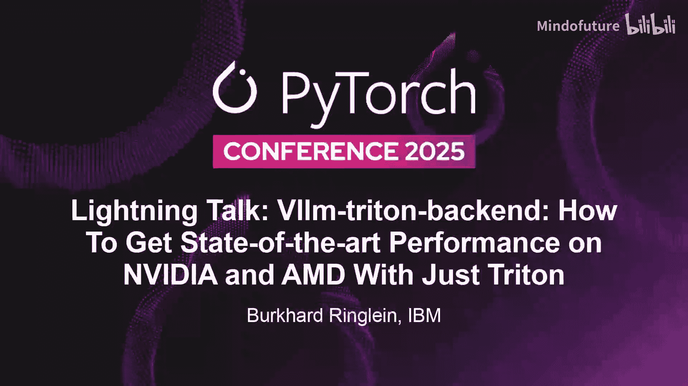
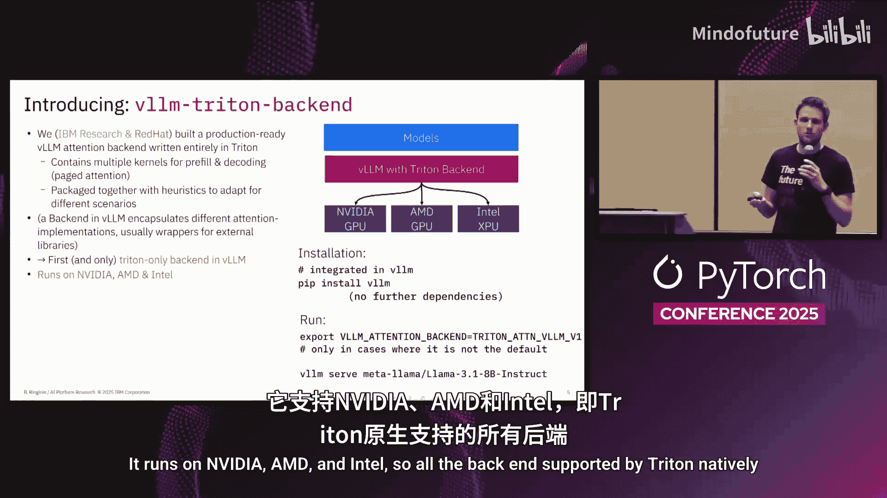
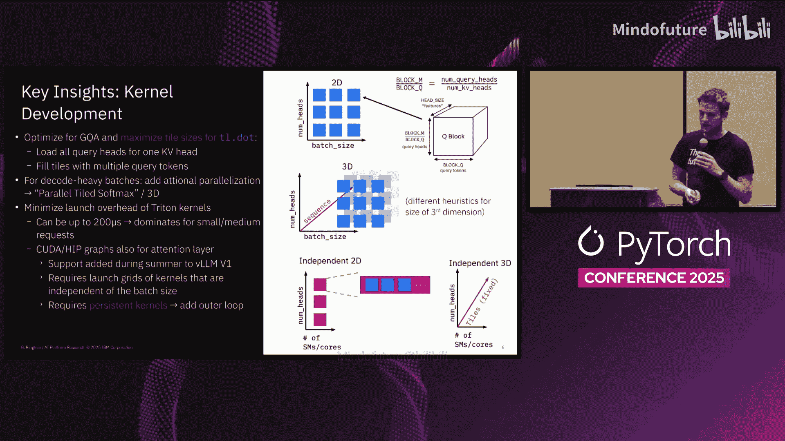
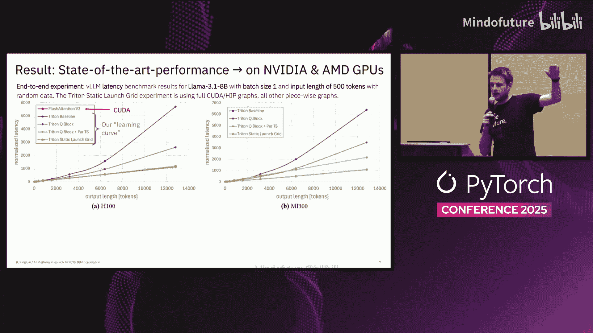
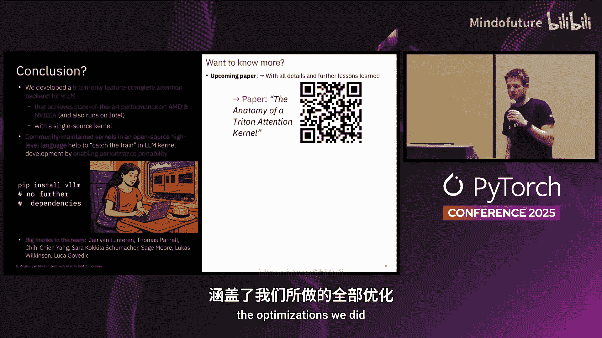

# 2025 Pytorch大会 ｜ Pytorch Conference 2025 p54 P54_闪电演讲-Vllm-triton后端——如何实现...尖端性能-B._Ringlein -BV1b8kRB6EJG_p54-

My name is Broca Englandingland， I'm IBM Research in theoryy Switzerland。

 and I would like to talk to you about performance port for LLM inference。😊。

If you take a step back， it already happened a lot this year in open source LLM influence。

 so we have a bunch of open source and amazing open source models released throughout the year。

 but also the technologies that makes their influence much more efficient。😊，Evolved。

 so we had a major rework in VL M V1 and a bunch of other techniques。

And the hardware where all these technologies running on also changed。

 so I remember last Pytht conference H100 and MI 300 performance was the big topic and now this years we had the release of Blackwell and also GPUs from AMD and Intel。

😊，My job is to work on compilers for this and also to write kernels and sometimes I feel a little bit squeezed between all of these trains and I wonder how to catch an next train or how to keep up。

😊，And how to make good kernels for the next technology or the next hardware。

And what would make my life easier is if we maybe take out a lower level of this and make it easier to port one kernel to another。

 one kernel from one hardware to another， so can we make kernels portable and the good news I would like to spread in this talk is yeah。

 the VLM Tritan backend can help you with it。😊，So and that's why I would like to take you on our journey to portable LLM inference。

 I start with a very brief background on Triton for those who are not familiar with that。

 then I show you what we did with severeM attention Triton back end。😊。

I also would like to share with you some lessons learned that we got throughout the process and finally show you the results that we have state of the art performance。

And then hopefully in roughly eight minutes， we arrive together at our conclusion。😊。

My goal for this talk is to sketch to use a way to perform its portability for inference with only open source tools。

😊，And also， more or less hit an agenda， make you excited about what we did about the Tri and attention backend。

😊，So I mentioned performance port already three or four times for those not in the field。

 what is it and how can try to help with that？Performance portability simply put is the ability to take one code that runs well on one GP and take the same code without any changes to the next GP and still get the best possible performance out of it。

 so a very important goal。😊，Triton can head with that because its programming model is at the right abstraction level where you still can write complex optimizations but in a hardware agnostic way。

 so for example you often work with tiles or blocks to do attention on and here's a 2D block in Triton and for one particular GPU you could as a compiler can decide to split this in two blocks or two larger blocks for another a GPU。

 these two dimensionmenal tile can be split in much smaller tiles and the programmer doesn' not need to take care about it because we can also autoune it so it's auto to adapt between GPUs。

So that's why we saw Tri as a good start。😊，So and we the via at IVN Research and Rhead build attention for feature complete4 VLM page attention。

 it contains multiple kernels and also heuristics to switch between these kernels。

For those who are not familiar with attention backend in VLM。

 it's a wrappper around attention libraries because there are different implementations like flash attention。

 F In， our Tritan attention， and usually it's a wrapper around external dependencies。

 not in this case since our attention backend is only Tritan and VLM has already Pyth ship。

 so you can just install it and good to go。😊，It runs on Nevida。

 AMD and Intel so all the backend supported by Triton natively。

 and it delivers data of the art of performance on AMD and Nvidia and as you will see we are actually a little bit faster than Fer Ten 3 on Hopper。

On Intel we still need to do some performance tuning and although a footmark I will show you the latest results we have。

 not all of that is yet mergech in VLM， but I promise we will merge it， the PRs are still in process。

We started this roughly half a year ago and in the meantime all the members of the community contributed。

 for example， attention things， so thanks a lot if you are here。

 that's good if an open source community can help each other。😊，So。

What did we learn throughout the process first we started with a 2D launch kit for normal models but then we realized well for models that have group query attention efficient to it's not efficient enough to utilize the matrix modificationplication units in the GPU。

So in the beginning we start have to have one launch dimension is a batch size。

 the other one is a number of KV heads and then we load all query heads that belongs to this KV head。

😊，But in order to utilize matrixx multiplications better， we also started to realize， okay。

 we need to add multiple tokens。And then why we in the end ended obviously three dimensional tile where we have multiple tokens and all the query heads for one particular KV head。

 and that's how we reuse memory usage， increase memory usage and increase the usage of matrix tiles。

😊，For decocode heavy patches， we need an additional level of parallelization。

 so we also parallellyze across the sequence length that's not super new。

 we call it parallel high softmax。😊，And I guess the similar concept is known with split K or similar names。

 of course you need then different heuristics for different batch sizes。😊，However。

 then we were still not at state of the art performance because although for decoding batches and short prefis we had a launch ofette of Triton dominating。

 so we looked for kgraphs to help and what the tradeososis kgraph is which just give a lengthy talk about this so we looked into this and with a major rework of VLM in the summer we were able to do it however we need to make our kernels compatible to that and have a launch kit that is actually independent of the batch size which also means we use persistent kernels。

And meaning this kernel iterates dynamically or multiple Q blocks， however。

 it's not really persistent kernel because one kernel or one record a chograph determines dynamically how many instances we need to do。

😊。

Finally we do all of that in the 3D case with static tile thin Finally we did a lot of heuristics and we did a lot of auto tuning to drive heuristics for different configurations and different GPs because in the end it's better a better trade off than plain auto tuning。

😊，So now I told you a lot what we did here I share with user results。

 we did default Lama 38 billion benchmark on H100 MI 300 to the right。😊。

AndIt's normalized latencies or lower it's better normalized by the leftmost value of each GPU platform and yeah。

😊，The red curve here on the left hand side is actually coer and the other four curves are represent our learning curve。

 these database are very simple implementation that is six times slower than coer。😊。

And then the QB optimization brought us a lot， the parallel tight softm helped also。

 and on more AMDs and on videos was the difference between yellow and green。

 is bigger on AMDs and onV was the independent launch grid and usage of full codegraph。😊。

Actually in this latency heavy benchmark we are slightly faster than flash attempts in 3 on Hopper so this CO。

7% is really important to us also our kernels are two orders of magnitude easier to read or shorter or however you want to put this。

😊，On AMD， there's no other benchmark actually， so for page attention on AMD。

 we are the default and yeah over the。Last six months we achieved roughly Xx speedta for both and I want to reiterate here it's the same kernel。

 so all the results is the same kernel on DVDVD and AMD GPUs we don't change any line in this。

 so I would say we achieved performance port for this problem。😊，So in conclusion。

 we were able to show that something like Triton helps us to deliver single source performance port and also for my questions beginning。

 I think this community maintained kernels and open source。😊。

Compilrs help us to catch a train for new LLM technologies every time because。

We don't need to take care so much more on low level hardware details。

We also don't introduce any further dependencies and of course that's a teamwork so I didn't do this alone。

 I luckily had a lot of help with my colleagues of IBM research in Surrey and Yorktown and colleagues on Rahead。

So this was only a lightning talk， if you want to learn more。

 you have an upcoming paper with all the details and all the。😊，The optimizations we did。

Then I will give a VM office hour in end of November about exactly this topic in full length。

 we have a VLM meet up in Surrey for those who are in Europe。

 we also developed this fully in the open so if you go to this link you see our code that is not yet merged into VLM but also all the microbenchmarks and developers setup we used to develop it。

😊，Finally I would ask you to start contributing， there's nothing easier to learn。

 especially for Triton if you go and try to fix some easy issue。

