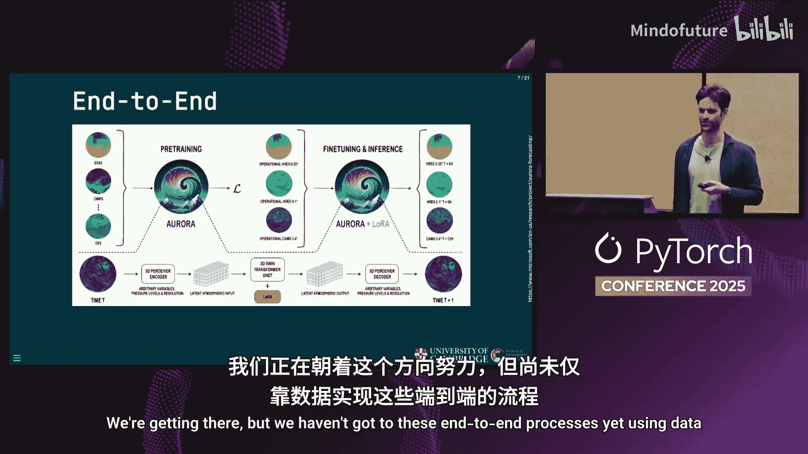
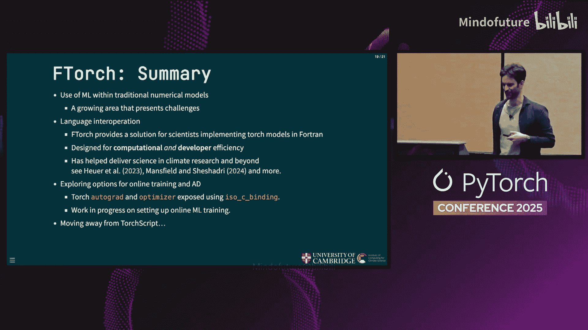

# 2025 Pytorch大会 ｜ Pytorch Conference 2025 p55 P55_闪电演讲-FTorch——连接PyTorch模型与Fortran气候模型的库-M_Archer -BV1b8kRB6EJG_p55-

Hello everyone， my name is Matt， I'm a research software engineer at the University of Cambridge working in the Institute of Computing for Climate Science。

😊。

And today I'm going to be talking about a library that we've been developed through our collaborations with various institutes around the world。

Which aims to couple pytorch ML models with Forran I appreciate this is quite a niche application of Pytorrch。

 no one really wants to look at Forrann codes anymore。

 but I'm going to try to convince you that Forran is still alive and well and people are still using it and they are using it on really important pieces of science。

Okay， that's that's the self for fortune out of the way。 So what are weather and climate models。

 They are very complicated multi componentent systems in the middle， we have this dynamical core。

Where we evolve various conservs like temperature， velocity pressure in time。

 and they're surrounded by all these other components like precipitation， multiphysics， choosphere。

 and they feed back to the dynamical water。 It's a very high level overview of what a climate model is。

 This is just the atmosphere。 There are other bits like the atmosphere of the land the land service model。

 the ocean model。Loads of different complicated approaches that that need to be coupled together。

Right， so。So we have this sphere or our earth which we geoocattize into lots of cubes。

 but these cubes can still be about 30 kilometers in dimension， this is really really coarse。

What we rely on is are these subgrid processes called parameterizations。

 which allow us to resolve below the sort of scale of our dynamical core。

The problem is that these are a really large source of uncertainty， so this is， for instance。

 this is just rainfall， we can't obviously model all the droplets in the atmosphere。

 we have to rely on these other other models which could be empirical， they could be numerical。

 they could be from data。So going back to my atmospheric climate model。

 what we're looking to do is replace one of these parameterizations with the machine learning model。

 so this could be for few reasons we can rely well we can make use of the wealth of data that we have available to us。

And also， we could also speed them up。 Some of these these numerical numerical models are extremely slow to to perform。

 so machine learning model could arguably be a lot faster。

好ello。So this is in contrast to many of the models that have been sort of in the news recently like Aurora。

 Gcast， Gencast， forecastNe， these are end to end processes， we're not interested in this。

 climate science is much more complicated than whether we're getting there but we haven't got to these end to end processes yet using data alone。

So there are many challenges from scientific challenges。

 but I'm going to be focusing on the language interoperability today。

 So obviously machine learning is often written in Pytorch， this great model。

 great machine learning framework and we want to bridge to these bridge from Fort Tra to these machine learning models。

 There are lots of codes that are written in Fortran like cos in the Me Office， ECN WF in Germany。

 there's icon Warf， etctera。 So there are loads of codes that are。Rely on using Fortm。

So we have developed this model called this library called Ftorrch， so researchers。

 they develop and they develop and train their neural network models offline and then Ftorrch provides an interface from Forrann into Pytorrch we see Pytorrch as a Python frontend to a very highly optimized C++ backend called Libtorrch and with Libtorrch we combined it to Forrann very easily using the IO bindings in Forchann 2003 So what we do is we provide a Forrann API to Libtorrch directly and this abstracts all the complicated details from users so it's really easy to integrate with Pytorrch from Forrann。

Users all that users need to do is to output their machine learning models in Torchscript。

 There was a great talk yesterday about the deplication of Torscript。

But it's fundamentally relatively simple。 This can be run in sequence as possible with liptorrch。

And we're good to go。So our approach is quite a simple one。

 we sort of bypass Python entirely and we go directly from Forchann to littorrch and we ignore we avoid all of the headaches that can can arise in high performance computing or clusters and accessory with Python which I'm sure many of you know about So one of the highlights our library is very easy to build and link we developed these tools which allow users to script models very very quickly and easily。

 and one of the really real highlights of this is that weve developed this really comprehensive example suite so it works users through taking a sort simple examples to more complicated use cases so it really handholds users through the entire process we've got really good documentation if I do say so myself and it's free and open source licensing。

MIT， we accept， well， we're open to many contributions from the community。

So we've tried to emphasize both developer and computational efficiencies。

 so we use all of pipe tos or lip ors implementation under the hood so it should be reproducible and future support to new features。

So you can guarantee that you should be able to get the same results if you run Forchann。

 the models of Forchann， as well as running through them through Pytorrch。

 we also expose or we use all of the torch backends for various GPU architectures。

And one thing you might be thinking of is that Forchann is very different to Python and indeed it is。

 so's this headache with how arrays are expressed in memory， Forchann is column major language。

 sequence++ and Python array major， so we avoid this whole headache by using the torch shed accessor which abstracts all of this away from users。

 we also have no copy access in memory so there are no necessary copies or and indeed with the torchtenor stranded accesses no necessary transpo of data which could lead to completely erroneous results。

Right， so I'm going to skip over the torch script。 I think people most people know about torch script。

 but there is executive torch， which might be who， which seems to be superseding it in the next few years。

There are two ways start tracing and scripting， but yeah， it's relatively easy to do。

 I want to show a bit of forran code。So we bring our library in， use fortre， use F torch。

 then we declare our input tensors and output tensors。 These have torch tensor types。

Create some input data。 This could be our density pressure， et cetera。

 And we alias our input data with our input tensors。

 So everything has tight input tensor within forger。We then load our model。

 which has been saved as a torchscript format we run our inference and then we do some cleanup because Python For is not Python and we have to do some doesn't have garbage collection and we have to do some reference some reference count。

Rferles cows dropping。One final thing in the last couple of minutes is something that we've been working on in the last few months is online training and autograd this has been that's been led by Joe and our team so all of the work that I've talked about previously has involved running codes that have been models that have been saved offline and we' just running influence on them。

 but there might be some situations where。We we want to do online training。

 so there have been a few papers that have been released recently in the climate science community where if you train offline models and then put them into production。

 they completely fall over like they diverge in over very very long timescales。

So there might be there's a good reason to do online training so that we can kind of massage these brittle models over time。

嗯。Let's avoid saving large volumes of data。 You can just completely avoid doing off offline training if you want to and just train train as you go in your climate model。

You don't have to convert between Python and Vtran data formats。

 and there's also a possibility to expand the loss function to include downstream model code。

 So this is something that we're really interested in doing and we want to find some really good examples for that。

The problemm is this is we're difficult to do in most frameworks。 So what we do is， again。

 we utilize a lot of the Pywa's functionality。I'm running out of time。

 but just to expand on this loss function idea where we have some downstream parameter。

 our neural network might output tendencies， things that we don't really know how to interpret。

 these are completely abstract quantities to researchers working in the field。

 researchers are more interested in things like precipitation or radiation。

We can really get a handle on these。 So what we would like to do is have this model and chain all of our pytorch operations or like tensor operations and types on on on until you get to this final output and with that。

 we can then back propagate from this quantity through our model and you know。

We find our model over time。So this automatic differentiation has all been implemented in a similar way to what I've described previously。

 we've basically piggybacked off of pie torch， we've exposed all the auto grad functionality and torch。

 that requires grad backward methods， SGD， atom， etc。

One of the really nice things about this is that we've exposed mathematical operatorss that apply to torch tensors。

 this makes it easy to write sort of expressive sort of pi torch code within Fortran and we're still working progress we've got some stuff to do on the loss functions but most of the building blocks are there。

So just to summarize。We have developed this library called Etorrch。

 This is really scratching an it an or trying to fulfill a need in the scientific community。

Particularly for parameterizations within the climate community。

 we've tried to optimize both computational and developer efficiencies。😊。

And we're exploring options for online training and automatic differentiation if anyone has any scientific examples would like that they're doing in Fortre and they're kind of faced a blocker and they would like to use our FTrch library。

 please come and talk to me and we're moving away from Torch script if anyone has any advice about how to do that they'll be interested to hear。

