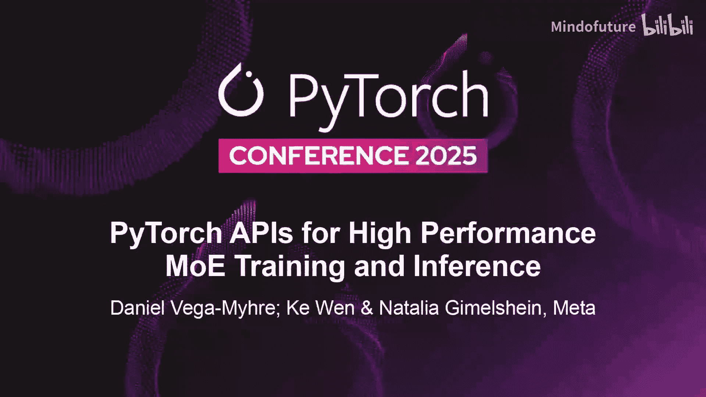
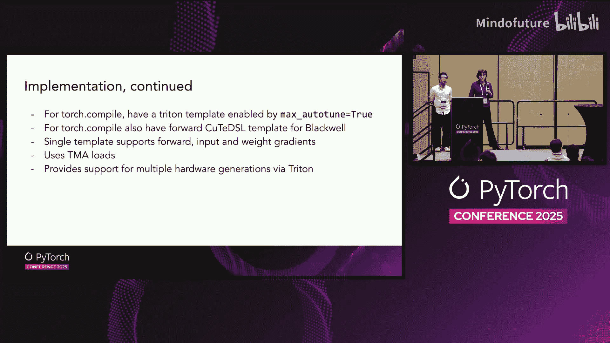
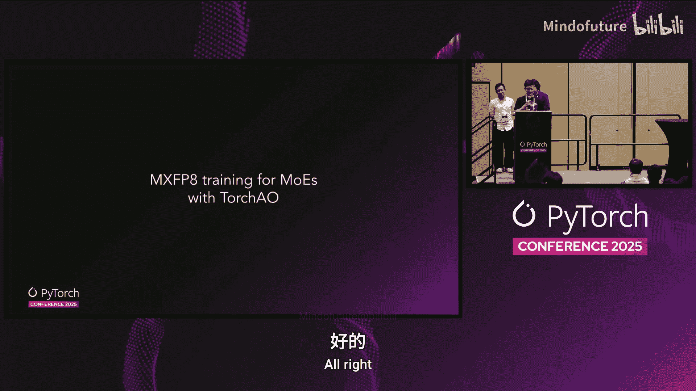
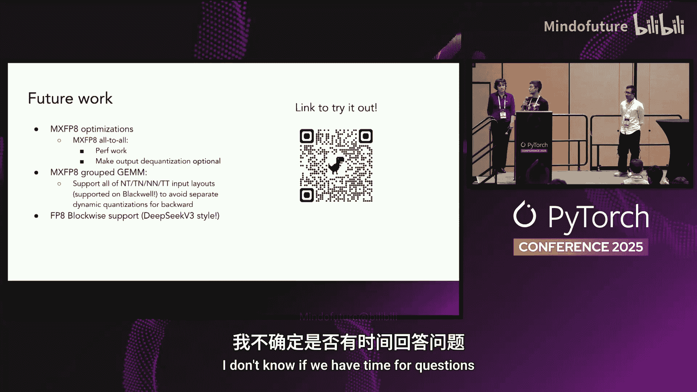

# 2025 Pytorch大会 ｜ Pytorch Conference 2025 p56 P56_面向高性能混合专家训练与推理的PyTorch_API-D._Vega-Myhre_Ke_Wen__N._Gimelshein -BV1b8kRB6EJG_p56-

Hello， I'm Anata Lega machine from Pyrch Mehi， and today I with my colleagues。

 Kevin and Daniel Vegamir are going to be talking about how Pyroche is making training of mixture of experts models more efficient。

So first， let's briefly remind ourselves， what is a mixture of expert model？

In a mixture of expert model you have a router which decides which particular experts is most suitable for processing a particular token instead of sending all tokens all through the same big linear layer。

 this allows you to make expert smaller the expert computation lighter and models become more powerful because there are more experts and generally they can store more information than just one linear layer would store。

So on this diagram， we see how there is a router， a router computes which experts to route the tokens  to。

 and then the tokens perform the computation。It doesn't have to be the case that one talkingken goes to one expert。

 in fact， most powerful models are sending the experts to view top K experts。

408 or something like this。So let me first go over the goals that we have in Pyrch and what we want our APIs to support。

First， we want to be able to support expert parallelism as we've discussed earlier there can be many experts in the model。

 it may be impractical to have all of them on the same GPU so we want to be able to spread the experts over the GPUs and efficiently support this for this we have to talking rout in that would be able of doing this and we' have more detailed discussion about this later。

The routing has to be efficient。 It has to put our tokens in the order that we want to see them in the resulting。

GpU。We also and this is a very important constraint。

 we want to have an option to avoid host device things if the model is written in a way that allows us to do so our APIs should support this because this is very important for performance for being able to chograph the model for being able to not be CPU limited on the GPUs。

 so this is one of the very important things that we want to have as part of our APIs。Potentially。

 this would require token drop in because if we are not dropping tokens， it's very。

 very hard to avoid really host device things， but it should be possible with the APIs that we provide。

And finally， NVDdia is very big on supporting quantized formats。

 the performance of low precision formats on NVDdia GPUs and on AMD GPUs is much better than performance of higher precision formats。

 so the mixture of expert APIs that we provide， we want them to support those low precision formats that nevertheless allow people to produce accurate results。

And the accuracy shouldn't suffer as a result of using quantized APIs。Next。

 Ka will talk more about how we are doing talkingken shuffle to fulfill those goals。Thank you。

 Natalia， for the introduction。 I'm Khen from the Py Dis team。On token shuffle。

There are a couple challenges in M O E。 First， the token split， as we all know。

 is determined by the router that runs on the GPU。 Hence， it's very dynamic。

Here is the input buffer of each GPU to the auto shuffle。The total buffer length is a fixed number。

 however， if you look into it and separate the token trunks to different experts。

 the length for each expert is varying from iteration to iteration。

 And what's worse this metadata is a tensor on the GPU side because it's determined by a GPU mamal。

So if we were to use the traditional To dot distributed API to perform the auto all。

 one big problem is that we will have to sync the split length from GPU back to CPU and then issue Nikel Auto all。

 for example。And this would cause the CPU to halt and eventually end up as a gap in the GPU stream。

The second challenge is that， let's say， each rank has multiple experts。0，1，2，3， for example。

 for GP PU 0。 If we were to just perform the traditional rank level all to all。

 then all the data for the experts on GP PU 0 who arrive together has as a big chunk。

 So if you open up the received data at GP PU 0， you find that the tokens are arranged in an interliftved way。

 as like。E 0， E1， E2， E3， and again， E 0， E1， E2 E3。

 This will be a nightmare for the expert processing， because the S 0， for example。

 will have to go to random memory locations to fetch the tokens。 right。

 So how do we avoid these two challenges。Our solution is something called 2D or 2 R V。

 We definitely want the expert tokens to arrive in a way that they are contiguous in the receive buffer so that when the expert process。

 the tokens， it can just fetch a big contiguous chunk。 So how do we do that。

 if you were in yesterdays memory talk。 you realize that we can use memory to do a split exchange in the GPU kernel itself。

 And with the exchange split， we can perform a perfect sum to calculate the offset of like where the token trunk would arrive。

😊，So if you are the receiver with such metadata， you can fetch the tokens from the peers again insymmetric memory into the preferred position of the receive buffer。

These are the two APIs we today have in Py 2。9 release on the left hand side is the dispatch API called all to all Vd 2D。

 and on the right hand side is the combined API， all to all 2D V dev offset。

 So let me explain the terms。 We stands for vector splits。

Deev stands for the fact that the splits live on the GPU device and 2D just stands for multiple experts per rank because your data is likely in a 2D fashion because each rank will have multiple experts。

The beauty of this two API is that it will return the output splits offset back to the user。

 So you get something in addition to just token exchange。

 This offset will be very helpful into experts。 First。

 the output offset of the dispatch is exactly the same as the input split offset you need to feed into the combined operation。

 So you just feed the same tensor to the next app。 Second， the offset information。

 as Natalia will show later， will be very important for the group jam。

 because the group jam needs that to see what process， which chunk。

We also have a convenience feature called alignment。 So if you provide this argument。

 we will automatically set the alignment of each aspect per chunk for you in the output buffer。 So。

 for example， good jam may require an alignment of 8。For。Hegenous fabric， for example， you may have。

Network link has lower bandwidth than Em link where we design an algorithm called pull and then push for no limited routing case as done by deepse。

 So the idea is that there will be a kernel that pulls tokens internal node direction。

 And once a token arise， it would ask the internal node。

Colonel to send it out based on the top K indices。As you can see from the trace here。

 we have a prototype planned for 2。1 release and the two kernels。

 one for internal direction and one for internal directions are able to overlap with each other。

 and for them to know a token has arrived， we have a signal between these two kernels to indicate a producer and consumer relationship。

As you can see here， they overlap， but not fully， that's because we are using an envelopeveing to mimic the network。

 And if the internal kernel actually runs on the network。

 you will expand in time and have a better overlap。Next。

 Natalia will talk about how we process the tokens。Thank you， girl。

Yeah so next I we will talk about the meat of this MOE expert computation and that's how we actually perform the gems that I needed for it。

So at the end of the previous step that Ka described。

 we have all the data that we have to process on our local GPU。

 It is already sorted in the order that is pretty convenient for our subsequent gem kernel。

 and it was absolutely important for us to control the communication routines and not rely on preset。

All to all Es that don't cover all our needs。So with all the data in place， what can we do next？

Each GPU has to process typically several experts from 4 to 12 to 16。 the number can vary。

 It's not very large， but it definitely will be larger than one。

Each expert has to process dynamic number of tokens so we cannot predict which tokens would be routed to each expert so zeros expert can process。

 I don't know， one key token tokens， the second expert may process 10，100 tokens and so on。

 so it's not just your regular ba matrix multiply that everyone knows how to do。

And we know model dims on the CPUU， but again， those number of tokens that are coming to each GPU are only on the GPU。

 so we have to design our APIs with that in mind。This diagram shows the computation that's happening and it's a convenient illustration of why mixture of experts is often called sparsity。

 because it shows that not every token goes to all the experts and only some blocks of your final product have to be computed。

So what do we propose and what do we support in Pyr？

The prototype API is shown here and it has two arguments for the data and the weights that we need for processing and also the vector of offsets that is telling the offsets of the start of the tokens that each expert is processing So self in this case is2 geometric where the first dimension is all the tokens that have come to this device and the second dimension is the input fissure dimension for weights its the traditional number of experts input fis and output fiss。

N and KG dimensions。 and let me remind that M and and K are usual nomenclacature for gem callss in all the blast like Kpis where M and N are the sizes of the output matrix and K is the contraction dimension。

 So in this case our N and K dimensions the model dimensions we know them of the CPU they are not dynamic M can be dynamic and we have to。

Take care of it。How do we decide whether to use offsets or sizes to handle the dynamic size In this case。

 the logic is if you have offsets， it's pretty easy to calculate the size of each particular matrix multiplication you want to do it's just all one operation where you subject to offsets if you have only sizes and you need to know where to start reading you would need to sum all the sizes prior to your particular group。

 and that is all of the operation。 So that's less convenient。 and as a general rule。

 we want our As to accept offsets and as cash shown。

 the previous token shufflin would produce the exact offset vector that we need here。

What about backward， forward computation is nice， but if we are training。

 we also would need to back propagate through this gem。And luckily。

 matrix multiplication is just a linear operation， group gemM is just a slight variation on matrix multiplication。

 so we can reuse all the existing formulas for the matrix multiplication。

 backpro that we already have that already handle all the transpose variants and if we support enough variances for the inputs then the backward formulas will work automatically for all the things we need in our backrop。

😊，So in particular for regular training， if we are computing gradient with respect to the inputs。

 it would be a pretty similar kernel that is multiplying 2 d grid output where the first dimension is the number of tokens and the second is the output model dim with the transposed weights and the weight the gradient with respect to weights is slightly different because in this case we have to multiply2 d tensors where one of the dimensions is the tensor。

 so contraction dimension is actually going to be dynamic in this case。

 as opposed to one of the regular dimension。But nevertheless。

 it's still all pretty similar and it's possible to write all those kernels in a very similar way without doing copy pasting and replicating the code for all those cases。

So how do we implement those kernels， we have precomped catalyst implementations in core that provide pretty good performance for compute bound cases and as all eager Pyrarch operations they can be used for pretty much any sizes and they don't incur any penalty due to the dynamic sizes or change model sizes。

H100 has some limitations on how the data has to be laid out in memory and so the user has to take care of actually placing the data in memory the way H100 requires it on B200。

 those limitations are lifted but still for some legacy reasons we haven't yet implemented a more generic version of those kernels。

Also， in my discussion， I have quite purposely amted the discussion of skills and Danielle will talk more about this because that's actually a very interesting problem。

 but we are here discussing just the general implementation of JamesMS。

In addition to precompiled cut implementations， we are also providing some triton versions of those kernels that can be used via torch compile if people are enabling max altitude equal to true。

Setting and those kernels， again， they follow the same template for all the variants that we need without any code divergence。

 and they in many cases provide significantly better performance for the bandwidth bound cases。

Where cuts is just not optimized for them。 And generally。

 it's pretty hard to have heuristics for all the sizes。

 So enabling aler tu in the triton helps with performance for some cases。

We also are working on supporting the Q DSL template， but currently it's very much work in progress。

 so I won't talk too much about it。

And finally， Daniel will talk about how we are actually using those APIs in the FH training in Torcho。

All right， let's talk a little about MXFP training for MOEs with Torcheo。

Cool， so quick reminder on what MXF is for anybody who's unfamiliar it's a low precision numerical format with native acceleration on blackwell GPUs for certain operations and it consists of a couple key parts the data itself is in flu rate format specifically E4 M3 as you see in this diagram here and the scales are also in floatate but an E8 M0 format so that's all exponent bits so these are power of two scales other key characteristic is that the scaling factor is quite granular it's1 by 32 this is good for preserving numerical accuracy during training because basically there's an outlier in that data that causes a scaling factor to blow up it will only impact that1 by 32 block of your data and not the whole tensor or a larger block that you might see with more coarselygrained quantization strategies。

So that's MXFP8 that's a TLDR how are we using it to accelerate training we're doing something called dynamic quantization and it can be summarized in this diagram here basically instead of a BF16 group gem for a routed expert computation we're dynamically quantizing the inputs as you see in the green and then we can use an MXFP8 group gem which is up to 2 x as fast and so as long as the quantization kernels are sufficiently fast we should get a net speedup as you see in the red。

And that's what we've implemented in torgeo so we have our first quantized ME building blocks they're now available for you to use the first ones called2 mxFP8 and scaled group M it does exactly what it sounds like basically basically just implements the slide that I showed you previously but we handle the backwards path as well so it's fully differentiable it also is the same API as torch group M so it's just a drop in replacement you can just easily experiment with and finally it's also natively integrated in torchty now so if you just want to kick it off like a pretraining run and take it for a spin that way with your favorite MoE model you can do that quite easily with just a command line argument benchmarks you can see we' ransom benchmarks with some La of 4 shapes some deepP3 shapes pretty strong speedups across the board you can see the micro benchmarkch for the individual op 1。

6 to 1。8x speed up over the Bf 16 baseline single ME layer on a single device for Lama 4 we got 1。

42x and for deeps 1。18x end to end training I've only been able to test with Lama 4 so far have a bug and deep。

See we're still trying to work out， but I just want to clarify this a single node benchmarks on AB200s I just reduced the number of layers in order to avoid oomms。

 but I'm using DPEP without TP all the standard model configs in training configs that you use in practice so still useful and representative benchmark I think so interesting results here during the early phase of training when there's an imbalanced expert load we see a very high speed of almost 1。

5 x and then as it kind of stabilizes and we get a more balanced expert load it stabilized around 1。

21 x so still very solid still very useful I looked into this and it's just turns out it's because the MxFP group gem the actual cutless kernel we dispatch to is just performs particularly well for very large M dimensions of the gem that you might see during this kind of imbalanced load early in training。

Moving on we also thought about comms so MOs are famously comms heavyav and so one way to optimize this is to send fewer bytes over the network and so this is kind of just building on cowork you just spoke about we have a couple kind of experimental APIs here for doing all to all dis patch or combine in MXFP8 so just lower precision comms and know the second one the tradeoff there is basically it's what cu described where it's in chi in some memory so that of ways the DDH syncnc which is very nice for performance but you know as a model practitioner you should be where some token dropping might be required so just some tradeoffs with data efficiency to be mindful of there so yeah the status of this is functionality is complete numerics are correct just some performance work to be done so stay tuned and we'll probably follow up with like a blog post on this。

Now for the fun part， how does this actually work I thought it' would be fun to just do like a quick illustrated walkthrough of how the forward and backward of this actually works so it's actually pretty interesting。

 so this is the dynamic of quantized MXFPA group jam that I showed earlier so we start in the forward pass with our 2D inputs with our offsets that demarcate the end index of each token group assigned each expert and then we have our 3D expert weights on the right there。

First step is we dynamically quantize M mixFP8 in the orange you can see the E4M3 data I referenced and then we have these new tensors in blue which are the E8M0 scales and then now here's where things get interesting and diverge a bit from quantized training you might see on like Hopper architectures basically we have to do something called converting the scales to a blockswizzd format and to kind of step back and just give context why we're doing this the actual PTX instruction that we want to use to run the blocks block scaled gems the TCG05 mM has some special requirements and this is not an exhaustive list but the relevant ones here are that one the scales must be in TM which is a new layer of the blackwell memory hiarchy and then two they must be in this special blockswizzd layout so what does that mean it means the blocks part means that the scales need to be paddted out such that they can be evenly divided into these 128 by four blocks that you see here in this diagram and so both along the rows and the columns both directions。

And then within those 120 by four blocks you need to perform swizzling using a swizzling formula prescribed by NviIDdia to avoid bank conflicts when fetching the scales during the gem operation to rescale the outputs and this is particularly tricky I mean it's already a bit tricky just for any gem but for group gems it's particularly tricky because this has to be done on a per group basis not the whole tensor which would be much easier so remember if the group sizes our dynamic and they live on the device and we want to avoid the DDH syncnc to get those on the host a dispatch kernels with the right parameters so solution here we have a custom kernel that does this in a performant way and you in summary when we write out this output in this kind of interesting format that's not just row major or column major memory layout I call it row of blocks major per group format where basically we have to write with this block level granularity if you picture iterating along the top row of blocks there。

 writing them out to memory continuously like in order for the first group。

And then the next row and then the second group and so on。

 so just some interesting kernel work there， if you're interested， feel free to check it out。Yeah。

 and then we can do our 2D 3D group jam that Natalia discussed。

 this just kind of decomposes and visualizes how we can get a 2D output from this operation。

 you see the variable size inputs on the left， statically size experts on the right。

 we get a projection to the hidden dimension。And then back groupss pass I'll skip a lot of it for time's sake。

 but one interesting thing is in the 2D2D group jam as Natalia mentioned group the grouping is now along the contraction dimension。

 which makes things a bit interesting specifically our favorite part per group blocked swizzling becomes particularly interesting and I won't go into elaborate detail here but basically just the point arithmetic becomes a bit tricky we have to kind of have these virtual strides that we calculate dynamically to understand the strides I' on a per group basis depending what thread block we are。

 it's kind of fun， I'll probably follow up about the blog post later on this for any of you who are interested in this kind of stuff and yeah then we do the 2D 2D group gem we get our 3D output。

 this kind of just visualizes how we get a 3D output from a 2D2D group gem and that's the gradient of the weight and so you can see here just the variable sized inputs from each operaand gets map mold together stackly sized outputs。

Act 3D tensor gradient of the weight。And yeah， that's it。 That's our future work。

 Just M X F optimizations I talked about。 We want to add block by support for Hopper for all the deepse fans out there。

 And then there's improvements to the group gym to make it more generic that Natalia mentioned a minute ago。

 So yeah， that's it。 Thanks， everybody。 I don't know if we have time for questions。😊。

嗯。Thank you。