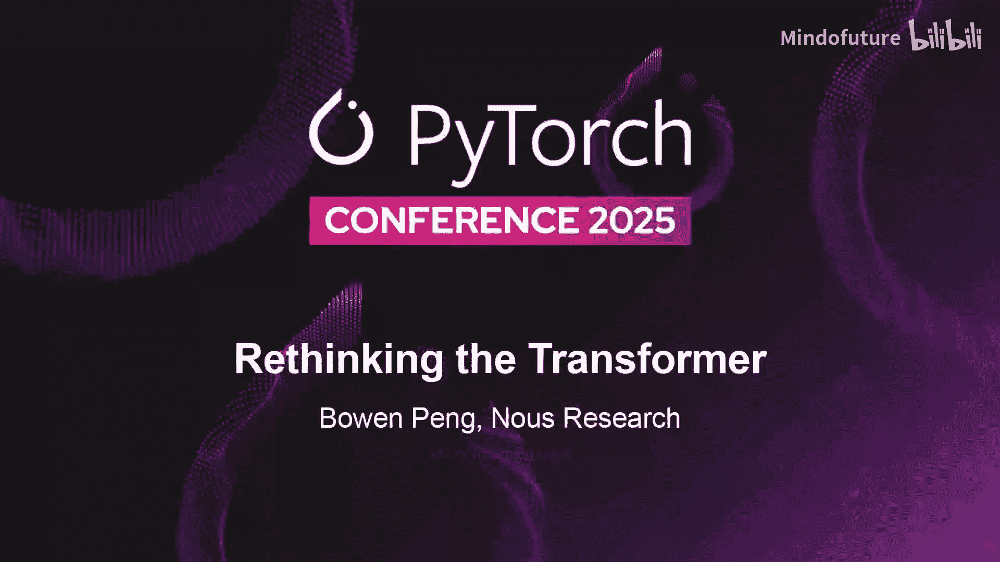
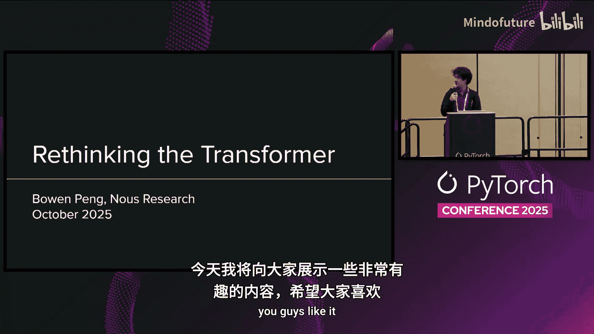
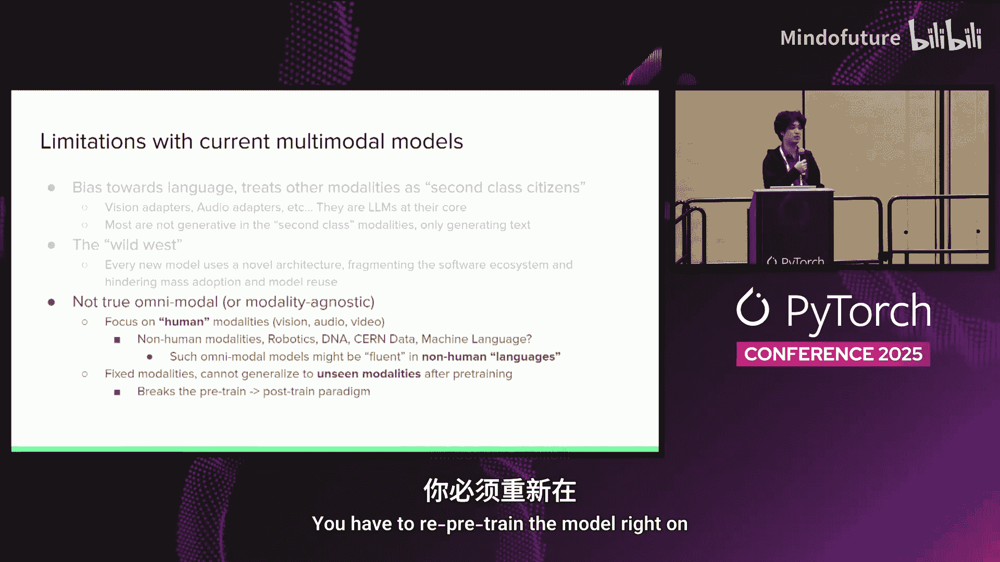
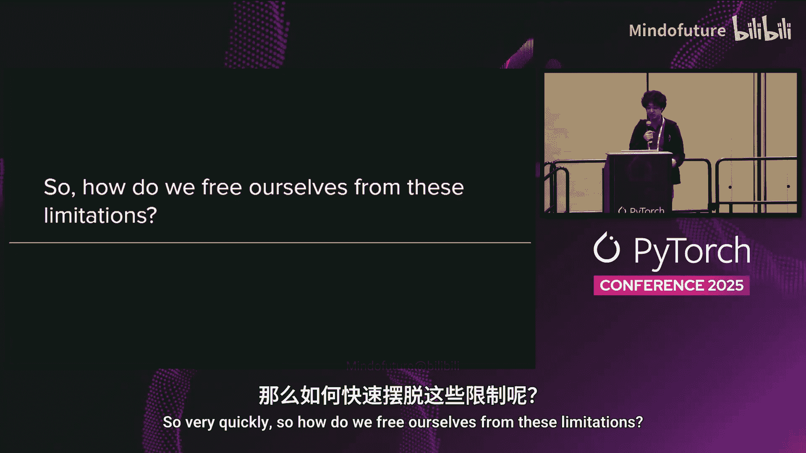
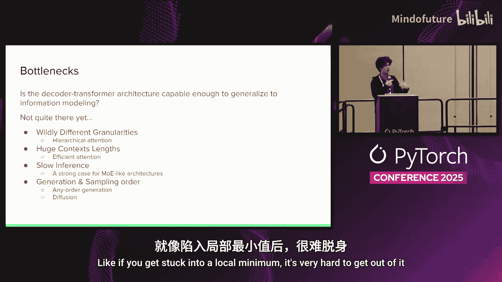
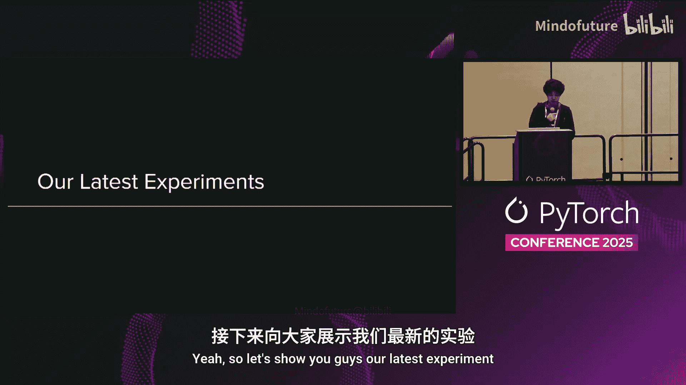
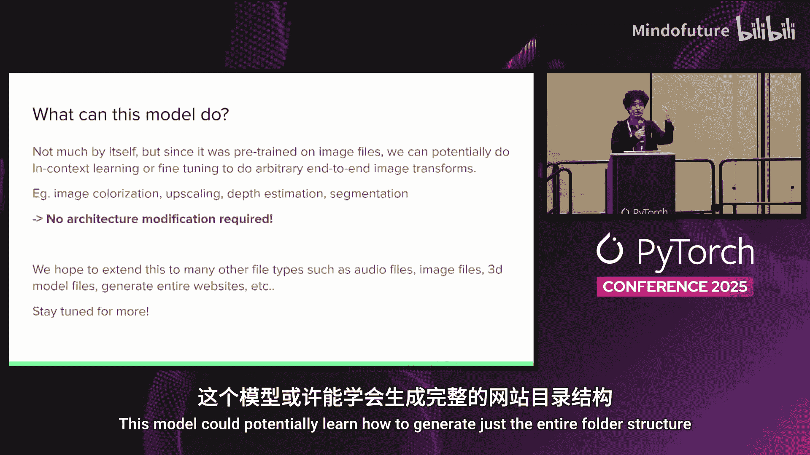
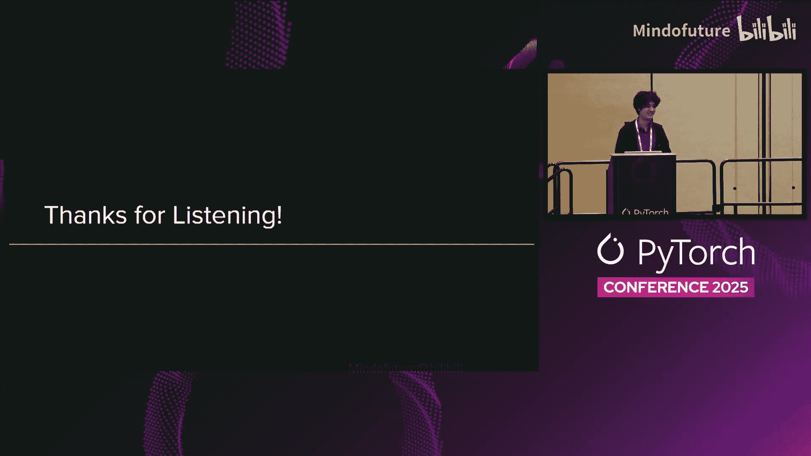
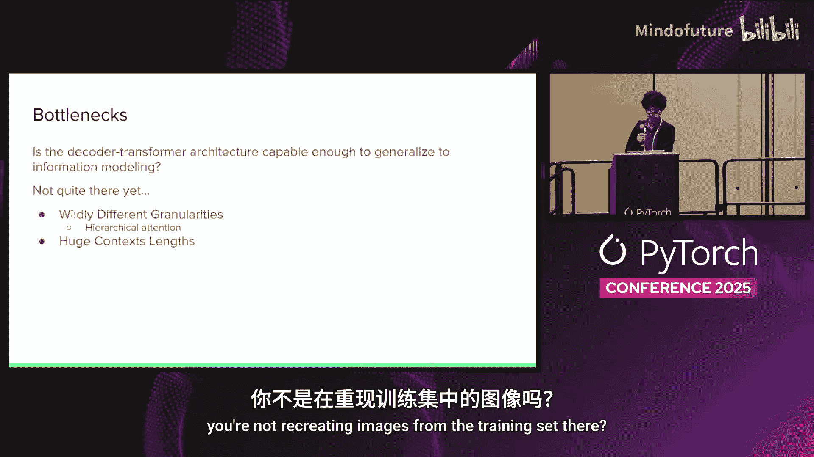

# 2025 Pytorch大会 ｜ Pytorch Conference 2025 p57 P57_重构Transformer——迈向原生多模态架构-Bowen_Peng__Nous_Research -BV1b8kRB6EJG_p57-

Okay， hii， everyone。 I'm Bowen， the chief scientist of New research。 And today。

 I'm going to present to you guys something very interesting。 And I I， I hope you guys like it。

 So rethinking the transformer。 So let's start。😊。

So you must have heard this a lot， right， Like the age of scaling is over， right。

 this word has been like repeated over and over in the in the recent years。 I mean， recent months。

 not even years is that some claim that there's not enough data， right。

 for scaling transformers up to like infinity and my my my current assumption on this is that it's probably not the case。

 And today， I'm going to talk about why I think so。So there's another way to continue scaling。

 And to do that， let's just take a step back and look a little bit at the bigger picture， right。

So here you have a standard S curve progression of technological progress that shows like improvement in AI。

 right， You have the effort on the X axis， which shows like how much resources and like research compute we put into the problem。

 And then you have the model capabilities on the Y axis。

 And you have this kind of have this exponential kind of curve at first。 But then it thoses down。

 right， So at first， we had language modeling scaling。 And then after that。

 we start to have like use cases of like multimodals， tool use agents， right。

 And let me give you a few examples。 at the beginning。

 had like G2 G3 that was at the very early the early times， right， where we only had pretrain。

 didn't even have SF or all of those R L and anything GRPO。😊，And after that， they scaled up to G4。

 and everyone's like， wow， this model was very good。 It was just pretrained， right。

 And then you got to the age of like G03， deep S 1， where we started to like。

 maybe scaling is not everything。 And we， we started to like look into alternative like multimodal LMs where。

 where like you have this example， Geini GLM， There's also like whenn VLM。

 There's deep sl C R that just came out。😊，And for me。

 I would put that in the very early like curve because we just begun to explore like use cases and multimodality。

 right， like the multimodal models we have today is only like barely images and like possibly audio。

 like we don't have open source audio models。 We also they the video models are also very rudimentary。

 They're not like with LLM， right， They're like separate image generation models。So yeah。

 let's talk a little bit about the potential limitations of current mod volatility， right。

 So there's a huge bias towards language。 So they kind of treat other modalities as second class citizens。

 What I mean by that is like they don't treat them the same as text， right You have the text decoder。

 but you have vision adapters， audio adapters， you have diffusion image like weird adapters on the input and output。

 right， those are like added on top of the M。 And most are not generative in a sense where for example。

 some some models V。 It's only in the input， the output is not really generative。

 except when you add another layer， which is diffusion model at the output。

So the decoder text decoder itself does not understand。

 like truly the essence of those other modalities。And I give an example at the bottom where you have like a image encoder。

The second limitation is like right now it's like kind of the Wild West of mis modality。

 where everyone just invents a new novel architecture every single day and it fragments the software ecosystem。

 So it hinders mass adoption。 For example， Lama CPP is like kind of one year behind implementation of the latest LL Ms that there's multimod L Ms because it's just impossible to keep up。

 right。There's just too many different vision encoders， diffusion models， and etca。

And the last part is like none of them are truly multimodal。 like omnimodal。

 What I mean by that is that they focus on human modalities。 And when you say omnimodal。

 we kind of assume many other modalities， like robotics， DNA， like certain data， right。

 machine language， all of those modalities， which are not human， for example。

 robotics and like sensor control data and everything。

 those are not being taken an account into these models。 And after you pretrain。

All of these current multimodality multimodal models， they cannot extend to this new modalities。

 So they break the pretrain to posttrain paradigm。 like in the past， where with G 3 or GP 4。

 we had this pretraining a very expensive pretraining that does everything。 And then you down。

 you have downstream evaluations or downstream tasks are very easy to add to the model。

 But these models， for example， quantum LM。 If you want to add， let's say， robotics， it's impossible。

 You have to re pretrain the model， right on， on other data。

Yeah， so like very quickly。 So how do we break free ourselves。

 like free ourselves from these limitations。

Let me show you guys。WellSo before we had this， like。Question mark。

 But here I would propose something called information modeling。 So right now， the。

 the the community is kind of exploring toward these ideas。

 but nothing is like very set in stone yet。 So what I mean by this。

Information modeling is that we transition to a new scaling paradigm， right。

 So while we work on extracting all of this， like knowledge from language models and all of these use cases with multi modality and agents。

 we can also on， on the back end， transition to a new type of scaling。

 a new type of like the next big paradigm where we train on information itself。

 So we model the information， the raw information。😊。

So I'll just coin this term like large information models just because I want to give like a tribute to large language models。

 So what I mean is that instead of assuming that language is the proxy to intelligence。

 which like humans， we love to do that， right， We have biases。 We invented language。 So therefore。

 it must be pre certain intelligence。 But I would argue it's possibly not the case。

 like if we model the information itself， like from the universe。

 it could unlock vast downstream capabilities， right， that we have never thought about。

 So this is an image from like a recent paper called B GP， like by by models。

So they were just training these LLM on like other modalities。 There like raw information。

 The results were not very good because there's a lot of problems with this currently， but is a good。

 like step， a good way of thinking， right， a good step forward。

I want also to note that here it is a tokenizer free transformer。

 right we're talking about a kind of information model。

 but it's not the same as what people are trying to do right now with tokenizer free。

 We're not trying here to improve on language by removing the tokenizer。

 we're talking about the new class of models。 So if you just want to， let's say。

 improve language modeling。 It's possible that tokenization is the best currently。

 Like it's hard to beat because there's a kind of theoretical optimums。But we won't like here。

 we're not claiming we're going to beat tokenization， but it'll unlock like new capabilities。

 So here I have a list of like， other data sources。You have， for example。

 the steam library like games， right， It's bigger than one petabyte。So like， that's very， very big。

 And if you train the model， let's just abuse the chininchilla like Chinililla law of scaling。

 If you train the large information model on the same library。

 It's kind of it needs to be around in the size of 100 tri parameters， right。

 And that's just for this， the same library。 And I'm really abusing the chininchilla law of scaling because it's not supposed to be used the other way around。

But， it gives you kind of a a rough idea。 And if you go even further， you have the NAa NAsa data。

 right， NASA， then they have 100 pery of data of astronomical data。 and you have CEern。

 which have more than one exabyte。And YouTube has more than 10 exabytes。 And the lastly， the。

 the one at the bottom is the Earth biosphere， right。

 the entirety of earth DNA data is more than 10 exp than 19 exabs。 So that's like will we。

 we ever run out the data。 I'm not sure if we're using this， right。And， is all of this data useful。

 Probably not， right， There is a lot of redundancy。

 but it gives you an idea of like kind of the scale we're talking about。Yeah。

 so the case for information modeling in here is a meme。

 But there's something called the bitter lesson， right， which which was proposed by Richard Sutton。

And he said that the simpler systems with more compute and data will eventually scale better than like more complicated systems that were more s specific。

 right， So like generalized systems that just scale up indefinitely are usually the winners at the end。

And the second case， this is 1 I really like is infinite downstream potential because here I'll just give random examples。

 I'll probably not list them all。 But here， there's an example， for example。

 let's say we want to generate the DNA sequence of a newly invented animal using a drawing。

 So let's say you just draw an animal on the paper。

 Take a picture and you ask the the large information model， What would be the DNA of this animal。

 right， How do you create this animal。 This information model would be kind of capable if trained correctly。

😊，You could also have， for example， act in a multiplayierer environment by directly working with a network packet。

 So instead of using all of this， like programming and， and this convolut stuff to control a agent。

 why not just let it send and receive network packet， right， it just add it to the networking。

 And it will just receive the packets and read them and， and output packets。

 So that would just allow you to directly use it on on any application。

You could also directly control robot using digital signals。 And that has been attempted right now。

 theres some papers about this where they try to control the robot using output of A M。Yeahep。

And there's like even more， right， There's the skys the limit。 Like you have， for example。

 teach a model how to compress data。 and then you can use R L to discover better or compression algorithms because if you。

 the model can successfully compress some kind of data。

 you can now use R L and try to find like novel ways and you have like differential rendering。

 you have native interfaces with computers。😊，um。Yeah， so let。

 let's go now a little bit back to the bottlenecks， right， So here you have like all of this very。

 very interesting and very capable model。 But why hasn't it been done， been done right now。

 So why is it， No one is really like pushing this。😊，There's like many， many， many， many issues。

So the first question we should ask is that， is the decoded transformer architecture actually capable to generalize to this new paradigm。

 So information modeling， And the， the question the the the answer is like very uncertain right now。

 there's some papers that claim that with chain of thought at Ls are to incomplete。

 They can do like MP hard problems or even empty complete problems。 But that's like very theoretical。

 So in practice， me personally or like， the community is not sure that transformers can do everything。

 right。So if you model this on， for example， compressed data， for example， zipped data。

 So that's using， for example， Hfman algorithms， like， could the transformer learn this。

 like undo this while reading the data right by itself without having access to an external decompressor。

So yeah， we're not quite there yet because there's so many problems。 The first problem。

 like the major problem is the the wildly different granularities from these model， these models。

 Like， for example， if this model can do both text and speech， right。

Text contains a lot of content information。 So you have like a description of the world。

 and it's very， very dense。 But if you have speech， now you have like megabytes of just raw waves。

 right。 And that's just a way a much different order of magnitude compared to text。

So how do you train a model that can understand both like this very sparse data。

 which is speech and then very dense data， which is text。 is's very difficult。 And， for example。

 cross entropy loss is also very inefficient in this case。

One solution could be hierarchical attention， where attention attends at different levels inside of the model。

 So some parts of the model attend to very dense data。

 So text and others attend to like very global information between， for example， images， video。

 very long context information。There's also huge context length。

 So this is kind of like the same problem， but not exactly。

 because huge like is not very a problem for， for example， R N Ns。 Those can do huge context。

 But now the question is。Can you do both the long and the short contextes， And that is the。

 the hardest problem。So you， you need some kind of basically efficient information efficient attention algorithm。

 So either like end log n attention。 I mean， linear attention could be possible。

 but that could limit the， the performance of the model at short context， thanks。And also， attention。

 we know it's quadratic， right， So it's like very， it scales very di difficulty。

 But that's okay if we make it efficient enough at different granularities。

 So let's say if you had a video input and your attention was 100 times faster on this video。

 it will be fine， right， It's like you kind of delay the problem， the quadratic problem。 So。

 if you divide the context thing by 100。You could kind of delay this problem。

 imagemage and audio files also go up to like a MB，2 MB。

 So you would require a lot of memory to train。The， the third problem is a slow inference。

 So now if you model bytes and you do autoregressive generation。

You're doing like you're going through the whole model for every single byte， right。

 That's very inefficient。 So how do you fix that probably something like M O Es or some other alternative similar to M O E。

 So now when you do inference， you don't go through the whole model， Like， let's say1 tri parameters。

 you don't go through the whole model for every single byte。

 you go through like a subset of the model every single time。And lastly， you have generation order。

 This one is very interesting。If you think about it。

 not every data type or like Mo modality requires you to generate kind of left to the right。

 Some modalities is better， for example， when you do drawings， you， you。

 you want to start with like the head， the face， the the body and and do the background or something like that。

 right， So， it's very inefficient to just assume that everything should be generated from left。

 left to right。So there's papers recently that explore any order generation for autorogive LLM。

 So they kind of， you have the input， also the position， position like coding of the of the input。

 And you also give it the output， the position of the output。

 So you can do like kind of start generating at talkingken 3， token 2， token 6， token 5， right。

 you can do kind of jumping around。There's also diffusion。 diffusion is also very interesting。

 where it generates the whole sequence at once， like one step at a time。

 But the problem with diffusion is， it's very difficult to do it with like discrete cases。

 It's difficult to move tokens around。 It's like when you， when you do the sampling。

 also like kind of stuck。 Like if you get stuck to into a local minimum。

 it's very hard to get out of it。

Yeah， so let， let's show you guys our latest experiment。

 So everything I I've talked about today was like theoretical， right。

 So we at news are currently trying to make this happen at smarter scales。

 So the first thing we tried was training a kind of image model。

 So when I say image model is not really the traditional image model。 We trained on image files。

 So we took BMP files。😊。

And we train a model where1 by equals 1 token。 So we just gave the BMP raw to the model。

 And the vocab is like 256， right， almost nonexistent。And you have a plus like a few special tokens。

 And this model was like 600，600 M。 We like tweaked around we。

 we trained like 20 models until it it like worked。

 And this one was the first time was the first time it worked。 And the， for example。

 data set was a datacom， common pool， which is a varied， like common crawl of the Internet。😊。

It was a 300 GB subset。 So it's the model was trained on 300 B tokens and quotes。

 because one token is not the same as text。 Here is probably less informative。

 So we train like this model was very trained very little。

 The image were res to around 8 kB per image。 So it was like 48 pixels wide or high。

 pretrained at 32 k context。 So four images per the sample。

And the interesting thing is that we are working currently on a paper called lighthouse attention。

 which is the new type of highcoco attention that we use for this model。

 And the paper is going to come out like soonish。 But don't count on that。 It's very early。

 but it did work with this model， especially because it was compatible with flash attention， too。

 So we could gain a four times like training speed boost compared to full attention。😊。

So this training took one day on 64 B200s。And let me show you the， I Im， I mean。

 you guys probably want to see the unconditional generation samples。 So these are non cher picked。

This is the， the 3， the 600 M model。 And we trained it on， on 300 GB of images。And gave us like this。

 right， This is very interesting because these are not images。 These are files。

 So after you generate using this model， you can just dump the bytes into a file and open it with Windows。

 And you have all of these like very different sizes， different like content。 right， the。

 the header is also correct。 So this model produces like correct bitmap headers。😊，And I。

 I think the results speak for themselves is pretty cool。

 It's very similar to the early days of Dali， right， where you had like very blurry images。

 very small images。😊，Yeah， and this with Ki V cache inference takes about like few seconds to generate。

 So without TVV cash， it takes probably one minute， but with Ki V cache。

 like a single image takes a few seconds。We can also do some fun experiments。

 right this was only train on images。 But if you， you can do file completion。

 So BMP files have start with the header at the at the bottom， like on the top of the file。 But the。

 the BMP format goes kind of backwards。 So it goes from the bottom to the top。

 So here we gave it on the left。 the input。 We kind of like just truncetated this image at the middle。

 And then when it complete， right， So it can do completion。 So we know the model is working。😊。

So this is a conditional generation。 There's we can also do stuff like give the header of a wide image。

 So you， you， you start the prompt is like the start of the BMP file with a wide。

 the kind of wide format。 And you let it generate the data。 And this is what you get。

 You only get like this exact size of image。 And this is also pretty cool。

 You can see here like some There's like some， I think I， I don't know what what those are。

 But I can see like buildings when people in front。 I see like a gym。 I see a car here。

 There's like it'， it's very interesting。😊，And you can also do the reverse like tall images， right。

 So with tall images you can see it's the distribution is different than why。 Like。

 why do you mostly see buildings and cars and stuff。 But tall， you see like people。

 it kind of looks like like kind of phone images， right， phone photos。 So it are lower quality。

 So it's， it's， it's very interesting。So what can this model do， This model。

 the first model we train not much， right？ It was only pretrained on image files。

 but potentially this can be extended to like image editing， image caization。

 upscating depth estimation segmentation。 and all of those won't require architecture modifications。

 You would only need kind of just change your data and then fine tune in your model， right。

 So this model was pretrain possibly can do this。 And this model was only pretrain like a few days ago。

 right， So feel here shout out to him。 He's the one that pretrain this model。 see sitting on front。

 So this is a very early model。 We're still playing around with it。

 And we hope to extend this to many other file types like audio image like audio text。

3D model files like entire websites， right this model could potentially learn the how to generate just entire folder structure of a website because it's just data。

😊。

I hope you guys like this presentation。 I hope you like it。It was interesting， thanks。

And you guys。And if you guys want to look at the images， there they are。

Do we have time for questions。Yeah系。Thank you very over here Yeah。

 thank you very much for the presentation。 I actually find this very interesting。

 I've personally been exploring some other architectures outside of transformers as well。

 one that has come up a lot is like like SM so like mamba and recently IBM released like a bomb architecture。

 So it's kind of a hybrid transform hybrid attention as well as kind of the linear inference speed for for a generation。

 So I'm curious。😊，One of the downsides of doing like character level or like bitete level。

Tokenization was always like having sort of semantic representations of different things。 So。

 for example， here， like the representation of a building and then being able to like continue the building or representation of like a human and then another person right next to them is kind of lost sometimes without having another form of tokenization So what are some mitigations that you can think of in either architecturally or in the attention mechanism underlying or just in general as a research problem。

 like how do we embed these sort of semantic relationships between bytes from one area of the file or to another or even cross files。

 perhaps yes I think me personally I think that is more of kind of a data issue because the model if expressive enough。

 can learn of these dependencies by itself So if you look at the previous like decoder only architectures the reason why we came from encodeder to decoder only was they assume that decoder only could also do kind of encoding at the same time。

Within the model。 So if you're not， you don't need to extract these representations outside to you for other use cases。

 And if you only assume that you use these representation within the model。

 I think it's not necessary specifically to like kind of deal with this issue。

 So it's like if you scale big enough。 the model would be able to kind of have this internal representation of buildings。

 And here in the in this image， you can see it did successfully model like image of a building。

 So I think it still understands kind of what the building is， it's just like not extractable， right。

 It's just this model， like if you look at the single byte inside of the model。

 the representation is like completely smeared between like 5，6 byte。

 right It's not in a single byte anymore。Does that， does that answer your question， yeah。没是。Hey。

 so I guess going back to your earlier slides， you were kind of like making this pitch for different types of data and like how bytes would offer like a central way to train models。

I guess I was struggling to understand how something like C data or things like that would like provide value。

 like given， I guess like in language models， we did language because of books and text。

 but I'm not quite sure how that fits in。I mean given it's like particle trajectories yes。So， okay。

 so， so this， this is a very hard question to answer。 But my， kind of。

 my intuition on this is that you don't know what the data contains， right， the。

 the certain data contains like ground truth about the universe。And is it useful for the model。

 I don't know。 Like how useful this data would be to the model。 But given a big enough model。

 let's say you build a 100 x trillion like X parameter model， right。

 that kind of scale at that point， would the model benefit from having certain data inside of it probably because if it had access to that it be helpful for physics research。

 right， So my my kind of my， my thinking about this is that when you scale up the size it makes the model can read more information。

 Got it。 And a quick follow up， are you are you certain in the the images generated like。😊，That like。

 you're not recreating images from the training set there。 Yes。

 because we we've checked and also here， the conditional is not the same。 Like you have variations。

 This is a ground truth。 It's not the same。 I see。 Yeah， Okay， we don't have that。

