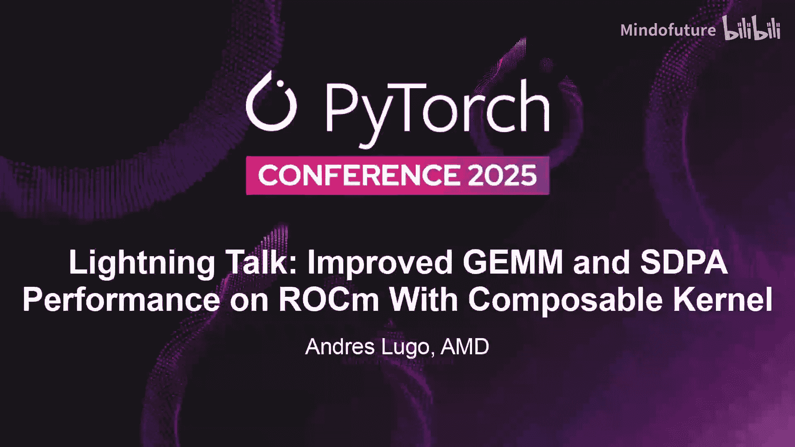
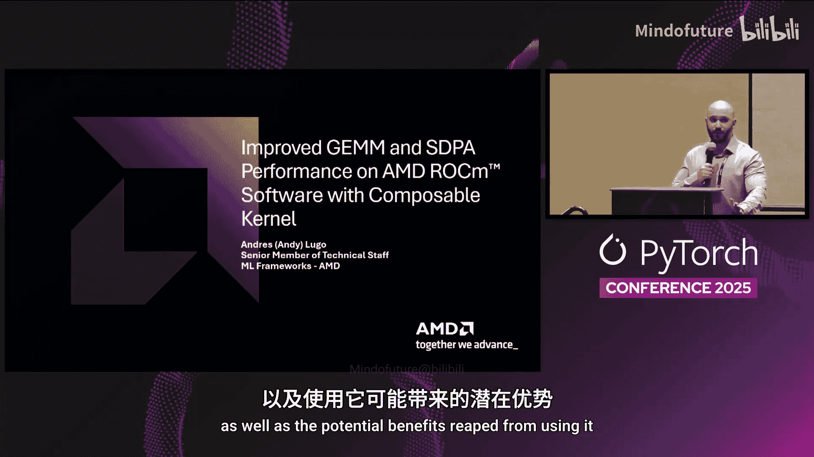
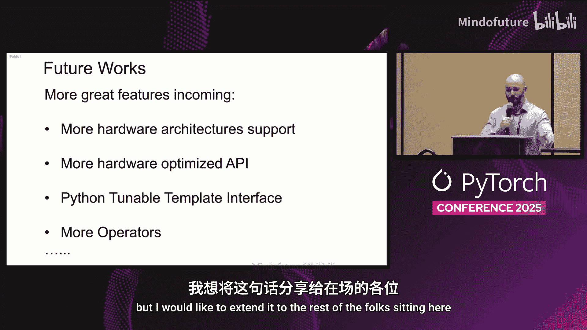
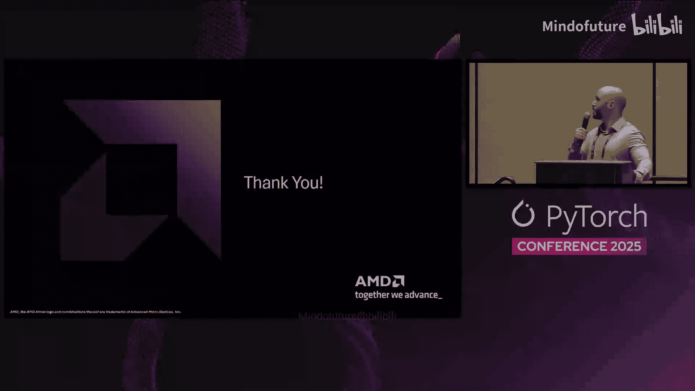

# 2025 Pytorch大会 ｜ Pytorch Conference 2025 p58 P58_闪电演讲-通过Composable_Kernel提升ROCm上的通用矩阵乘法与自注意力性能-Andres_Lugo__AMD -BV1b8kRB6EJG_p58-

Hello and good afternoon my name is Andres Lugo， but most people call me Andy。

 I am a senior member of the technical staff over at AMD with a focus on integration of math libraries into Pytororch。

Today I'm here to introduce you to Rock and Comosable Colel。

Newly integrated as a backend math library for two of the most important operations in the field of artificial intelligence。

 gems， which are the backbone of almost all ML models and scale dot product attention。

 which is the core component within transformer neural networks， particularly LLMs。Today。

 we will introduce its integration into Pytororch， its enablement。

 as well as the potential benefits reaped from using it。

Before we get started， I did want to give some recognition to the folks that made this integration possible。

 I represent a very small cog in a very large machine and the information presented today is a result of the hard work and long hours of many AMD engineers。

On the left， we have the core CK team who helped educate me on how to use it properly。

 and on the right we have my teammates on the framework team who I leaned against for the actual integration into PyTtororch。

Not to mention wu。Not to mention the countless hardware and firmware engineers who worked tirelessly to create the MD GPUs on which C relies。

On to maximize its performance， this list is but a small subset of the names of developers who work to make CK possible and without them and many others too numerous to name this would have been impossible。

Firstly， what is composable kernel or C as I will refer to it moving forward？😊。

CK is a powerful library that allows users to write custom， vendor， optimize kernels。

 and integrate them into various applications。These kernels take advantage of the underlying Rockham stackack to efficiently allocate resources on chip to maximize performance。

There are quite a few supported operators， including but not limited to various types of gems。

 fused multi head attention， as well as smooth quant just to name a few。

CK aims to abstract away fundamental operations such as Tensor coordinate transforms in order to accelerate development for high performance linear algebra kernels tailored for machine learning workloads。

 it is especially useful for fused operations which distinguishes itself from other linear algebra libraries like HLOS some of the greater advantages include speed of light performance customizable C++ operators that users can modify to their specific needs as well as a tuable template instances that can be used to get as much performance out of the AMD hardware as possible we have taken this powerful library and begun integrating it as the backend for various ML operators and Pytororch for the scope of this talk we will focus on two such operators those being gems and scale dot product attention let's start by looking at gems。

Enabling CGs begins at build time， they key off the environment variable use Rockham CKG。

 which is currently enabled by default。At runtime users may set their preferred blastL backend to CK by calling preferred BL library。

 then the gems will be used normally such as when that at operator is used。

 there are also batch gems integrated which will similarly be used in the normal BGM case。

After the preferred backend is set at the Python level。

 the variable is red down in the C++ layer at the moment where Pytorch previously decided between HLOS and hipL LT。

At this point， the logic will flow through a heuristic that selects the best gem for the provided inputs based on various factors such as the sizes of MN and K。

 the data type， as well as whether the inputs need to be padded。

We are currently in the process of tuning this heuristic further。

 so to improve performance even more。On the topic of performance。

 here we have some numbers that we pulled running these gems on an AMD MI 300 x based system using the Bf16 data type on the X axis。

 we have a selection of common shapes and on the Y axis， the time in microseconds each gem took。

After a number of warm up iterations， the orange bars are when C was used and the blue is without。嗯。

As you can see， there's a stark performance delta when comparing the two。

 these numbers represent the power of composable kernel when successfully tuned and optimized。

 it is important to note that these numbers were're taking using a highly specialized CK pipeline that was optimized for the shape shown。

It is not a one size fits all solution， but this demonstrates that when tuned appropriately。

 the performance scans can be enormous。Each gem time is just a fraction of what was previously and represents。

 in this case， an average of 78。9% speed up。This data was taken a snapshot using Rockham version 6。4。

2， and in both the CK and HA LT case， we aim to continue to improve with each subsequent release。

Here are the various outputputs for those same shapes and again。

The difference is night and day C is still the orange bars and hip loss Lt is blue here。

 larger is better as it represents a higher throughput。

It's important to note once more that these examples were specifically tuned for in some cases where there was insufficient tuning or the absence of an appropriate C pipeline hit bus LT exhibited better performance。

 which is why I want to emphasize that in order to truly squeeze the most out of composable kernel tuning and profiling is required。

 this tuning is made possible thanks to CK Pror。CK Prors。

 utility that comes for free in the CK repo that you can build and use to select the best pipeline for your specific problem。

Running this will output the pipeline you want to use which version of said pipeline as well as other tiling template parameters that best fit your needs usage is fairly simple as you can see users just need to give it which type of tensor operation you're profiling for this can be various types of gems like batchlor groups or grouped amongst others then you provide the transpositional layout of the tensors as well as the data type values for MN and K as well as the strides of the inputsDifferent tensor operations require different parameters but you can easily find the usage by running the executable followed by the tensor operation and then dashHe。

Usage is described in greater detail on the Readme in the GitHub repo， so please take a look。

This tool is incredibly important and is how users can select the best gem kernel for their job。

Now let's move on to our next operation， scale dot product attention。In the case of SDPA。

 the previously used library on Rockham wasa O Triton when enabled the logic is simply routed to CK instead。

Similarly to gems， this functionality is only built when the environment variable used Rockham C SDPA is set to true dissimilar to gems。

 this is not enabled by default we are currently working on ironing out the implementation in order to have this on by default。

 so please stay tuned for that。Once Pytorch has successfully been built with the new kernels。

 setting CK as the attention backend is a simple matter of adding this one line of code to your model。

 then anywhere your code regularly calls scaled dot product attention， the CK backend will be used。

 important to note that it is currently implemented as a backend for both flash attention and efficient attention。

 CK will not be used in scenarios where the math backend is desired or obviously the CUDNN backend。

Here's a diagram illustrating that last point in different situations in Pytor there are separate algorithms that are used for flash and efficient attention。

 but in the C case it accesss backends for both each entry point accepts different arguments。

 for example， efficient attention accepts attention bias while flash attention does not CK is capable of working in either scenario。

With respect to SDPA performance we collected this data using the open source benchmark provided by Pyettorch in the benchmark/ Transformers directory。

 this data was also collected on MI 300x using the BF 16 data type and the next couple of charts we will observe the X axis as the sequence length of Q and the Y axis as the time in microseconds once again the blue bar represents the benchmark being run on Rockham on Rockham without CK and the orange bar represents the data collected when CK was being used。

In this chart smaller is better as it represents less time taken per kernel。

 in all cases C outperformed the incumbent Aottriton this particular chart is the forward pass and represents a 19% speed improvement。

Followed by the same data for the backwards pass， again， as you can see， C outperforms Ao Triton。

This next chart shows the throughput andter flops as sequence length of Q increases。In this case。

 larger is better as it represents more floating point operations performed per second again。

 this first chart shows the forward pass as CKL performs once more。And finally。

 we have the same data just for the backwards pass。

 which is quite a bit faster representing an average of 98% speed improvement。嗯。

CK integration has not been limited to just Pytorrch。

 it has also been consumed by various other popular ML frameworks， including but not limited to FBG。

 which has several gem variants integrated， exformers and Triout flash attention。

 both of which have options to use CK's  fused multi-head attention。

 as well as integration inside torch inductor。As we can see by this list。

 CK continues to be widely adopted across multiple platforms。

 and the number of integrations just keeps growing。Looking ahead。

 we are currently migrating the gems towards a new。

 more simplified API and templated library in the form of CK under tile。

We also look to increase hardware architecture support， continuing to optimize the API。

 as well as at a Python level tunable template interface。

 so please look forward to those improvements。This presentation represents the ongoing work happening at AMD as we continue to push the needle forward in this space。

 we look forward to continuing this work to improve Pytorch on rockham platforms。You know。

 I believe it is up to all of us here to continue to innovate and improve technology。

 especially in this fast paced artificial intelligence space。We have a saying internally at AMD。

 but I would like to extend it to the rest of the folks sitting here as well as those listening online。

Together， we advance， thank you。

