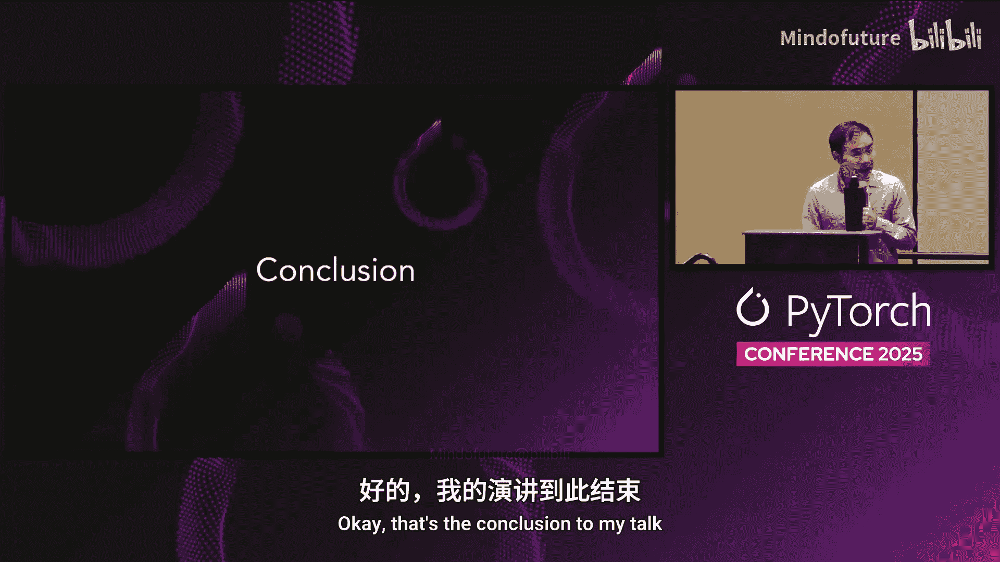

# 2025 Pytorch大会 ｜ Pytorch Conference 2025 p60 P60_闪电演讲-动态形状重编译问题-Bob_Ren__Meta -BV1b8kRB6EJG_p60-

Hi everyone， my name is Bob， I work on Pytororch and today I'm going to talk to you about dynamic shape recompilations。

 I hope at the end of this talk you'll have a better intuition on dynamic shapes and how to reason about them。

Okay， so what is a dynamic shape so for this talk we're going to imagine that we're building an LLM service so maybe something like chat EBT and like most LM service what we want to do is we want to batch user requests together so。

A dynamic shape is a way to symbolically represent a tensor， so in this case。

 you know typically in an LM service you have a bunch of user requests。

 you batch them together into a single tensor and you run them through your network。

And we can symbolically represent the batchch size with a symbol， in this case， S0ro。

 and so the tensor that we feed through the network would be something like S0 by3。

And why do we need dynamic shapes the reason why we need dynamic shapes is by default torch compile does what's called a static compilation and what this means is that every time torch compile sees a new shape。

 it would do a new recompilation So in this example， if we first see a batch size of 10。

 we might do a compilation， maybe that takes 10 minutes。And if we see a new size。

 a new batch size of two afterwards， we'll do another 10 minute recompilation。

 and if we see a batch size of five， we'll do another one。

And so dynamic shapes help to solve this problem and the way that you can enable dynamic shapes is through the Mark dynamic API。

So the mark dynamic API is very simple， it takes in a tensor and it takes in the dimension that you want as dynamic。

😊，And under the hood， what it will do is annotate the tensor to hint to our compiler to tell our compiler。

 hey， in the future， this dimension we expect to vary。And so in this case。

 after the very first compilation， we will compile a dynamic region of code such that when we receive differing batch sizes like two or five。

 there's no recompilations and we can reuse the same region of code and we get that efficiency back。

Okay， and now what are guards， so to understand guards。

 let's imagine we hire a really excellent intern for our LLM service。

 and they came up with a really good algorithm that makes our inference much， much faster。

But it only works if the batch size is divisible by eight。

So a reasonable way to implement this would be to update your inference function with a conditional where you say。

 you know， if the batch size is visible by eight， then I will use my entrancen algorithm。

 otherwise I will use my normal algorithm。And this diagram gives a quick overview of how Torch compile sees this code。

 so the way to interpret this diagram is time is going from the top to the bottom and what we're doing is we're feeding increasingly larger batch sizes into our model so starting from five all the way up to 11。

And so what first happens is when we feed in a batch size of five。

 it's the first time we run an input so we do a compilation， five is not divisible by eight。

 so we will do the slower inference algorithm， and we'll do a compilation and critically we will guard this region of code with the guard batch size is not divisible by eight next we run a batch size of six through it it passes the guard because six is not divisible by8。

 we reuse the compound region， same with7 Now when eight comes around。

 we will have a guard failure because eight is actually divisible by eight。

And so we will do a recompilation at that point， we will compile the fast inference code and we will guard that code with a new guard that says。

 only use this code if the batch size is a8。Subsequently for 9， 1011， it will fail the div by A card。

 but it will pass the notdi by A card， and so we'll revert back to the first compilation。Okay。

 so now we understand guards， we understand recompilations。

 when is it worthwhile to do a recompilation and for this。

 I want you to think about the trade off that is the most common in dynamic shapes。

 which is one around performance versus generality。

So you can imagine that if you have an optimization that only works when the batch size is div8。

 that's not very general， it will only work for a single batch size。

 but oftentimes due to the constraints you can make a very， very performant kernel in contrast。

 if you have a specialization that works for any batch size of divisible Y2， it's far more general。

 but in practice you'll have worse performance than a super specializedized kernel。

And the general equation to think about recompilations is to think about how many times do you expect to run through this specialization。

 what is the expected speedup of this specialization？

And is the multiplication of those two greater than the compile time youll have to incur for that specialization。

 so in this example， if you have an optimization where for x equals8。

 you get a 20 millisecond speed up。😊，If you invoke it 100 times your expectation is a two secondcond overall speedup。

 but if your compile time is five seconds it's actually not worthwhile you're going to be spending more time compiling than the counterfactual in contrast if you have an x mod2 equals zero optimization it has a five millisecond speedup which is one fourth of the previous one。

 but you expect invoke 8，000 times it's actually a worthwhile recompilation to do because you net out ahead。

Okay， so now we understand you know， the general trade off between compile time and。

And recompilations， what are some other considerations so this is actually a real worldor example we saw internally where there was a machine learning engineer who came up with this idea to decompose matrix multiplications and so they implemented this as an Fx graph pass where they checked the shapes of the matrices and if it conform to certain sizes。

 it would decompose it。😊，And after this shift， this caused some problems。

 so the way to interpret this graph is each line， each horizontal line is a GPU and each circle is a recompilation。

😊，And as you can see， the recompilations are quite unpredictable and quite unwieldy。

 and in a distributed environment this is particularly problematic because distributed GPUs actually have to synchronize they synchronize via collectives and so you can imagine if you have you 100 GPUs and one of them recomples。

 the other 99 have to wait for that single GPU to finish recompiling and this can tank your performance and worse。

 if your graph is sufficient large， you'll actually it can take more than 10 minutes and you might actually hit nickel timeouts which will completely crash your job and cause some reliability problems for you。

Okay， so you might be thinking well recompilations are really bad how can I prevent recompilations we'll get to know the tradeoff of recompations versus not。

 but one way to prevent recompilations is the mark unbacked API so the mark unbacked API is very similar to the mark dynamic API except if you mark a tensor is unbacked if at any point in the compilation we specialize instead of specializing we would simply throw an error and we will point out where you are doing this specialization so that you can rewrite in custom op or remove the specialization。

Okay and lastly， I want to come back to this generality versus performance tradeoff。

 if there's nothing else you take away from this talk。

 I want you to remember that dynamic shapes is about generality versus performance。

 where on the one hand if you use something like static shapes。

 you're oftentimes going to get your peak performance but it's going to be less general。

 and on the other hand you can use something like Mark unbacked to get peak generality where you will always be guaranteed a single graph but you might not necessarily get the performance that you want and somewhere in the middle you have something like mark dynamic where you can control the specialization and explore the Perrito frontier to optimize for both performance and generality。

Okay that's the conclusion to my talk， thank you so much for coming by。

 this is my GitHub and X as well as my email if you have any questions， thank you。

