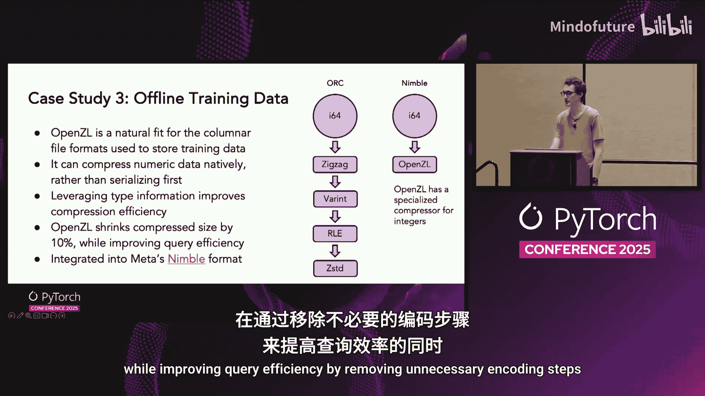
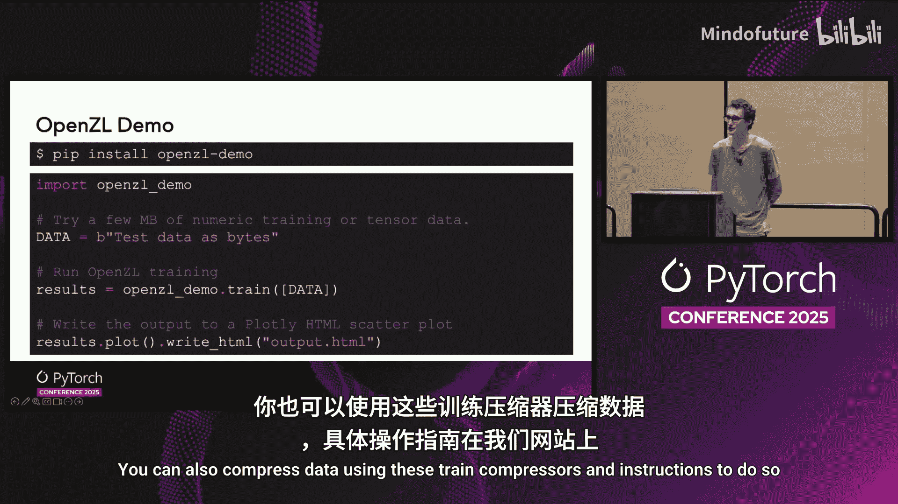

# 2025 Pytorch大会 ｜ Pytorch Conference 2025 p61 P61_闪电演讲-基于OpenZL的模型检查点压缩-Nick_Terrell__Teja_Rao__Meta -BV1b8kRB6EJG_p61-

Hello everyone。 I'm Nick， and I'm going to tell you briefly about Meta's new open source compressor。

 Opens Yel and how it can be used to improve efficiency across the AI stack。

Traditional compressors like Z standard， G Z， X， E， and so on。

 Don't understand anything about the input data they're compressing。 They just end up seeing bytes。

Sar compute can overcome this hurdle， as shown by the latest development of neural net based compressors。

 but this comes to the cost of being really， really imp practicallyally slow。

But simply telling the compressor about the format of the data allows for transformational gains and compression efficiency without additional compute。

This is especially true， for numeric data。For example。

 an increasing sequence of integers cannot be compressed at all by Z standard because theres no repetition。

But a simple delta transformation of subtracting the previous value。Makes it trivially compressible。

Opens Ya as a toolkit for building and deploying specialized compressors。

We're going to go through a few case studies and we'll start off with talking about how open Z L can be used to compress model checkpoints。

Traditionally， models are lossily compressed by quantizing floating point tensors， for example。

 truncating a float 32 to a B F 16。However， this impacts model quality。

So that impact has to be measured for each model before it can be applied。

 making it difficult to apply at checkpoint time。Quantation was applied to a handful of models。

 and it saved 50% on these models。But there are hundreds of models。

 So the overall savings are pretty meager。Losless's compression doesn't save as much。

 but it saves it transparently across all models without impacting quality。

 and we were able to reduce storage and bandwidth by 17%。And because bandwidth is a bottleneck。

 adding compression， also reduce checkpoint， save and load time by 15%。

 making it a win on both storage and checkpointing overhead。

We'll take a slightly deeper dive into how we actually achieve this compression by looking at a B floatat 16 tensor。

A B F 16 contains one sign bit，8 exponent bits， and seven fraction bits。

We typically see that the exponent is highly biased because the flows are generally normally distributed between negative one and one。

And for the same reason， we see that the signine in faction bits are largely noise。

There's some signal in the highest bits of the faction。

 but it's really minor and generally not worth extracting。So in order to compress these floats。

 we shuffle the bits in the float to separate the exponent bit from the sine infction bits。

Then we compress the exponent bits with an entropy compressor like Hoffman and just store the rest oncompressed。

This separation allows us to specialize the entropy statistics in Huffman for the exponent bits。

 rather than mixing in the noise of the signine infraction bits。

 and this also speeds up compression because we don't need to compress the signine infction bits。

Ultimately， this technique is pretty simple， and it has been applied pretty widely throughout the industry。

 for example， in diet GPU or in ZNN。So opens seals。Approach to compressing floats isn't new。

 but that's not all we have to offer。Opens yellow as a generic graph based model for compression。

 It has a set of codes it uses to manipulate， transform and compress the data。

 And then the compressor combines these codex into a dag of operations。😊。

And then the compressed data is just the output of this dag， together with the graph itself。

In this example， we inspect the input data。And on sparse data。

 we run length and code the zeros before we compress it， as shown earlier。 And for dense data。

 we just compress it。The decompressor then just runs the reverse graph to regenerate the original data。

This means the compressor can change its graph at any time while maintaining compatibility with existing decompressors。

 which gives an immense amount of flexibility in how we compress the data。😊，In this example。

 Sprse data has to run an extra run length decoding operation。

 which was written to the dag of the compressed data。Generally。

 OpenZL employs a model where the compressor is smart and understands the data。

 and the decompressor just follows instructions left by the compressor， making it very generic。

In this next example， we'll leverage OpenZL's flexibility to allow us to handle a slightly more complex format。

Here where we're compressing image embeddings stored in pie torches， Torch。 save format。

Which is an uncompressed zip file。We want to compress the tensor data the exact same way we did for checkpoints。

 but it's mixed in with zip file metadata， which gets in the way。To handle this。

 the split codec and open ZL is driven by custom code in the compressor to parse the zip file and group all the tensor data together so that we can compress it。

And while the compressor needs to understand the zip file， the split codec records its decisions。

 So the decompressor is agnostic to the file format。Meaning， we can change how we parse at any time。

Using this technique， we are able to reduce storage and bandwidth consumed by these embeddings by 30%。

 and we did that without regressing training performance。😊。

And because we were able to reuse existing components。

 the compressor was built in under a week and can be deployed with zero changes to the decompressor。

Now we're going to move on to offline training data。

 which is typically stored in a column data format。In open source， this is often parquet。And meta。

 this was ORC and is now nimble。Fundamentally， column or formats break complexel columns like maps down into columns of atomic data types like in 64 or float。

At this point， formats like OrRC would need to encode the data to reduce its footprint， for example。

 by warrant encoding and running run length encoding before passing to Z standard。However。

 Z standard doesn't actually know it's compressing numeric data and just treats it as bytes。

Open Z is different。Nimble passes the column data directly to open ZL together with a type annotation。

Which allows for dramatically improve compression at faster speeds。

OpenZ is able to shrink nimble files by 10% compared to Z standard。

 all while improving query efficiency by removing unnecessary encoding steps。

And in our last case study， we'll look at online training data。

The volume of this data can be immense， and transmission is offered a bottleneck and training。

A typical solution is to sub samplele the training data。

 but this degrades model quality because you're training on less data。Improve compression in scribe。

 which is the pipeline through which online trading data flows at Me。

 means that we drop less data and that improves model quality。On training data。

 OpenZL is able to offer compression ratios that are competitive with the strongest compressors like X C level 9 or Z standard levelve 19。

 but at speeds that are fast enough to be used in online training where we were replacing Z standard level 4。

Switching to open seal reduced scribes compressed bandwidth by 15%。

 which improved efficiency and model quality。And to finish things off， I have a very quick demo。

You could install the Open ZL demo package and pick some data to compress。 For example。

 numeric training data， model weights or any simple numeric data。

Then simply call the train function and visualize the different trade offs that open Eel can offer。

We can handle more complex structure， but that's out of scope for this simple demo。

 And if you're interested in that capability， check out our website， which is linked at the end。

You can also compress data using these train compressors and instructions to do so on our site。

After running the demo， you'll get a chart like this。

 here we see the Pato frontier of compression ratio。

 compression speed and decompression speed trade offs。Depending on your speed requirements。

 different points might be interesting。If you care the most about compression。

 point0 might be interesting。If you want a middle ground between compression speed and and compression and speed。

04 might be interesting。 And if you care the most about speed。

 and want just a little bit of compression，08 might be interesting。

And if you have a more specific requirements， other points may provide the optimal trade off。

But note that the exact compression ratio and speeds will depend heavily on your data and its compressibility。

Thanks for listening。 And you know， see the link below for instructions to run the demo on your own data and generally learn more about Open ZL。

And thanks to the entire Open Z L team， as well as our partner teams that worked with us on these projects for making all this possible。

If you have any questions， I'll be right outside for the talk， thank you。

