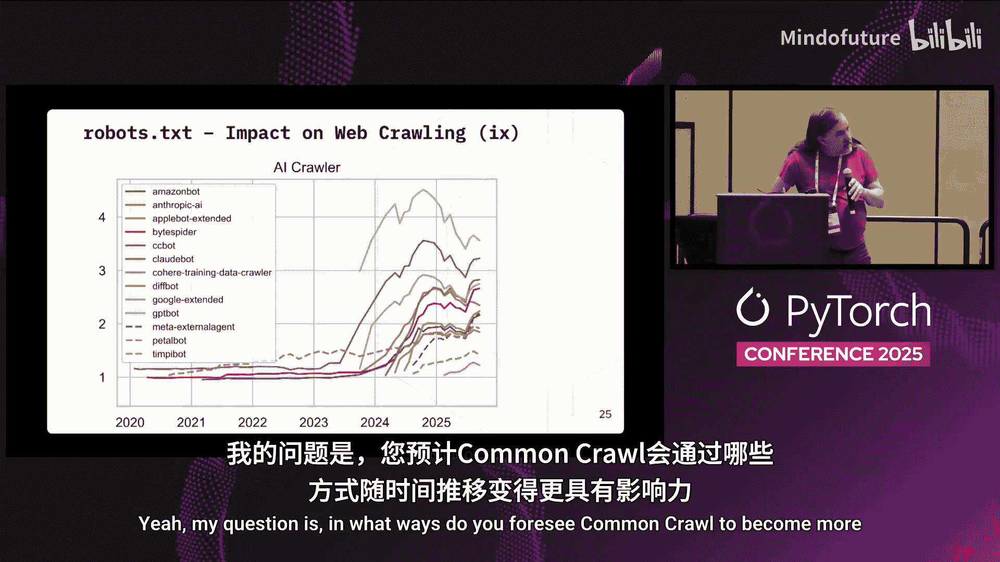
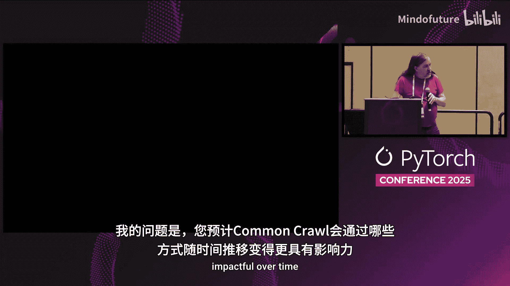
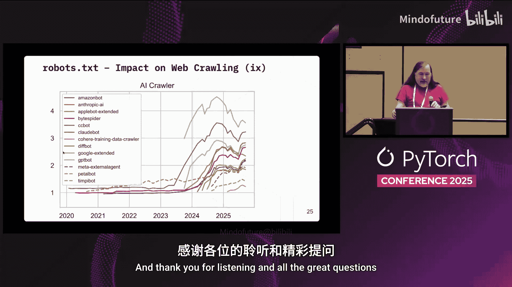

# 2025 Pytorch大会 ｜ Pytorch Conference 2025 p62 P62_应对公共网络数据挑战-Greg_Lindahl__Common_Crawl -BV1b8kRB6EJG_p62-

Hello， so thank you all for coming to this talk， it's probably your last talk of the day so I appreciate people sticking around my name is Greg Lndhal and I'm the chief Technology officer at the Common Cwl Foundation。

U。Let's see。あ。Okay， so we are。A nonprofit， and when you see people saying that they trained。

Artificial intelligence or machine learning or whatever off of web data。

 likely they actually mean our data set， so we date back to 2007 and we were founded by a guy named Gi Elbaaz who sold his company。

Sure。Gil Elbas， who sold his company to Google before they IPOd。

 and so at that point he had seen how beautiful the data was inside of Google。

 he was wondering where is the next Google going to come from？So。

So he founded Common C and he funded it himself and he hired an engineer and over the years he had one engineer and gradually usage took off and so this is the Pytorch conferences this is my first time at PyTtororch and frequently people use Pytorch to either process Common C directly。

 or they use a data set that is derived from Common C so for example。

 FineWeb is 100% derived from Common C， and this point we've been cited in over 10。

000 research papers。And so here's our exponential growth so that the last bar is 2025 so that's only three quarters of a year。

 so it's not exactly exponential， but it looks pretty good so there's a whole ton of use cases for Common Cr data more than the Pytororch communities so there have been a couple of search engines that sort of started with Common Cral as they bases。

 there's a bunch of people who do digital humanities with it。

 and especially if you want to study in a relatively obscure languages for example。

 Nigerian pigon the BBC is the biggest source of Nigerian pigeon and in the entire Nigerian pigeon academic community studies。

 Nigerian pigeon out of our data， that's a foreshadowing because the BBC insisted that we erase that data set。

So that's where we're headed and then finally AI and machine learning training so that's the Pytorch community so our mission is to make this data set available and make it really available so it's actually free to download thank you to Amazon and Jeff Bezos and we support a lot of people making know data-drin decisions so for example one of our UK partners that I wrote my first letter of support that I wrote after I started at Common call two and a half years ago full time was to a UK researcher who was researching small businesses in the UK on the web。

And he found them in Common C。That last point is super important to us。

 so we want to preserve every language， community， and culture that's there on the web as best we can。

So we have a very open mind as to how much we should work on lower resource languages。

 so the size of our data so it's 10 petabytes of data it's 30 billion web pages it started 17 years ago so I became an advisor to come and all in 2012 and we add about  two and half billion pages a month and they're divided up into separate 108 separate crawls at this point and we add one every month and we have a bunch of other additional data products。

 so for example the web is a graph。And we have a graph of the web that you can study if you want to。

 we also have a host index which rolls up all the individual web pages。

 and so you can see sort of what's going on on a host by host basis is this website 50% English and 50% French？

That number is in the host indexex。This is downloads of our data last year。

 we nearly reached one exabyte。Of downloads。 So that's the 10 petabyte data set being downloaded fully 100 times。

And we have a bunch of different data products and that's the different colors on this graph and the numbers aren't particularly important。

 but in the AWS Open Dataet sponsorship program， we have the largest outgoing bandwidth。

 we're not the largest bucket in size， but we're the most active bucket for downloads。

So we want to have a representative data set of the web we' text only。

 and so we worry about breadth and depth and freshness and we don't want too many duplicates and we want good regional coverage。

 we want quality whatever that means and then there's a bunch of different use cases and we try to support all of them at the same time So it's a very unfiltered data set and as I tell people you know look。

 if you want to study hate speech on the internet， we have your data and once you've figured out what hate speech is。

 then you can remove it， but we're not gonna to remove it from our cor because other people want to also research hate speech and hate speech changes every time。

So this is sort of a summary back to the beginning of the freshness。

 so as you can see we mainly revisit web pages in the modern era。

 that's because the web doesn't actually the good parts of the web don't actually change that quickly。

And you can sort of see us evolving over time。 and quality， pretty much the。え。

It gets better starting at about。2016。So we're actually on the right track。

 according to the quality measures that we use internally。Okay。

 so we crawl the web and we're the politeestt web crawler ever。

 we crawl extremely slowly so we don't crawl more than two webage a second， we respect a robust text。

 even though people don't agree on what robust our text means。

 we also pay attention to URLlel tags and HTML headers and we preserve all of this information so that anybody using our data set can see if they're unwanted by a website。

 we also identify ourselves when we crawl and we crawl from a fixed list of IP addresses and we have a reverse DNS and so you can verify that if you see our bot CCbot on your website whether or not that's someone lying that their CCbot or if that's actually us。

So the robots on text。As I mentioned， it's a file that allows website owners to say what crawlers should and shouldn't crawl and different crawlers can have different rules。

This was only standardized in 2022 and people don't actually agree about what that standard means。

 And so there's another effort going on to。To another standard。Whi we're taking part in。

 and it's widely used。 So here's a 2022 example。 and so this is the BBC before they blocked us。

And so this is mainly technically related， right， They don't want search engines using their search interface on BBC do com。

 And that's that's totally fine。 And there's a couple of bad bots that are that are disallowed。

 And then， and then there's actually dedicated rules for Google and Bing。

 which are the two largest search engines。 So here's 2025。

 And you notice there's a very large number of user agents， which are entirely disallowed。

 And this is because of the rise of chat GT。So here we are in the era of AI panic。

 so when GPT3 got released to the academic community in 2020 nobody really noticed。

 but when Chat GT released a web interface in November 2022 everybody noticed and the initial backlash to that mentioned two user agents for robots。

 Cha GT and CCbot， and so we became widely blocked eventually after that and I'll tell you what the consequences of that are both in size and in data quality in future slides。

 the backlash then grew much worse because there's a bunch of anonymous unknown probably AI bots out there aggressively crawling the web and so when you see someone you see a company that says they had their own crawl in their own data set and no one has ever seen their user。

They're stealth crawling。And so XAI would be an example of that that nobody's ever seen their crawler。

And because of this， website infrastructure providers。

 so Glaavflare and WordPress saw this as a marketing opportunity and so。

That's caused bad things to happen both in robust our text entries and also bot defenses。

 So Cloudflare manages the robust outt text for 3。8 million websites， and they call us an AI crawler。

 even though we're used from many different things。 And that decision was made by the CEO and。

He can do whatever he wants， he controls 20% of the internet， so there we are。

 and then the WordPress CEO said he was going to block us in robust text and we said to him。

 you know， you're nott own any of the content on any of those WordPress blogs。

 your users own that content， they should decide whether or not they to get crawled so he went home and he instituted a rate limit we're only allowed to crawl like one page a day。

So there we go， so that's bot blocking， and I hope to have bot blocking numbers for this talk。

 but I didn't get them done any time。So that's the AI panic so let's measure the AI panic so the basic idea right is that at some point right so November 2022 is on the far left of this graph but when you talk about blocking it doesn't make any sense to just talk about the entire internet the internet is a power law it's like everything else and so you should talk about different sizes of measures in the top websites and so you need a way of ranking websites and we have search engine style ranks and there's the people publish other rankings so this one uses somebody else's ranking so the top line is the top 5000 websites and then the lower line is the top 100000 websites and so as you can see we're more frequently blocked by the more important websites has an effect on web crawling and so in this chart GTbot is the most hated crawler。

And we're number two。sorry。 in this chart， actually， what is showing is the top 1000， top 10000。

 top 50000 dot dot dot dot dot。 So the highest line is the is the。Most important。

 but smallest number of websites on the very bottom line is the top 2 million websites。

 So as you can see， the more important a website is the more likely it is to block CCbot in particular。

So now what about other user agents so the top line in this chart is GPT bot and the second top line is us and remember November 2022 was the magic date but the panic didn't really break out until the middle of 2023。

And you can see that there are some bots that are not particularly affected and other ones are strongly affected。

 so let's do this by sector。 So now we're changing how the thing is done。

 So one means you're blocked by the default user agent of star。And so on this chart。

 so one is star and the things that are blocked less than star are being in Google。

 and the thing on the top is GPbot and the second one is CCbot。Okay so now let's do it by sectors。

 if you look at search engines you'll notice that there's no bump in this graph so search engine crawlers have not been blocked in particular search engine optimization is a thing that there are companies that provide data sets for and as you can see there's no significant change over time for SEO web archiving oh well so the Internet Arch was blocked more than CCbot back in the good old days。

 but now CCbot is number one we're more blocked than the Internet Arch。

And we're about a third of their size， by the way，So for for AI crawlers。

 which the CEO of Cloudflare considers us to be an AI crawler。 As you can see。

 all of those are affected。 So， so this AI panic is mainly affecting AI crawlers in particular。

 There's also AI， there's there's search， which is rag， and then there's agents。

And and so as you can see for both of those， there's also an effect of people getting blocked。

 even though you might。Want to choose to allow search and agents because you're trying to sell something but yeah it seems to be that a lot of those are also affected。

 Okay， so let's flip it over and this look at the impact on AI training So in this chart the dashed lines are the top 2000 websites in these three corusees。

And then the lower line is a random selection of the entire corpus。 So as you can see。

 it's mainly affecting the head of the training data。And doesn't have very much effect on the。

The training data overall。So it。If you。Look at ablation studies of AI models。

 it turns out that if you leave out the New York Times， your model isn't really hurt by it。

 it's only slightly worse whereas the New York Times think to the most important newspaper in the history of mankind。

 and you should pay them a lot of money to train on their content。

 it actually doesn't have very much value。And you can do this split by category and so you notice that on the right that the shopping and auctions category has the least blocking of anything。

 and then this is politics， so the left side is left wing news websites and the right side is right-wing news websites and as you can see what's going on is that most of the blocking is for centrist websites whereas the most rabid websites on the left and right have the least amount of blocking。

 so this introduces an unfortunate impact in training data that if you want to study the news on the web it's getting much more difficult over time because our data set is much less complete and it's less complete in a biased way。

Okay， so legal and policy， there's sort of stuff going on at the IETF to update the aer robots style text preference to include AI preferences and it's going really poorly。

 so I don't expect that to ever finish and there's some people who think that。

You can convince crawlers to pay for data， but that's never going to work because the people who are stealth crawling are going to stealth crawl and all those people block us anyway。

There's just a lot of。Talking and， and， nothing actually happened。 But let me。

 let me tell you a policy trend so that the the bottom half of this slide。 So we。

 when people send us a letter demanding that we erase all of their data from our archive， we。

 we put them on a list because。People have downloaded our data set already。

 and the only way to remove that data that was downloaded in the past is to publish a list and say。

 you shouldn't use this data because this company is very litigious and man。

 there's a list of four felonies that almost all of them accuse me personally of and I love getting these letters I been getting about。

What，5 a week from France， French publishers。 but it's very much mainly the news industry。

So we would like people who use our data to start filtering out the data from people who have opted out and here's the number of opt out requests for years。

 as you can see it's exponential， we're only nine months into 2025 and it's already a winner so here we are。

So consent in crisis so the funny thing here is that so we're a nonprofit。

 we produce a data set and it's used for all kinds of things。

 and if you sue us first we don't have any money and secondly a US court is very likely to find that it's fair use and if that creates a precedent then everyone would be on the publishing side would be annoyed and so no one's ever going to actually sue us but we sure get harassed a lot and there's no agreement in between publishers who own the copyrights and all the different variety of communities that would like to use that data to do stuff。

And remember， we're talking about the public web here， right we don't go behind a paywall。

 we don't log into any website。Right。Okay， but know knowledge。

 the most important thing you need to know is the location of the library。Okay。

 so finally to talk a little bit about languages， so ourCL is pretty much focused on English and if you look at if you look at the crawl statistics in 2013。

 we got worse， we became more English dominated and that's my fault because I donated a bunch of metadata from my search engine and of course our search engine was focused on English because that is the market with all the money。

So I actually made things worse。 It's been getting better over time。

 But most of the data comes from the Web， and we're trying to find。

You know these rare languages and so here's on the left side sort of a diagram of what the world is like in terms of what people actually speak and that looks nothing like our actual distribution and on the right is the distribution of source code and the wrong place to look for our source code C anyway but and we don't do a good job on that so here's top domains by geography and here they are by geographical coverage blah blah blah and so that badness that I mentioned it's the blue is English。

 that's co and net effectively that's English and as you can see it got worse in 2013 that part became taller and only recently we were covered so we're working on this and so we have stuff that we're doing so we got the web languages project so if you know my personal history I've been involved in two major crowdsourcecing。

Thanks the first was the open directory project which preceded Wikipedia and inspired Wikipedia ODP。

 also called Ds， so Ds。org was the domain and then my search engine Bleco also had 2000 crowdsource lists that were on top of our search engine and so we had 2000 vertical search engines built into our main search engines here we go for the third time so this is about language community and culture and we used this to。

Ster the crawler in the right direction。So it's actually a Github thing。

 So if if you happen to be a native speaker of a language other than English and would love to fill out your personal language community or culture。

 please have a look it's in the Common C Github web dash languages So we're also working on language identifications。

 so browsers already have this but they're not very good at it。

 and people do foolish things like they train a language identifier on using the Bible as a parallel text and everybody knows that the Bible is not written in standard English。

Right it's not written in a standard it's flowery compared to normal speech。

 and it's nothing like colloquial speech in any language。

So we're trying to capture colloquial and normal speech from different communities and cultures。

 not just languages， so we held a workshop about this。

 we ran a workshop two weeks ago so that's coming along so here I am at the end of my talks。

 we'll have a Q&A in a few seconds but so the AI panic is definitely hurting the tip of our data but we don't believe it's significantly hurting artificial intelligence or machine learning uses of the data。

嗯。We currently classify that state of the art 160 languages， but we want to support many more。

 there are more than there are nearly 8000 living languages， a lot of which aren't on the web at all。

 and we like to support as many of those as we can we're crowdsourcing information in two different ways for this language coverage and then finally we're involved in all this IETF stuff that's going on。

So that's， that's the of my talk， there's a portable microphone if people want to。Ask some questions。

Oh okay so two questions。 First one is with respect to like kind of AI generated data。

 that's kind of part of the AI panic hurrying the tip thing。

 Are you guys doing anything to of like identify or label or attempt to do so on any of the data sets that you have like what something is AI generated or not。

 I'm an astronomer。 And you， when physicists build stuff that measures radiation you often want to get steel that predates the beginning of nuclear testing。

 and it's called low background steel。 And so somebody raised a World War I warship and melted it down and they will sell you low background steel。

 So you know， everybody knows the day that G was released。

 So you can use you know all of our older data is in our archive。 So you can use that。

 you can compare that to the present。 So we don't do any of these things。

 but you compare to the present and then。AIB AI probably isn't popular and so because we have a search engine attitude towards quality。

 in theory， we're reasonably resistant to that， but no that's something that on a whole。

 we hope our partners will do。Awesome， cool。 second question was like you mentioned Wikipedia as well。

 that made up kind of 5% of your data。 I've heard recently like studies are showing that like Wikipedia is dying out because everyone is just going to like AI and asking questions and not actually reading Wikipedia and Wikipedia actually has a problem where not only is your aggregate traffic going down。

 but their traffic is。Distribution wise is being replaced with a lot more like crawlers than human traffic to Wikipedia such that they've literally had to like make data sets available。

 What do you think like projects like Common crawl like due to kind of affect the feature of sites like Wikipedia and whatnot the first thing so people when they say they use Wikipedia data they go directly to Wikipedia for it because we're the worst possible place。

 we only have a sample of Wikipedia when we have it in a bad format。

 So so people go directly to Wikipedia and as you know right it's a it's a crowdsourced thing。

 And so fads come and go know the open directory project is long dead Wikipedia lives on the number of editors is falling I'm an angry early Wikipedia editor。

Mad that people deleted a bunch of web pages that mentioned me。

 so all these things play into it and I don't think know Common Cross is going to end up having any effect on Wikipedia we wish them the best。

 but we're not going to directly end up having any effect on them and they have challenges。

 we have challenges， everybody's got challenges。Would you mind showing us again the language distribution slide you went through it super quickly。

 and I would love to have your comments about the trends there。

Whether you are getting any requests from foreign countries that are looking at having some sort of sovereignty over foundation models whether you see any trends in that space so this chart is by language not by domain name and the two highlighted lines are English and Russian which are the top two languages in our crawl yes。

 we hear from people about sovereign language stuff and so humorously I accidentally hired the top two postdocs in language identification who are both Europeans and one of them got a call from Microsoft and they wanted to fund his graduate student project and he's like well I work at the Common foundation now so they gave us the money。

And then they met with the French president and dropped our name and that's cool and the reason that the French President is interested in this is because France wants not only a sovereign French model。

 but they also want all of their regional languages to be in it。

And there's like more than a dozen French regional languages。

 and so every country in the EU wants to do that and we're working with them to different degrees。

 so sometimes there's an organization that works as us sometimes as individuals and we really appreciate the interest in that kind of stuff。

一。So the question is why is Chinese so underrepresented。

 so the great firewall of China is double sided？So， so we we， we do crawl Taiwan and Singapore。

 And that as part of web languages， you know， I sense language， community and culture。

 So I'm hoping to dramatically， So we already have a good。

Taiwanese list of important websites and we don't have one for Singapore yet。

 so we would love to do a better job with that and that's also true for languages like French and Spanish。

 where're the national language of a lot of countries that are former colonies and so that is part of the Web languages effort to make sure that we cover all those different geographies。

But we're not there yet。Can you elaborate on what you mean by the Great firewall is double sided because the last time I checked。

 you could access Chinese websites from overseas 00% of them。Yeah， if you can access them。

 so Michael says no。the same okay， so like what percentage of that of website are I have not analyzed the details。

 I just know that we have a problem crawling in China。 Okay， cool， Okay， so yeah， it's， you know， I。

 I'm at the。Yeah， I'm at the shrugging stage too。It's on my roadmap。😀这这。Yeah。

My clever idea is to try to crawl from Hong Kong because Hong Kong is special on the outgoing side。

 so it might it's special on the ongoinging side， too， who knows。

What percentage of your data would you say is from pre-existing data sets like Wikipedia or the internet archiveive or something more obscure like text files versus something that you crawled one page at a time？

So we crawl web pages， right， so Sony puts up a。a data set that' parquet files。

 we're not going to crawl it。Is that what you were aiming at？I mean， there' are still websites。

 essentially， so。There's still open data sets that our website and have web pages。

 So if you're crawling them， would you still。Pull them in。

 And is there a quality difference in terms of what you get yourself versus something that you get from。

Like one just giant website which took other websites。

 So that is a problem in our data set and hopefully it's minimized by our search engine and attitude about more important websites are a zion copies of Wikipedia they're all slightly different from Wikipedia because their clones usually a clone of Wikipedia on a particular day and in Wikipedia changes rapidly over time all that's in in our crawl and it's bad for AI purposes because one way to poison a crawl is to repeat the same information slightly differently10000 times in the input data and so that is a problem however。

 none of these Wikipedia's copies are popular。So that's the hope and it seems to kind of work that way but I actually have a project that's just kicking off so I have a funder who's very interested in data poisoning and we're going to run some projects along those lines and see because we know the Wikipedia example and it's easy to see just from the names of the pages if you keep the same names that are in Wikipedia then it's really easy to see this copy of Wikipedia。

So will I will tell you about that next year。Hi thanks， this is just a passing curiosity。

 but there was a table you showed about the composition of LOM data and I'm just curious how what the source of that data was I missed that it showed books web。

Periodicals other things， and I'm just curious about that because I'm also curious if you're aware of efforts to include more published text in LLMs。

It's just not something I thought about until I saw that So it's certainly common that people do want to include other stuff and we're not directly involved in that we actually are interested in adding more data products so for example structured and unstructured data sets so one example of structured data is micro formatats so it's very common that restaurants and and recipes in particular use this special markup in the HTML and Google will emphasize your website for searches related to restaurants and recipes if you have that markup so that becomes an interesting data in and of itself and and it doesn't appear unless you do special processing of the data so we have a partner of the web data commons。

org that's been doing oneC a year with that and so we're planning on productizing that and then producing it for every month。

That'll be an example of a structured data set， it'll still have flaws because some of the data is just wrong。

 but in general it works pretty well and so for restaurants especially you can really figure out where they are because in a typical restaurant website。

 the of the website， the address of the restaurant is in a JPEG。And you're like。

 how is this possible？That。😊，Right but it's true， and then usually it's in the microphone that it's there in plain text。

here。Right here。So I think one of your key points was the。

So called AI panic hasn't hurt the quality of the LLM responses。 is that right。So far。

I'm not really understanding what you're saying。 Sorry。

 you had a takeaway about the quote unquote AI panic about more sites blocking AI crawlers。

And saying that that still hasn't affected AI response quality yet。

But is that mainly because they still have archives of。呃。Prior。Prior archives。

 which which are still adequate to give good responses。

 But eventually as more and more sites start blocking AI crawlers， I mean， obviously。

 it will impact quality， right， I mean so。I'm not clear about your thesis there。

 Like are you saying that it's okay that more sites are blocking crawlers because that is not affecting the LMs yet。

So I made two assertions backed up with facts， the first one is this slide。

 which says that we're blocked on a lot of the top websites。

 but not in the top 2 million websites very much， and then the second one was impact on training data that again the training data from the top websites has disappeared。

 but the quality of。The remaining data is pretty good in an inflation study you can prove that you're not missing out very much yet。

So sadly， I do not have an ablation study in these slides。But there are。

 there are papers that have that。But of course， eventually as more and more start so that depends on whether or not more and more sites block us so if you watch the SEOo community right so if you want to sell widgets。

 you want your widget selling website to be at the top of biowiidget on Google search engine right so a lot of people have realized that they also want to be in the top of the new search engine right so Google for a while decided they wanted to block my ad blocked and Firefox and so I started using chat GT as my search engine and it's pretty good I'm on you know I built a search engine。

 I've evaluated know a lot of search engines and chat G is pretty good and so the Se community has woken up and so there's this new term and people use five different terms that I call it AIO artificial intelligence optimization and they're saying look you do want your content in the pretraining data for LOMs so that chat G and everybody else is going mention you。

when there's something relevant to your business and so I think that the backlash is going to have a counter backlash and the amount of blocking may stop rising at some point in the future and as you can see the amount of blocking did peak and move around a little bit。

 so it's unclear exactly what's going on now。But 12 months ago， the peak was 12 months ago。

So who knows what the future will bring？These are really great questions， by the way， I appreciate。

Having a very attentive， engaged audience。Yeah， I saw on page 6 that you mentioned that you have 300 bidding web pages。

 I'm curious to know what what is the strategy like you call the top domain second domain。

 and more later does have pages things like for many， for many social media like like YouTube。

 there's already like beating。Just under YouTube， definitely， you only sample very small of it。

 but that may be very valuable information if you continue to get all all the information。 Thank you。

So we're terrible at crawling YouTube and part of this is because it's too large right so our politeness is such that we'll never crawl more than two pages in a second so we don't fully crawl Amazon even over all the years right our sample of Amazon is nowhere close to 100% of the products on Amazon。

So the basic strategy is as we build a search engine style score similar to Page ranknk and the higher that score is the larger a crawl budget each particular web host has。

 and that keeps us out of crawler traps， it keeps us away from crawling overly SEOO stuff it's a big quality improvement and it's not a perfect score but even inerfect score is enough to keep us in the better part of the web。

How do you foresee common crawl becoming even more impactful and useful for？

Building models and for companies like innovating and all of this stuff。

 So was that did you say sovereign models Oh no yeah my question is in what ways do you foresee common crawl to become more impactful over time and helping to improve models。

 So so I mentioned the web graph。 So we've been generating the web graph since 2017。

 but it uses an idiosyncratic。

Graph format。 And so nobody outside of us has ever looked at it。

 The Web graph is an incredible graph。😊，And so in like two days I'm publishing a testing version of a conversion of it to Neo4j so that it's no longer an idiosyncratic format and it's something that anybody can use so these new data products I think will be very helpful secondly improving the ability of people to generate annotations of both web pages and hosts so for example if you wanted to run your own language classifier or your own topic classifier you could do that and then you could publish the annotation and other people could use it。

And then the next step is the ability to select out a small amount of a crawl and then have that be repackaged into a small number of one GBab files that you can then process on your laptop。

Right，And， and maybe that that file ought to be a zip file。

Where all the content is in individual files and then all the metadata is in a spreadsheet。

 so that's the digital humanities version。So these are all things that are on my roadmap and I hopefully will have shipped in the next year we grew。

3。5 x between last year and this year。So suddenly we're getting a lot more done。

We so we're out of time， I guess， okay， so thank you all happy to chat with people because there's a few there's like one more round of talks but not in this room。

 so I'd be happy to chat with people here and thank you for listening in all the great questions。

