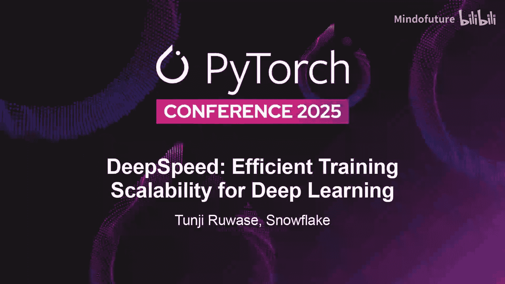
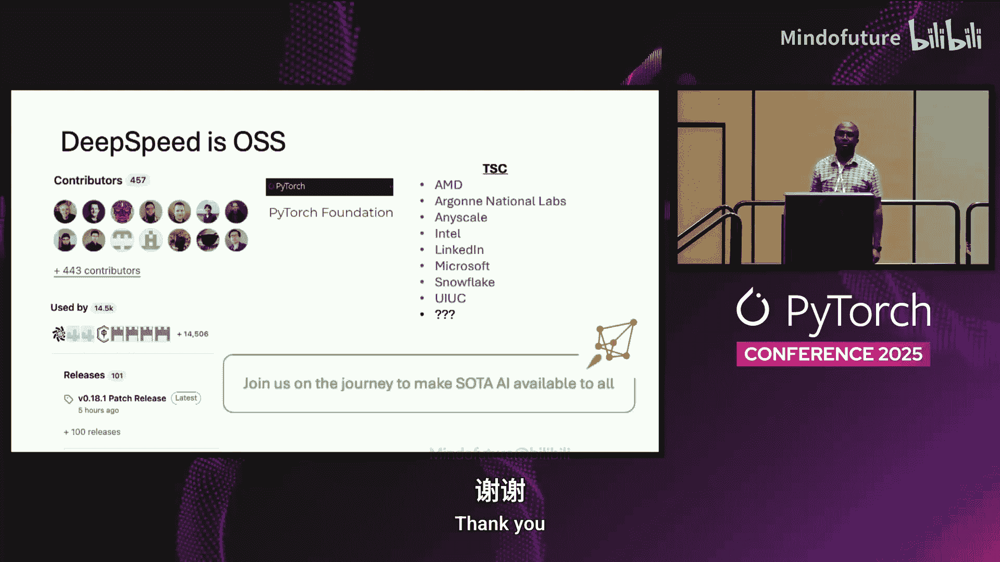

# 2025 Pytorch大会 ｜ Pytorch Conference 2025 p63 P63_DeepSpeed——深度学习训练的高效可扩展性-Tunji_Ruwase__Snowflake -BV1b8kRB6EJG_p63-

Alright， everyone， thanks for coming for my talk。 My name is Tnji。 I'm from Snowflake。

 I'll be talking on deep speed。😊。

So what is Deep speed， it's an optimization library for making large distributor training efficient。

Easy and effective。 And by that， I mean that if you use deep speed for your training workload。

 whether you're training on a single GPU or up to 100000 GPus。

 you would have sustained high efficiency。Or high performance。 And deep speed is easy to use。

 It runs out of the box。 should download and you get run in pretty quickly。

 and it also democratizes AI by basically reducing the GPU budget for you to either build state of the art AI or to use state of the art AI。

And Deeppeed became a part of the Pywach Foundation earlier this year。So deep speed was motivated。

 like when we created， it was motivated by the observation that scaling is what drives state of the art in deep learning。

And here I'm showing two interesting dimensions of scaling on the y axis is the model size。

 and the x axis is showing the training data size。And as you can see from 2018 till now on boot dimensions。

 we've seen three orders of magnitude of scaling on side on wood dimensions and has created significant system scalability challenges in our modern computing systems。

And so the first problem we tackled in the deep speed project was that of the GPU memory wall。

 And so this is what sort of restricts the ability to scale the model because the then the model can no longer fit in the memory of a single GPU。

And to address this problem we created two directions of optimizations the first direction is something we call zero。

 so zero is a memory optimization that would partition your model across multiple GPUus on the data parallel rank and in addition could also offload the model states onto CPU or NVME and so this combination essentially means you can scale your model almost infinitely。

The second direction of optimizations is what we call 3D parallelism。

This allows you to combine things like tensor parallelism and pipeline parallelism with zero。

 And so basically， your ability to scale your model is pretty much infinite。

The consequence of these two directions is that we effectively solve the GPU memory wall。

 at least as far as the models scaling was concerned。 So for example， as far back as 2021。

 we had provided system support for trillion parameter scaling。

 we already had that available even though the models of that scale did not exist back then。

And second the other impact was that this technique is so effective。

 it's really been adopted by other scaling frameworks that are out there。m so。

You know going forward the new things that we're looking at in deep speed。

 now there are other scalability challenges。 and I'm gonna talk about a few of them today。

 But but broadly the ones we are looking at today fall into offloading So this is an important democratization technique because this allows us to reduce the GPU budget by basically utilizing CPU and NVME long context。

 our context windows are also scaling very dramatically as more applications are are being digitized with AI。

 we're also taking advantage of compilers technology and we have checkpoint in becomes more complicated once you start doing distributed training and I O itself also becomes an important scalability problem。

In the rest of this talk， I'll focus on just the first three lines of work。

So the first work that I'll talk about in offloading is something we call super offload。

 It's one of our newest work。 This is making offloading efficient for the emerging super chip architecture。

So the motivation here is that super chip are new。 I mean， they're just sort of you know。

 becoming available broadly， but there hasn't been a lot of studies about how to efficiently use them for large language model training。

And in particular， existing offloading techniques were designed for the PCIe or loosely coupled architectures。

 whereas the super chip is a different architecture where the CPU and the GPU are closely coupled and have a much faster interconnect between them called the Mvi link C2 C。

And so this means that when we if you use existing offloading technologies。

 you're basically in inefficient。 you underutil the capabilities of your super chip。

 And so to address that， we created a number of optimizations that leverage the hardware features of the super chip。

 And in particular， we have a technique called speculation then validate。 and I'll talk about that。

 Were able to atgen to split the optimization computation over both the GP and the CPU。

 whereas traditional approaches would have run the optimization computation just on the CPU。

We have a super cheapware cast in， so when mixed precision， often you have to type cast。

 we've designed optimizations that is optimal for the super cheap architecture and part of that too。

 is that we've implemented an Adamom optimizer that runs efficiently on the Grace CPU。

This work will appear at AS+ next year， but the key takeaways the high level results we got is that we are able to fine tune large models like the GPTOS 20 B or the coin 40 B on a single GH200 the Lama 70 B on4 GH200 and in all of these cases were able to hit over 50% of the MF over 600 teroflops。

So。The first technique is what we call the speculation then validation。

 So here showing basically the flow， the top。Picture there is showing how the traditional offloading approach works。

 So there you have your forward pass， right， and then you have your backward pass。

 all of which are taking place on the GP。 at this time， your CPU is idle。

 And then we copy the gradients onto the CPU in order to do the GP to do the optimizer competition on the CPU。

 So while that is going on on the CPU， that means your GP is essentially idle。

 right This is a huge waste。Now， the reason we need to do this is that we typically need to see all of the gradients want to detect if there are any kind of you know。

 deommalized values on the flows over flows， right before we can move to the optimizer computation。

 So that's one reason we wait for all of the backward path to complete。

 Another reason is we often have to do gradient clipping and such clipping is based on global norm information。

So this is why， you know， the traditional approach basically serialize the backward pass and the optimizer computation。

But what we took what we did in and super offload is basically we did we found a way to overlap them in a speculative manner。

 So we start doing the optimizer computation as soon as gradients are available in a speculative way。

 And we still check for those conditions， those global conditions that I talked about and we would do a roll back。

 if it turns out that， you know， something went wrong。 And by doing this。

 we're able to keep both the GP and the CPU constantly busy。

We are able to do some of the optimizer computation on the GPU as well。

 which also provides additional acceleration。Now， doing this， if we had so。

 if rollbacks were frequent， then this would not be a win But we take advantage of the fact that when you're training。

 typically this conditions that could call cause a rollback such such as overflow onflow or clipping。

 They don't happen often throughout the entire run。

 They happen at the very beginning of training and towards the end of training。

 and the plot here I'm showing is for the bloom 176 B model。

 which shows that over the entire over the training time。

 80000 steps that the conditions for doing a rollback occur less than 1% of the time。

 So it's really not a performance overhead。The other optimization I want to talk about is the castton。

 So in like I said， with mixed precision training， you know。

 your forward backward is in low precision， your optimizer competition is in high precision。

 All of this is for numerical stability。Now this means you have to cast your gradients and parameters as you switch from your CPU to the GPU in the old approach。

 we typically try to minimize the volume of things we transfer。

 So usually you would do the cast in on the GPU and tried to like only transfer like in low precision but by studying the C2 the hopper the GH200 we observed that the right approach actually is to always cast on the GPU right So we always it's very fast。

 And because the C2 C connection， which is a 4，50 gigytes each way is so fast the fact that we're doubling the communication volume really doesn't matter And so that's sort of what we're showing here where the option of you know。

Trying to minimize the communication volume is not so important in the great operapper architecture。

Then the other part shown on the right hand side is our atom optimizer implemented in the grace CPU。

 and we take advantage of all of the vectorization features that are available。

 Ve units are available in the grace CPU。 And this allows us to get。

 you know atom optimizer that's three times faster than the pietorrch。

 And we believe this is the first open source Adamom implementation for the grace CPU and pretty excitedent about that。

So all in all for super offload， we get speedups compared to the baseline of about 4 to 5 x speedup。

 the technique itself is composable with existing you know zero and ulysses techniques。

 and so that means you can plug it in easily into your existing workflow。Alright。

 let me move on to the next talk， ZenFlow。 So this is another offloading optimization that we created in collaboration with our academia partners。

So the problem that Zenflowlow tries to solve is similar， but is solving it on existing hardware。

 It is basically that when you're doing the optimizer competition on the CPU， you know。

 your training basically stalls。Right， and that's kind of showing that here。

 The first figure on the left is showing， I guess， offloading helps you to scale your model size compared to no offload。

 But then when you start to do your then your GPU then ends up being idled a lot when you're doing optimizer computation And given that the speed of the GPU and the CPU continues to the speed gap continues to grow。

 it means that this stalllin is only going get worse with time。 right， So what can you do。Yes。

 plot is just showing sort of some actual numbers where your forward pass takes about 45 milliseconds。

 your backward pass takes 2000 milliseconds。 a big chunk of that comes from the fact that you're offloading the gradient to your CPU。

 and then you look at the CPU time for the parameter update。 It's about you know4。6 seconds。

 It's just really a big bottleneck。This makes it hard to overlap， right。

 If you have this sort of numbers， you can't really overlap。

But then one observation we made is that in the pre training scenario and sorry。

 in the post training scenario and fines un， that not all the gradients are created equal。

 Only a few of the gradients are actually very critical to your convergence。

And this is the plot we're showing here。 And the main takeaway is that only 1% of your gradients are responsible for about 90% of the total norm。

Re gradients。 and what that means is that we can essentially take those 1% of ingredients。

 run them on the GPU。 And while the the others that are not so important， we run them on the CPU。

 but we don't even update them update the parameters frequently， right So there's a delay。

 We can afford to delay the updates there because the norms are just pretty much insignificant at this point。

And that's essentially what we do in Zenflow right So we come up with an as synchronous update where some ingredients get updated every iteration while some get updated。

 you know， sort of in a slower fashion might put it that way。

 And this helps and the benefits is now the 1% of gradient can be updated on the GP because they're so small。

 it doesn't really affect your model scale size， and then the slow ones get updated on the CPU and you know and that can be done sort of lazily。

And the consequence of that is that if we over you know compare to the baseline and looking at， well。

 I guess one thing that's really interesting is that it doesn't affect the accuracy and actually in one of the benchmark。

 we saw a higher accuracy compared to you know the sequential approach。

 but overall it improves your speeds by about 5 x speed up compared to the baseline。

The next work I like to talk about is what we call the Arctic lung sequence training。

 And This is from our snowflake AI research。And the motivation for this work is that the context window for your models is growing。

 So if you think back to 2018 when we had Bt， the context window for that was about 5。

12 tokens since then the largest one that I've seen recently the last time I checked was about 100 million tokens。

So the context windows are scaling growing really really fast。 And so then the challenge is。

 how do we train models that have long context capabilities。

And that's what we've done in Arctic sequence in ALSD or actic long sequence training。

 So to drill down to what is the what is the cost what challenge does know the longer sequence create here I'm showing the memory costs of scaling up your context window。

 And here I'm using just 8 billion Lama3 model here I'm plotting the activation memory as you increase the context length on the x axis。

 Y axis is showing the memory usage， I have gradient activation enabled already here。

 So it's not much else we can do。 And if you can see you know the model the context and this is just the activation memory。

 So we're ignoring the model memory here。 You can see that is just skills linearly And what this really means is that on a single GPU。

 the memory wall shows up again。 It turns out we can't support more than 32000 context window1 30000 tokens。

So that's a problem。And there are multi GPU solutions that try to like parallelize the context window across multiple GPus。

 But those are not general。 They don't work very well。 One。

 they don't support Hogging face Finds Uni， which is really the primary way most people do find Uni these days。

 So you grab your model from hogging face。 And so this is a significant you know， adoption barrier。

And secondly， they don't support the more modern attention。

 So work it works well with you know multi head attention。

 but not something like group query attention or M QA。

And so to address that we created Arctic long sequence training and so the key points there is a suite of optimizations for helping you to scale your context window and there are three directions of optimizations here。

 one is Tling， so we end up doing the tile computation， then we also leverage parallelism。

 we have to parallelize your context across GPUs and we take advantage of the newest memory optimizations in the latest versions of Pytorch。

So by solving this problem were able and we also provide the hug and face fine tu capability and support for the newer attention mechanisms and so here I'm just sort of showing that with all of these techniques on a single GPU we've been able to increase your context window from 32K to half a million tokens and you can also see that as we add more GPUs。

 we are actually linearly scaling your context window。

So let me talk a little bit about the optimizations here just briefly。

 So the first one is the sequence tiling。Now， Tin is know a prestandard computer science concept right where if you know you try to break your problem down to reduce work the footprint。

 And so it turns out with your attention， there are actually some operations where the intermediate tensors are a function of your context length。

 And so examples of that would be your logics or your loss computation。

 And so the solution here is basically instead of trying to compute on all of it at once。

 compute on tiles of your sequence and that helps to reduce the size of the intermediate tensors point out that this only applies to operations that do not have cross dependencies。

 So like your causal attention will not be suitable for this optimization。

But there are other parts of the the loss and logics like I mentioned or the embes that would actually work well with this and here I'm basically just showing that for the loss competition in an8B model with and without Tling on the left hand side is no tiling on the right hand side with Tin and this is a Ptor memory profile shows the reduction not only in the memory but also in the peak memory。

Sequence parallelism， we build on the Ulysses， which already does parallelism of parallelly your context over multiple GPUs。

And here， the challenge with Ulysses is that it only assumes MHA multi head attention。

 It's not able to support the newer attention mechanisms。

And so we are able to support that by basically replicating the KV right so the challenge is that these optimizations of GQA and MQA are trying to reduce the memory costs of your attention and in Arctic long sequence。

 we're able to support that by basically replicating the KV。Right。

 results here are just showing that， you know， on a single GPU。

 we can scale your context by 60x and we achieve a linear context scaling。All right。

 I'll move on in the interest of time。 the last work I'll talk about is the compiler work called deep compileile。

Now， the motivation for this is there are a lot of parallelism techniques that are out there and integrating them into your workflow is actually non-trivial。

 So you have Tensor parallel， pipeline parallel， expert parallel。

 all of this integrating them into into your workflow is actually challenging。

 and then additionally tune in them for performance is also even more challenging。

 right if you try to do manually。 And so the approach we've taken is we've decided to automate this using compilers。

 compiler technology。 So the compiler will go in and transform your single GPU model into into a distributed model。

 and the compiler will also at runtime， learn into profile your model and your training run and then optimize。

 re optimizetimized for it。And yeah， I just show some of the results we have。

 so the zero stage3 is a very popular parallelism technique and with deep compile。

 we're able to automatically take your model and apply 03 to it as a compiler pass but more interestingly what I'm showing here is that we are also able to do things like prefetch much more smartly by looking at how much memory is available at different regions of your training。

 we're able to prefetch aggressively when you have a lot of memory and also scale back when you don't have much。

 this is very hard to do manually but with a profile guided optimization we can study your model and actually apply these optimizations。

The result is that compared to manual parallelism， we can see up to a 50% speed up for you03。

 we've also applied this to zero stage one and to just offload in and we've seeing really good speedups by just using the compiler approach。

We also applied this to reinforcement learning in particular to the training portion of reinforcement learning。

 and so here we're comparing you know baseline of the manually implemented 0。

3 with flash attention and then the compiler approach and so on the forward pass。

 we're able to cut the forward time in half while the on the backward path we're able to get like a 60% improvement。

So just to wrap up， think I and have some time for questions so。Like I said earlier。

 Deeppe is an open source project。 It growth and its you know advancement is really based on the open source community。

 And so here I'm just kind of showing like the contributor list you know we have over 400 contributors。

 it's heavily used by the open source community， we've constantly been trying to keep up with releases in response。

 not only to the innovations we are integrating in but in response to requests from users were under the Pytoch Foundation。

 we've recently constituted a steering committee made up of all of the companies I've listed here。

 and I'm hoping this is a call to you if if this line of work is something that's interesting to you。

 we would love for you to join us。 Our goal is to make state of the art AI available and free for all and we think we can do that we have a good track record and were just really relying on the community to help us out here That's all I have。

 Thank you。

With Pytorch， you mean， you mean merge with Pytorch。 Yeah， that's a great question。

 I think what you we don't need to merge with Pytorch because if you sort of look at the trajectory of how both projects have evolved。

 Pytorch we are we are sort of more， I'll say cotton edge in the sense that we try out ideas that are maybe risky and it takes a while for those ideas to demonstrate whether they will really pan out well or not。

 And so we have we break more often than pytorch will break。 if you understand what I mean。

 but the good news is we do have some technologies like zero， for example。

 that we created and now is part of Pytorch like as FSDP。 universal checkpoint in。

 which I didn't talk about today was something we created and it turned out to be very useful and it's now part of native Pytorch。

 So I kind of view us as the guys were are running ahead trying out the crazy know daring ideas and some of them will pan out well。

 some wound。But all in all， we're helping people， we are helping push that frontier。

 And I think Pytorch quality requirements cannot allow it to do that。

 right like Pytorch cannot break as often as we break just you know so。Yeah。Yes。Yes。

 I believe it's architect agnostic。 Yes， it's just based on the touch compile graph。

 It's really just on touch dot compile。 So， and we run on top of pieytorch， right。

 So we're really a pie toch on top of pieytorrch。 So we and we follow their APIs and all that。 so。

Yeah。Any other question？ Yes， Sir。Yeah。You know what sense， like can you say a little bit more？Great。

 great。 Yeah。 Okay， It's very domain specific。 We know that， you know。

 the gradients that are created on the backward path are what's used for updating the parameters。

 But we know that individual parameters can be updated independently of all the other parameters。

 right， because the gradients are different And so that's what we are leveraging The fact that individual parameters have individual gradients and they are updated by only the gradient。

 not some global。Call information。 That's what we're。Okay， thank you。

