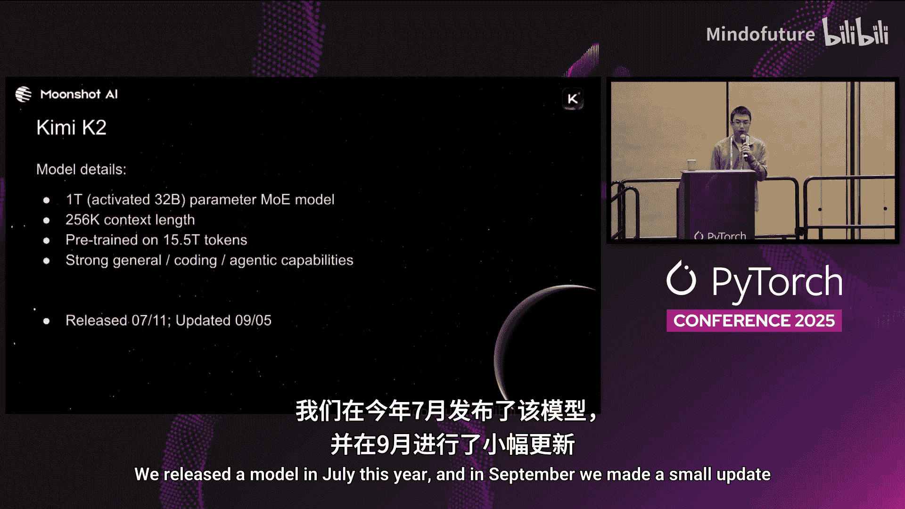
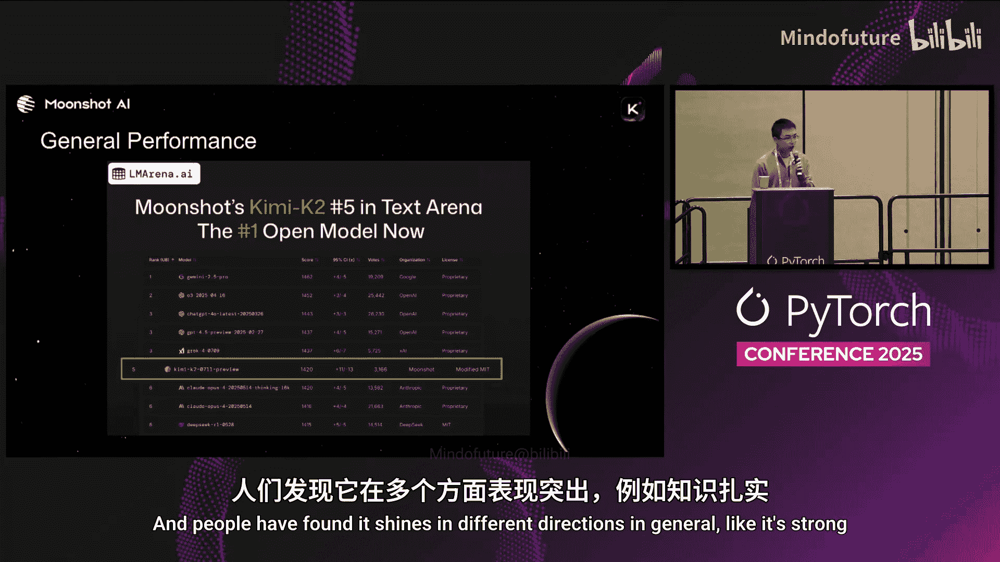
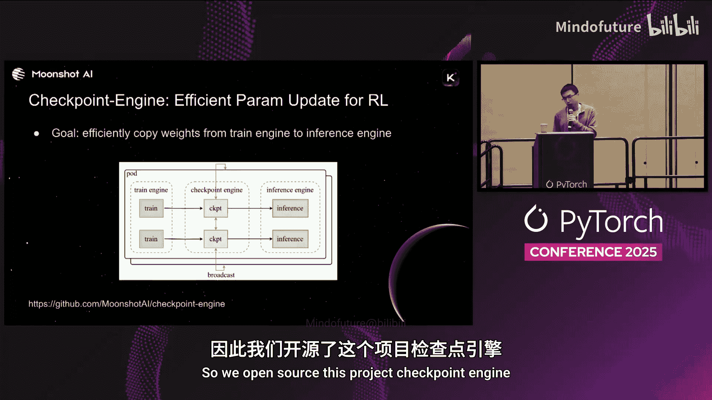
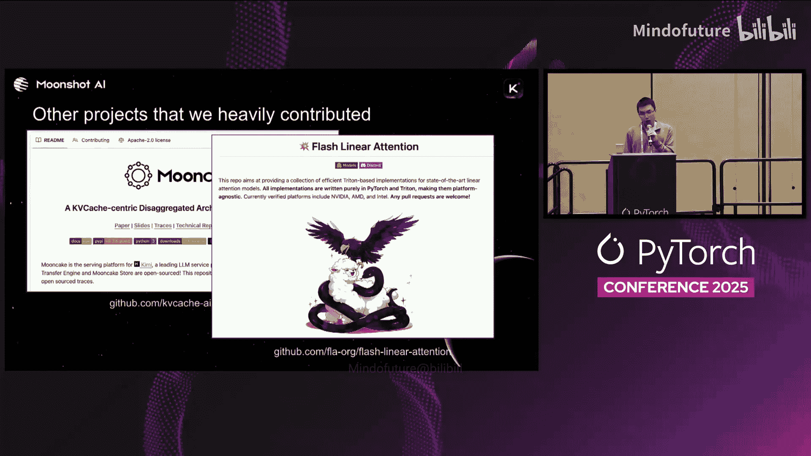
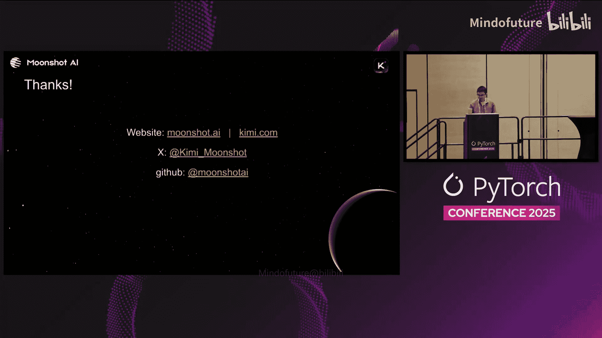

# 2025 Pytorch大会 ｜ Pytorch Conference 2025 p64 P64_Kimi_K2与我们对开源的贡献-Yuxin_Wu__月之暗面AI -BV1b8kRB6EJG_p64-

Good afternoon。 Thanks， everyone for coming。 My name is Yu Xing Wu。 I'm a cofounder of Mushot AI。

 And today， I'm going to introduce Kimmi K2。😊，So we'll talk about this model， what it is。

 what it can do。 and I will focus on a few important technical contributions behind this model that we have made to the research community and Py community in this year that covers some of our innovations in training in our RL system and in inference。

So。Kmi K2 is a trillion parameter M O E model。 So for every token。

 it activates only about 32 billion parameters。 So it is not only a very big open models。

 Its also the spaist models。 It has a context window of 256 case。

 which is sufficient for most of your tasks and is pretrain on 15 trillion tokens in post training。

 We supply with very strong capabilities in both general day to day chat。

 as well as coding and agent tool call capabilities。

 We release a model in July this year and in September， we made a small update。

At the time of release in July， it was the best open source model， according to El M Marina。

And people have found it's， it， it shines in different directions in general。 like it's。

 it's strong knowledge and it strong creative style。 And its writing is very good as well。

It also has pretty good coding capabilities。 It can write， for instance， some H M L web pages。

 So here are some examples of some pretty impressive web demos that people have built with this model。

This year is also a big theme is agent， which is also a direction that we care a lot about。

 So during training， we supply the model with a large variety of different tools。

 So we learns one how to use them。 and when people are building their own agent。

 they can also provide a pretty good description of their tools and the model will know the best time to call them。

 So we started to see many companiess building agent start to use this model。 For example。

 on the on the left， we have toing a recent podcast。

 saying that they have redirected a lot of workloads tokimi K2。

 And on the right is a CEO of Veral who in a recent post。

 saying that theyre also building their internal agents with K2。

 because it's more efficient and more accurate。So behind all this working the model。

 we like to contribute to the community。 And in the past。

 we have published several models and some interesting open source projects as well。 So today。

 I'm going to talk about a few innovations behind K2。

So first one I'm going to introduce is the moon optimizer。

 So it's a new optimizer invented at the end of last year by a Keller at all in his personal blog post。

 So the key idea behind this optimizer is to use also normal updates。

 So the rough idea behind that is that when you get a a gradient matrix。

 you will do an SVD decomposition of it in order to get an orthogonized component from this matrix。

 well， in practice， we actually won't do the SV decomposition because it's too expensive。

 And there is a way to approximate that by something called a newton Schros iteration。 And。

 and it is essentially just a large number of map mouses。 So to get good results。

 typically it takes about a 15 mat mouses using this gradient matrix as well as is transpose and some other small computation。

😊，InIn between。 So the bulk of the computation is just a bunch of math mouse using the matrix。

 So a very fundamental difference between this optimizer and some other optimizeimr that we've been using in the past。

 such as Adamom。 is that when using moon， you really need a full gradient matrix。

 So all the updates between different element in a matrix is no longer independent。

 There you can do just do an element element wise update and get your get your parameter to the next step。

 You really need a whole matrix。 And this is believed to be one of the most important reasons why moon can work so well。

So in February this year， we are the first to scale up moon to a large language model。

 which ran a 16 billion parameter M O E models and publish it in February why it is so important because there are actually so many optimizers getting invented every year。

 But you probably have not heard many of them。 because when you really care about performance and seriously training model with a lot of resources putting into it。

 you will have the best setting the best baseline， the best hyper parameters and oftentimes at still works the best。

 So that's why it's so important to have strong baselines and training on a large scale。

 with a small scale， you might be able to tune a lot of parameters to to show that some optimizer work better than the other。

 But in a large scale， what truly wins with shine。 So we。

Or the first to show that moon really works well in a large scale。 In this work。

 we proposed some improved the recipe， including like how to do weight decay K and how to correctly control the magnitude of updating every step。

 And we show that it's a really token efficient model， which means that a token efficient optimizer。

 which means I you use the same model train with the same data for the same number of steps。

 It just give you a better results in the end。 And， and。

 and we showed that like 20% to 50% more token efficient than the atom baseline， which we don't even。

And in this work， we don't even tune the hyperpar one trend with moon。And together， we also。

Put up an open source reference implementation in Macch arm for this work。And in July。

 we released Kmi K2， which is a trillion parameter model， Also trend with the moon optimizer。

 So if anything， this should be a really convincing argument that。

Adam is no longer the go to option for training large language models。

 And Moon really works pretty well。 And during this process。

 we also addressed some other instability issues that we found during the scale up。

 And we will get to that in a minute as well。And we have seen growing adoption of the moon optimizer in the community。

In August， it's officially added to Pytorch。 and some of our team member help with that a little bit as well。

 And we have seen more and more research papers studying the behavior of moon and some other popular open source models start to adopt moon as well。

So you might ask if it works so well， what has the cost， right， What are。

 what is the overhead of moon， And I want to briefly go through that a little bit。

 So the computation of moon， like I just said， is's just the sequence of Macmos and。A。

 a key inciting that is that。The computation can be sharded right， you only have so many parameters。

 So as you scale up with more GPUus， you make sure that every GPU is only responsible for computing the updates for a small subset of your parameters。

 And that's important。 Another concern that people might have is that mathmo is cubic in complexity if you scale up would that be a problem。

 Well， it could be if youre training a very large dance models where parameter matrix are super big。

 But today we see a clear trend towards a mixture of expert models。

 especially fine grand M O E models。 For example， in K2， there are 384 experts in total。

 which means every single expert is not going to be that large。 So as your scale up。

 your parameter matrix is not necessarily going to be insanely big So the cubic complexity is not a problem in reality is more like quadratic。

Another concern that takes some effort to address is communication。 Like remember。

 what's so special about Moon is that in needs of full gradient matrix in order to compute an update。

 But in reality， your gradient is probably sharded across your GPus。

 So you need some way to get them into the same place the exact solution will depend on your system depends on how you shard your gradients and parameters。

 for example， here， I put on I put a few links of different implementation in different systems。

 Mac L M is having an implementation in their depth branch。 And if you use detensor。

 there are also some gradient implementation trying to minimize the communication cost。Of course。

 you also want to overlap your communication with the computation so that when you are computing the updates for one parameter。

 you'll be gathering the gradient matrix for the next parameter。 So putting this all。

 it does take some engineering effort to address。 but people are working to make that easier。

 And if things are doneright。 It shouldn't be a big overhead。 especially when you scale up。

 you often have a pretty large global batch size， like a million or several million tokens in every step。

 which means your optimizer is not going to be caught very frequently。

 So the overhead won't be a significant deal breaker， like in in our training。

 it takes about like3% overhead to go from atom to moon， but the benefit would outweigh that。

Another issue that we see during the scale up is a stability。

 We observed something called attention logic spike。 So we。

 will plot the attention logic during training。 It will have some spikes in between。

 And this is not a new phenomenon。 People have been studying this for several years。

 And it's believed to be correlated to your models stability or healthiness。 It's not new phenomenon。

 but we seem to find that it's correlated more with moon。

 theres some theoretical hypothesis on why they may be correlated。

 but we employ a pretty straightforward fix to the problem。Logit attention logic is。

 is computed by a dot product of your queries and keys。 So what we did is just。

 if the logic becomes too large， we just clip the weight of the queries and keys。

 And that will stabilize the logic and also make the training fairly stable。

 So here I'm showing the training loss curve of Kimmi K2 from the very beginning to the very end of 15 trillion tokens。

😊，There's no down sampling happening here。 So every loss point is plotted。 It's remarkably stable。

 There are no spikes and it just a big， beautiful curve。嗯。So this is about moon。

 We believe it's a great optimizer for scaling up。Another interesting project I want to talk about is checkpoint engine。

 It is a system middleware in our reinforcement learning infrastructure。

 So we try to solve the problem of parameter update。 So in R L， when you train your model。

 you have to， at the same time， run inference with the latest weight of the model。😊。

And that means you have to copy the weight from your training system to your inference system。

And this is a nontrivi task because both of the systems are often highly optimized， right。

 They may have different sharding strategies。 They might have their own memory management strategies。

 So it's， it's not a simple task of Mem copy。 And it's tricky to do it efficiently。

 So we open source this project checkpoint engine。 And a cool thing about it is that it's very easy to integrate。

😊。

You just import and run it from either your training code or your RL controller。 You can just say。

 hey， I just finished training one iteration。 here are the latest ways。

 Please send them to the inference workers。 And then it will talk to the inference workers。

 and another cool thing is that the the implementation is nonintrusive to V IL M。 So this is。

 this means you don't have to change any of the V IM source code。

 this is implemented as using a mechanism called worker extension。

 which is an extension point provided by V IL M to allow you to inject custom code during inference。

 So this is where the parameter to update happens。😊。

There is also an SGL integration that's working in progress as well。

So checkpoint engine is pretty efficient in terms of update the weights even for a giant model like K2 with a trillion parameters。

 it takes only about 20 seconds to update a copy of the weights across 256 GPs running inference。

 And that's sufficient for pretty much all R workload that we care about。

 So the key idea to optimize the performance there is to first of all。

 course utilizing all the available bandwidth that you have it's RM A or M link or whatever。

 And we also heavily use pipelineing。 So we pipeline different copy stages of different parameters。嗯。

Another benefit that comes out of checkpoint engine is fault tolerance。

 So when you run a large scale R L jobs， some of your influence workers may die， right。

 And when they restart， they need some way to get the latest weights。

It'll be expensive to constantly save and reload the weights from disk。

 So checkpoint engine happen to solve that nicely as well。

 because whenever a inference worker restart， it can just tell the checkpoint engine， Hey， I。

 I'm a newbie。 I just come。 I don't have the weight。

 Can you send me the latest weight so you can get the weights from the checkpoint engine pretty efficiently。

 It also further allows you to dynamically add more inference workers to the system if you need。😊。

Another contribution that we made this year is something called decocode context parallel。

 This is a feature that we added to V L L M。This year。

 So the problem we try to solve is that if you run influence using VL M with a model like Kmi K2 or deepse。

 you will find that your K V cache is duplicated across all your tensor parallel workers。

Why does that happen， Because for these models that uses multi head latent attention or other models that use multi query attentions。

 they only have one K head in inference。 So normally， when you use T use tensor parallel。

 you can speed among your your head to to reduce the storage burden of K cache。

 But here the models only have one head。 And during inference。

 every worker will have to access the KV cache of that single head。So we。

 we adopt the different strategies。 We sh the KV cache in the sequence lens dimension。

 And that's similar to context parallel that people use in training。

 So we call it decocode context parallel。So during decoding， every worker will only access。

 We only store a store a subset of the context。 And when computing the attention。

A token will first only attend to the local subset of the history context。

 And then they have to do some communication to get an accurate global attention results。

 And this can be done fairly efficiently using something similar to the online soft metric trick。

 So there's only very tiny communication volume。In， in this， in， in this process。

So the benefit of that is that。You can greatly reduce this the KV cache size usually by eight times or even more。

 And this will give you a larger batch size to use in inference， which give you 2 to。

 three times more throughput。 And this is very important in scenarios where you just want to optimize throughput。

 such as in reinforcement learning where latency may not matter。

 And you just have to have very high throughput in the rollout。This feature has been。

 has been upstreamed as already， and it's also very easy to use。

 You can just add a parameter in your command line， when serving a model。

There are some other projects that we heavily contribute as well。

 although not directly related to K2。Moon cake is a project that we created。

 It's a system behind our production inference。So it's built upon the idea of disaggregated serving。

 which means you'， you'll use different set of machines for preview and decocode task。 And this year。

 we've seen a lot of other inference system such as N VD dynamo start to adopt this paradigm as well。

 So we were one of the first to pioneer this idea and actually implement and and deploy it on a very large scale production system。

And this work is now maintained by a group of researchers and community together with， with us。

 And this work also won a best People award this year。

Another project that we sponsor is flashly near attention。It's social linear attention is。

A variant of attention mechanism that people believe might become an alternative to softm attention。

 That' has great potential。 And flash linear attention is a library that includes a lot of variants that implement a lot of high performance kernels for different linear attention models。

 very popular library among researchers of linear attention。

We are also very interested in this direction。 and a lot of the a few of the main contributors of this library are from。

 from our company as well。 And yeah。 so and as a spoiler， in the coming weeks。

 we're also going to release some of our recent innovations in the space of linear attention as well。

😊，So great that concludes my talk。 We talk about a few interesting technical details behind Kimmi K2。

 And if you want to learn more about our work， here are some ways to find us。

And， thanks。Hello， thanks for the presentation。 a quick question on neon optimizer。

 So is it more memory efficient also as compared to Adam W。The question like doing training， like。

 does it take less memory。Yeah， the question is， is the moon optimizer more memory efficient than Adam W。

 Yes， because in Adam W， you have to save more optimizer states。

 including like a momentum buffer for your both your first order and second order gradients。

But in moon， you only save one extra of states。 So it is also more memory efficient as well。Hi。

 so just regarding the loss curve that you showed。Just regarding the loss curve。

 I saw that it didn't have like any spikes like， is it that you didn't get any spikes in 15teryra tokens of training or is it like filtered out。

嗯。The， for clarity of the curve， the curve started like a little bit after the first iteration。

So initially， the loss is higher， like like you normally seeing in a random initialized model。

 But that part is not shown because it'll be an outlier that makes a figure looks it'll be unclear。

So， I mean， like training spikes。 So when you train LLM。

 like you usually get spikes because of a bad batch of data or because the learning rate might be higher a bit so。

Is it like that you didn't get any like long spikes during the training， The。

 the losses are definitely higher， but。But it's decreasing。 Yeah， so， so theres no X spikes。

In the big。Gま in here。You talked about the challenge of taking small scale research on optimizers and seeing that it doesn't always perform when you scale it up。

 did you have an insight that Muon would scale well or did you just try to scale up many of the recent optimizer research and Muon is the only one that worked well or the one that worked the best。

Yeah， that's very important questions。 And how do we identify things that are。

Have potentials to scale up。 I think it's a combination of many different。perspectiveerspective。

 like， first of all， you have to be able to quickly try out new ideas on a small scale。

 That means your， your infrastructure and code base have to be ready for that。 So when we。

When we see more， we first， we think it's a very elegant approach。

In the front just from the theoretical perspective。 So we like to show it。 and we。We are able to。

 quickly。Take it from the， the original implementation and quickly put it into our code base and try it。

 And that's very important。 So we。Quickly see that it seem to have some benefits on small scale experimentss。

 right， But， of course， we know that's not necessarily a indicator of itss a success。

 So we will have a scaling ladder where we will gradually increase the size of a model and verify that it works well in every scale and eventually to the larger scale。

Yep。What was your process like for scaling from billions to trillions of parameters in the pretrainming regime where like your debug cycles are very long and training over trillions of。

 I can I hear very loud one more time。What was your debugs like like or your process from scaling to billions to trillions of parameters。

 especially when your process， like the pretraining process involves training over trillions of tokens。

 which takes quite a long time？The question is， what is the debugging process， Yeah， like。

 how would you validate a particular architecture or how would you validate that。It scales well。

I see。I think it's don' be similar to the previous question。

 It's not about debugging when things go wrong。 It's more about validating things before you start the training。

 So it's about having very good baseline at at various different scales。

 So when you have an idea you try to validate at different scale， make sure it always works。

 and that will give you confidence to really put it into your large scale run。What's the end。开怎么。

