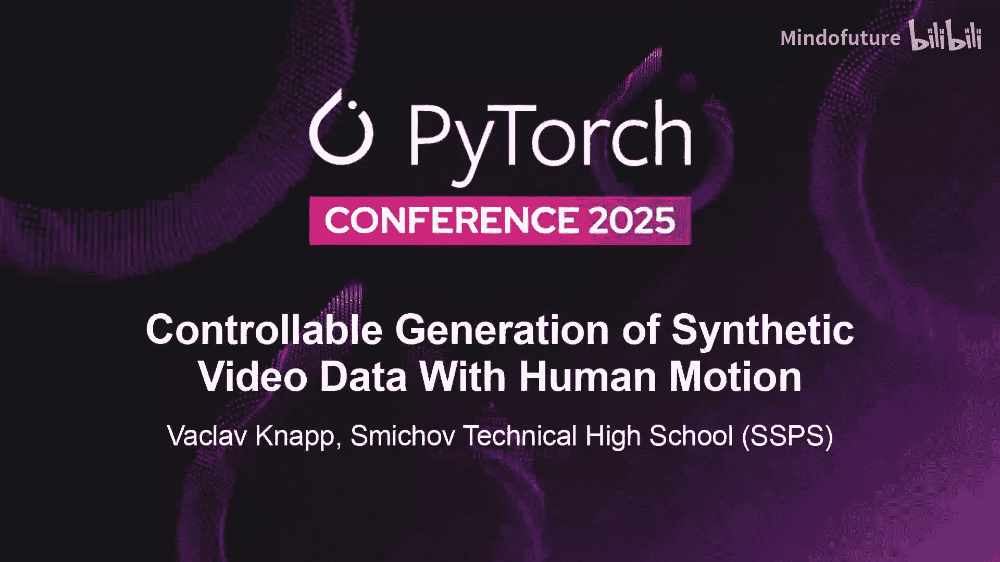
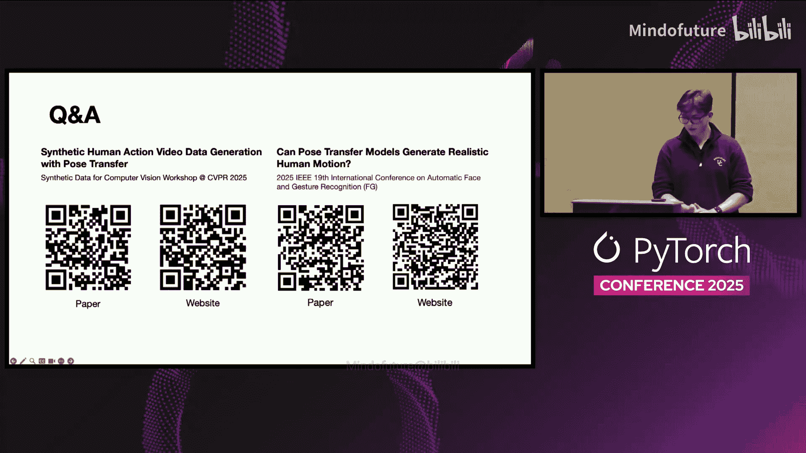

# 2025 Pytorch大会 ｜ Pytorch Conference 2025 p65 P65_基于人体运动生成可控合成视频数据-Vaclav_Knapp -BV1b8kRB6EJG_p65-

Hello everyone， my name is Batslav and I'm from Czech Republic and today I will be presenting my work on behalf or the work that I did with Matthiaj Bahack。

 which is undergraduate student at Stanford and now researcher at Google Deepmind and I am at Czech Technical High school right now in my senior year。

So my talk will be on controllerable generation of synthetic video data for human motion。

So as we all know， language and vision models progress in recent years。

 mainly eroed or was boosted by large scale divers and in recent year synthetic data。

But human video data sets for action recognition or sign language translation。

 or all of the tasks that require human to be in the video are not very diverse， large scale。

 or if they are， they are usually internet scrape， so they are not very clean。

 sometimes multiple people occurring in a single video。

This is screenshot from a data set called NduU RGB。

 which as you can see is just in one room like four people。

 so the model then doesn't generalize really well。So。

 and for sign language or action recognition or simple like driver monitoring， we need。

The the real data are very scarces or costly to make and sometimes even privacy constrain。

 You might think that we can use models such as text to video like Soa or V3。

 which are photo realisticistic and today。Super fast， also， but there is no hard post control。

 And also， the problem is that。The models as as Andre Carpati said in his podcast like LLMs also live on very small manifold。

 So when you say， for example， jump all of the people in the generated video will jump in the same way。

 which is not very good for the action recognition model because they will not generalize to different type of like actions。

And also prior synthetic data generation methods like elder SIim or Syriariac are we're using like classical CGI or simulation methods doesn which are not very realistic。

 they don't have identity transfer， they cannot be very diverse。

Because you need to hard code program the the structure of the of the identity。And thus。

 you cannot scale it。But the solution that we came up with is you create synthetic videos using post transfer on the data。

 so we extend the data on new identities with new background。

So just so all of us are on the same page， we can ask ourselves what is post transfer。

 so post transfer is something that you have reference identity。

 which can be picture of human video of some human today it can be generated by a diffusion model and then you have some type of novel pose。

 which can be from the data set， some person performing some action。

 and then we can react the identity on the image or in our case video。

So first we had to evaluate what type of posttrans methods we have to do we can use mainly so there are two types。

 generative methods or 3D grounded methods or hybrids in between so we came up with human evaluation task which have three parts first is semantics where you basically ask what action is shown in the video and people answer and then you compute the the correct percentage if people guess the right choice。

Then you have consistency， which was simple， yes， no question。

 how consistent is this motion and then qualitative per people。

 simply yes or like adjusted the accuracy of the motion if it's correct or not if its if there are some random moves or physical constraints that are not real。

So then the task was very simple。 we have the driving pose， which is like person performing golf。

 for example， and then using diffusion model， we have we generated the target identity and then using at the time state of the artrc methods for post transfer。

 which was animate anyone magic animate an X avatar so animate anyone is basically diffusion model to learned or trained with。

Like skeleton control where we extract skeleton from the driving video。

 and then we try to diffuse a person。Then we tried to difffuse the target identity。

Magic animates is using depth control and depth dense post control and exavvatars using 3D Gaussians。

Splas to have like 3D grounded identity that we can then animate。

So here are some qualitative results， as we can see， Magic anMA doesn't perform really well。

It performs really well on the benchmarks or control videos。

 but most of the datas are not very clean， as I said。

 sometimes there are multiple people or the person is not centered or there is a mask on the face of the person and model doesn't register it very well。

Or animate anyone， which is a little bit better， but still there's a lot of physical inconsistencies。

And then there's the Xavvaar， which which have 3D grounding， but is still performing diffusion。

 but on the 3D Gaussian。So here from the participant study。

 we found that exalvatar has the best semantic results。Also， best consistency results。And also。Also。

Yeah， consistency results。 And here are a few examples。 So people found on the on your。Left。

 people found them consistent and inconsistent on the right。The same for animate， anyone。

And the same examples for exavvatar even for exavvatar there are a lot of mistakes。Made by the model。

And qualitative， some people， mainly with older。Diffusion models such as magic animate or animate。

 anyone pointed that there are distorted faces， another person appeared there。

 or they are not photoistic。So what is the main goal of the method for synthetic data。

 We want post transfer quality， which using our human eval we found that that's Xavvatar currently as a state of the art for post transfer。

Then we want identity diversity， which is as many identities as we can so the model can generalize to different ethnic groups。

 et cetera， and then scene diversity， which is backgrounds。

Because all the data sets are recorded in the same room basically so also we found that alternativeative models provide realism。

 but like control， simulation engines offer control， but like the realism。

 an Xavvatar which is combination of both the it's not perfect， but it has the best results。

So to create the diversity in identities， we collected， create a data set that we call random people。

 which is hundred identities sort sourced from the Internet。 We， we paid people on the Internet to。

 to。Basically record special videos， as you can see here。

 where they for the X avatar to have the 3D identity。

 they need to perform certain actions like do two 360 rotations with raised arms， not raised arms。呃。

And we open source。All of that as well on our hugging face。And so now the method for avatar creation。

 So first the whole method， there are three steps versus avatar creation， So we take the video。

 we subsle few frames because we don't need like the videos are taken in like 20 FPS and we don't need all 20 FPS per second so we subsample it to 2 FPS and then from the each image basically extra SLx。

 which is like a 3D post of the human， then depth map which is like a depth capture then key points which is the skeleton then segmentation mask facial expression and also hand post so we have accurate hand gestures and we combine all of this into single tensor basically and we call it body features and then we train neural network to correctly map the。

Correctly map the texture on 3D avatar of the person。嗯。Next。

 we have the reference video preparation where we extract the pulse of the person in the data set video basically。

 where we extract all the same information and have the body features basically the body feature tensor as before。

And then the whole combined method is where we reenact the trained identity on new background and performing the action that the person in the reference video was doing。

So this is this pipeline is much more。can create much more diverse and very easily because you just need those sourced videos than random background images from the。

呃。From the internet and reference video from your data set。

 then you can basically extend your data for human action recognition infinitely。Yeah。

 so then for some experimental setup to understand if if those videos actually held the models。

 so we'd be tested it on two data set， one is N U RGB plus D。And other is Toyota Smart Home。

 and Toyota Smart Home is basically elderly people performing daily tasks in their home。

And we subsample 16 classes because we had to our method yet doesn't take care of like multiple people in the scene or sometimes use of objects。

 so we had to clear for those classes that had all these like multiple people or objects and for each data set we generated 3600 videos。

And here are some results。 Yeah， so the results are not perfect， but let's see if it helps the model。

 actually。But they can be physically consistent， also you can have as many identities if you as you want in any background。

Many actions doesn't matter。It's generalizable this method and also there is a consistency where below is the synthetic video and above is the real video from which the synthetic video was created so you can see that it's quite physically consistent。

And so now some results。So because of computational constraints， because we are students。

 we took 225 real videos and 225 synthetic videos and we trained two models we trained two architectures。

 one is Fresnet and one is slow fast and then we tested on 50 real videos and as you can see sometimes there is three or fivefold increase in performance in baseline experiments。

Where having just original was for Toyota around 20% and for ResNe with synthetic and original was 50% and for NtRGB。

 there is even bigger increase。Then we performed one and few shot accuracy， so for one shot。

 which is basically you take one real video and then you increase the amount of synthetic videos。

it where you can see on the graphs or in the table that it still helps the synthetic videos and the same is for NRGBD and for five five few shot。

 which is where we take five real videos and then we add by 50。

 we add the synthetic videos and the curve grows and if we would continue we would get even better results after。

嗯。So here are some limitations and ethics considering this project。

 so the framework has few limits which is that it can do only single person in the video and there cannot be there is no interaction with objects to this date and our current method sometimes can be seen displaced because the models are not big enough to have but we can clear for those videos。

And sometimes actions may be physically like in a like like for example， if you would be cooking。

 but it would happen in a living room， then it's not very consistent with the real world。

And all the the research license is MIT， so it's open and all the when we were collecting the identity videos。

 it was checked by Stanford。Stanford people， and also there is demographic diversity to mitigate the bias in the data set that res there to this data。

And so to conclude the contributions are we have a toolkit for synthetic human action videos。

 via post transfer， and we can add backgrounds， it's very easy to use very fast and also we have random people data set which is 100 controllable identities that are released and open for research。

And we have strong results on the Toyota onto two action recognition data sets， Toyota and N T RGB。

And if you have some questions， both of these work were presented at CVPR this year on syntheticthe data workshopshop。

 and the human evaluation was presented at F and gesture recognitionogni conference this year。

Thank you。

Thank you thanks for the presentation first off how are you seeing this as being applicable for like the ASL community using that sign language I know highlighted it lightly how do you think we could get it to that accuracy to allow something like an AI translation service be used for them for sign language so we did few experiments on that also that was presented that Expo 2025 at Osaka this year and we boost the results and also the he gestures can be very accurate if the videos are accurate and most of the sign language videos are very accurate so there is big potential because sign language data sets are very scarce for American sign language that's not big problem but like for example for Czech sign language from my country or from other like sign languages from。

S countries， there are basically no data sets for them so we can create synthetic data and。

Possibly boost those results there also。