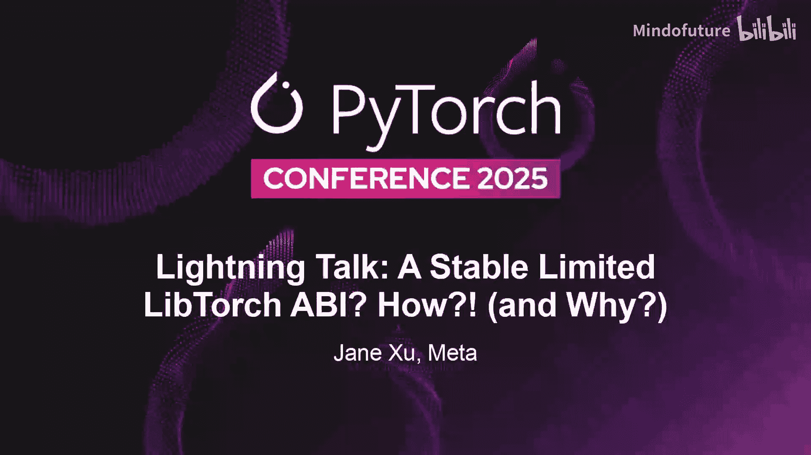
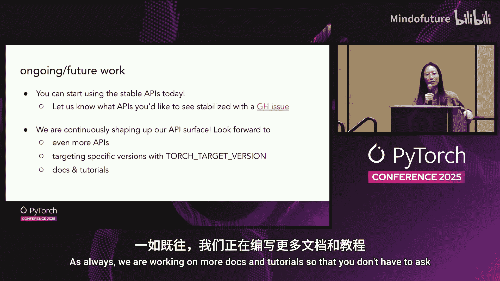
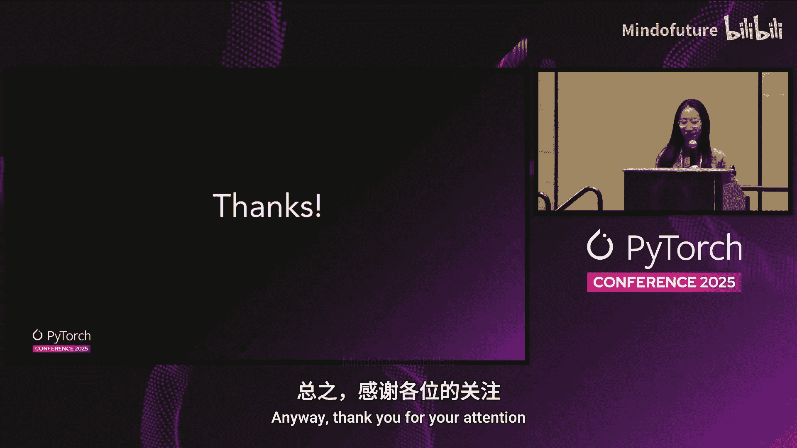

# 2025 Pytorch大会 ｜ Pytorch Conference 2025 p66 P66_闪电演讲-如何（及为何）实现稳定的有限LibTorch_ABI-Jane_Xu__Meta -BV1b8kRB6EJG_p66-

I'm Jane， I work on Piytorrch from Me and today I'd like to motivate why we want a stable limited liptorrch AI and how we plan on doing it。

Cool， so let's start with where we started if we imagine livetorrch as a binary blob where， you know。

 A Bs， where all those little pointy bits are where our dependencies sit on top of us。

 then you can imagine the world like a stack of。😊，Libraries that sit on top of Litorrch and the problem with this is whenever we upgrade Litorrch。

 the API is not guaranteed to be the same， so everything in the world or everything in this stack would also need to upgrade。

Oh no， so if only everything was you know a nice box where you can just swap out the boxes and the rest of the stack stay exactly the same in that case you can upgrade liptorrch however you want because you know everything's flaw。

 you can VV2 you can beV3 it's great except oh oh we can't actually do this and in fact we don't really want this because what this would mean is we would need to freeze every API in our library and that's not a good plant nobody wants this。

 we want to continue improving， growing， fixing those bugs that we didn't realize we had before。

So what do we do Well that's where we have the limited A What if we built a stable subset of As that extensions can rely on so if you sit on this flat portion of liptorch we promise you that even if we upgrade you don't need to rebuild your extension concretely if what would it take to you know have flash attention3 be liptorch A stable？

And that's where we got to ask ourselves why is it not stable in the first place。

 like what APIs is it using that are currently unstable and these APIs should be really familiar to most people。

 Tensor， you know， if you're a custom operator， you care about registering to Torch library。

 you probably care about A10ops like calling Pa or Phil or MaM， the device UTels。

 if you're writing a coUuda kernel， you care about couda events， couda guards， and lastly。

 all those little things that you might not think about like BFloat 16， the Scalar types。

 those are all APIs that live in Livetorrch today that are not guaranteed to be stable。

So our plan is to pave a path and we literally mean that like we literally mean to steamroll a C shim that would sit on top of this unstable API and provide a surface that extensions could rely on without having to be broken every time and what that concretely means is actually literally having。

 for example for tensor having a shim API that that it would liaison between the unstable tensor API and the user itself and if you're wondering what magic this is。

 it's actually not that magical we just instead of passing a big tensor around。

 we pass around a pointer and thanks to AOTI， the compiler team。

 we already have that so A10 tensor handle is just an opaque tensor pointer and what you would do with that pointer is pass it into other AOTI functions that are also promised to be stable already。

😊，If you think about this just for a little bit， you can imagine that this is not a pretty API to work with you are working with pointers everywhere。

 everything is in a Cst API， for example， this one line or I guess three line change becomes 10 lines because for example。

 you see in line 242 you allocate in a 10 tensor which is a pointer。

 you pass that pointer into 247 and by the end of that call you're kind of guaranteed that oh out will now be some tensor that is representative of all the things you wanted。

If you're curious like I thought the seahe might have been feasible at first as well， and I tried it。

 but it is very ugly and you can look at that link if you want to look at how ugly this truly is so how can we make this not ugly？

With this with UX in mind， we decided that hey， maybe the CSim is not what  custom opps writers want to use maybe they still like C++ so we're like okay let's give them C++ so we introduce torch stable tensor which which sits on top of just the stable portions on top of the shm APIs and therefore is guaranteed to be API stable as well the actual C++ API is not like shim Sable but it promises to only use the shm APIs and you can imagine it just wraps around this pointer and works all of that logic out for you and one thing you might also realize is that memory is really hard when you're just passing around pointers everywhere so torchtable Tensor would also work that out for you as well。

And with that， instead of having it go from three lines to 10 lines。

 you can actually write the same code in two lines， which I think is a lot cleaner。Cool。

 so let's move on what is next well what about Torch library Imple if you maintain your own custom op you probably this this cost should be very familiar to you every op you write。

 you need to register the schema to the torch dispatcher。And it's the same drill。

 we add a shim version of Torch library Iple and then we add a nice macro on top of it so that your user experience could be similar。

 but the challenge here is all these schemas like forward backward forward combined they all have different schemas。

 how do we make all these different schemas fit under one AOTI torch library Iple C shim call。😊。

So if you're if you've read a bunch of if you know about eyevalue， you already know the answer。

 we use the idea the same idea behind box kernels， so instead of passing around like tensor tensor。

 wait what was it tensor tensor optional tensor optional scalar type that returns to tensors。

 we actually just convert every one of those args into an eye value。

 a stable eye value for us and so instead of passing a different schema everywhere。

 everything just gets reduced to a stack of stable eyevalue also named stable eyevalue。

We're still working on support for what eyevalue are supported。

 but check out our docs for what's currently supported。

 we're actively working on this so be on the lookout Okay， moving on what about A10ops same drill。

 you add， for example， fill you add a shim for fill and then you add the C++。

APpiI on top of fill and you know we're done， right， well， not quite。If you think about it。

 there are like 2000 A10 ops， we don't really want to add 2000 shims to our API so we introduced this new call called AOTI torch call dispatcher and this is when I realize that we should probably stop naming things after AOTI but that so you can ignore that part but this one API is really cool because it reuses the idea that hey。

 if everything already goes through the dispatcher we can reuse the dispatcher pass in a schema for whatever A10op you want and get support for it with just one API so you see here instead of having I don't know55。

5 yes5 A10 ops represented with five shim APIs there's just one we don't need more。Allright。

 the next thing here， like device of course so for like kuda event or couda guard。

 it's the same drill actually， you add a handle in the shim。

 which is a pointer and then you add some nice conency plus plus wrappers on top of that This one is very nice Great done So do we do the same thing though for a 10 half for utilities like Bflow 16 or all these other things do we just add you know do do we also steamroll and pave with a shim Well actually no。

 so this is when we realize that half is already implemented in a header only way And what that means is that the implementation for half lives entirely in a header in a header itself and if you note here this means that the header those APIs have no dependence on liptorrch already。

😊，Okay， so for all of those APIs， we're formalizing a torch header only namespace where it's a namespace you can trust to have APIs that do not depend on Libtorrch and we wrote tests for this so you can can that's a guarantee for you and half now lives there you can still call half through A and half like we're not BC breaking anyone but but use torch header only stuff if you want those guarantees。

So we put it all together， what does the new liptorrch look like and this is I think where we should pause and absorb like this entire frame so you still have your old liptorrch that is subject to change those spiky bits can move for every release but we're deciding that hey。

 we want this seam that sits on top of those spiky points that are promised to be flat and smooth so that you can depend on it each time and but we realize that the seahem is not good UX so we decided to build a high levell convenience wrapper。

😊，Living in torch C source stable that promise to only use those stable APIs and then separately independently from all of that。

 we have our torch header APIs that guarantee no literature dependency at all。 Okay。

 what does that mean Well， it means that we can actually just migrate flash attention3 from the unstable portion onto this new。

😊，More stable stack。And two things to note here， one。

Flash attention now sits directly on the flat portion that guarantees that it can be A stable。

 but because of our convenience wrappers note that we don't actually have to change much about flash attention3 to get it to be A stable at all and the note here is that much is a little subjective if you're curious what that actually look like check out Michaelchaa's PR big props to Michaela for implementing a lot of the features mentioned in this talk and if you're also curious about hey is this flash attention 3 wheel really stable you can try it yourself we're actually hosting this wheel just for RCI but you know why not it's already public as read only you can download it you can play with it let us know what goes wrong just for details it's built on a nightly and it should with KUa 129 and it should work with any torch after 29。

Yeah so we're still working on this like flashlash attention3 was just the first step but what can you do what am I doing well you can start using those APIs today as you can see a lot of the things that are used across all custom ops are already supported so please like use them let us know what's weird。

 let us know what APIs you'd like to see were continuously working on this where we're always increasing more APIs we're always shaping up what that looks like and one other super cool thing we're working on is being able to target a lower or a different API version than the one you're building with with to target version and as always we are working on more docs and tutorial so that you don't have to ask me questions after this conference anyway thank you for your attention。

Does anyone have any questions how much time do I have oh I have no minutes oh but I don't think there's a talk after this。

 so go for it。So the question is， are we having are we going to promote a CMake build system for like C++ extensions you could technically use CMake with the C++ extensions today。

 but you would I think there's a way to work around it like that。

 but I'm not super familiar with concretely what you want to do。

 but I think a lot of what you want should be doable already。

