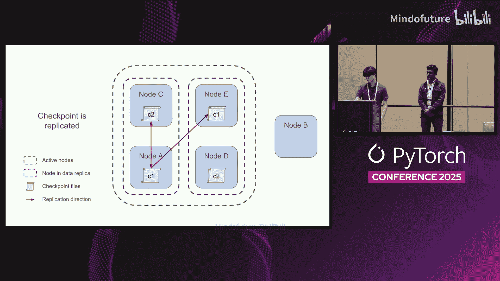
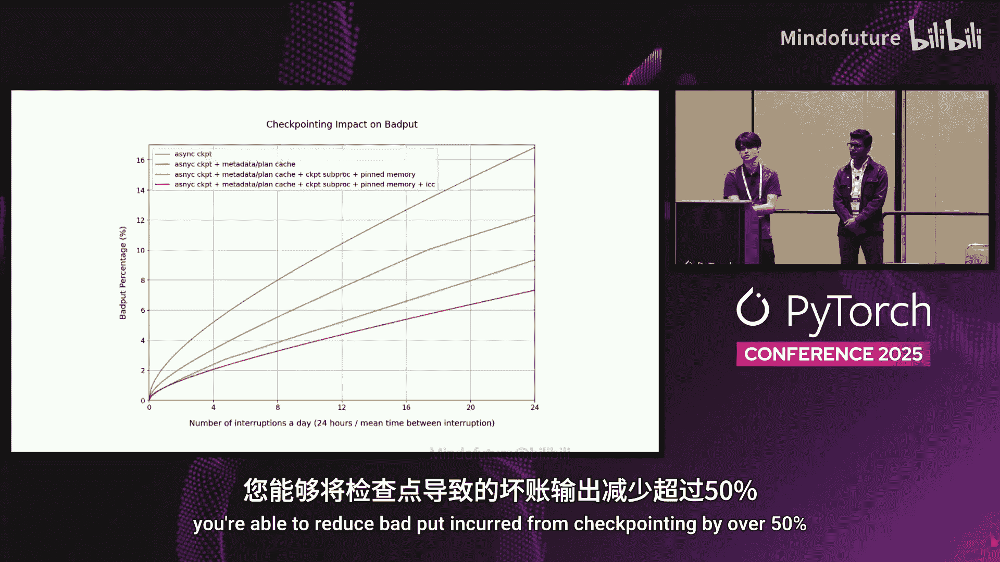

# 2025 Pytorch大会 ｜ Pytorch Conference 2025 p67 P67_闪电演讲-集群内分布式检查点——优化训练...-G._Kroiz__S._Mishra -BV1b8kRB6EJG_p67-

Welcome everyone， I'm sorry， I work on PyTToch Cha Mera and I'm joined here by Grserson。

 who comes from Google， and together we're going to talk about some of the scaling bottlenecks for fault tolerance and various solutions that we developed to resolve those。

😊，So in a training job， even though we take checkpoints periodically and we restore the training progress in the event of a failure。

 there's still a non-trivial amount of GPU wasted GP hours one reason is the checkpointing overhead itself so if we may not want to take a lot of checkpoints the second is the unsafe training progress which is the red block here that you see and it can be as bad as the checkpointing interval itself and it has to be multiplied by the number of GPUs in the job so for large scale jobs we want to minimize this checkpointing interval as much as possible which means that we may want to take as many checkpoints as possible so you can already see the tradeoff here so more visually if we plot the wasted GP hours or wasted training time against the checkpointing frequency the curve looks something like this so if we are checkpointing too frequently then the wasted training time goes up because of the checkpointing overhead and if we are checkpointing to infrequently then。

And wasted training time goes up because of the larger window of unsafe training progress。

 So for large jobs， we want to take checkpoints very frequently。 But at the same time。

 we want to reduce the checkpointing overhead to near 0。

So what are the different overheads during checkpointing so I am taking the example of the asynchronous checkpointing here because I'm assuming anybody who cares about training efficiency they must already be using asynchronous checkpointing in there except staging all other steps in the checkpointing like the metadata preparation planning I upload all those things happen asynchronously now during staging we upload the data from GPU to the host memory and that's why this memory overhead we allocate and delocate the memory for every checkpoint save and also it's pageable memory so page faults also happen leading to inefffficiency and again this is a blocking operation for GPUs。

The next step is the planning step where we figure out how different data types need to be serialized and saved in storage and we also prepare the metadata so there is metadata preparation cost here but the main bottleneck here is the collective so rank zero coordinates across all these different ranks in the job and it gets their local metadata than it does validations dedplications creates the global metadata which describes the entire checkpoint and this collective what we have observed is become it becomes quadratically more expensive with respect to the job size。

And in the IO step we observe that the GP utilization gets impacted because of the global interpretter log content between the trainer threads and checkpointing threads so on the right you can see the plot of GP utilization and the red line in the middle demarcates the time when staging has completed and after that the GP utilization should come back to the previous baseline but you can see that it's suboptimal it's less than expected and finally the checkpointing can only happen as fast as the storage bandwidth allows right so there are storage bandwidth constraints as well so we develop various optimization for staging we now do pin memory based staging so the memory is page locked so we don't run into page falses also another interesting idea here is that during the forward step of the training weights do not change so we overlap the staging step with the forward step so effectively the staging becomes partially。

Comple asynchronous for the planning step， we introduced the rank local checkpointing where every rank saves and restores its own data and metadata。

 Another interesting idea is that across different versions of the checkpoint the metadata that describes the checkpoint that does not change so we can cache the metadata and all these runtime objects and we can amortize the metadata preparation cost across different checkpoint saves Finally for IO optimizations we build the process based checkpointing which completely eliminate the giilt contention issues that I described earlier and for storage bandwidth constraints we build in cluster checkpointing where we stage and replicate the checkpoint within the cluster itself to provide more technical details I'll invite my friend Gererson here。

Who will talk more about it？Thank you。One of the reasons we were excited to collaborate with the To TCP team was so that we could bring some of the latest and greatest checkpointing optimizations to our customers at Google Cloud。

I want to provide some more color and what it's like to train on cloud and how to measure efficiency。

Cloud customers want to maximize their return on investment and care a lot about raw performance metrics such as MFU。

 tokens per second and step time These are great metrics for understanding the overall models efficiency within a short period of time。

As you have larger training jobs due to the sheer distributed scale of these workloads。

 customers will run into unexpected failures and fault tolerance issues。

Due to the highly coupled nature of AI workloads， when one node goes down。

 the entire training job stops making any progress。

 and this really emphasizes the overall importance or the importance of overall performance， right。

 we don't only care about performance at a single step time。

 but the performance over the course of the entire training job。

We define a metric good put for this and to understand good put， there's a visual on the right。

The bar represents the total time spent training where 80% of the time is spent training at peak performance。

 the remaining 20% of the time is time wasted due to unexpected interrupts， failures。

 and stragglers and things of this nature， we get define find good put as the percent of time spent on productive training or 80%。

 the remaining time is considered bad book1 minus80%， which is 20%。

Goodpot is important to customers as it has to go to market implications and could save millions of dollars。

Now， tying back in checkpoint， why is checkpointing so important to Goodput。

 There are a few reasons here during stableple training。

 every checkpoint you save has some degree of saving overhead。

And this results in slower step times and ultimately longer time to converge。 Furthermore。

 during these unexpected interruptions， you have to reload your state back into HBM。

 This is loading overhead， which is ultimately time not spent training。 and furthermore。

 you have to revert state to an old checkpoint。 Any progress not saved is considered lost and the time spent trained on these lost steps is considered waste in progress。

The async checkpointing optimizations that Serab went over are great for minimizing the checkpoint badput。

 but alone are not good enough due to existing storage IO bottlenecks。

 especially within a cloud environment where your storage is in a persistent location。

So we collaborate together to develop an in cluster checkpointing solution for our customers in Google Cloud and aims to minimize checkpointing bad。

We define in cluster checkpointing as local checkpoints。

 being able to save and load checkpoints locally without persistent storage here we see just the cluster itself in which you could manage all of your checkpoints。

The obvious benefit of this is the read and write speeds are much faster since you could take advantage of Ram diskk。

Now you could also tie this in with a more traditional persistent checkpointing based solution to have a multi tiered checkpoint solution。

 right you save your checkpoints frequently， locally and infrequently to persistent storage in case of any catastrophic cluster wide failures。

When you add on the torch DCP ASync optimizations that SAR went over。

 you're able to push saving overhead to near zero， which allows you to fully utilize and take advantage of the ability to save checkpoints frequently locally。

Now， I want to provide a bit of an illustrative example on how in cluster checkpointing works。

Here we have an oversimplified workload of a customer's training job where we have four nodes。

 two data replicas， and we have one hotsp， you can notice the hots spare does not have checkpointing state because checkpointing or the training state is updated frequently。

But now， let's say one node goes down， right， to resume training as quickly as possible。

  customers will reserve a portion of their capacity such that when this node goes down。

 you could swap it back into place。 However， you could see node E just swapped into place。

 doesn't have the checkpoint state。Furthermore， in place reset is not guaranteed and what is meant by this is that as you swap in and out nodes。

 your overall network topology changes and this dictates how you define your distributive collectives and groups。

 and so because of this in this example， node A and node C swap positions in our network topology and thus need to transfer state。

So within cluster checkpointing and our solution， we're able to replicate state during loading time。

 right we see node A and C， both already in the cluster swapping state and we also see node A giving it state to node E。

 such that node E has the need to checkpoints and could resume training。After all the swapping。

 which takes advantage of the nickel Collects。

We're able to then resume training。Now I want to I hope that built some intuition on how in cluster checkpointing works。

 but we also have some imperial cor results。

Here's a plot showing the checkpointing impact on badput right on the Y axis。

 we plot the overall badput percentage incurred from checkpointing and on the X axis we show the number of interruptions a day。

We could see that as you introduce each of these aing checkpointing optimizations that S went over。

 we're able to reduce our bad put percentage Furthermoremore。

 with the addition of in clusterster checkpointing。

 we're able to even further push the bad put percentage closer to zero。

I think one of the high levelve takeaways here is that in cluster checkpointing as well as these acing optimizations are important and that with your depending on how frequently you run into these interruptions you may need a various degree of sophistication and in the most extreme of cases with all these optimizations。

 you're able to reduce badput incurred from checkpointing by over 50%。

That concludes our talk， we're happy to take any questions afterwards and if you're interested in learning more。

 we have several links attached to the slide our blog posts weve worked on together and also like Google Cloud's approach to resiliency and checkpointing。

Thank you。