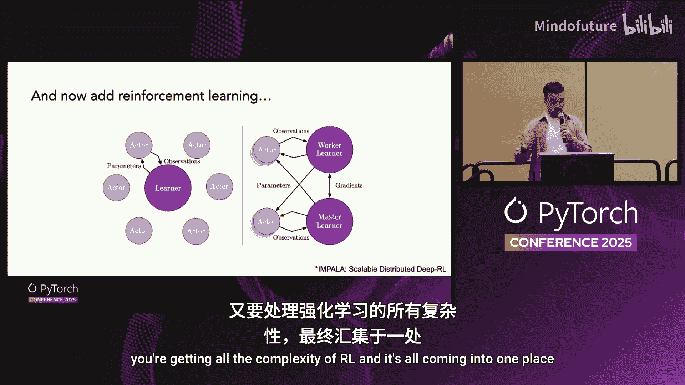
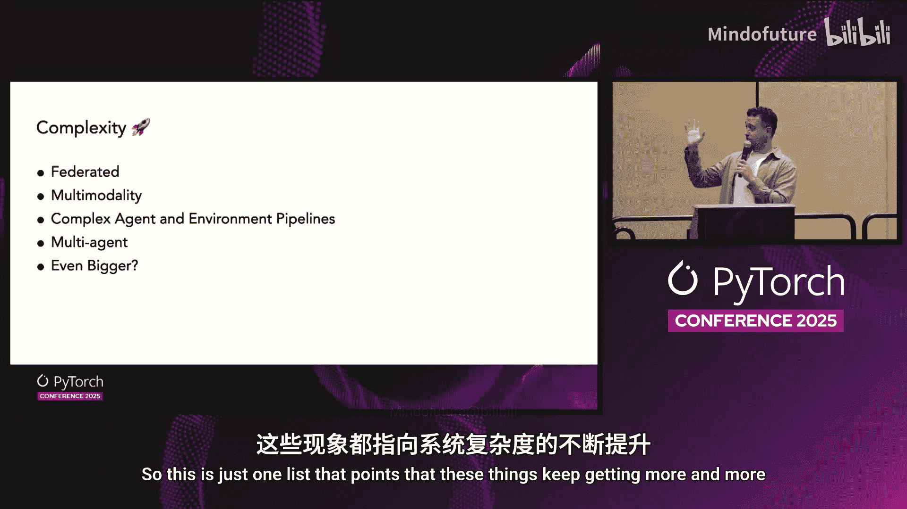

# 2025 Pytorch大会 ｜ Pytorch Conference 2025 p68 P68_参数的生命周期-Philip_Bontrager__Meta -BV1b8kRB6EJG_p68-

So I'm Philip Bond Trigger， I've been working on the torch forge for the last few months。

So working on this project， I've been thinking a lot about reinforcement learning in large scale。

And just how every part of the stack basically starts breaking down as you get to a large scale。

So I thought it would be interesting to look at just one part of that。

And talk a little bit about that。So if we look at where we've come from。At one point。

 we just had a perceptron。 This is a handful of parameters。

There's not a lot you have to do to get it to run。 It ran on a CPU， very old CPU。 And over time。

 this got bigger， you had multilayer perceptrons， you got more layers。

 but you're still running on CPUs。 you had to distribute it， maybe multiproces。

But it's still something you could run on your own computer。Then， about 15 years ago。

We got to the GPU era where we're running models on GPUs。

 So now you have the extra complexity of dealing with different hardware types， accelerators。

And you have multiple GPUs， but a lot of the different things that you as long as you swap out the backend。

The way that you program and develop has mostly stayed the same。

This is something that one person could do。 You could spin things up， spin things down。 But if were。

Dealing with a model， if it's on your computer， you can load it in。 that's the same。

 And but it's been in the last like five years or so that we've gotten to a point where the model has trained on an entire data center。

 And this is where things really start to change。Where the model is distributed across a data center。

 and this changes a lot of your assumptions。 if you have a model that's a trillion parameters。

 even at FP 8， you're dealing with a terabyte， which doesn't fit on any hardware。

So this is just the scale side。 This is a proposed data center that looks like it's half the size of Manhattan here。

 and these are all computer chips。 So you're dealing with much bigger scale that we've ever dealt with before and apart from the scale side。

The complexity is going up， so。Regular training， or what's now called pre training is you're doing a forward pass。

 You're doing a backward pass supervised learning。 You have a bunch of data and you update your model weights。

But there's always been this other。One of the other training paradigms。

 which is reinforcement learning here， you're generating the data while you're training the data。

 while you're training on the data。 and in order to get the data that you're training on。

 you need to interact with environments。 So this is bringing multiproces coordination。

 all at the same time。 So this has always been a complex area。

 and what's happening right now is these two things are converging where you're getting very large scale training and you're getting all the complexity of RL and it's all coming into one place。

So I thought it would be very interesting to just zoom really far in to one aspect of all of this。

 I think all of us have some familiarity with different parts of these different things or have run into them。

 But it's。Ithi is interesting how every little thing has to change when you get。

As the complexity goes up and as the scale goes up。

And the area that I wanted to focus on was just the parameter。

 which is something that you never think about。 It's maybe like one of the most mundane parts where if you wanted to train。

 you have your model， you create， you initialize your parameter。

You do some updates on it and you save the checkpoint。 very basic。

 It's like nothing you ever think about。 But now when you're on a cluster。

And you have trillions of parameters。 What are all the things that change。

So here's my diagram of what a cluster looks like。 It's very small compared to a real cluster。

You have your cloud where you you're hosting your weights。

 I'm just focusing on the RL post training case because I think it's a good example of a very complex workload。

 But there's a lot of different ways you could look at this。You have your storage。

 So this is a network storage drive。 And then you have all of your different nodes that are running in the cluster Here。

 there's just four shown。 We have four GPUs that share their Ram together。

And there's a lot of different layouts， though， as GPU memory changes。

 this layout might change if you're on TPUs， you're going to have different things。

 but this is a common layout。So how does this story start？We're gonna start。 You have weights。

 They were pre traineded and they just exist in your model hub。

So just to describe how the diagram works， the the stack of lines here is your model。

 Each line is a parameter。 and I've highlighted one of the tensors in red here。

 And you could see you have a key， you have the size of it and you have the data type。

 So already a new area of complexity that you didn't really have to deal with too much in the past is that you're not always dealing with the same data type。

 you might have it in very quantized formats in very big formats， depending on how you're training。

 depending on how you're doing inference。So this is the parameter that we're going to follow。

So the first thing you need to do is download it。 If your model is one  TBaby。

 you're not gonna want to download it to each individual computer。 It's going to be very large。

 So you have to have your network storage now， So you download to the network storage。

 This is the simplest part of the process you can do that pretty fast now。

And this is where things start getting complex， which is how do we load this really large model onto my GPUs。

 So in this example right here， we have dedicated half of the cluster to training。

 so we have two nodes right here and before we even know where to put the parameters we need to allocate them So we have this model definition in Python code somewhere。

And we need to allocate it across these。Two nodes in this example。So。

If you just naively created it and you instantiated all these tensors。

 they wouldn't fit on any of the process。 So each GPU is running a separate process。

 And if they tried to fit an entire parameter on there or all the parameters on there。

 they wouldn't fit in memory。 So you wan to do is you w to create like a virtual。

Me tensor in order to create everything and allocate just little parts of memory to each one。

 So now you're ready to actually load in the parameter。

So this is what happens when you read the checkpoint now。

 So you have some checkpoint that was trained somewhere。 and it's in a。

Whatever format that this checkpoint was in， but that doesn't necessarily match what's inside of your trainer。

 you can't just read it indirectly because maybe you've。

 you've optimized your trainer to have maybe in the checkpoint。

 you have separate tensors and you've decided to merge them inside your trainer for faster training。

 You have different names。 So you have to keep track of a mapping of all of these changes。

And apply all of them while you're reading it in。The next part is the sharding。

 So we showed in the previous example that we've actually split the model across all of our GPUus。

So we don't want to read in the full file for every single one。 So you need to be able to。

Read just fractions of the file and to be able to split that out。

So that you're efficiently reading in just the data that you need for each one。

So you need to know where the mapping， where your model actually is。

 and then each of these processes need to read the same file and be aware that they're each getting a different piece of data。

And the blue is just our specific parameter that we're gonna follow。Or a set of parameters。

And then the last step that you might need to do is deal with decoquantitization。So。

The checkpoint in this example， let's say it was in FP 8。

 because that's what you're using for inference。 But you don't necessarily want to train in that if you're。

If you have an F8 checkpoint， you might want to train with your parameters in like B F 16 because you need larger parameters in order to do gradient training and not go out of range。

 or you might need something even bigger， F F P 32， if you want even more stable training。

 So while you're reading that in， you're also doing this decoquantization on the fly so that you can put the actual parameters in the space that you allocated。

So we talked a little bit about sharding， but how do you actually shard the different parameters？

Here I've put four popular examples for sharding。And I'm just gonna go through kind of how they work and why you might choose the different ones。

 But this is very dependent on your model architecture on the layout of your cluster。

 And these are all decisions that you have to make when you're placing things。

So the first one is pipeline parallel。 So what does this one do。

 You're not actually breaking up the specific tensors。

 but you're breaking up your layers across your compute。

 So maybe you have a node that in this case does half of the layers and another load that does the second half of the layers。

 And this is very good if you don't have a very low latency connections。

 you can run your data through the first node。 it's half of the processing。

 and then you pass that output to the second one and it processes the second half。

 while it's processing the second half。 you start the first one on the next batch of data so that they can be stay busy at the same time。

 This can work really well。 but the difficulty is that you have to keep both of them busy at the same time and they're doing forward passes and eventually they have to do the backward pass。

 which takes a different amount of time。 So it's very difficult to keep。

Both of them on the same schedule so that they don't end up having large breaks where there's down time。

 but you don't have to worry about latency too much。The next1 I have is expert parallel。

So expert parallel is specific parallelism that you can use when you have a mixture of expert architecture。

 What does this mean。So， typically， when you have。like a layer in an neural network。

 Maybe you doing a forward pass。 This is a matrix multiplication。嗯。

What a mixture of experts means is that you actually have for that matrix multiplication。

 you're gonna have a group of mates that matrices that you can choose from to do that multiplication。

 So instead of let's say， I have my data and I wna do this go through this layer。

 I'll have eight layers。 and then I'll have a router thatll select which layer that I'm going to。

And what you can do is you can put each of those different variants of the layer on their own GPU。

And then just route the data to which GPU they need to go to。

So this also isn't too latency sensitive。 but the downside is that it's not general。

 You need to be using this specific architecture。 And if you don't have this architecture。

 it doesn't help you。The next one I have here is data parallel。This is the simplest architecture。

Well， it can be the simplest architecture。 So in the simplest form。

 you actually just have a copy of your full checkpoint on every single GPU or process。

 So that's very simple。 you send different data to each one。 They process the entire model。

And you don't have to manage any splitting or sharding of your data。

But you have to be able to fit the entire model on that GPU。

 which doesn't really work with larger models。 So what you can also do is what's called sharded data parallel。

Or otherwise， you'll hear a lot FSDP。And with that。What you do is you do shard the the model。

 So let's say in this case where you have8， every GPU gets one/ eighth of the of each part of the parameters。

But when it's time to actually compute a layer， you collect all of the。

All of the layer and compute that entire layer。 So you'll do a full collection for layer 1 and you'll start doing your forward pass on layer 1。

 And while you're doing that， you request all of the parameters of layer 2 so that it's ready when you get to layer 2。

 you can compute the lower the forward pass on layer 2 and release layer 1 So what this does is you actually don't have to keep the full model in your memory。

 as you see in this example for most of the parameters。

 you only have a shard and you only have to keep in memory the full layer that you're currently processing。

It's a bit。You need low latency， but it's not still the most sensitive option because you can prefetch the next layer。

 So as long as you have enough memory， you can prefetch a little bit ahead and you're not gonna be waiting on the all gather for the next forward pass。

So this is very effective。 But your the problem is that your GPU still has to process the full parameter。

 So you're doing a much larger matrix multiply。 So then the final 1 I have here。

 which is tensor parallel。 You split everything into shards。

And then you only you ever keep that shard on the GPU。

 So not only do you only keep the shard on the GPU when you're doing the forward pass。

 you only compute a fraction of the GPU of the parameter multiplication on that GPU。

 So the GP is less busy and it can run faster。 This is very fast。

 but then the downside is that when you have that output。

 you have to join it with the outputs of all the other GPUs before you can send it to the next layer。

 So this requires very low latency connection。 So。just each one of these things has a benefit and a trade off。

 And what you end up having to do is decide what are the for my exact hardware。

 my exact architecture， what is the combination of these that will give me the least number of trade offs。

Oh。And。Once you get through figuring out how you wanna do all of your distributed setup， the final。

Part before we're done with just loading the， the checkpoint is that you also have to handle deco quantitization。

 Well， what does that mean。um。If you keep your parameters in a lower。Precision format。

 you're not gonna be able to have a very wide range of values that you can represent。 So what you。

 the trick that you do there is you group every few parameters together in a block。

And then you keep one scalar value for that。 So you try to keep your numbers all normalized within the range that that low precision can represent。

 And then when you go to actually use it at a higher precision， you multiply it by that scalar。

 So you get the actual number that it represents。And then this is something that you can also play with。

 if you have a very small block size。 So let's say like a block only represents two。

 That means you need one scalar for every two。 and you're not actually saving that much memory。

 but if you have a very large block size。Now， you don't。

 your scalers are fairly small compared to the actual data you're keeping。

 but you have a single scale for a bunch of numbers。 And if they're not close together。

 you're not gonna have good representation of the real values you're representing。So this is。

 you have to decide this format。And all of this happens on the fly。For when we get。

To actually load the model weights into the trainer。

 And now the trainer is actually able to start training。嗯。So。

The next step is actually very complicated normally。

 But since we're only looking at parameter movement and changes。

We can actually skip a lot of the complexity on the train step。 Basically， the number changes。

 You do a forward pass， You compute activations， you get gradients。

 You could do another talk on all that stuff。But as far as we're concerned here， it gets updated。

And I think what I want to do。 Yeah， the another thing I wanted to say about this， though。

 is in the setup that we have here， since we just went over all the sharding and what that looks like is we have two nodes and our parameter that we looked at is on four of the GP PUs。

 So since we're focused on T P。In this example， we're basically saying we split the parameter into four parts and so every four GPUus will have that fourth one。

 So we have TP of four， and then we have data parallel of four because every one of those groups of four will have a different set of data。

So。Now that we have the model training and we're updating the weights。The new。

 unique thing that we have to get have for reinforcement learning is that we also have to get the data to the inference side。

So on the inference side。We're doing decoding， so。We've optimized our trainer to be able to take the data and update very quickly。

呃，被。For an LLM， in order to generate data very quickly。

 you have a different model representationca it's auto aggressivegressive。

 which means that you're doing the same computations。Over and over again。

 So you need caching so that it's not too slow。 There's other。

 there's a lot of other optimizations in the model definition。

 So what we do is we have another model definition that's only doing data generation that's running while we're also doing the training side。

So just we'll go over this quickly。 But basically， when we want to put it the weights back。

 we have to do everything that we did before in reverse。 So we go from the quant， we have the。

 the unquantized data， requantize it。 We reconvert it back to the checkpoint format。

 and then we have to reshard it for whatever format that the inference side is expecting。

And this is where we actually sync the weights。 So in this setup right here。

 what we did is we pushed off the weights to our CPU Ramm。

 and now we can move it to the inference model， CPU Rams。

 and they can be loaded up to the inference engine。 And you see here on the inference side。

 we actually have a different setup。 We're doing T P2。

 And the reason why you might want a different setup is there' different requirements。 For example。

 you don't need to do back propagation。 You don't need gradients。

 so it doesn't require as much memory。 butre depending on the context length and different things you want those numbers can be completely different。

And then one other thing I wanted to say is this is just one set of decisions that you can make on why you want to do it。

 why you want to do the weight sync this way。 So if your model is too big to fit on a single node。

 you're gonna have to have your inference models on a completely other node。

This format is really good if you're doing asynchronous training。

 What does that mean is my trainer and my generators are running at the same time。

 And the most important thing is to not slow down or stop each one of them。 So the trainer。

Only has to stop long enough to push the weights to the local CPU rim。 That's very short。

 And if you overlap that with its next forward pass， you almost don't disturb it at all。

In the meantime， it can move the weights over to the inference modelss nodes and everybody's running and they're not stopped at all。

 And now on the inference side， they only have to stop long enough to do a local copy to the GPU memory。

 So this is very fast。 if you're doing asynchronous training， but asynchronous training。

Has issues with a data staleness， which just accept my word for that。 So another option is。

 if you w to do synchronous。 And then in that case， you want to minimize the just。

 you wan to move the data from the trainer to the inference model as fast as possible。

 So you don't wan to do these three steps。So what can we do is we can do direct GPU transfer。

 And here you have to deal with the complexity of I had one set of sharding on the left。

 Now I have a different sharding。 I need to figure that out。

 I figure out that mapping and I need to pause the trainer and pause the inference side at the exact same time so then I can send directly send this and the downside is that the trainer and the inference side both have to be stopped for the total time of the transfer。

But the total time is smaller。 So depending on what you're doing。

 you have these different optimization choices。And I didn't even show it here。

 but you can also just save to your storage， read from your storage， which is really slow。

 but not as complex。 or you can put both the trainer and the inference on the same node if your models are small enough。

 so。Just the number of different ways you can optimize this。Just keeps growing。

But just to complete our story here， now that we。Are pushing to the generator。

 We're getting new data。 We're training。 We're updating the parameters。 And when we're happy with it。

 we can push those weights back to our Ram and then and now actually save them in storage。

 So now we have a checkpoint that we can use。 And as we remember。😊，The same thing with wasting。

 we gotta quantize our weights。 We gotta convert them back to the original format。

 and we now merge back into like a complete full model。And now we can finally， we can upload them。

 We can evaluate them。 We can use them for whatever we want to use them for。

So in summary of all of those steps。We start with a full checkpoint。We do download the checkpoint。

We load the parameters， do all the conversions， set up the model。Then we actually update。

 train the model。We push the parameters either directly to the GPU or to some staging area。

We actually have to complete this sink on the inference side。

 So the inference side has the updated weights to generate more data。

We save the checkpoint and then we upload and evaluate。Just this simple process of。

Creating your model。Updating your weights and saving has now become way more complex and requires solving a bunch of info problems。

 If you w to make it simple for people to use again。And where are things going even from here？

I don't think anybody can answer that definitely but there's a number of things that people are doing that just allude to that it's probably getting more and more complex。

 Once you go past a single data center and you multiple data centers。

 now you have really bad latency between them。 So maybe you want some kind of federated learning or where things are out of sync between your data centers for a little while and then you synchronize if you have multimodal data or video data。

 Now， competing with all of your data movement for your parameters and you're distributed updates。

 you're also moving around a lot of data that's also competing for your bandwidth。

 You're having environments running on the CPU at the same time and competing for your CPU Ram。

 maybe you have multiple agents that will have different different sets of parameters that have to go different paths。

 and。They can keep getting bigger， so。This is just one list that points that these things keep getting more and more complex。

And。If you wan to see how we've been working on it in torch forge， I have a link to that here。

 But in general， I just thought this was an interesting look at just one little aspect of all the things that are changing right now。

 Thank you。

