# 001：欢迎来到深度学习 👋

在本节课中，我们将学习深度学习课程的基本介绍，包括课程目标、要求、评估方式以及人工智能、机器学习和深度学习之间的核心关系概述。

---

## 课程概述与目标 🎯

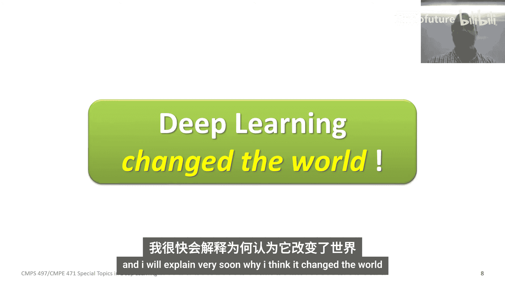

欢迎来到深度学习课程。请确保您进入了正确的课堂。

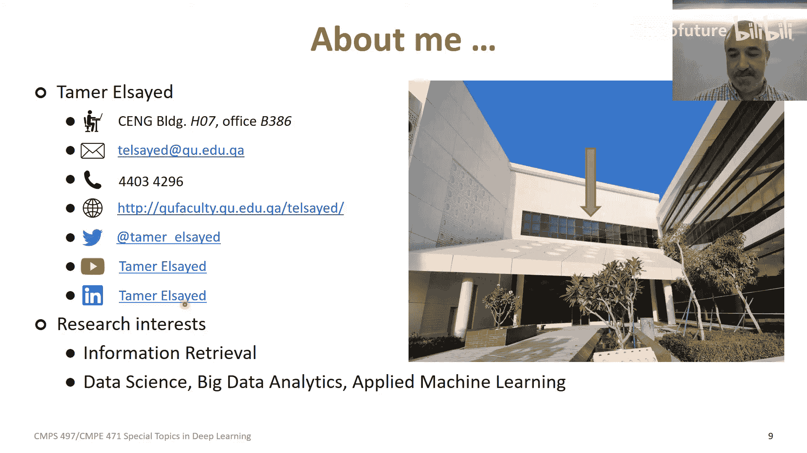

我们通常以一句箴言开始：“让我们学习有益的知识，并以此增长我们的学识。”这应是我们始终追求的目标。另一句箴言是：“谁踏上求知的道路，真主将为他开辟一条通往天堂的坦途。”这不仅适用于本课程，也适用于您所学的任何知识。

此外，鉴于当前世界的局势，我们感到无力帮助那些需要帮助的人。我认为我们有一项长期的责任，那就是在我们各自的专业领域追求卓越，以期在未来做出改变。因此，让这成为我们学习的另一个意图：不仅仅是为了GPA、学位、工作或证书而学习，而是为了真正有益于自身和他人而学习。

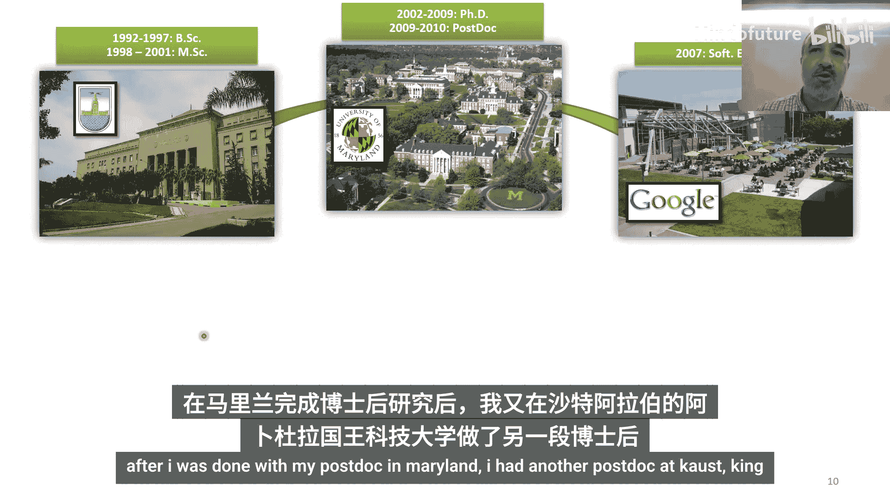

同时，请记住，当前世界上的一些冲突，不幸地，是由人工智能技术驱动的。有报告指出，所使用的某些技术实际上由人工智能和深度学习技术赋能。因此，我希望学习本课程的另一个意图是了解这些技术如何运作，并思考如何阻止其滥用。

另一句箴言是：“真主喜爱你们中做事精益求精的人。”所以，让我们以追求卓越的心态来学习。

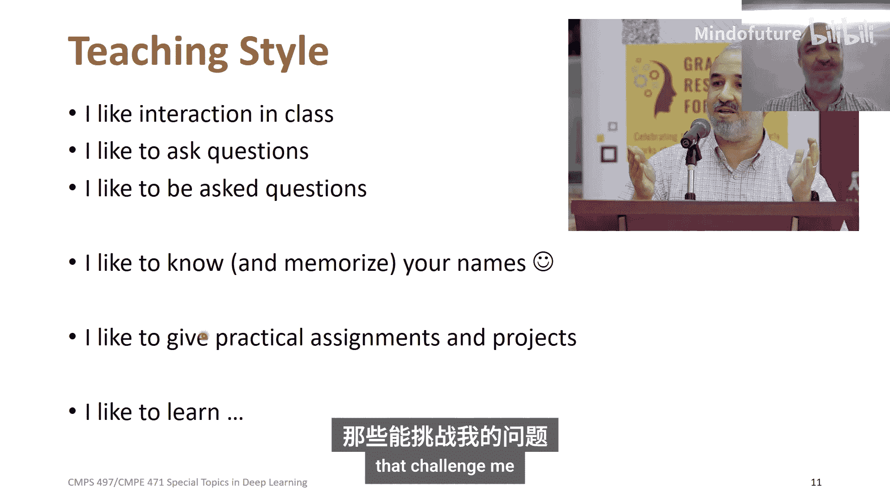

欢迎来到深度学习世界。这是一个真正改变世界的领域，我稍后会解释原因。

---

## 讲师介绍 👨‍🏫

在深入课程之前，请允许我自我介绍。我叫艾哈迈德·赛义德，是计算机科学系的副教授。

我的办公室位于B386室（二楼）。这是我的联系方式：
*   电子邮件：`ahmed.said@qu.edu.qa`
*   电话：+974 4403-XXXX
*   个人网页：`http://www.qu.edu.qa/ahmed.said`
*   社交媒体：我活跃于Twitter、YouTube和LinkedIn。

我的主要研究方向是信息检索，这是构建搜索引擎背后的核心领域。此外，我还在数据科学、大数据分析和应用机器学习等子领域有研究兴趣，这也是我来教授这门课程的原因。

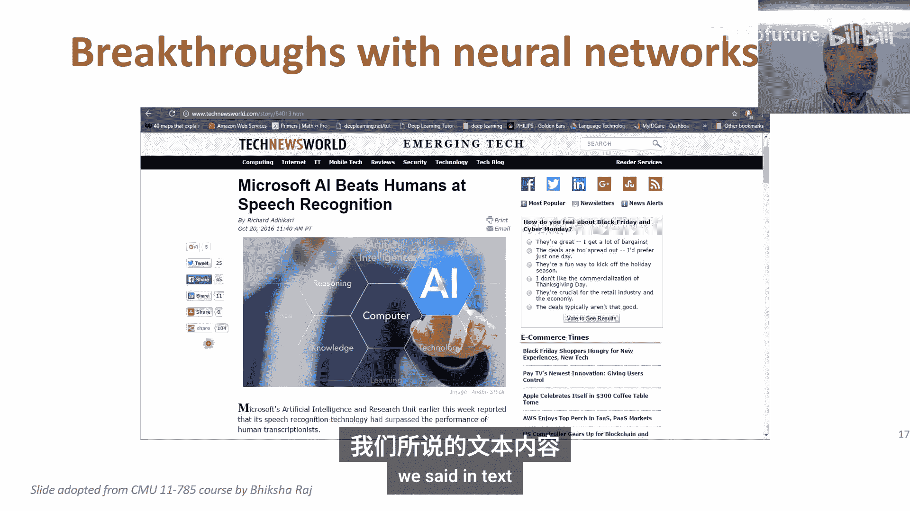

**个人履历：**
*   埃及人，1997年毕业于埃及亚历山大大学。
*   2001年于同一所大学获得硕士学位。
*   2009年于美国马里兰大学帕克分校获得博士学位。
*   博士毕业后，在马里兰大学进行了一年的博士后研究。
*   2007年博士期间，曾在谷歌担任软件工程实习生。
*   2010年在沙特阿拉伯阿卜杜拉国王科技大学进行博士后研究。
*   2011年，加入埃及微软研究院担任研究员。
*   2012年，加入卡塔尔大学担任助理教授，并于2018年晋升为副教授。

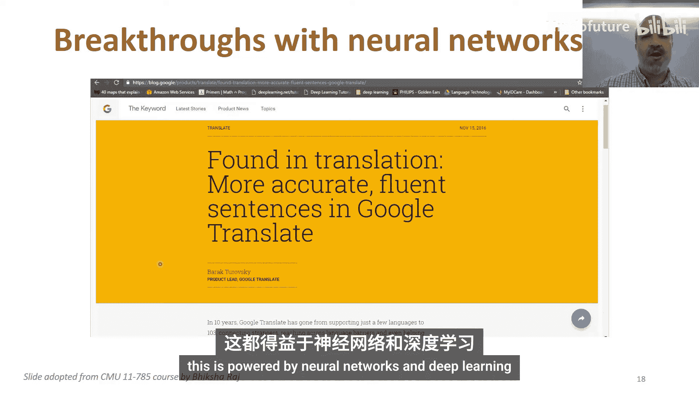

**教学风格：**
由于大多数同学可能未曾上过我的课，以下是我的教学风格：
*   我喜欢课堂互动，会提出很多问题。
*   我也欢迎并鼓励大家提问。
*   我会尽力记住大家的名字，请在提问或回答时先告诉我你的名字。
*   我喜欢布置实践性作业，本课程也会如此。
*   我会尽力将所学内容与现实应用联系起来。
*   我喜欢在教学相长中学习，包括从挑战我的问题中学习。

---

## 深度学习为何改变世界？🌍

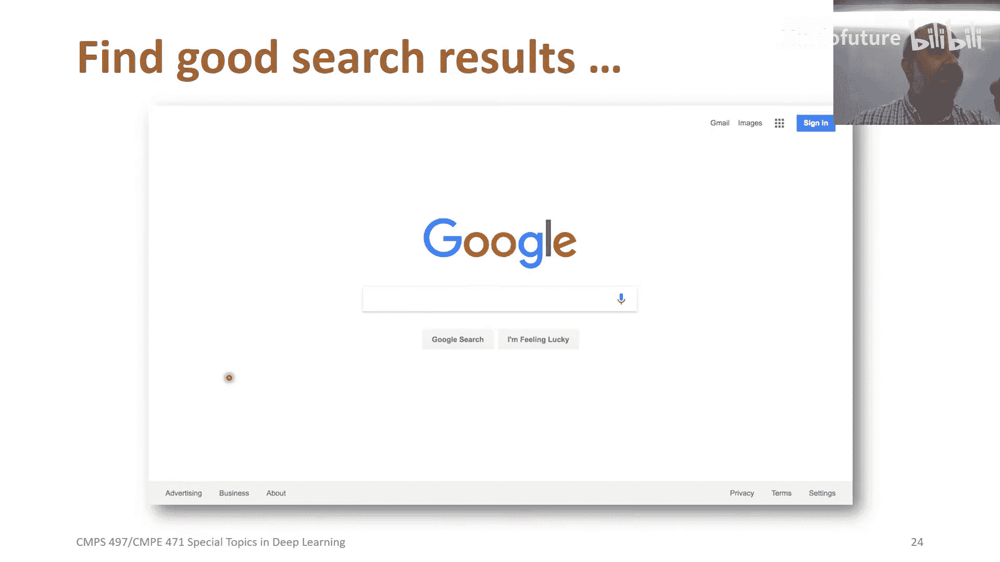

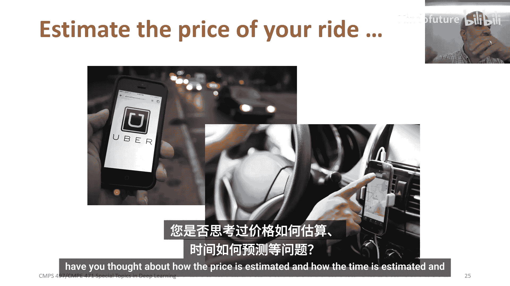

现在，让我解释为何我认为深度学习改变了世界。首先，有多少人同意这个观点？为什么？

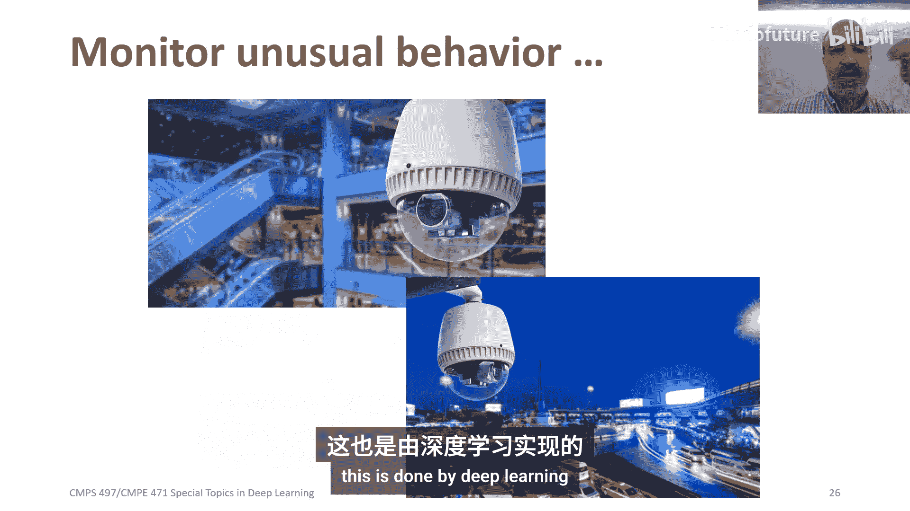

有人认为是因为人工智能（AI）无处不在，它改变了我们的日常生活，因为我们使用的许多应用都由AI驱动。但这里我们讨论的是深度学习。它和AI是一回事吗？不完全是。

深度学习是AI中使用的一种数学模型。在深度学习出现之前，我们已有其他AI技术。深度学习，特别是神经网络模型，如今已成为许多日常应用的核心，并改变了我们解决问题的方式。

可以说，神经网络正在成为AI的主要方法之一，甚至就是当前最主要的方法。这意味着它只是AI中使用的众多模型或技术之一，我们稍后会详细讨论。

正如所说，它已成功应用于许多领域，并在一系列问题上确立了最先进的性能水平。“最先进”意味着使用神经网络在解决许多问题上达到了当前最佳性能，甚至超越了之前其他机器学习技术的表现，或解决了我们之前未曾尝试过的新问题。

**以下是一些由神经网络和深度学习驱动的应用实例：**
*   **语音识别**：将音频转录为文本。
*   **机器翻译**：如谷歌翻译，现在比以往更加可靠。
*   **文生图**：根据文本描述生成图像。
*   **聊天机器人**：如ChatGPT，可以进行对话、回答问题、提供建议等。
*   **图生文**：根据图像生成描述性文字。
*   **游戏AI**：在围棋等复杂游戏中击败世界顶尖人类选手。

神经网络的成功遍及众多领域，从天文学到医疗保健，再到股票市场。

**更多应用示例：**
*   在搜索引擎中寻找优质结果。
*   估算网约车（如Uber）的价格和时间。
*   通过监控视频监测异常行为。
*   自动驾驶汽车。
*   教机器人烹饪。

以上是对深度学习影响力的快速介绍。

---

## 课程管理与政策 📋

现在，让我切换到课程的一些管理事务。

**课堂纪律：**
*   **准时**：请准时上课。今天例外，我们晚了5分钟开始，但下次将准时开始。
*   **出勤**：将执行学校的出勤政策。如果缺课，您需自行负责错过的所有课程内容和通知。
*   **提问**：可以随时提问，请举手示意。当我提问时，也请举手回答。我有责任确保大家理解内容，所以请不要害羞提问。如果对任何内容不确定，请随时打断我。
*   **手机与电子设备**：上课时请勿使用手机，请关机或调至静音。不要发短信或刷社交媒体。如果您确实需要处理紧急事务，可以自行离开教室，无需征得许可，但请在教室内时保持专注。
*   **电脑使用**：可以使用笔记本电脑或平板电脑做笔记，或在我要求时进行编码。除此之外，请关闭它们。

**课程资源：**
*   我们将主要使用Blackboard平台。所有内容都会在那里发布，包括教学大纲、通知、幻灯片、讲义、作业截止日期等。
*   请注意，Blackboard通常不会自动发送通知，因此请定期查看我们的课程页面。
*   教学大纲尚未发布，我将在下次课前发布。

---

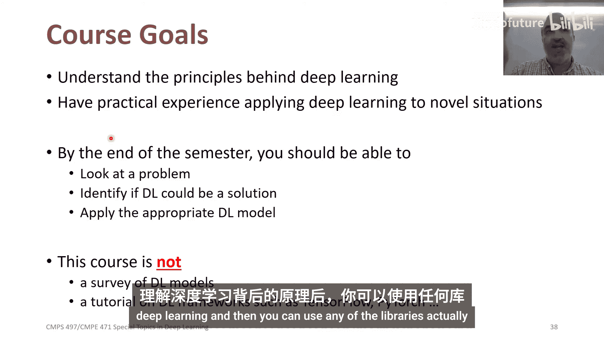

## 课程先修要求与目标 🧠

这可能是本讲最重要的幻灯片。官方上，由于这是专题课程，系统没有设置先修要求。但实际上，存在一些要求。

**重要说明：**
*   我知道有些人上过机器学习课程，但这**不是**本课程的先修要求。我不会假设您已具备机器学习知识。
*   然而，确实存在以下先修知识要求：
    1.  **编程**：至少学习过面向对象编程，最好也学过数据结构。我们将使用Python。
    2.  **微积分**：具备基本知识，主要是如何计算导数、梯度、偏导数等。
    3.  **概率与统计**：基本概率论（如贝叶斯定理）、统计学（如计算均值、期望、方差等）。
    4.  **线性代数**：了解线性方程、矩阵、向量，以及如何进行矩阵乘法、矩阵与向量乘法等。

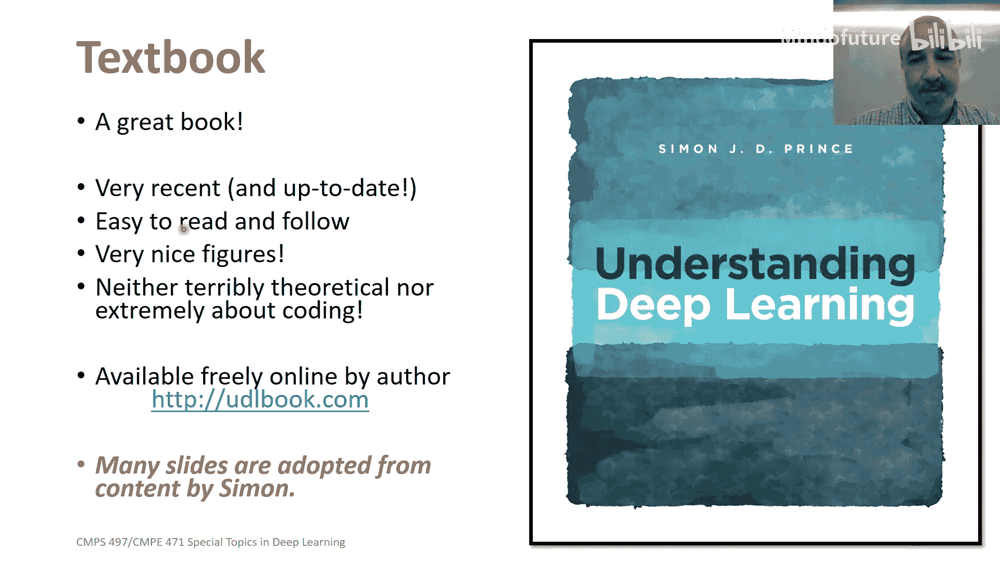

如果您缺少以上大部分知识，可能需要重新考虑是否选修本课程。如果只缺少其中一项，请与我沟通，看看如何解决。

我将尝试在本周或周末前，准备一些关于这些主题的复习材料，但这只是快速回顾，并非从零开始的教学。

**课程目标：**
我对本课程有两个目标，希望你们能达到：
1.  理解深度学习技术背后的基本原理。
2.  获得将其应用于现实世界问题的实践经验。

到学期结束时，希望你们能够：面对一个问题时，判断它是否可以用深度学习解决，并应用适当的深度学习模型。

**重要提示：**
*   本课程不仅仅是模型概览。
*   本课程不是特定库（如PyTorch）的教程。我们将使用PyTorch，但重点是学习深度学习的基本概念和原理，之后你可以使用任何库。

---

## 教材与课程主题 📚

我们将使用的教材是《Understanding Deep Learning》。这是一本非常新的书，内容前沿、易于跟进。它混合了理论与实践，没有冗长的证明，也不全是代码。最重要的是，作者免费提供了电子版。我会分享我们将使用的特定版本（可能是2024年5月版）。

许多幻灯片内容也改编自作者Simon J.D. Prince的材料，在此表示感谢。

**课程主题（基于教材章节）：**
以下是教材目录，我们无法覆盖全部内容。
*   **基础部分**：我们将覆盖第1至第9章，主要内容包括深度神经网络、如何训练、如何评估性能等。
*   **高级架构**：之后，我们将学习更专业、更复杂的深度学习架构：
    *   卷积神经网络（CNNs，第10章）：专门用于处理图像的模型。
    *    Transformer与大型语言模型（第12章）：专门用于处理文本的模型，如ChatGPT、GPT-4。
    *   无监督学习与生成模型（第15章）：如生成对抗网络（GANs）。
    *   稳定扩散模型（第18章）。
    *   深度强化学习（第19章，如果时间允许）。

实际上，最后四个主题（第14、15、18、19章）将根据课程进度和时间安排进行选择。

**实践环节：**
教材和幻灯片附有Jupyter Notebook。有时我会在课堂上演示，我们一起修改代码、观察效果。这些Notebook也可能用于作业。它们可以在Google Colab中运行（非常方便，只需一个Google账户），也可以在本地Jupyter环境中运行（但需要安装相关库）。

---

## 评分标准与期望 📝

这可能是大家最关心的幻灯片：成绩分布。

*   **作业（10%）**：包括问题求解和编程任务，可能有4到5次。我们会去掉成绩最差的一次。作业需**独立完成**。
*   **测验（20%）**：计划进行5次测验，我们会去掉成绩最差的一次。**没有补考**，如果错过一次，那次即视为最差成绩。
*   **项目（20%）**：课程后半段进行，以两人小组形式完成。将是应用型项目。
*   **期中考试（20%）**：闭卷。
*   **期末考试（30%）**：闭卷。

以上是暂定方案，将在下次课发布最终版教学大纲时确定。期中考试日期会提前确定，以便大家规划。

**我对你们的期望：**
1.  **努力学习**：深度学习是当前计算机科学领域最热门的话题之一。投入时间和精力去理解它，这将成为你简历和未来求职中的重要资产。
2.  **复习数学**：我会提供一些复习材料，但你需要确保数学基础。
3.  **积极编程**：会有相当数量的编程实践。
4.  **认真听课**：“听课”意味着真正参与，而不仅仅是坐在教室里。
5.  **课前预习**：根据教学大纲的阅读要求，尽可能提前阅读相关章节。
6.  **独立按时完成作业**：不要拖延到最后一刻。

---

## 学术诚信 ⚠️

这是一个非常严肃的问题。抄袭（无论是互相抄袭还是使用外部资源，如谷歌、ChatGPT、GPT-4、Gemini等生成的答案）即被视为作弊。

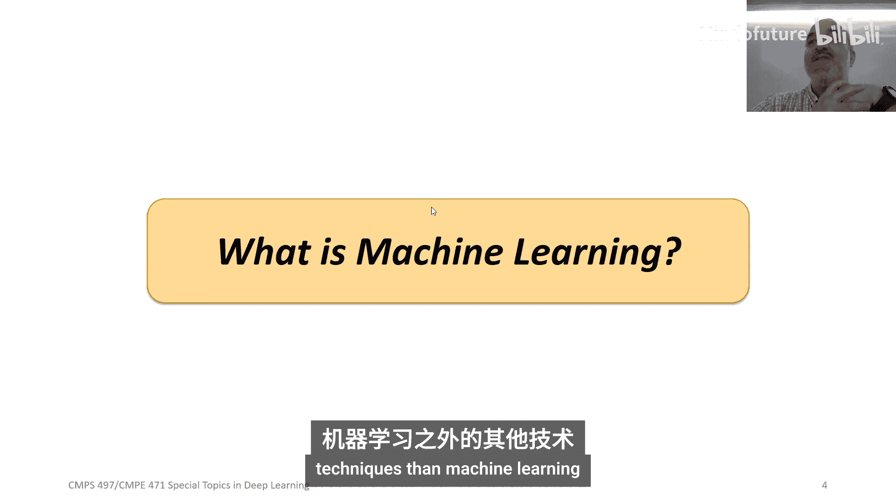

*   如果一次作业中的**任何一道题**被发现抄袭，则**整个作业**计零分。
*   抄袭者和被抄袭者都将获得零分。
*   个人作业必须独立完成，提交的作品必须是您自己的。
*   我们将执行大学的相关规定。

请严肃对待，因为诚信关乎根本。

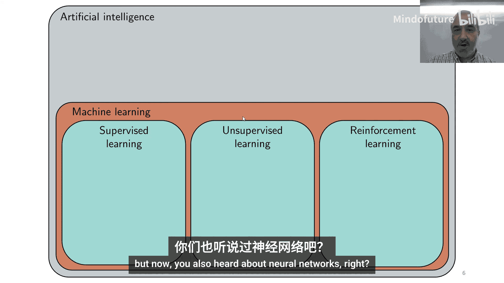

---

## 核心概念辨析：AI、机器学习与深度学习 🤖

现在进入本讲的正式内容：深度学习导论。首先讨论：什么是人工智能（AI）？

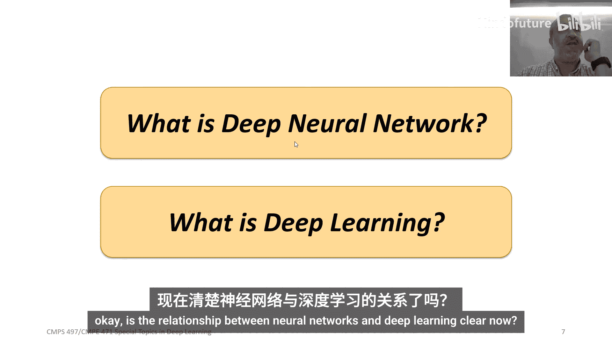

*   **人工智能（AI）**：指**人工智**能。它的目标是构建能够模拟人类智能的系统。请注意，是模拟智能的**效果**，而非完全模仿人脑的**工作机制**（就像飞机模仿鸟的飞行，但并非扇动翅膀）。AI是一个广阔的领域，包含逻辑、推理、搜索、学习等多种技术。
*   **机器学习（ML）**：是AI的一个**子领域**。其特点是让系统能够**从数据中学习**。根据数据和学习方式的不同，机器学习主要分为三类：**监督学习**、**无监督学习**和**强化学习**。
*   **神经网络（NN）** 与 **深度学习（DL）**：
    *   神经网络是一种用于机器学习的**数学模型**。
    *   **深度学习**则特指用于训练**深度神经网络**（即具有多层结构的神经网络）的**方法和技术集**。
    *   因此，深度学习是机器学习的一个子集，而神经网络（特别是深度神经网络）是深度学习所使用的核心模型。

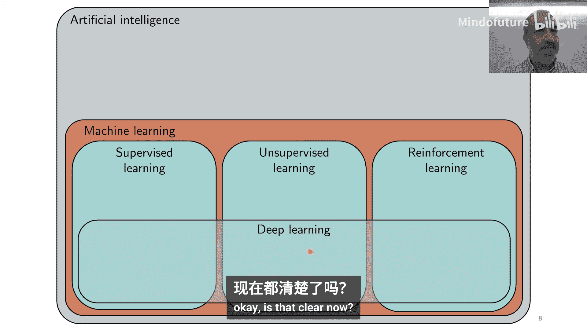

**关系总结：**
`AI ⊃ 机器学习 ⊃ 深度学习`
深度学习使用（深度）神经网络模型，并应用于机器学习的各个子领域（监督、无监督、强化学习）。

**概念辨析小测验：**
*   AI就是深度学习吗？ **错误**。AI范围更广。
*   “将数学模型拟合到观测数据”描述的是？ **机器学习**。
*   深度学习也是将数学模型拟合到观测数据吗？ **是**，因为它是机器学习的一部分。
*   深度学习等于机器学习吗？ **错误**。机器学习包含许多非深度学习的模型（如决策树）。
*   以下哪项是机器学习的一种类型？ 深度神经网络、监督学习、深度学习都是。

---

## 总结 🎓

本节课中，我们一起学习了：
1.  深度学习课程的欢迎致辞与学习意图。
2.  讲师的介绍与教学风格。
3.  深度学习改变世界的原因及其广泛应用。
4.  课程的管理规定、先修要求、目标、教材和主题。
5.  课程的评分标准、对学生的期望以及严肃的学术诚信政策。
6.  人工智能（AI）、机器学习（ML）和深度学习（DL）之间的核心概念与层次关系。

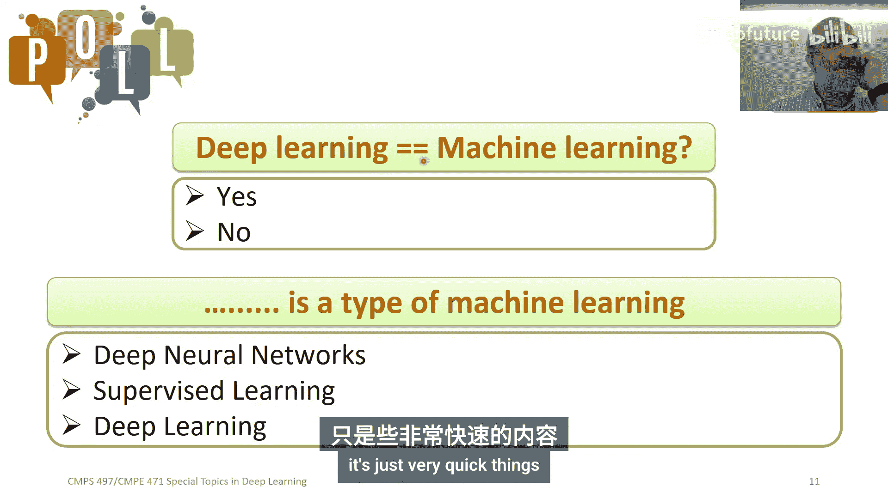

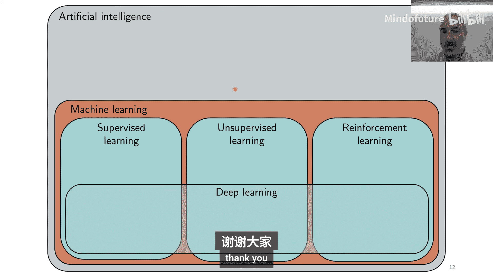

希望本课程能让大家在享受学习乐趣的同时收获满满。我们下次课再见！