# 002：机器学习三大类型 🧠

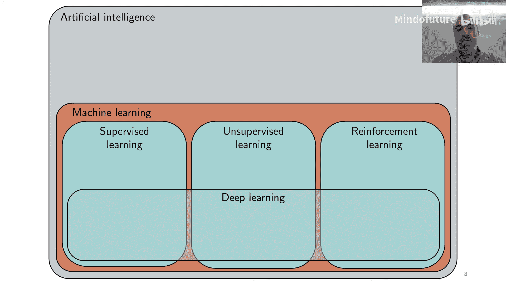

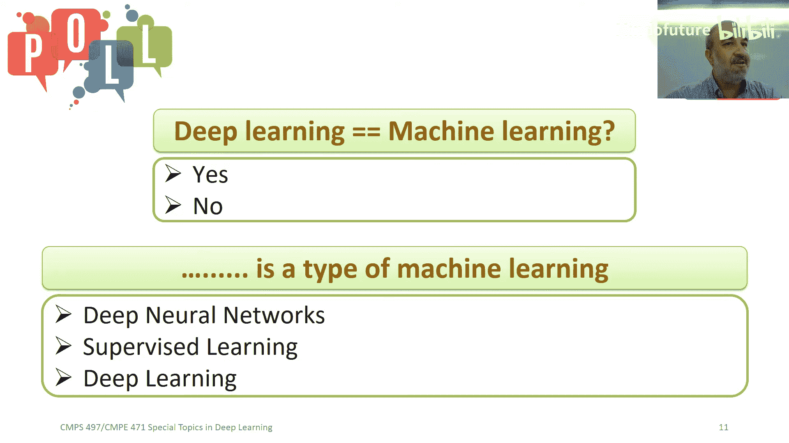

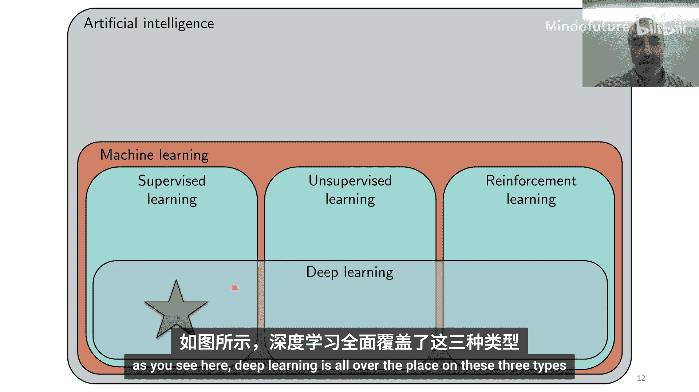

在本节课中，我们将继续深度学习导论的学习，重点回顾并深入探讨机器学习的三大类型：监督学习、无监督学习和强化学习。我们将通过大量真实世界的例子来理解它们之间的区别与联系，并了解深度学习如何赋能这三种类型。

上一讲我们讨论了人工智能、机器学习和深度学习之间的关系。简单来说，机器学习是实现人工智能的一种方法，而深度学习是机器学习的一个子领域，其核心模型是深度神经网络。

## 监督学习：从输入到输出的映射 📊

监督学习的核心目标是学习一个从输入到输出的映射函数。我们通过提供带有标签的示例（即已知输入和对应正确输出的数据对）来训练模型，使其能够对新的输入做出预测。

以下是监督学习中几种常见的问题类型及其示例：

**回归问题**
当模型的输出是连续值时，我们称之为回归问题。
*   **单变量回归**：预测儿童身高。输入是年龄，输出是连续的身高值。模型学习一个函数，例如 `height = f(age)`。
*   **多变量回归**：预测房价。输入可能包括面积、卧室数量等特征（转换为数字向量），输出是连续的房价。
*   **多输出回归**：预测分子的熔点和沸点。输入是分子结构，输出是两个连续值。

**分类问题**
当模型的输出是离散的类别时，我们称之为分类问题。
*   **二分类**：情感分析。输入是一段文本评论，输出是“正面”或“负面”两类。
*   **多分类**：音频分类或图像分类。输入是音频片段或图像，输出是多个离散类别中的一个（如音乐流派或物体名称）。模型通常会输出每个类别的概率，我们选择概率最高的类别作为最终结果。
*   **像素级分类（图像分割）**：区分图像前景与背景。对图像中的每个像素进行分类，输出是每个像素的类别标签。

**思考题**
给定一篇新闻文章，预测其属于政治、体育还是经济类别。这是一个**单变量多分类**问题，因为输出是一个具有三个可能值的离散变量。

**生成式监督学习**
有些监督学习任务更为复杂，其输出并非唯一确定，且需要“生成”内容。
*   **机器翻译**：输入一种语言的文本，输出另一种语言的文本。
*   **图像描述生成**：输入一张图像，输出描述该图像的文本。
*   **文生图**：输入一段文本描述，输出符合描述的图像。

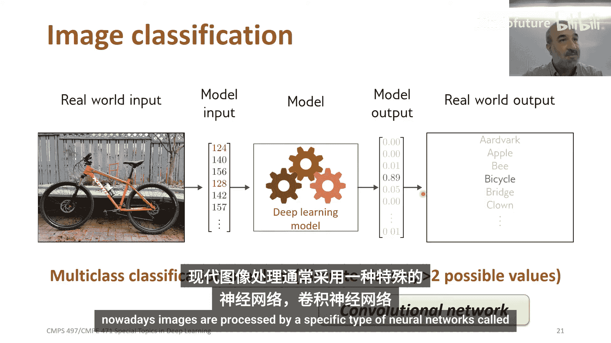

这类任务的共同特点是：输出空间巨大且不唯一，输出需符合特定领域的“语法”或规则（如语言语法、图像的真实感），并且通常需要从海量无标签数据中学习这些底层规律。

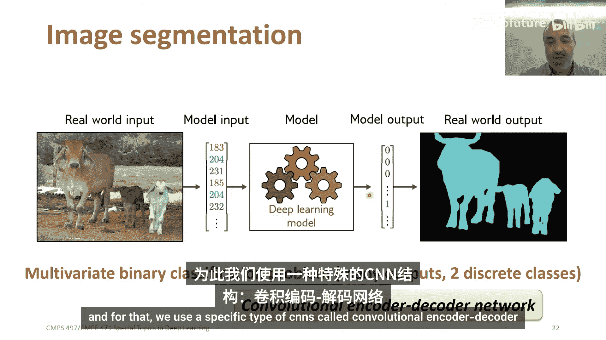

## 无监督学习：发现数据内在结构 🔍

在无监督学习中，我们只有输入数据，没有对应的标签。目标是发现数据中隐藏的结构、模式或关系。

**聚类**
最经典的无监督学习任务。例如，给定一组未标记的图像，根据其视觉相似性自动将它们分成若干组。

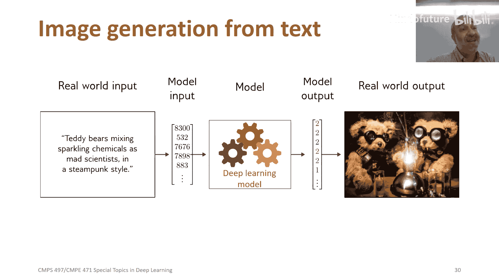

**生成模型**
这是当前的热点领域，模型能够学习数据的分布，并生成全新的、类似真实数据样本。
*   **生成对抗网络 / 扩散模型**：可以生成逼真的猫、建筑图片或连贯的故事文本。
*   **条件生成**：根据给定的部分信息生成完整内容。例如，图像修复（移除图中不需要的物体）、文本续写（如ChatGPT根据提示生成后续内容）。

## 强化学习：智能体与环境的交互 🎮

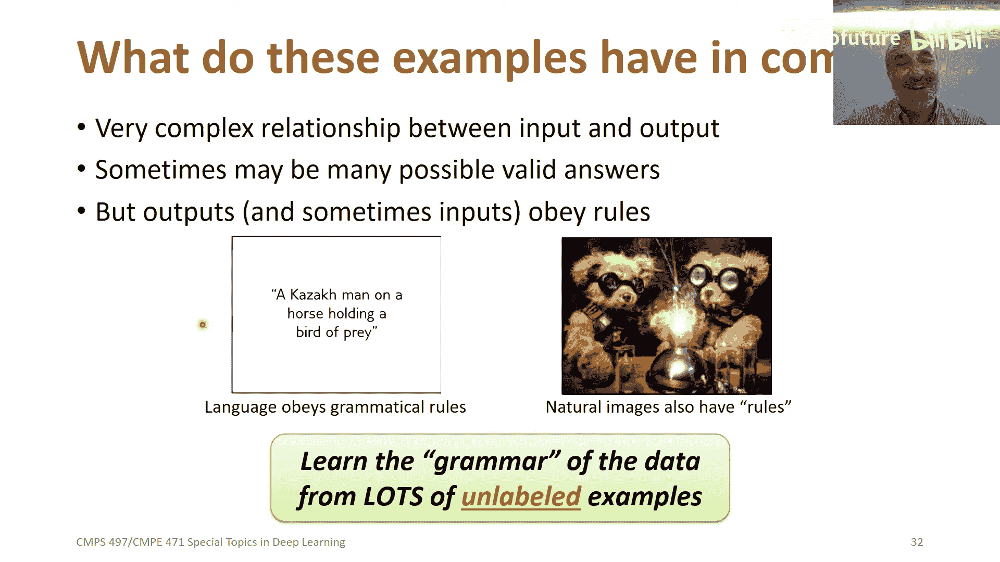

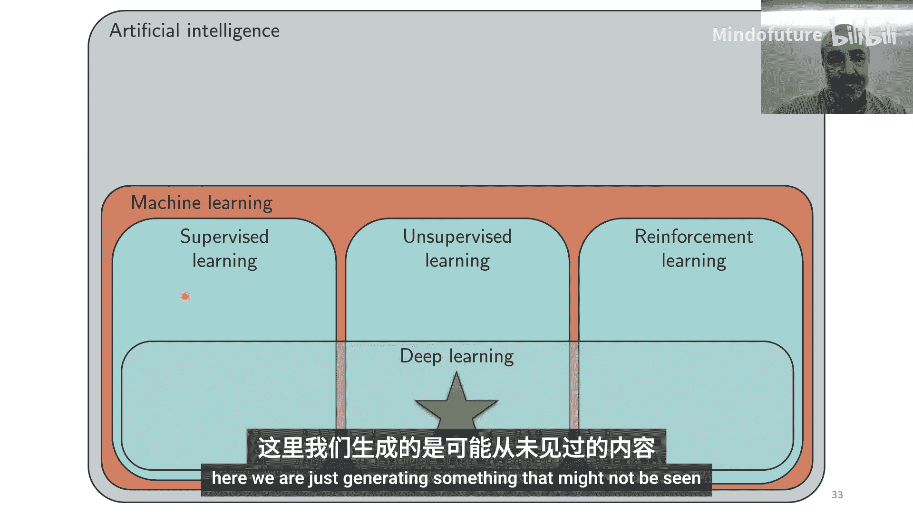

强化学习关注的是一个智能体如何通过与环境交互来学习最优策略。其核心框架是：智能体观察环境状态，采取一个动作，环境反馈一个奖励（或惩罚），并转移到新的状态。

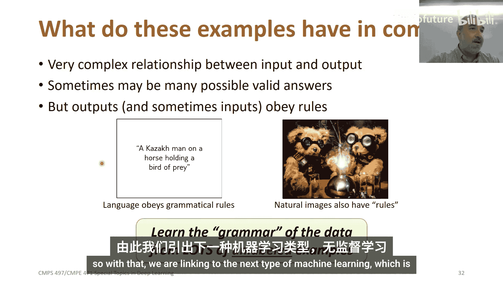

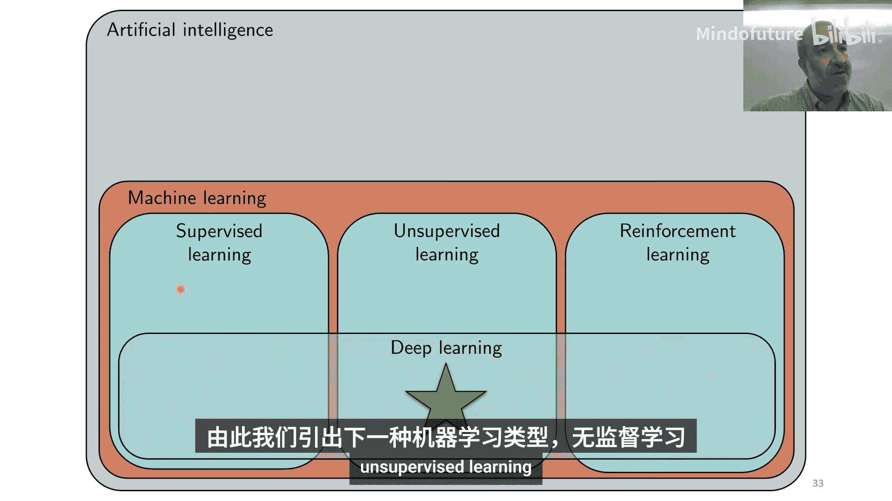

**经典示例：下棋**
*   **环境**：棋盘。
*   **状态**：棋盘上所有棋子的位置。
*   **动作**：所有合法的走法。
*   **奖励**：吃掉对方棋子获得正奖励，己方棋子被吃获得负奖励，最终赢棋或输棋获得延迟的大额奖励。

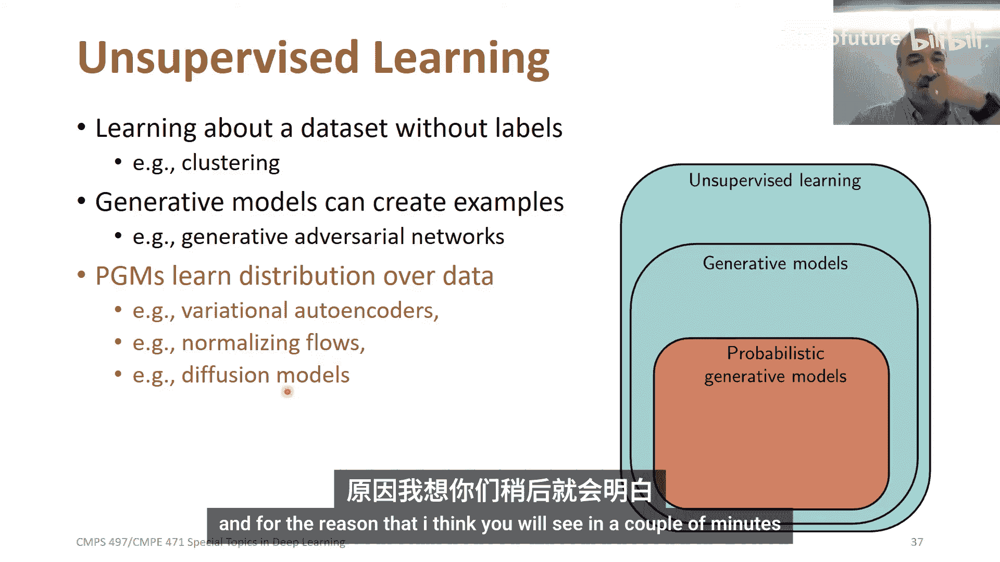

强化学习的挑战包括：延迟奖励分配、探索（尝试新动作）与利用（使用已知好动作）的权衡、以及环境的不确定性。深度学习在这里的作用是帮助智能体学习从复杂状态（如图像像素）到最佳动作的映射。

## 深度学习简史与发展 📜

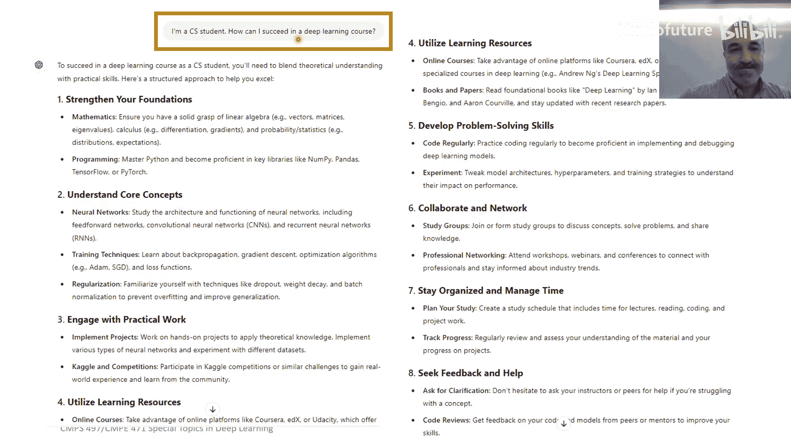

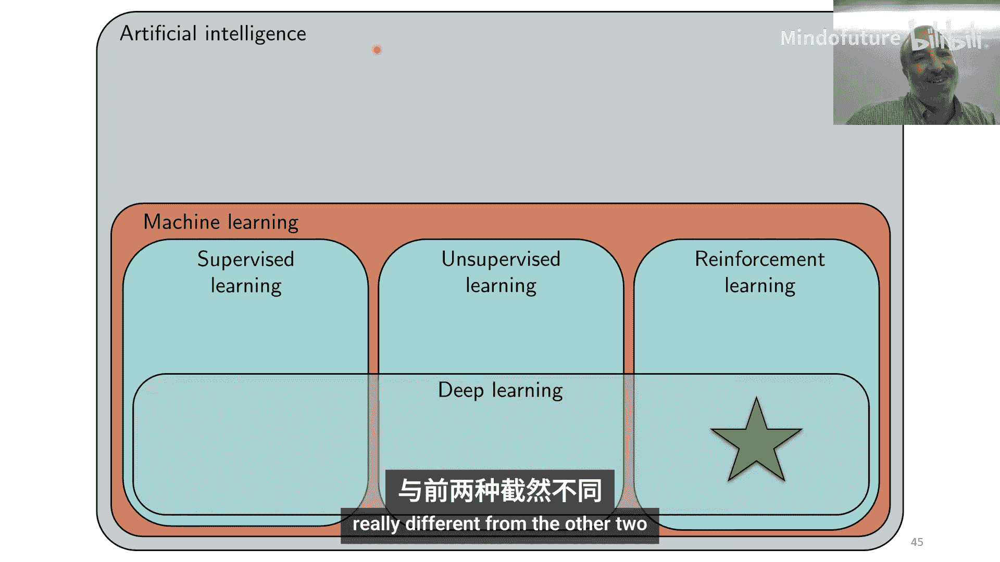

机器学习与深度学习的发展大致经历了四个阶段：
1.  **萌芽（1960s）**：提出最简单的神经元模型（如感知机）。
2.  **发展（1980s-1990s）**：反向传播算法使得训练多层神经网络成为可能，但规模较小。
3.  **突破（2010s）**：算力、数据和大规模训练技术的进步，使得训练极深的网络（参数达数十亿）成为现实，在诸多领域取得突破性成果。
4.  **普及（2022-）**：大模型（如GPT系列）从研究实验室走向普通用户，带来了生成式AI的普及。

2018年的图灵奖授予了深度学习的三位先驱Yoshua Bengio, Geoffrey Hinton和Yann LeCun，以表彰他们推动该领域发展的奠基性贡献。

## 总结

本节课我们一起学习了机器学习的三大范式：
*   **监督学习**：利用带标签的数据学习输入到输出的映射，解决回归和分类问题。
*   **无监督学习**：从无标签数据中发现内在结构，用于聚类和生成新数据。
*   **强化学习**：智能体通过与环境交互获得的奖励信号来学习最优行为策略。

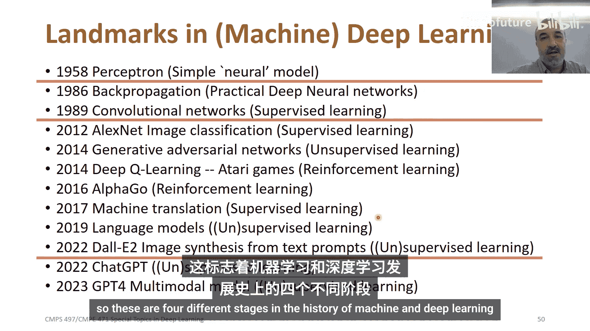

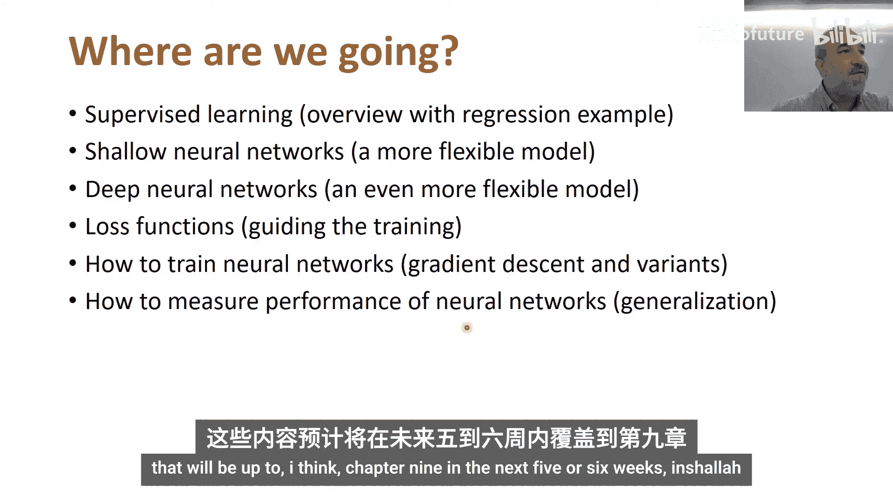

深度学习作为一套强大的建模工具，已经深度融入并推动了这三类机器学习的发展。从下一讲开始，我们将聚焦于监督学习，通过一个具体案例来剖析机器学习的完整流程，并逐步深入到神经网络的核心原理。