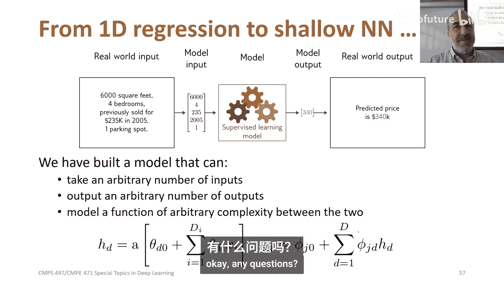

# 005：浅层神经网络 II

在本节课中，我们将继续探讨浅层神经网络，并开始为理解深度网络打下基础。我们将从回顾上一讲的内容开始，然后扩展到多输入和多输出的情况，最后讨论网络的通用表示和激活函数的作用。

---

## 回顾：通用近似定理与单输入单输出网络

上一节我们介绍了**通用近似定理**。这是一个非常重要且有趣的定理，它告诉我们，使用一个浅层神经网络，只要拥有足够多的隐藏单元，就可以以任意精度近似任何一维函数。这展示了浅层网络的强大能力。

为了巩固理解，我们回顾一个具体例子：一个具有**一个输入**、**三个隐藏单元**和**一个输出**的浅层网络。我们从方程转向了图示，希望大家能更关注图示，因为图示能更直观地呈现方程之间的关系。

*   **网络图示与参数**：在图中，每个连接代表一个**权重**，每个隐藏单元和输出单元（输入单元除外）都有一个**偏置**参数。我们通常不在图中标出具体参数值，但需要理解其含义。
*   **计算过程**：
    1.  每个隐藏单元首先计算输入的**加权和**（即预激活值）：`z_j = θ_j0 + θ_j1 * x`
    2.  然后对预激活值应用**激活函数**（如ReLU）：`h_j = max(0, z_j)`
    3.  输出单元计算所有隐藏单元激活值的加权和：`y = φ_0 + φ_1*h_1 + φ_2*h_2 + φ_3*h_3`
*   **输出函数特性**：最终，网络的输出 `y` 是关于输入 `x` 的一个**分段线性函数**。每个隐藏单元贡献一个“关节”（即函数斜率改变的点）。因此，**最大关节数等于隐藏单元的数量**。每个线性片段对应一种特定的**激活模式**（即哪些隐藏单元被激活，哪些未被激活）。

理解了单输入单输出的基础后，本节中我们来看看如何将网络扩展到更一般的情况。

---

## 扩展至多输出网络

现在，我们考虑网络具有**一个输入**但**多个输出**的情况。这相当于使用同一组隐藏单元来同时预测多个目标值。

假设我们有两个输出 `y1` 和 `y2`。网络结构变化如下：
*   **隐藏层**：与之前完全相同。同一组隐藏单元 `h1, h2, h3` 被两个输出共享。
*   **输出层**：现在有两个输出节点。每个输出节点都是隐藏单元激活值的加权和，但使用**不同的权重和偏置**。
    *   `y1 = φ_(10) + φ_(11)*h_1 + φ_(12)*h_2 + φ_(13)*h_3`
    *   `y2 = φ_(20) + φ_(21)*h_1 + φ_(22)*h_2 + φ_(23)*h_3`

**输出函数的特性**：
*   `y1` 和 `y2` 各自仍然是关于 `x` 的**分段线性函数**。
*   由于它们共享相同的隐藏单元，因此这两个分段线性函数会在**相同的 `x` 值处**（即相同的隐藏单元激活阈值）拥有**相同的关节**。
*   但是，由于输出层的权重 (`φ`) 不同，每个线性片段的**斜率**会不同。因此，`y1` 和 `y2` 是两个形状不同但关节位置相同的分段线性函数。

**参数数量计算**（以1输入、60隐藏单元、2输出为例）：
*   **权重**：
    *   输入层到隐藏层：`1 * 60 = 60`
    *   隐藏层到输出层：`60 * 2 = 120`
*   **偏置**：
    *   隐藏层：`60`
    *   输出层：`2`
*   **参数总数**：`60 + 120 + 60 + 2 = 242`

**推理过程**：给定输入 `x` 的值（例如1.5），计算输出 `y1` 和 `y2` 的过程称为**前向传播**或**推理**。步骤是：先计算所有隐藏单元的激活值，然后用不同的权重集分别计算两个输出的加权和。

---

## 扩展至多输入网络

接下来，我们考虑网络具有**多个输入**的情况。这使我们的模型能够处理更复杂、更高维的数据。

假设我们有两个输入 `x1`, `x2` 和一个输出 `y`。网络结构变化如下：
*   **隐藏层**：每个隐藏单元的预激活值现在是**所有输入**的线性组合。
    *   例如，对于隐藏单元 `j`：`z_j = θ_j0 + θ_j1*x_1 + θ_j2*x_2`
    *   这在高维空间中定义了一个**平面**，而不再是一条线。
*   **激活函数**：应用ReLU等激活函数会“裁剪”掉平面的负值部分，使其为零。
    *   在二维输入空间中，这个“裁剪”的边界不再是一个点，而是一条**直线**（即 `z_j = 0` 的等高线）。
*   **输出层**：输出 `y` 仍然是所有隐藏单元激活值的加权和。

**输出函数的特性**：
*   最终，输出 `y` 是关于输入 `x1` 和 `x2` 的**分段平面函数**。
*   每个隐藏单元贡献一条分割输入空间的直线（关节线）。
*   所有这些直线将整个输入空间划分成多个**凸多边形区域**。
*   在每个凸多边形区域内，`y` 的值由一个**平面**（线性函数）决定。不同区域间的平面在关节线处连接。

如果此时我们再增加一个输出，就会得到**两个不同的分段平面函数**（即两个曲面），但它们会被**同一组关节线**分割。可以想象为两个形状不同但裂缝位置相同的曲面。

对于更高维的输入（例如图像像素），原理相同，但输出函数变为高维空间中的**分段超平面函数**，难以可视化，其关节是**超平面**。

---

## 通用表示与网络特性

现在，我们可以给出浅层神经网络的通用数学表示。假设有：
*   `D_I` 个输入
*   `D` 个隐藏单元
*   `D_O` 个输出

网络方程可以紧凑地写成：

**隐藏层**（共 `D` 个方程，`j = 1...D`）：
`h_j = g( θ_j0 + Σ_(i=1)^(D_I) θ_ji * x_i )`
其中 `g(.)` 是激活函数。

**输出层**（共 `D_O` 个方程，`k = 1...D_O`）：
`y_k = φ_k0 + Σ_(j=1)^(D) φ_kj * h_j`

**网络类型**：
*   **全连接网络**：相邻层之间的每个节点都相互连接。
*   **前馈网络**：信息单向从输入流向输出，没有循环或反馈。
*   **浅层网络**：仅有一个隐藏层。多于一个隐藏层则称为**深度网络**。

**激活函数的作用**：激活函数是网络**非线性**能力的唯一来源。如果没有激活函数，无论网络多深，整体变换仍然是线性的。此外，激活函数（如ReLU）根据输入值决定哪些神经元被“激活”（输出正值）或“抑制”（输出零），形成了不同的激活模式。

---

## 网络容量与区域数量

网络的“容量”或复杂度可以通过其输出函数能形成的**最大线性区域数量**来衡量。对于浅层网络，这个数量取决于**输入维度**和**隐藏单元数量**。

**关键结论**：
*   最大区域数随输入维度和隐藏单元数量的增加而**急剧增长**。
*   例如，一个具有100个输入和500个隐藏单元的浅层网络，理论上可以产生多达 `10^100` 个区域！这显示了即使是很浅的网络，也能表示极其复杂的函数。
*   区域数量 `R` 有一个计算公式（Zaslavsky, 1975）：
    `R ≤ Σ_(i=0)^(D_I) C(D, i)`
    其中 `D` 是隐藏单元数，`D_I` 是输入维度，`C` 是组合数。当 `D > D_I` 时，`R` 介于 `2^(D_I)` 和 `2^D` 之间。

**直观理解**：每个隐藏单元相当于一个超平面，将输入空间一分为二。多个超平面以不同方式组合分割，就能创造出指数级数量的区域。

---

## 总结

本节课中我们一起学习了浅层神经网络的扩展与通用表示：
1.  **回顾了单输入单输出网络**，理解了其分段线性的输出特性。
2.  **扩展到多输出网络**，认识到多个输出共享隐藏层，产生关节相同但形状不同的分段线性函数。
3.  **扩展到多输入网络**，输出变为分段平面（或超平面）函数，关节变为直线（或超平面）。
4.  **建立了网络的通用数学表示**，并区分了全连接、前馈、浅层/深度网络等概念。
5.  **强调了激活函数的核心作用**：引入非线性并控制神经元激活模式。
6.  **探讨了网络容量**，通过区域数量理解了即使浅层网络也拥有近似任意复杂函数的巨大潜力。

我们现在拥有一个强大的模型，它可以处理多输入多输出数据，并能通过增加隐藏单元来近似复杂的非线性关系。这为我们接下来学习更复杂的深度神经网络奠定了坚实的基础。