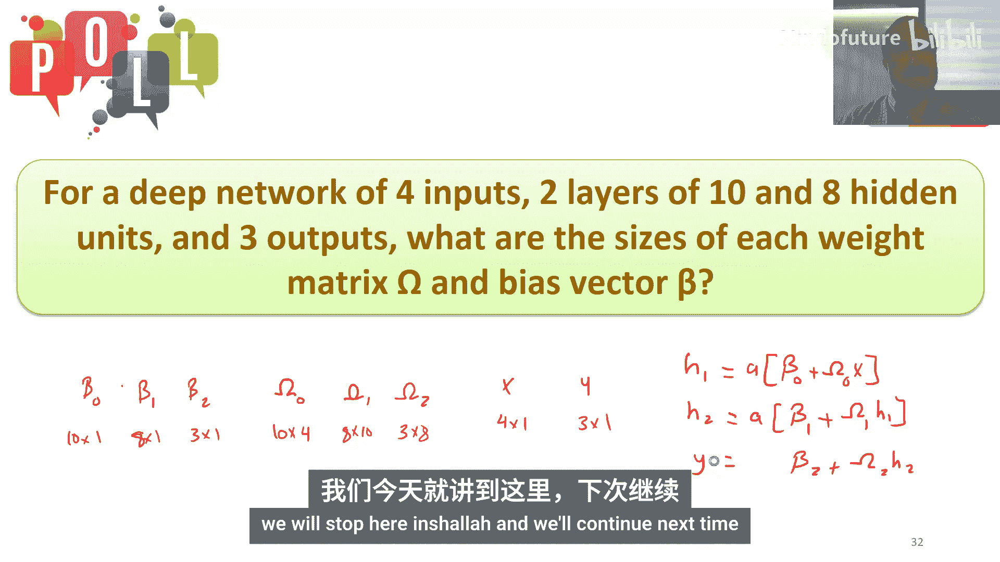

# 006：深度神经网络 🧠

在本节课中，我们将学习深度神经网络。我们将从回顾浅层网络开始，然后扩展到具有多个隐藏层的深度网络，理解其工作原理、优势以及如何用更紧凑的数学符号表示它们。

---

## 课程回顾 📚

上一讲我们介绍了浅层神经网络，它只有一个隐藏层。我们看到了如何通过增加输入和输出的数量来构建更复杂的模型，并且了解到每个输出都是一个分段线性函数，且所有输出函数在相同的输入点处具有“关节”。

本节中，我们将把这个概念扩展到具有多个隐藏层的深度神经网络。

---

## 深度神经网络：从两层开始 🏗️

深度神经网络与浅层网络的主要区别在于隐藏层的数量。浅层网络只有一个隐藏层，而深度网络则拥有一个以上的隐藏层。

让我们先看一个具有两个隐藏层的网络示例。

### 数学表示

对于一个两层的神经网络，其计算过程可以分解为多个方程。第一隐藏层的计算与浅层网络相同：每个隐藏单元是输入的线性加权和，然后通过激活函数。

第二隐藏层的计算也类似，但它的输入不再是原始输入 `x`，而是第一隐藏层的输出 `h`。因此，第二隐藏层的每个单元是前一层所有隐藏单元输出的加权和，再加上偏置，最后通过激活函数。

网络的最终输出则是最后一层隐藏单元输出的加权和（通常不加激活函数）。

如果我们将所有中间方程代入最终的输出方程，会得到一个非常庞大但仍然是单一的数学方程。这说明了无论网络多深，它本质上仍然是一个（复杂的）数学函数。

### 功能分解与可视化

为了理解深度网络如何生成更复杂的函数，我们可以沿用分解的思路。

1.  **视为“浅层”输出**：首先，忽略第二隐藏层的激活函数。此时，第二隐藏层的“预激活值”可以看作是一个具有三个输出的浅层网络的输出。正如我们之前所学，这三个输出将是三个具有相同“关节”位置的分段线性函数。
2.  **应用激活函数**：接着，我们对这三个分段线性函数应用激活函数（例如ReLU）。这会将每个函数的负值部分“裁剪”为0，从而在每个函数的“关节”处创建新的转折点，并改变函数的形状。
3.  **加权求和得到最终输出**：最后，我们将这三个被激活函数处理后的函数进行加权求和，并加上输出偏置。这个求和过程会将所有中间函数的“关节”和转折点组合起来，最终形成一个**分段更多、更复杂**的分段线性函数。

**核心概念**：增加隐藏层，相当于对前一层产生的分段线性函数进行“裁剪”（激活）和“混合”（加权求和）。每增加一层，都会引入更多潜在的“关节”，使模型能够拟合更复杂、更曲折的函数。

---

## 网络超参数 🔧

在构建神经网络时，我们需要决定一些结构性的选择，这些选择不是通过训练数据学习得到的，而是由我们在训练开始前设定的。它们被称为**超参数**。

两个最重要的架构超参数是：
*   **深度**：网络中隐藏层的数量，记为 `K`。
*   **宽度**：每个隐藏层中神经元的数量。通常如果各层宽度相同，这个数字就是网络的宽度。

**超参数与参数的区别**：
*   **参数**：指网络中的**权重（ω）** 和**偏置（β）**。这些值在训练过程中通过优化算法（如梯度下降）从数据中学习得到。对于固定的网络架构，参数决定了该架构所代表的函数族中的具体函数。
*   **超参数**：指网络的**深度（K）** 和**宽度**等。它们定义了网络架构本身。改变超参数，就相当于选择了一个不同的函数族。寻找最佳超参数的过程称为**超参数优化**，这通常需要尝试多种架构并分别进行训练来评估。

我们可以说，神经网络提供了一个**函数族的族**。超参数选择了具体的函数族，而训练参数则在该函数族中挑选出最终的函数。

---

## 紧凑的向量/矩阵表示法 📐

随着网络变深，用单个方程表示每个神经元会变得非常繁琐。为了更高效地表示和计算，我们引入向量和矩阵表示法。

### 表示法演进

对于一个两层的网络：
1.  **原始方程**：为每个神经元写出单独的求和与激活方程。
2.  **向量化**：将同一层的神经元值组合成向量（如 `h`），偏置组合成偏置向量（如 `β`），连接到前一层的权重组合成权重矩阵（如 `Ω`）。这样，整个层的计算可以写为：
    `h = a(β + Ω * x)`
    其中 `a(·)` 表示对向量中的每个元素独立应用激活函数。
3.  **统一符号**：为所有层使用统一的符号。通常用上标或下标表示层号。例如：
    *   `h^(1) = a(β^(0) + Ω^(0) * x)`
    *   `h^(2) = a(β^(1) + Ω^(1) * h^(1))`
    *   `y = β^(2) + Ω^(2) * h^(2)`

### 维度说明

理解各矩阵和向量的维度至关重要，它能确保计算在数学上有效。
*   **输入 `x`**：维度为 `D_in x 1`，`D_in` 是输入特征数。
*   **输出 `y`**：维度为 `D_out x 1`，`D_out` 是输出维度。
*   **第 `l` 层隐藏向量 `h^(l)`**：维度为 `D_l x 1`，`D_l` 是该层神经元数量。
*   **第 `l` 层偏置向量 `β^(l)`**：维度为 `D_(l+1) x 1`（对于连接 `l` 层到 `l+1` 层的偏置）。
*   **第 `l` 层权重矩阵 `Ω^(l)`**：维度为 `D_(l+1) x D_l`。它负责将第 `l` 层的输出（维度 `D_l x 1`）映射到第 `l+1` 层的预激活值（维度 `D_(l+1) x 1`）。

**这种表示法的优势**：
*   **表达简洁**：用几行公式就能描述任意深度的网络。
*   **计算高效**：现代计算库（如NumPy, PyTorch, TensorFlow）可以高度优化矩阵运算，实现并行计算，速度远快于循环计算每个神经元。
*   **便于实现**：在代码中，前向传播几乎可以直接按照这些向量化公式来编写。

---

## 深度 vs. 浅层网络 ⚖️

现在，我们可以总结深度网络与浅层网络的主要对比：

*   **模型容量**：深度网络通过嵌套的非线性变换，可以创建具有**更多分段**的分段线性函数。这赋予了它更强的**函数逼近能力**，能够建模更复杂、更精细的数据模式。
*   **参数效率**：对于表达相同复杂度的函数，深度网络有时比浅层网络所需的神经元总数更少，即参数效率可能更高。
*   **计算与优化**：深度网络的前向传播和反向传播计算量更大，也更复杂。同时，训练深度网络可能更困难，例如可能遇到梯度消失/爆炸等问题。
*   **直观理解**：浅层网络的函数形状（分段线性）相对容易可视化理解。深度网络的行为则更复杂、更不直观，但其强大的能力使其在图像、语音、自然语言处理等领域取得了突破性成功。

---

## 总结 🎯

本节课中我们一起学习了：
1.  **深度神经网络**通过堆叠多个隐藏层来构建。每一层都对前一层的输出进行线性变换后接非线性激活。
2.  深度网络可以生成**分段数远多于浅层网络**的复杂分段线性函数，拟合能力更强。
3.  网络的**深度**和**宽度**是关键的**超参数**，它们在训练前设定，定义了模型架构的搜索空间。
4.  引入了**向量和矩阵表示法**，用 `h = a(β + Ω * x)` 这样的紧凑形式描述每一层，这对于高效计算和简洁理论分析至关重要。
5.  比较了深度与浅层网络，认识到深度网络在模型容量上的优势及其在实现上的复杂性。

理解深度网络的基础原理和表示法，是学习更复杂架构（如卷积神经网络、循环神经网络）和掌握现代深度学习实践的关键第一步。