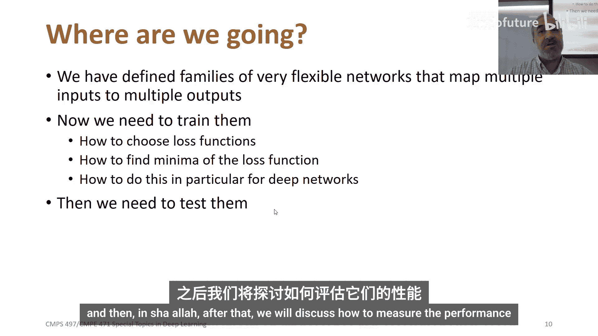
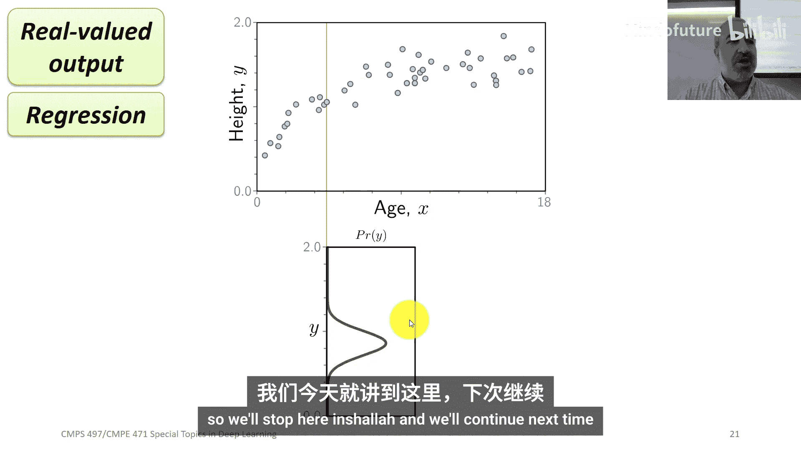

# 007：损失函数 I

在本节课中，我们将学习损失函数。首先，我们将回顾深度网络相较于浅层网络的几个优势特性。接着，我们将从预测单一输出值转向预测概率分布，并引入最大似然估计的概念，这是构建损失函数的核心思想。我们将探讨如何为不同类型的问题设计合适的损失函数。

## 深度网络的优势

上一节我们介绍了深度网络的基本结构。本节中，我们来看看深度网络相较于浅层网络（仅有一个隐藏层）的几个关键优势。

### 线性区域数量

对于固定的参数预算，深度网络能产生比浅层网络更多的线性区域。

*   **公式**：对于一个深度网络，其线性区域的数量随网络深度（层数）的增加而呈指数级增长。
*   **对比**：假设总参数量相同。将这些参数全部放在一个浅层网络中，其能划分的线性区域数量有限。若将这些参数分配到多个层中形成一个深度网络，它能划分的线性区域数量会显著增加。这意味着深度网络能以相同的计算成本，表达更复杂的函数。

### 深度效率

为了逼近同一个目标函数，深度网络所需的神经元（参数）数量可能远少于浅层网络。

*   **核心概念**：深度效率意味着，使用深度结构可以更高效地表示某些函数。一个浅层网络可能需要指数级多的隐藏单元才能达到一个深度网络用较少单元就能实现的近似效果。
*   **现实意义**：虽然并非所有现实世界的函数都表现出这种特性，但在许多复杂任务（如图像识别、自然语言处理）中，深度网络已被证明是更高效的选择。

### 结构化处理能力

深度网络天然支持结构化的、层次化的信息处理，这对于处理如图像、文本等具有内在结构的数据至关重要。

以下是深度网络处理图像时的层次化过程示例：
1.  底层检测边缘和纹理等低级特征。
2.  中间层组合这些低级特征，形成形状和部件等中级特征。
3.  高层进一步组合，识别出完整的物体（如人脸、汽车）。

这种逐层抽象的处理方式，在单一的浅层网络中难以实现，因为浅层网络缺乏层与层之间的交互来构建这种层次结构。

### 训练更容易

在达到一定深度之前，训练深度模型通常比训练浅层模型更容易、更快。

*   **实验观察**：在相同训练数据量下，增加网络层数（在一定范围内）可以使模型更快地达到较低的训练误差。
*   **两种理解角度**：
    1.  为了达到相同的性能（如5%的错误率），深度网络所需的训练时间或数据量更少。
    2.  在相同的时间或数据预算下，深度网络通常能获得更好的性能。

## 从预测值到概率分布

在之前的所有模型中，无论是线性回归还是神经网络，模型都是直接输出一个预测值 `y_hat`。现在，我们将改变这一范式。

我们将不再让模型直接预测输出值 `y`，而是让它预测一个**条件概率分布** `P(Y | X; θ)`。这里，`θ` 代表模型参数。

*   **含义**：对于给定的输入 `X`，模型输出的是所有可能输出 `Y` 的一个概率分布。
*   **回归示例**：预测身高。模型不再只输出“1.1米”，而是输出一个概率密度函数（如高斯分布），其峰值可能在1.1米附近，并有一个方差表示不确定性。峰值越高、方差越小，模型对“输出为1.1米”就越确定。
*   **分类示例**：判断邮件是否为垃圾邮件。模型输出一个离散概率分布，例如 `P(垃圾邮件)=0.7`, `P(非垃圾邮件)=0.3`。

这种转变的核心优势在于，概率分布能够自然地表达模型预测的**不确定性**。

## 损失函数与最大似然估计

既然模型的输出变成了概率分布，我们的目标也随之改变。我们希望模型为**训练数据中观察到的真实输出值** `y_true` 分配高的概率。

**最大似然估计** 正是这一思想的体现：我们寻找能使观测到的数据出现概率最大的模型参数。

*   **损失函数的作用**：损失函数应量化模型预测的概率分布与真实情况之间的差异。当模型为真实标签分配的概率很低时，损失应该很大（高惩罚）；当分配的概率很高时，损失应该很小（低惩罚）。
*   **设计思路**：因此，一个自然的损失函数是**负对数似然**。最大化似然等价于最小化负对数似然。
    *   **公式**：`Loss = -log( P(y_true | X; θ) )`
    *   **解释**：如果 `P(y_true)` 接近1，`-log(P)` 接近0（损失小）。如果 `P(y_true)` 接近0，`-log(P)` 会变得非常大（损失大）。这完美符合我们的惩罚逻辑。

## 数学基础回顾

在深入具体损失函数之前，我们需要回顾两个重要的数学函数，它们在构建损失函数时经常出现。

*   **指数函数**：`exp(x) = e^x`
    *   性质：`exp(0) = 1`, `exp(-∞) = 0`，是单调递增函数。
*   **自然对数函数**：`log(x)` (以 `e` 为底)
    *   性质：`log(1) = 0`, `log(0) = -∞`，定义域为 `(0, +∞)`，是单调递增函数。
    *   重要运算法则：`log(a * b) = log(a) + log(b)`

这两个函数互为反函数：`log(exp(z)) = z`。

## 总结

本节课中我们一起学习了：
1.  **深度网络的优势**：包括能产生更多线性区域、具有深度效率、适合结构化处理以及通常更容易训练。
2.  **预测范式的转变**：从直接预测输出值转变为预测条件概率分布，以表达模型的不确定性。
3.  **损失函数的核心原理**：基于最大似然估计，通过最小化负对数似然来设计损失函数，旨在鼓励模型为真实数据赋予高概率。
4.  **关键数学工具**：指数函数和对数函数及其性质。

下一节，我们将把这些原理应用到具体问题中，推导出回归和分类任务中常用的损失函数，例如均方误差和交叉熵损失。