# 008：损失函数 II

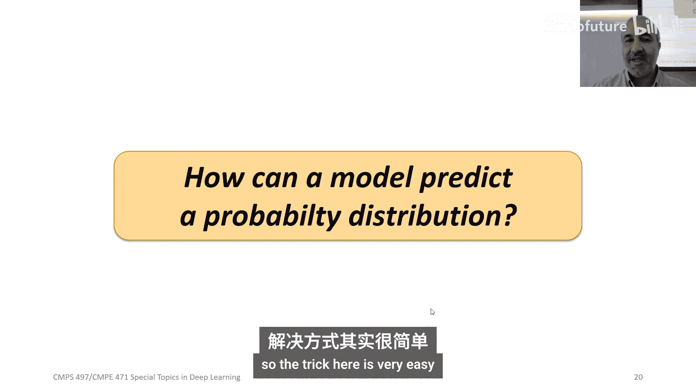

在本节课中，我们将继续深入探讨损失函数，特别是如何通过概率分布的视角来构建适用于不同问题的损失函数。我们将学习最大似然估计的核心思想，并将其转化为可优化的损失函数。

上一讲我们开始转变对模型输出的看法，不再直接预测输出值，而是预测输出值可能取值的概率分布。根据问题的类型，我们会选择一个合适的概率分布。对于连续值输出，可以选择正态分布；对于离散值输出，可以选择分类分布。我们假设模型将预测这个概率分布，而不是单一值。你可以这样理解：模型将为每一个可能的输出值分配一个概率。

## 构建损失函数的步骤

以下是构建基于概率分布的损失函数的通用步骤。

### 第一步：选择合适的概率分布

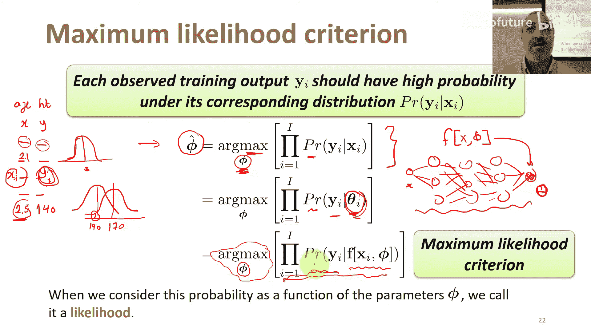

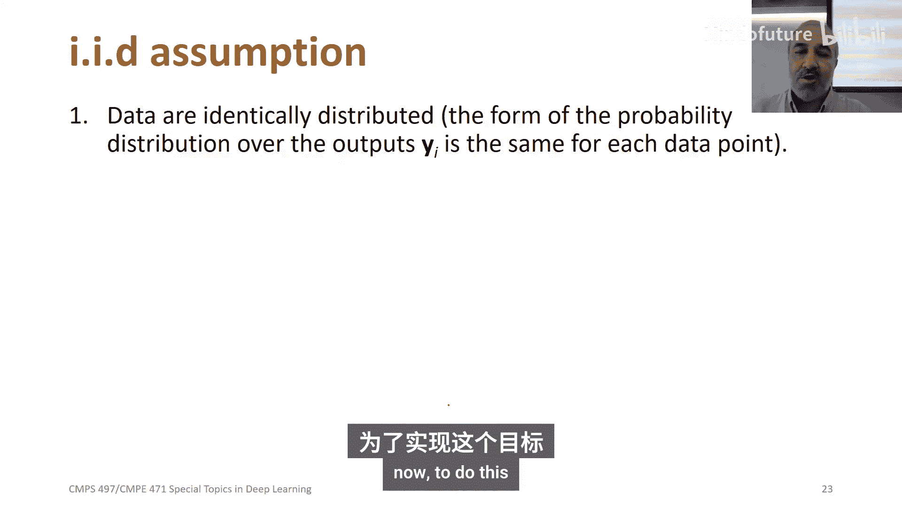

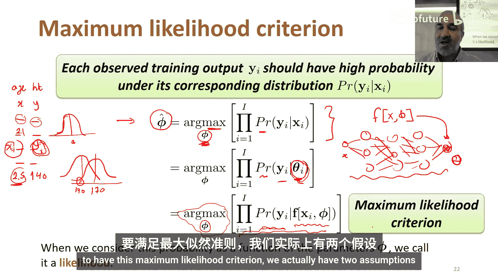

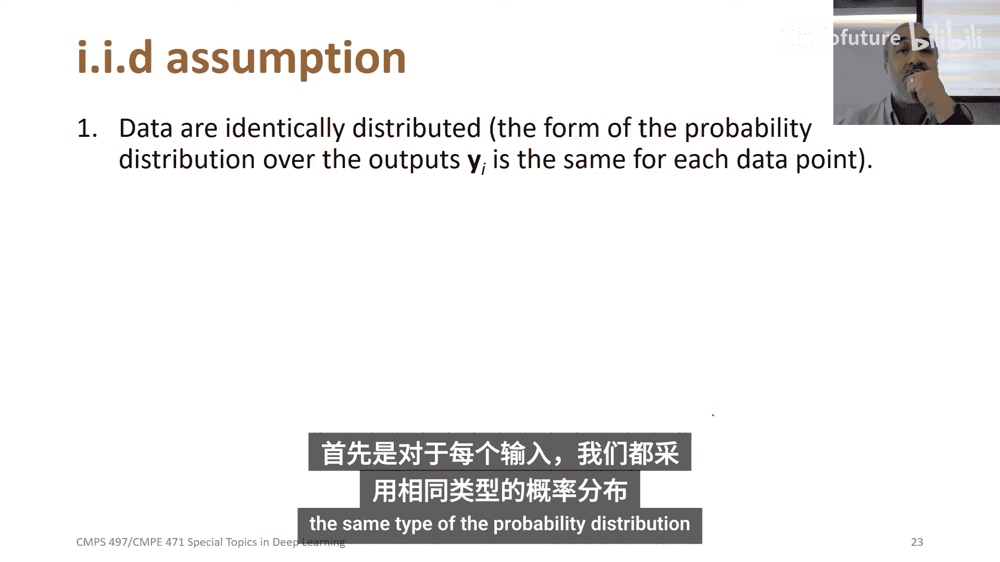

首先，根据输出值的类型（连续或离散）和范围，选择一个合适的参数化概率分布。例如，对于回归问题（连续输出），正态分布是一个常见选择。参数化分布是指其形状由一组参数决定的分布，例如正态分布由均值（μ）和方差（σ²）两个参数决定。

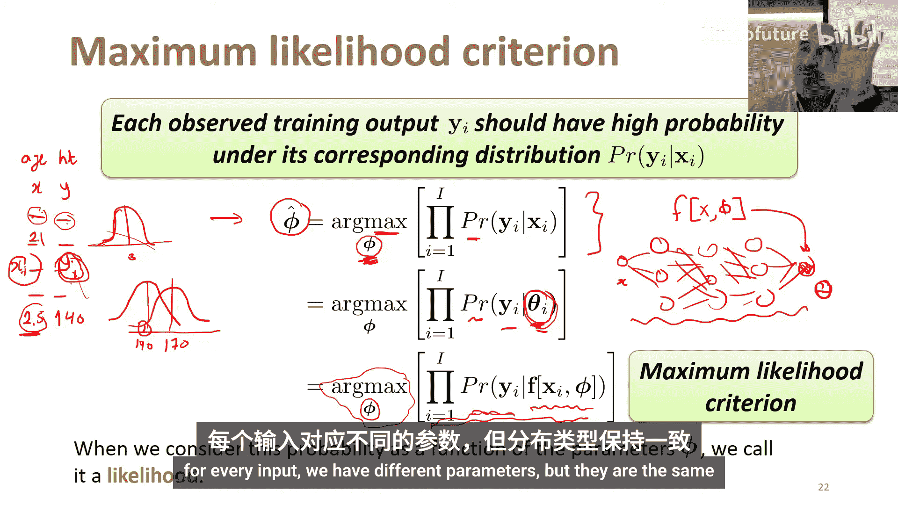

### 第二步：设定模型输出为分布参数

我们设计模型（如神经网络），使其输出层不再直接预测最终值，而是预测所选概率分布的参数。例如，如果选择正态分布，则模型输出可以是均值 μ，或者同时输出均值 μ 和方差 σ²。

用公式表示，模型是一个函数：`θ_i = f(x_i; φ)`。其中：
*   `θ_i` 是模型为第 `i` 个输入 `x_i` 预测的分布参数。
*   `φ` 是模型自身的参数（如神经网络的权重和偏置）。

### 第三步：定义并优化损失函数（负对数似然）

我们的目标是让模型为训练数据中的正确答案分配高概率。这通过最大化似然函数来实现。似然函数是所有训练样本上，模型为真实输出 `y_i` 分配的概率的乘积：
`L(φ) = ∏_i P(y_i | θ_i = f(x_i; φ))`

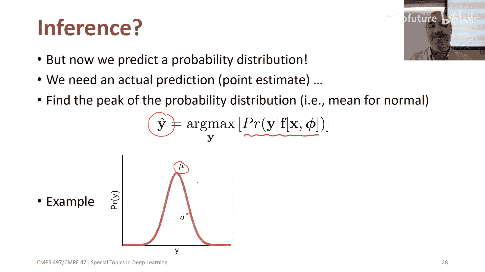

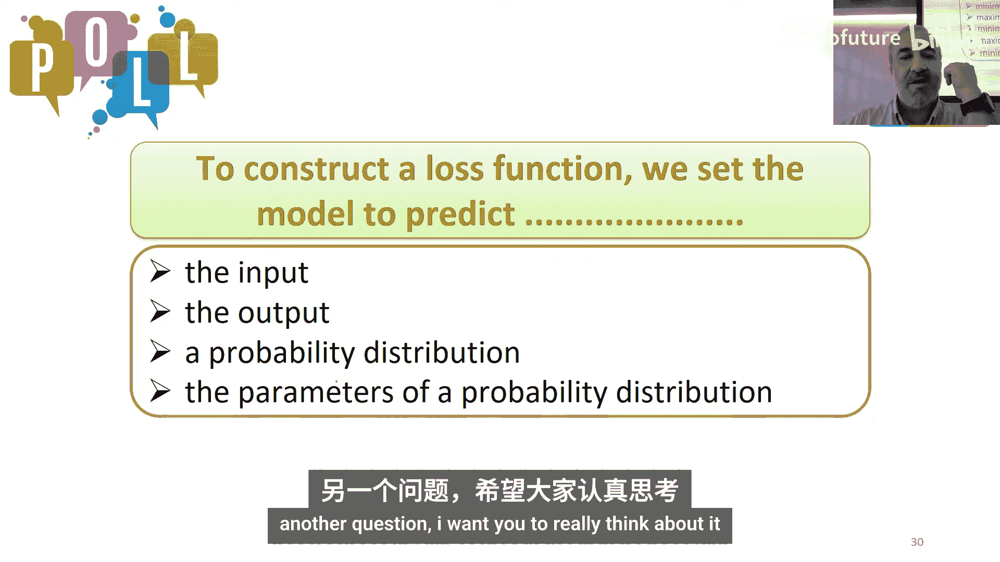

为了数值计算的稳定性（避免连乘导致下溢），我们对其取对数，得到对数似然函数。由于优化算法通常最小化目标，我们取负对数似然作为损失函数：
`Loss(φ) = -∑_i log P(y_i | θ_i = f(x_i; φ))`

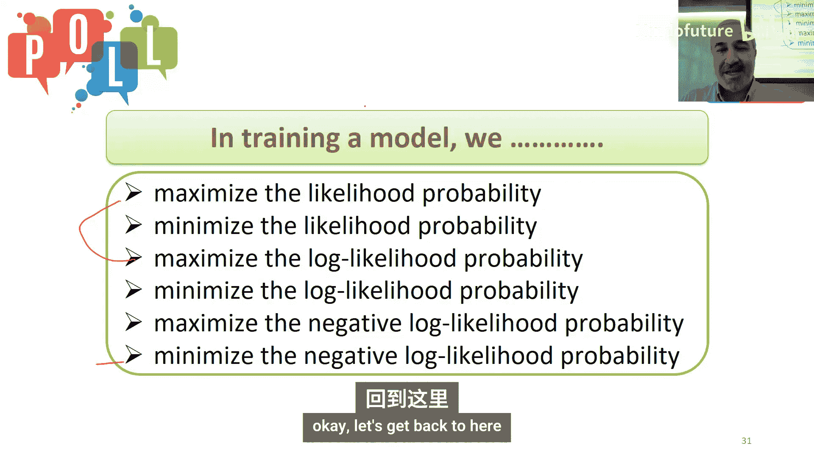

通过最小化这个损失函数，我们就能找到最优的模型参数 `φ`。

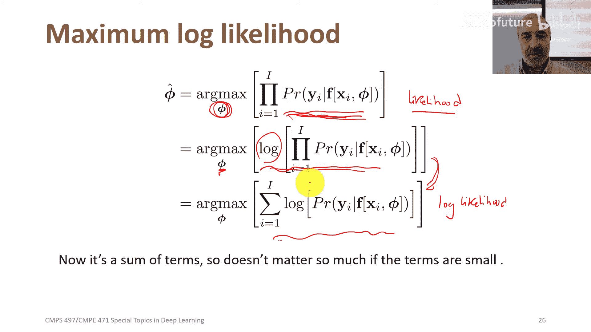

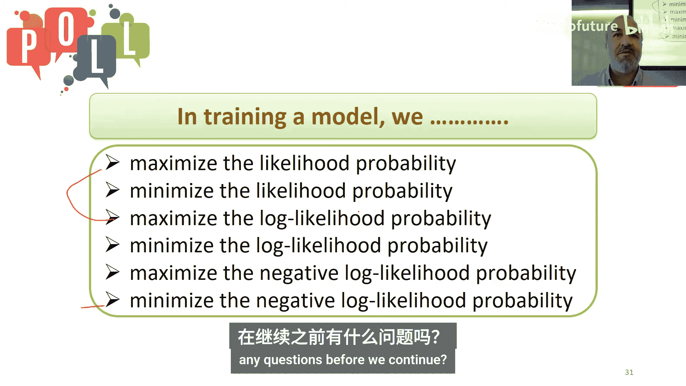

### 第四步：推理时获取预测值

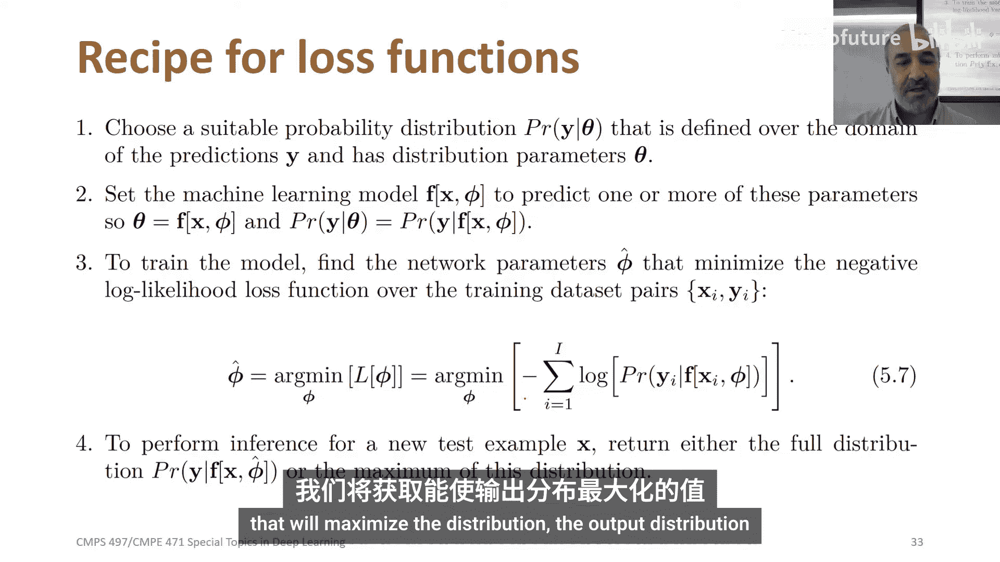

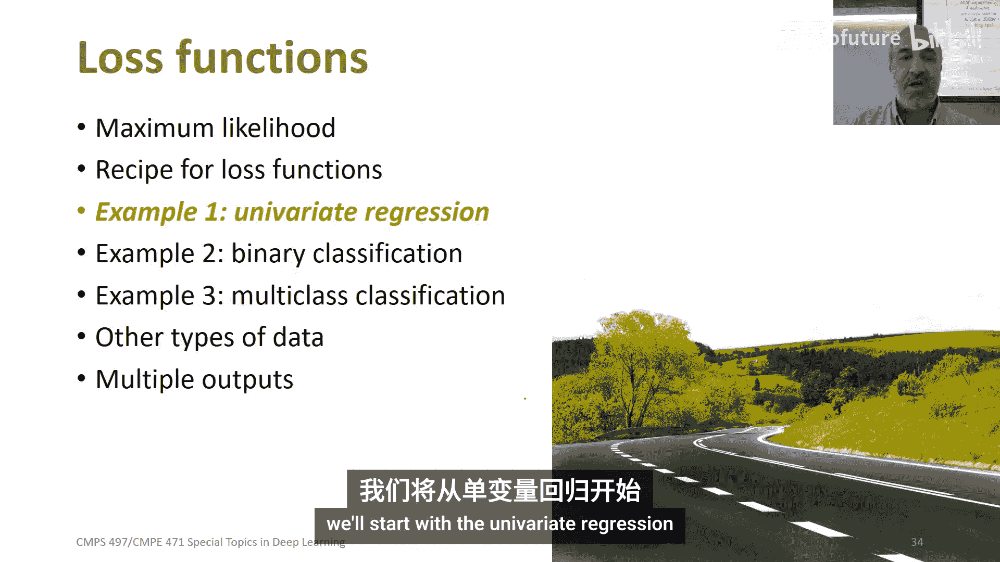

训练好模型后，对于新的输入，模型会输出一个概率分布。为了得到一个具体的预测值，我们取该分布中概率最高的值。对于正态分布，概率最高点就是均值 `μ`，这恰好是模型的直接输出。

## 实例分析：回归问题与最小二乘法

让我们通过一个回归问题的例子，看看上述步骤如何推导出熟悉的损失函数。

**问题**：给定房屋信息，预测其价格（连续值输出）。

1.  **选择分布**：输出为连续值，我们选择正态分布。其概率密度函数为：
    `P(y | μ, σ²) = (1/√(2πσ²)) * exp(-(y-μ)²/(2σ²))`

2.  **设定模型输出**：假设方差 σ² 是一个常数（我们暂时不预测它）。模型 `f(x; φ)` 的输出设定为正态分布的均值 `μ`。即 `μ = f(x; φ)`。

3.  **定义损失函数**：将模型输出代入负对数似然公式。
    ```
    Loss(φ) = -∑_i log [ P(y_i | μ=f(x_i;φ), σ²) ]
            = -∑_i log [ (1/√(2πσ²)) * exp(-(y_i - f(x_i;φ))²/(2σ²)) ]
    ```
    利用对数运算性质展开：
    ```
    Loss(φ) = -∑_i [ log(1/√(2πσ²)) - (y_i - f(x_i;φ))²/(2σ²) ]
            = ∑_i [ (y_i - f(x_i;φ))²/(2σ²) - log(1/√(2πσ²)) ]
    ```
    由于 σ² 是常数，上式中的 `- log(1/√(2πσ²))` 项也是常数，在最小化过程中可以忽略。同时，乘以常数因子 `1/(2σ²)` 不影响最小值点。因此，最小化上述损失函数等价于最小化：
    ```
    Loss_simple(φ) = ∑_i (y_i - f(x_i;φ))²
    ```
    这正是我们熟悉的**最小二乘损失函数**。这表明，在输出误差服从固定方差的正态分布这一假设下，最小二乘法等价于最大似然估计。

4.  **推理**：对于新输入 `x_new`，模型的预测值就是其输出 `y_hat = f(x_new; φ)`，这对应于正态分布的均值，也是概率最高的点。

## 总结

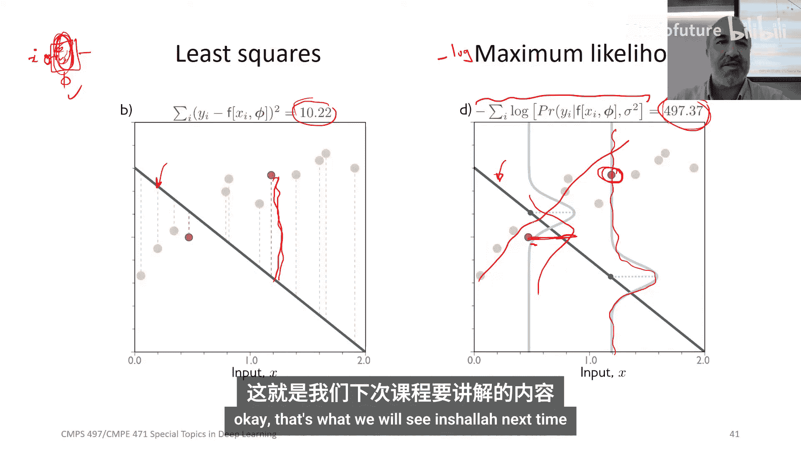

本节课中，我们一起学习了如何从概率视角构建损失函数。核心思想是让模型预测一个概率分布，并通过最大化该分布为真实数据分配的概率（最大似然估计）来训练模型。我们将其转化为可最小化的负对数似然损失函数，并通过回归问题的实例，验证了在特定假设下该框架与最小二乘法的等价性。下一讲我们将探讨当不假设方差为常数时，应如何处理。