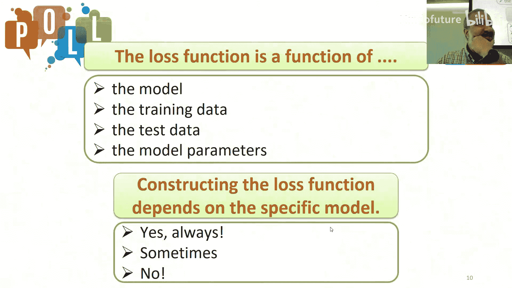
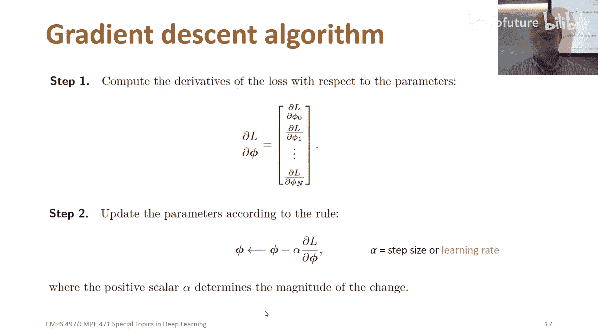
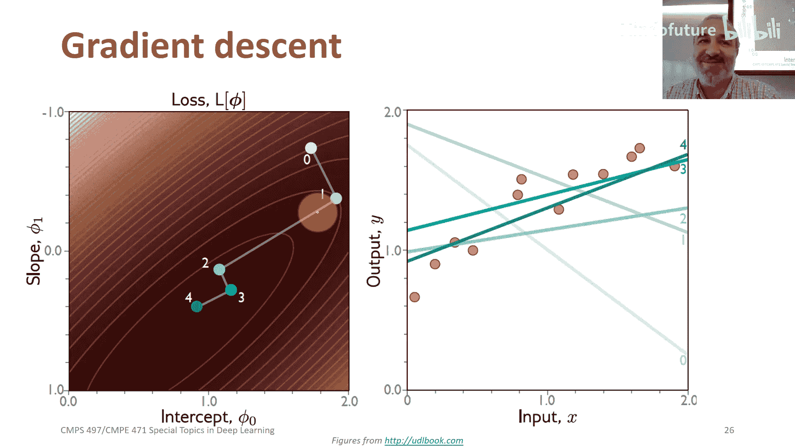
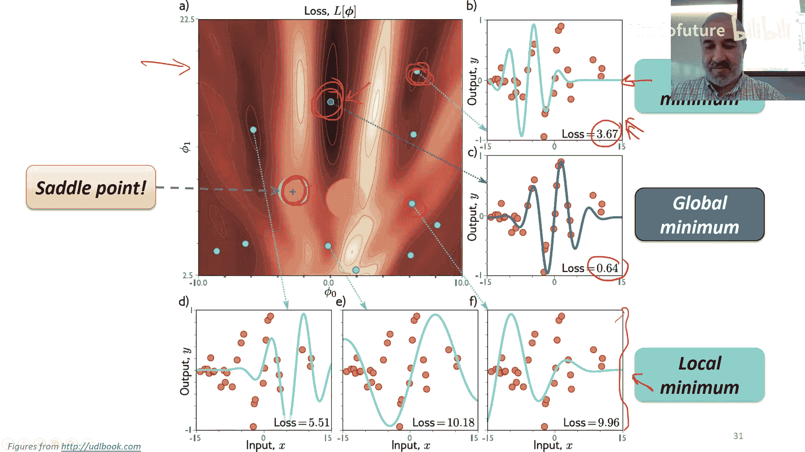
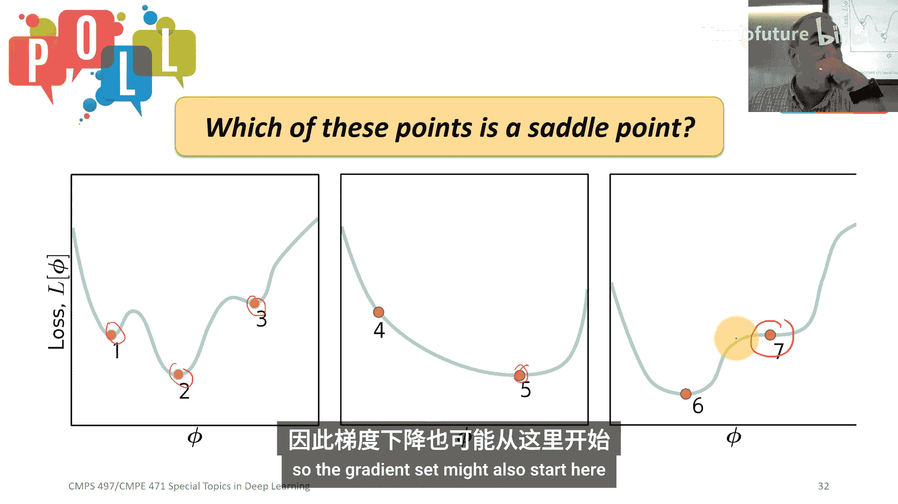
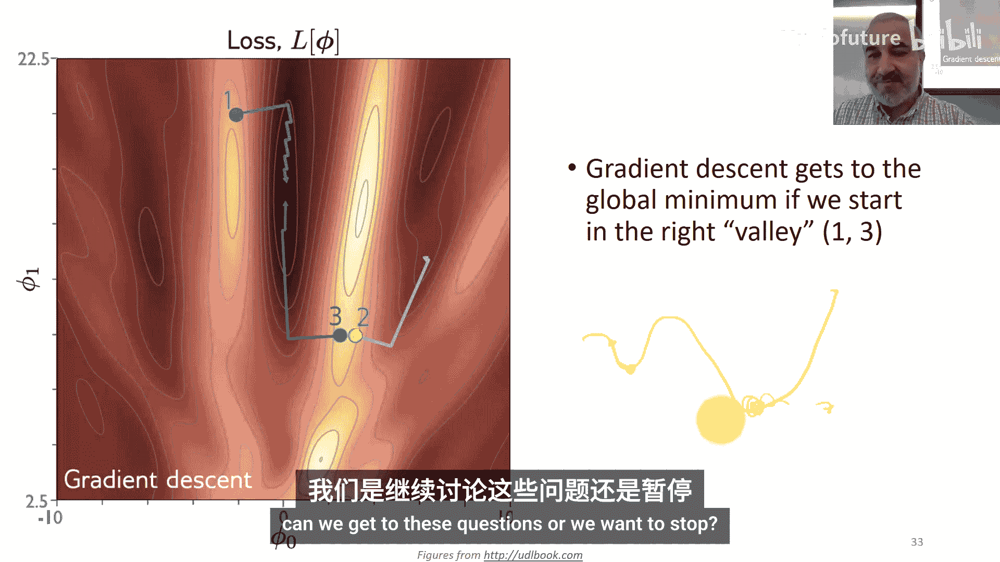

# 010：模型拟合 I 🧠

在本节课中，我们将学习如何训练（或称“拟合”）一个深度学习模型。我们将从回顾上一讲未完成的内容开始，即如何为具有多个输出的模型构建损失函数。接着，我们将正式进入模型拟合的主题，理解梯度下降这一核心优化算法的原理，并通过线性回归和高斯模型两个例子，直观地展示其工作过程。

## 多输出模型的损失函数 🔄

上一讲我们介绍了如何为单一输出构建损失函数。本节中，我们来看看当模型需要预测多个输出时，应如何处理。

假设我们的应用需要预测一个化学结构的两个属性：**凝固点**和**沸点**。这意味着我们的模型有两个输出。

构建损失函数的第一步，是为每个输出选择一个合适的概率分布。为了使问题简化，我们假设这些输出是**相互独立**的。因此，整个输出的联合概率分布就是每个输出概率分布的乘积。

**公式**：`P(Y | X) = ∏_{d=1}^{D} P(Y_d | X)`，其中 `D` 是输出的数量（本例中为2）。

接下来，我们使用负对数似然来构建损失函数。由于我们取了对数，概率的乘积就转换为了对数的和。

**公式**：`L = -∑_{i=1}^{N} log P(Y_i | X_i) = -∑_{i=1}^{N} ∑_{d=1}^{D} log P(Y_{i,d} | X_i)`。

这里，`i` 索引训练数据，`d` 索引输出维度。

对于回归问题，我们通常为每个输出选择正态分布。每个分布有自己的均值 `μ_d`，我们可以假设方差 `σ^2` 是常数（或为每个输出学习不同的方差）。模型的输出 `f_d(X)` 被用来预测这些均值 `μ_d`。

因此，一个具有两个输出的神经网络，其最后一层将有两个神经元，分别预测 `μ_1` 和 `μ_2`。

**一个重要的注意事项**：当多个输出的数值尺度（例如，体重以公斤计，身高以米计）差异很大时，损失函数会更多地被尺度较大的输出所主导。这可能导致模型忽略对尺度较小输出的优化。

以下是两种解决方案：
1.  **数据重缩放**：在训练前，将每个输出缩放到相近的尺度（例如，都缩放到均值为0，方差为1）。在模型预测后，再将结果缩放回原始尺度。
2.  **学习方差**：不再假设方差为常数，而是让模型也为每个输出预测一个方差 `σ_d^2`。这样，损失函数会自动考虑不同输出的尺度差异。

## 模型拟合与梯度下降 🎯

现在，我们已经有了模型（带参数）和损失函数。下一步就是找到能使损失函数最小化的模型参数值，这个过程称为**模型拟合**或**训练**。

我们的目标是：`θ* = argmin_θ L(θ)`，其中 `θ` 代表模型的所有参数。

实现此目标最核心的算法是**梯度下降**。其思想源于微积分：函数的梯度（即各参数的偏导数向量）指向函数值**增长最快**的方向。因此，要**最小化**函数，我们应沿梯度的**反方向**更新参数。

梯度下降包含两个核心步骤：
1.  **计算梯度**：计算损失函数 `L` 关于每个参数 `θ_j` 的偏导数，形成梯度向量 `∇L(θ)`。
2.  **更新参数**：按照以下规则更新所有参数：
    **公式**：`θ_new = θ_old - α * ∇L(θ_old)`。
    其中，`α` 是一个很小的正数，称为**学习率**，用于控制每次更新的步长，确保更新是微小且可控的。

这个过程会迭代进行多次。每次迭代，我们都会计算当前参数下的梯度，然后沿负梯度方向迈出一小步，期望损失函数值随之下降。

## 示例一：线性回归 📈

让我们在线性回归模型上应用梯度下降。模型为：`y_pred = θ_0 + θ_1 * x`，损失函数为均方误差：`L = ∑_i (y_i - (θ_0 + θ_1 * x_i))^2`。

其梯度为：
*   `∂L/∂θ_0 = -2 * ∑_i (y_i - (θ_0 + θ_1 * x_i))`
*   `∂L/∂θ_1 = -2 * ∑_i (y_i - (θ_0 + θ_1 * x_i)) * x_i`

下图展示了梯度下降的过程：
1.  我们从参数空间中的一点（对应一条特定的直线）开始。
2.  计算该点的梯度（图中红色和绿色箭头分别指示了 `∂L/∂θ_1` 和 `∂L/∂θ_0` 的方向）。
3.  我们沿负梯度方向（即与红/绿箭头相反的方向）更新参数，到达一个新的点（对应一条新的直线）。
4.  重复此过程，损失函数值逐渐降低，拟合的直线也越来越接近数据点。

**线性回归的损失函数是凸函数**，这意味着它只有一个全局最小值。对于凸函数，梯度下降能够保证找到这个全局最优解。

## 示例二：高斯模型与局部极小值 🏔️

然而，并非所有损失函数都是凸的。考虑一个更复杂的“高斯模型”（混合了正弦和指数函数的模式），其损失函数曲面如下图所示：

这个曲面存在多个**局部最小值**和一个**全局最小值**。梯度下降的最终结果**强烈依赖于参数的初始值**：
*   如果从点1或点3开始，梯度下降会引导我们到达全局最小值，得到最优拟合。
*   如果从点2开始，梯度下降可能会陷入一个局部最小值，无法达到全局最优，得到的模型拟合效果较差。

此外，损失函数曲面还可能存在**鞍点**（梯度为零但既非极小也非极大的点），梯度下降也可能在此处停滞。

这些情况（非凸损失函数、局部极小值、鞍点）是深度学习模型训练中的主要挑战。后续课程将讨论更先进的优化技术（如带动量的梯度下降、Adam等）来尝试缓解这些问题。

## 总结 📝

本节课中我们一起学习了：
1.  **多输出损失函数**的构建方法，关键在于假设输出独立并使用概率分布的乘积，同时需注意处理不同输出尺度差异的问题。
2.  **模型拟合**的核心目标是最小化损失函数。
3.  **梯度下降算法**的基本原理：通过计算损失函数的梯度，并沿负梯度方向迭代更新模型参数，使损失值减小。
4.  通过**线性回归**示例，我们看到了梯度下降在凸函数上的有效工作流程。
5.  通过**高斯模型**示例，我们认识到**非凸损失函数**中存在的**局部极小值**和**鞍点**问题，这些是梯度下降算法面临的挑战，也是我们后续需要深入探讨的方向。