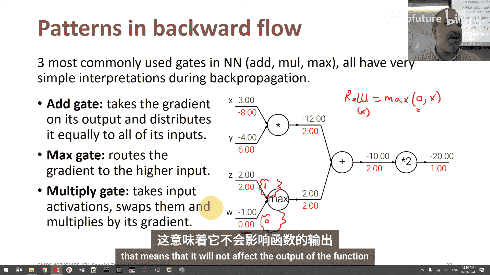
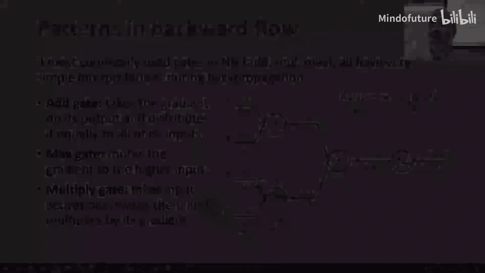

# 012：优化算法与梯度计算 🧠

在本节课中，我们将完成关于模型拟合的讨论。我们将介绍一种非常常用的优化算法——Adam。Adam是我们上一讲讨论的随机梯度下降和动量思想的扩展。之后，我们将深入探讨如何高效地计算梯度，这是训练神经网络的核心挑战之一。

## 优化算法：Adam 🚀

上一讲我们讨论了随机梯度下降，它不是在所有样本上计算损失，而是在小批量数据上计算。这给损失值带来了一些随机噪声，其效果是可能帮助我们避免陷入局部最小值。我们还讨论了动量的概念，它不仅考虑当前批次的梯度，还考虑之前批次的梯度，通过一个权重递减的无限加权和来实现。

### 梯度归一化的动机

我们之前讨论过学习率。任何参数更新都是学习率与梯度值的乘积。如果学习率固定，那么更新完全由梯度值控制。对于不同的参数，如果某个参数的梯度非常小，那么该参数的更新就会非常小；如果梯度非常大，更新也会非常大。这会带来问题。

考虑一个具有两个参数（φ0 和 φ1）的损失函数。在某个方向上（例如 φ1），损失值变化很大，梯度很高；而在另一个方向上（例如 φ0），损失值变化很小，梯度很低。这意味着 φ1 的更新步长会很大，而 φ0 的更新步长会非常小，导致收敛速度极慢。如果为了加快 φ0 的更新而提高学习率，又可能导致 φ1 方向上的更新过大，产生振荡，无法到达全局最小值。

### 归一化梯度

解决这个问题的一个方案是进行**梯度归一化**。我们希望沿着每个参数轴（即每个方向）移动固定的距离，而不是让某些参数更新很大，另一些更新很小。概念上，我们可以只取梯度的符号，将其绝对值设为1。也就是说，如果梯度为正，更新方向为+1；如果为负，更新方向为-1。这样，所有参数的更新幅度就相同了。

具体实现时，我们保留原始梯度 `M`，并计算其逐元素的平方 `V = M^2`。然后，我们用梯度除以平方根的近似值（加上一个很小的 ε 防止除零）来进行归一化：
`M_normalized = M / sqrt(V + ε)`
这实质上等同于保留梯度的符号，并将其幅度归一化为1。这样，每个参数的更新步长就变得一致了。

### Adam算法：自适应矩估计

Adam算法，全称为自适应矩估计，结合了梯度归一化和动量两个思想。

1.  **动量计算**：它不仅对梯度本身应用动量，也对梯度的平方应用动量。这引入了两个超参数 β 和 γ。
    *   `m_t+1 = β * m_t + (1-β) * g_t` （梯度动量）
    *   `v_t+1 = γ * v_t + (1-γ) * g_t^2` （梯度平方动量）
2.  **归一化**：使用计算出的动量值进行归一化。
    *   `m_hat = m_t+1 / (1 - β^(t+1))`
    *   `v_hat = v_t+1 / (1 - γ^(t+1))`
    *   参数更新：`θ_t+1 = θ_t - α * m_hat / (sqrt(v_hat) + ε)`
3.  **偏置校正**：公式中的 `(1 - β^(t+1))` 和 `(1 - γ^(t+1))` 是偏置校正项。因为在训练初期，动量值 `m` 和 `v` 初始化为0，会导致更新非常小。这个校正项在初期会放大更新值，随着迭代次数增加，其影响逐渐减弱至1，从而确保训练初期有足够的探索步长。

Adam是目前最广泛使用的优化算法之一，通常是训练神经网络时的默认选择。它能够平滑更新过程，有效处理不同参数梯度尺度差异大的问题，并通常能很好地收敛。

### 超参数回顾

在模型训练中，我们需要区分**参数**和**超参数**。
*   **参数**：是模型在训练过程中学习和调整的变量，例如神经网络中的权重和偏置。
*   **超参数**：是在训练开始前设定的、控制训练过程的配置。训练过程中，超参数通常是固定的。

我们目前接触到的超参数包括：
*   网络结构相关：隐藏层数、每层隐藏单元数。
*   优化算法相关：学习率 α、Adam中的动量系数 β 和 γ。
*   训练过程相关：迭代周期数、批次大小。
*   其他：优化算法本身的选择、损失函数的选择（理论上）。

---

## 梯度计算：反向传播 🔄

优化算法（如梯度下降及其变体）面临两大挑战：
1.  需要高效计算损失函数关于所有参数的梯度。对于拥有数百万甚至数十亿参数的现代神经网络，为每个样本、每个参数、每次迭代都计算梯度是一项巨大的计算任务。
2.  模型参数的初始化对训练结果有重大影响。不同的起点可能导致收敛到不同的局部最优解。

本节我们将重点解决第一个挑战，介绍一种高效计算梯度的著名算法——**反向传播**。反向传播不仅适用于神经网络，也适用于任何可微函数。

### 计算图与链式法则

反向传播的核心思想是利用**计算图**和**链式法则**。计算图将复杂的函数分解为一系列简单的运算（称为“门”或“节点”），例如加法、乘法、指数运算等。

考虑一个简单函数：`f(x, y, z) = (x + y) * z`。我们可以将其构建为如下计算图：
1.  输入节点：x, y, z
2.  中间节点 q = x + y （加法门）
3.  输出节点 f = q * z （乘法门）

我们的目标是计算损失函数 `f` 关于所有输入（x, y, z）的梯度（即 `∂f/∂x`, `∂f/∂y`, `∂f/∂z`）。

反向传播分为三个步骤：

**步骤一：前向传播**
给定输入值（例如 x=-2, y=5, z=-4），从左到右计算每个节点的输出值。
*   q = (-2) + 5 = 3
*   f = 3 * (-4) = -12
同时，在每个门（节点）处，计算其**局部梯度**，即该节点的输出关于其每个输入的导数。
*   加法门 (q = x+y): ∂q/∂x = 1, ∂q/∂y = 1
*   乘法门 (f = q*z): ∂f/∂q = z = -4, ∂f/∂z = q = 3
关键点：局部梯度的计算只依赖于该门的运算和当前的输入值，与其他门无关。

**步骤二：反向传播（计算全局梯度）**
从最终输出开始，向后计算损失函数关于每个变量的梯度。
1.  初始化：∂f/∂f = 1。
2.  到达乘法门：已知从后方传来的梯度是 ∂f/∂f = 1。根据链式法则：
    *   ∂f/∂q = (∂f/∂f) * (∂f/∂q的局部梯度) = 1 * (-4) = -4
    *   ∂f/∂z = (∂f/∂f) * (∂f/∂z的局部梯度) = 1 * 3 = 3
3.  到达加法门：已知从后方传来的梯度是 ∂f/∂q = -4。根据链式法则：
    *   ∂f/∂x = (∂f/∂q) * (∂q/∂x的局部梯度) = (-4) * 1 = -4
    *   ∂f/∂y = (∂f/∂q) * (∂q/∂y的局部梯度) = (-4) * 1 = -4

至此，我们得到了所有需要的梯度：∂f/∂x = -4, ∂f/∂y = -4, ∂f/∂z = 3。这个过程就像每个门都在向后传递一个信号，告诉前面的变量：“如果你改变一点，会对最终输出产生多少影响”。

### 应用于神经网络节点

反向传播可以系统性地应用于神经网络。一个神经元的计算（如加权和加上偏置，再通过激活函数）可以自然地表示为一个计算图。

例如，一个使用Sigmoid激活函数的神经元计算：`f = σ(w0*x0 + w1*x1 + b)`，其中 `σ(x) = 1 / (1 + e^(-x))`。
我们可以将其分解为多个基本门（乘法、加法、取负、指数、加1、取倒数），并按照上述前向-反向流程计算 `f` 关于 `w0`, `w1`, `b`, `x0`, `x1` 的梯度。

为了提高效率，我们可以对已知导数公式的复合函数进行“门合并”。例如，Sigmoid函数本身可以作为一个门，其局部梯度已知为：`∂σ/∂x = σ(x) * (1 - σ(x))`。这样就不需要将其拆分成更细的基本运算了。

神经网络中常见的“门”类型包括：
*   **加法门**：用于加权求和。局部梯度为1。
*   **乘法门**：用于权重与输入的乘积。局部梯度为另一个输入值。
*   **Max门**：用于ReLU等激活函数（ReLU(x) = max(0, x)）。局部梯度为：对于输入值较大的那个，梯度为1；对于较小的那个，梯度为0。这直观地反映了改变较小的输入不会影响输出最大值。

---

## 总结 📝

本节课我们一起学习了两个核心内容。

首先，我们深入探讨了**Adam优化算法**。它通过结合**动量**（平滑梯度更新方向）和**梯度归一化**（使各参数更新幅度均衡）的思想，并引入**偏置校正**来解决训练初期更新过小的问题，从而成为当前训练深度神经网络最有效、最常用的优化器之一。

其次，我们系统地学习了**反向传播算法**的原理。通过将复杂函数分解为**计算图**，在前向传播中计算各节点输出和**局部梯度**，在反向传播中利用**链式法则**从输出向输入逐层传递梯度，从而高效地计算出损失函数关于所有参数的梯度。这是训练任何基于梯度的机器学习模型，尤其是深度神经网络的基石。

理解Adam如何更新参数，以及反向传播如何计算这些更新所需的梯度，是掌握深度学习模型训练过程的关键。