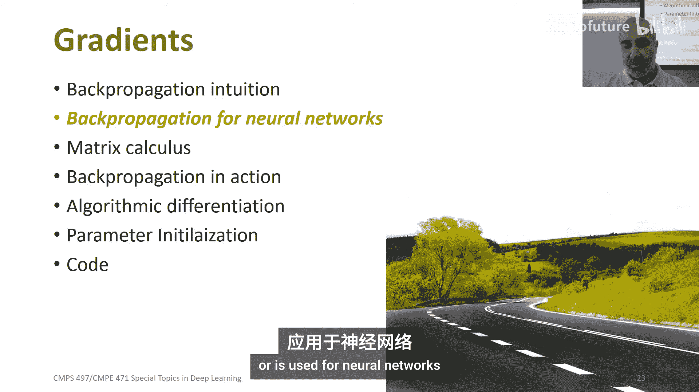
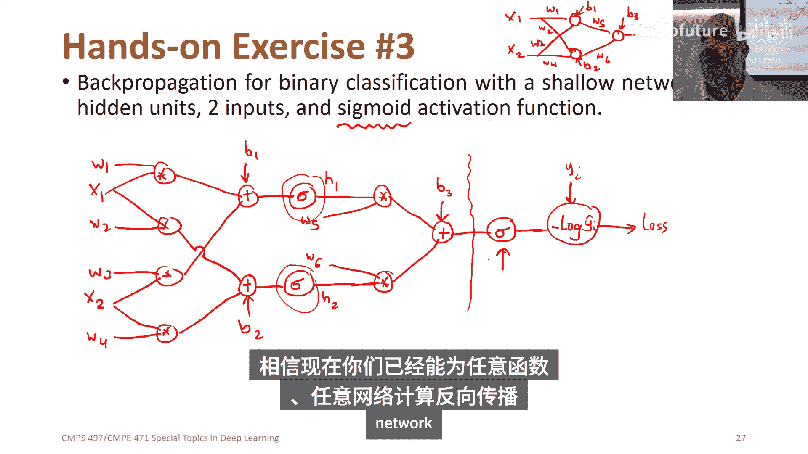
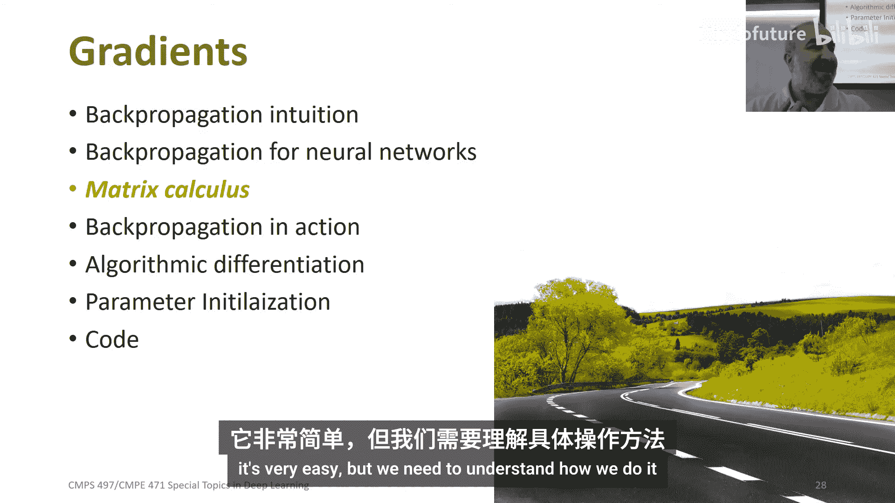
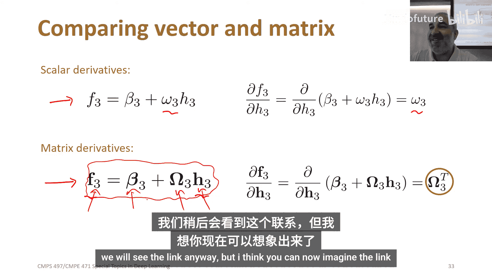
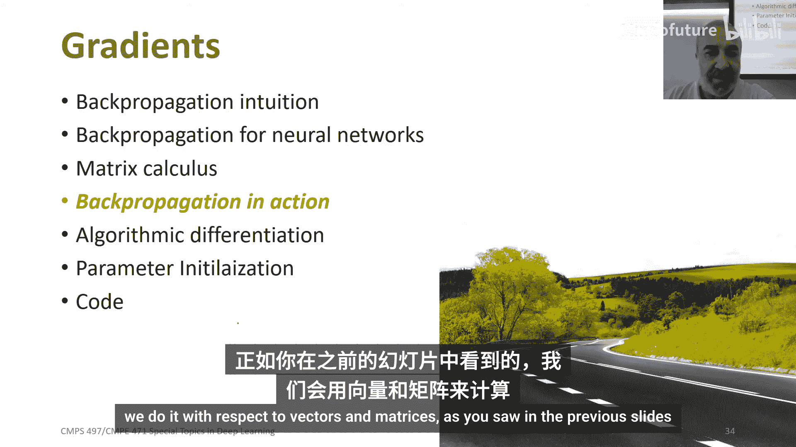
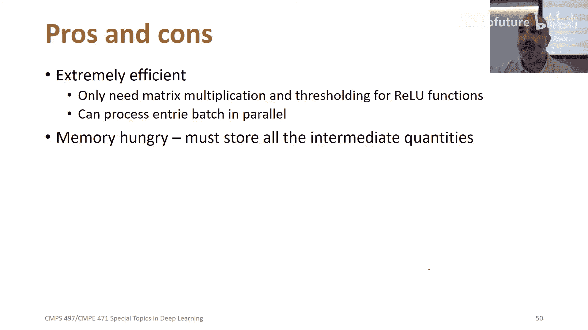
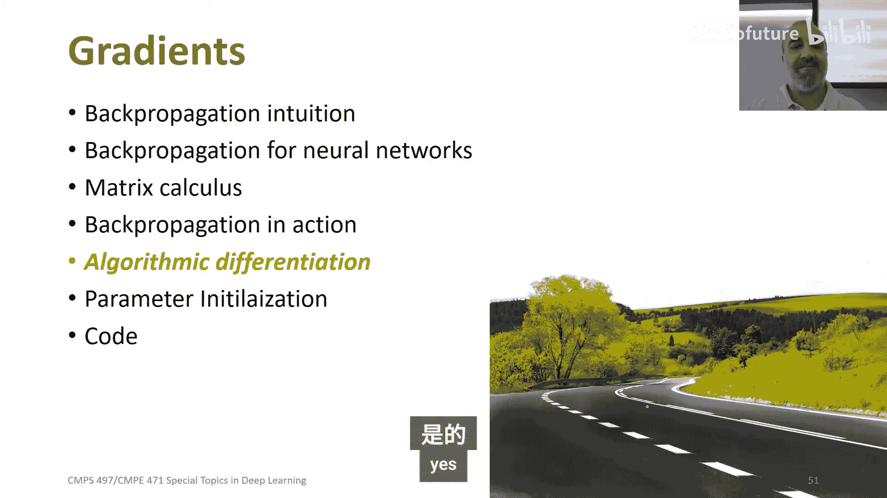
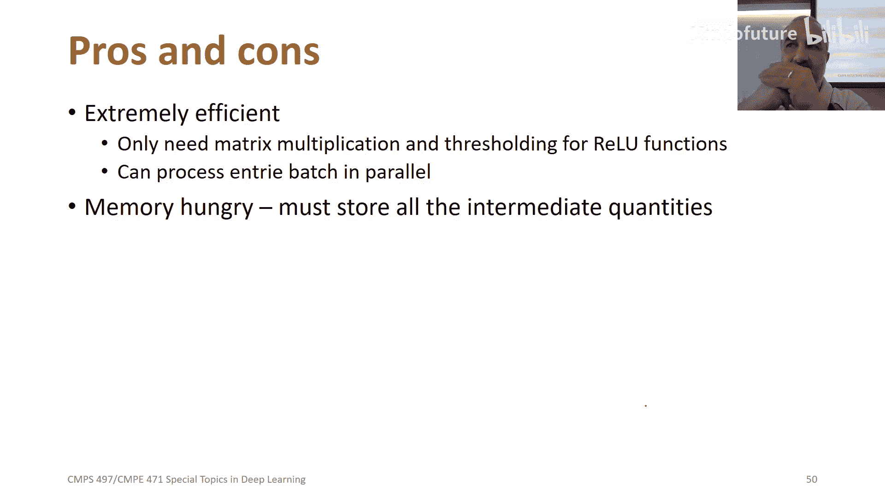
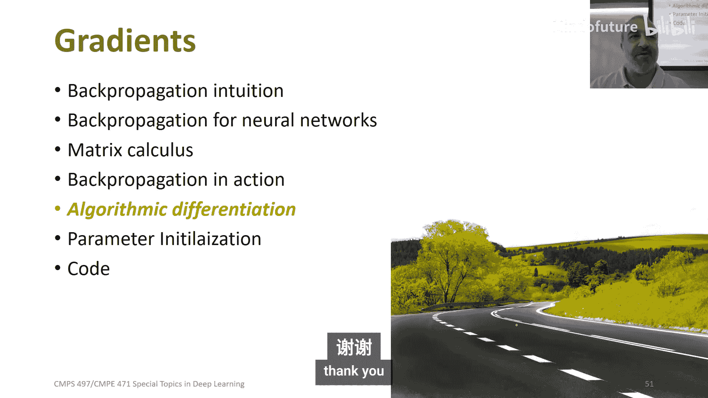

# 013：反向传播 II

在本节课中，我们将继续学习反向传播算法，并专注于如何将其应用于神经网络。我们将通过两个动手练习来理解计算图的构建，并学习如何使用矩阵微积分高效地计算梯度。

## 概述

上一节我们介绍了反向传播的基本概念，即通过前向传播计算值，再通过后向传播利用链式法则计算局部导数。本节中，我们将专门探讨如何在神经网络中应用反向传播，并理解其背后的矩阵运算原理。

## 神经网络中的训练与反向传播

回忆一下，神经网络的训练包含两个核心部分：反向传播和梯度下降。反向传播本身并不直接进行训练，它的作用是计算损失函数相对于网络所有参数的梯度。我们随后会使用优化器（如梯度下降及其变体）来利用这些梯度更新参数。

我们将通过两个练习来巩固理解。

## 练习一：多类交叉熵损失的反向传播

以下是第一个练习：我们有一个具有三个输出（F1, F2, F3）的神经网络。我们希望使用反向传播算法来计算交叉熵损失函数相对于这三个输出的导数。

首先，我们需要构建从这三个输出到最终损失值的计算图。

1.  **输入**：网络的三个原始输出值 F1, F2, F3。
2.  **计算Softmax**：首先计算每个输出的指数：`exp(F1)`, `exp(F2)`, `exp(F3)`。
3.  **求和与求逆**：将这些指数值相加得到总和 `S = exp(F1) + exp(F2) + exp(F3)`。然后计算其倒数 `1/S`。
4.  **计算Softmax概率**：将每个指数值乘以 `1/S`，得到对应的Softmax概率：`Y1_hat = exp(F1)/S`, `Y2_hat = exp(F2)/S`, `Y3_hat = exp(F3)/S`。
5.  **计算损失**：损失函数是负对数似然。我们需要正确的标签 `Y_i`（一个指示正确类别的值）。损失 `L = -log(Yi_hat)`，其中 `Yi_hat` 是根据 `Y_i` 选择的对应类别的Softmax概率。

至此，我们完成了前向传播的计算图。对于反向传播，我们需要知道每个“门”（操作）的局部导数：
*   `exp(x)` 的导数是 `exp(x)`。
*   `1/x` 的导数是 `-1/x^2`。
*   乘法门的导数遵循规则。
*   加法门将梯度分配到所有输入分支。
*   `-log(x)` 的导数是 `-1/x`。

**一个重要概念**：在计算图中，如果一个变量影响后续计算的多个路径（例如，`S` 影响了所有三个Softmax概率），那么在反向传播时，该变量收到的梯度是来自所有下游路径梯度的**总和**。

## 练习二：二元分类网络的计算图

现在，我们来看第二个练习：为一个具有两个输入、两个隐藏单元、使用Sigmoid激活函数的浅层二元分类网络构建完整的计算图，从输入一直到损失函数。

以下是构建步骤：

1.  **网络结构**：输入 `x1`, `x2`；第一层有两个隐藏单元，各有权重（`w1, w2, w3, w4`）和偏置（`b1, b2`）；输出层有一个神经元，具有权重（`w5, w6`）和偏置（`b3`）。
2.  **前向传播计算图**：
    *   **第一层加权和**：计算 `z1 = x1*w1 + x2*w3 + b1` 和 `z2 = x1*w2 + x2*w4 + b2`。
    *   **第一层激活**：应用Sigmoid函数：`h1 = σ(z1)`, `h2 = σ(z2)`。
    *   **输出层加权和**：计算 `z3 = h1*w5 + h2*w6 + b3`。
    *   **输出层激活**：应用Sigmoid函数得到预测概率：`y_hat = σ(z3)`。
    *   **计算损失**：对于二元交叉熵损失，`L = -[y * log(y_hat) + (1-y) * log(1-y_hat)]`，其中 `y` 是真实标签（0或1）。

有了这个计算图，并且我们知道每个操作（乘法、加法、Sigmoid）的局部导数，就可以通过链式法则从损失 `L` 开始，反向计算损失相对于所有权重和偏置的梯度。

## 矩阵微积分简介

在实际实现中，我们不会为每个标量变量手动计算导数。神经网络中的运算（如加权和 `z = W * h + b`）本质上是矩阵和向量运算。因此，我们需要使用**矩阵微积分**来高效地计算梯度。

核心思想：
*   如果有一个**标量函数** `L` 相对于一个**向量** `a` 的导数，结果是一个向量，每个元素是 `L` 对 `a` 中对应元素的偏导：`dL/da = [∂L/∂a1, ∂L/∂a2, ...]^T`。
*   如果有一个**向量函数** `f`（例如，一层中所有神经元的预激活值）相对于一个**向量** `a` 的导数，结果是一个**矩阵**（雅可比矩阵），其中第 `i` 列是 `f_i` 对 `a` 的梯度。

一个关键例子：对于运算 `f = b + W * h`，其中 `f` 和 `h` 是向量，`W` 是矩阵，`b` 是向量。那么：
*   `∂f/∂h = W^T` （注意是转置）
*   `∂f/∂b = I` （单位向量，效果相当于1）
*   `∂f/∂W` 的计算涉及外积，但最终形式简洁。

## 神经网络中的矩阵形式反向传播

现在，我们将反向传播应用于矩阵形式的神经网络。考虑一个具有 `L` 层的网络。

**前向传播方程**（对于第 `l` 层）：
1.  预激活：`z^(l) = W^(l) * h^(l-1) + b^(l)`
2.  激活：`h^(l) = σ(z^(l))` （`σ` 表示激活函数）
3.  最终输出：`f = z^(L)` （或经过最终激活，如Softmax）
4.  损失：`L = loss(f, y)`

**反向传播方程**（从输出层向输入层）：
1.  计算损失对输出的梯度：`∂L/∂f`。
2.  对于第 `l` 层（从 `L` 到 `1`）：
    *   计算损失对当前层预激活 `z^(l)` 的梯度：`δ^(l) = ∂L/∂z^(l)`。对于输出层，这直接来自损失函数。对于隐藏层，`δ^(l) = (W^(l+1))^T * δ^(l+1) ⊙ σ‘(z^(l))`，其中 `⊙` 表示逐元素乘法，`σ‘` 是激活函数的导数。
    *   计算损失对当前层权重 `W^(l)` 的梯度：`∂L/∂W^(l) = δ^(l) * (h^(l-1))^T`。
    *   计算损失对当前层偏置 `b^(l)` 的梯度：`∂L/∂b^(l) = δ^(l)` （对 `δ^(l)` 求和，如果 `δ^(l)` 是批处理的）。

**优势与挑战**：
*   **效率**：整个反向传播过程被简化为一系列矩阵-向量或矩阵-矩阵乘法，这些运算在现代硬件（如GPU）上可以高度并行化和优化，因此极其高效。
*   **内存消耗**：主要挑战是内存。反向传播需要存储前向传播中所有的中间变量（`z^(l)`, `h^(l)`），以便计算梯度。对于参数数量巨大的现代模型（如数十亿参数），模型本身和中间状态都需要巨大的内存。

## 总结

本节课中我们一起学习了反向传播在神经网络中的具体应用。我们通过构建计算图理解了梯度的流动，并引入了矩阵微积分，将繁琐的标量计算转化为高效的矩阵运算。我们推导了神经网络中反向传播的矩阵形式通用方程，并讨论了其计算效率高但内存消耗大的特点。下一讲，我们将看到这些理论如何转化为实际代码，并讨论神经网络训练中另一个重要话题：参数初始化。