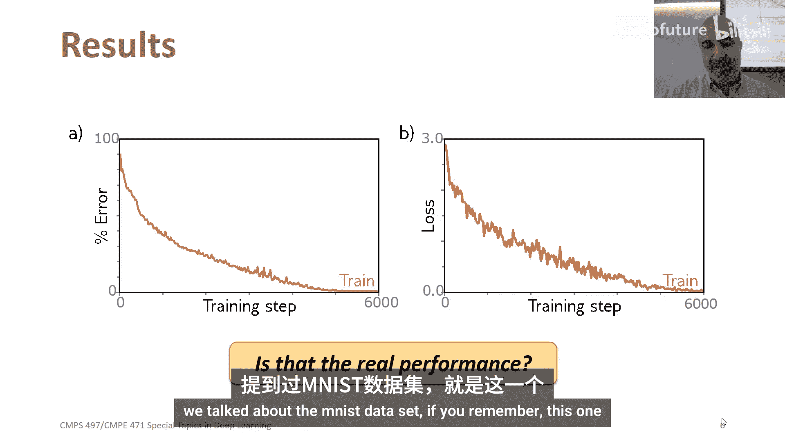
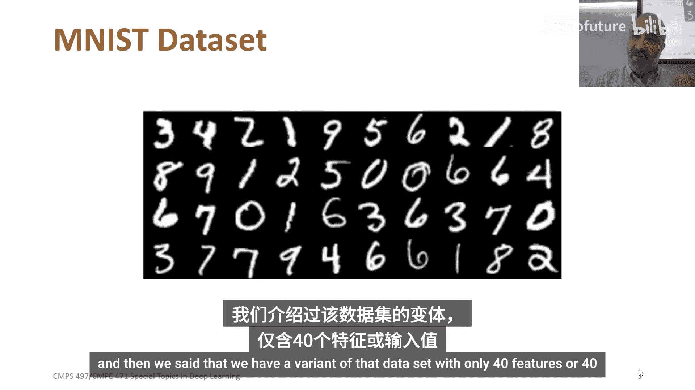
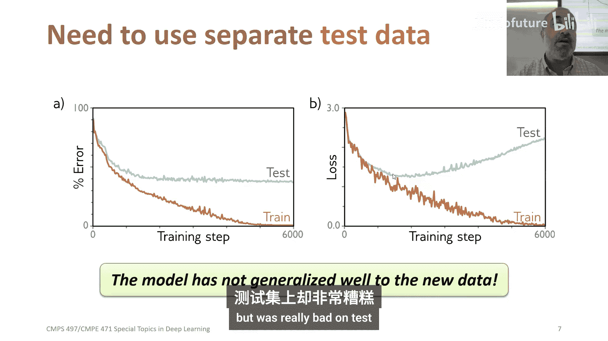
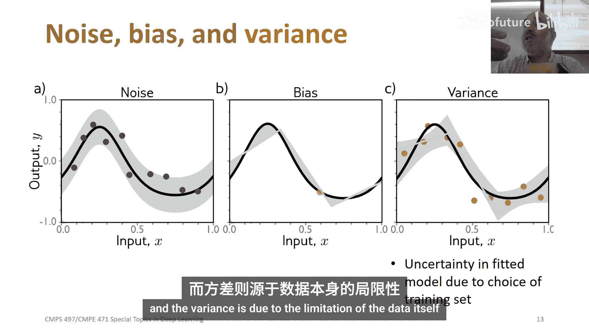
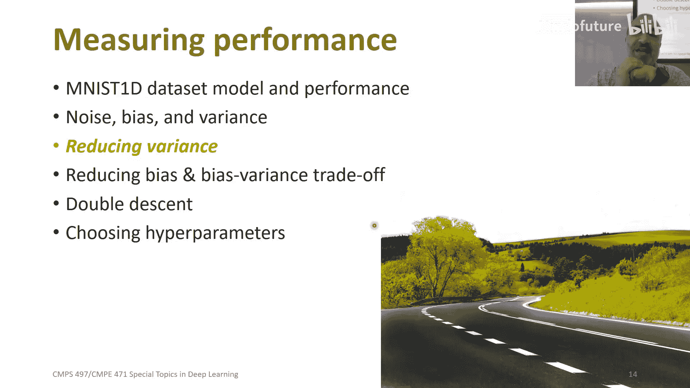
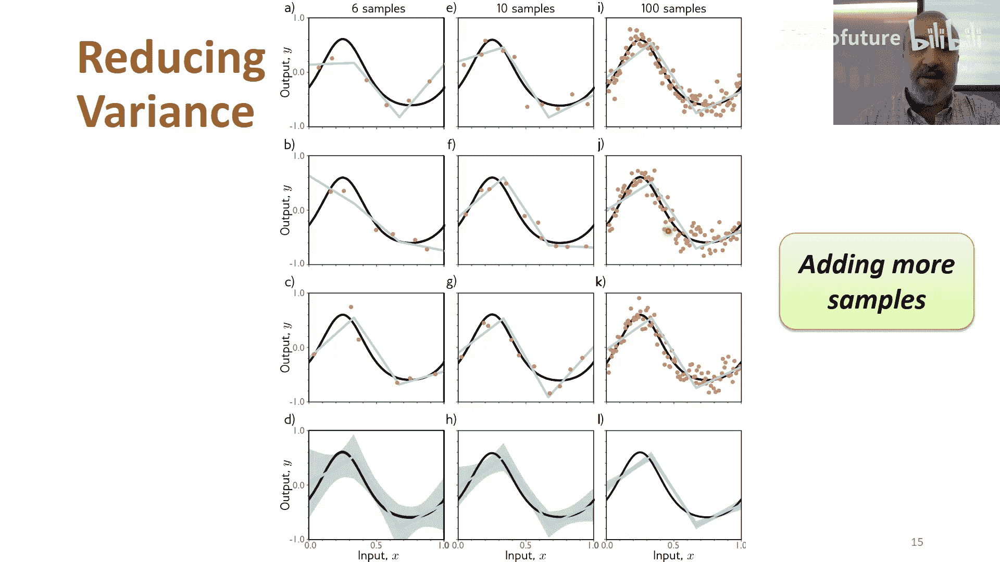
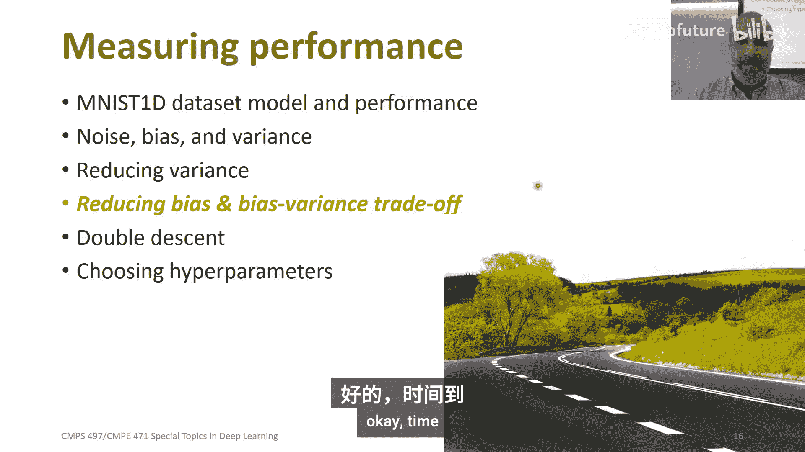
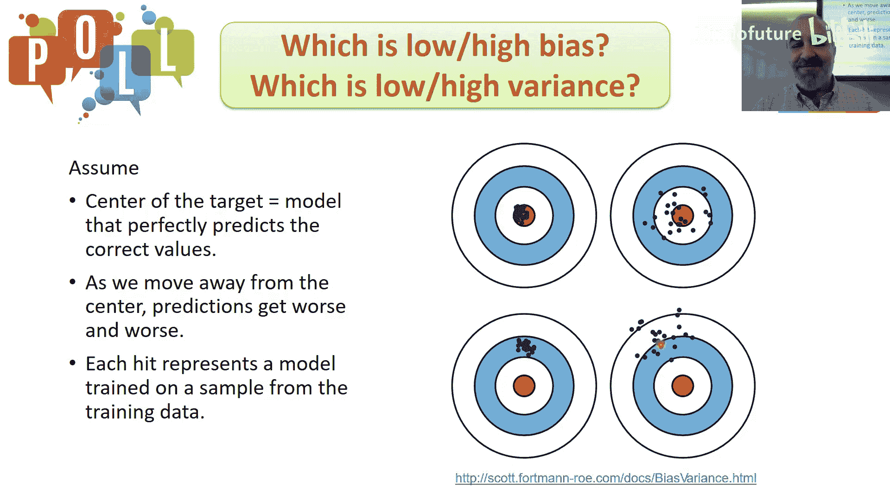
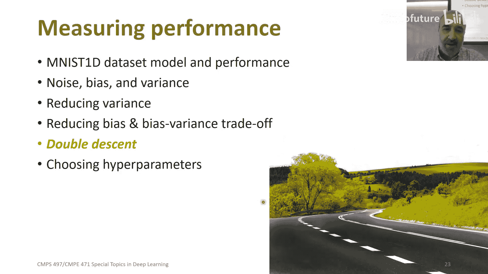
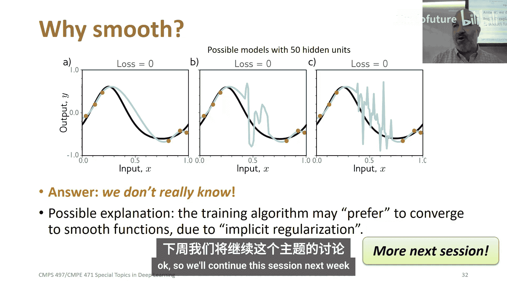

# 015：性能测量 I

在本节课中，我们将学习如何测量深度学习模型的性能。我们将探讨模型在训练数据和未见过的测试数据上表现不同的原因，并深入理解影响模型性能的三种主要误差来源：噪声、偏差和方差。

---

## 性能评估的挑战

上一讲我们介绍了性能测量的概念。我们观察到一个现象：随着训练步数的增加，模型在训练数据上的性能（准确率上升，损失下降）会持续改善。

然而，这是否是模型真实的性能？答案是否定的。要获得真实的性能，我们需要在**未见过的数据**（即测试数据）上评估模型。在训练数据上，模型有可能通过长时间训练找到全局最优解，甚至达到零损失，但这并不意味着它能很好地泛化到新数据。

让我们看看模型在测试集上的表现。下图展示了训练（棕色）和测试（绿色）性能的对比：

我们可以观察到几个关键点：
*   测试误差在初期下降，但之后趋于稳定，甚至可能上升。
*   测试性能远差于训练性能（例如，训练准确率接近100%，而测试准确率可能只有70%）。
*   测试损失在达到某个点后开始增加，而训练损失持续下降。

这表明模型未能很好地**泛化**到新数据。它在训练集上表现完美，但在测试集上表现不佳。

那么，为什么会发生这种情况？接下来，我们将探讨导致模型性能问题的三种核心误差类型。

---

## 三种误差来源：噪声、偏差与方差

为了理解模型性能不佳的原因，我们需要区分三种不同类型的误差：**噪声**、**偏差**和**方差**。理解它们之间的区别至关重要。在定义之后，我们将探讨如何尽可能地减少每种误差。

我们将使用一个简单的例子来阐明这些概念：拟合一个正弦波函数。

### 问题设定

我们的目标是近似一个正弦函数 `y = sin(x)`。然而，我们无法直接获得这个函数。我们只能获得带有噪声的样本数据。具体生成过程如下：
1.  在0到1之间均匀采样输入值 `x`。
2.  计算对应的正弦值 `sin(x)`。
3.  为每个输出值添加一些随机噪声，得到最终的训练样本 `y' = sin(x) + noise`。

下图展示了真实的正弦函数（黑色曲线）和带有噪声的训练样本点（橙色点）：

我们的任务是根据这些带有噪声的样本点，训练一个模型来近似**真实的**正弦函数。

### 模型设定

我们将使用一个非常简单的模型：一个浅层神经网络，包含 `k` 个隐藏单元。其权重经过特殊设置，使得这些单元的“关节”在输入范围[0,1]内均匀分布。通过调整输出层的权重（即每条线段的斜率），我们可以学习到不同的分段线性函数。下图展示了具有三个关节（`k=3`）时，模型可以学习到的几种函数形态：

我们的目标是学习一个由 `k` 段直线组成的函数来逼近正弦波。

---

### 1. 噪声

**噪声**是数据本身固有的误差。
*   **来源**：例如测量误差（本应是2.5，却测成了2.52），或标签标注的主观性（不同人对同一数据标注结果不同）。
*   **特点**：噪声存在于任何观测数据中，无论是训练集还是测试集。它是**不可避免且无法控制**的。
*   **在示例中**：我们人为添加的正态分布噪声，使得样本点围绕真实正弦曲线上下波动。图中的灰色区域大致表示了这种噪声的方差。

### 2. 偏差

**偏差**是由于模型本身能力不足（灵活性不够）而引入的误差。
*   **来源**：模型过于简单，无法捕捉数据背后的真实规律。例如，试图用三段直线（一个简单模型）去完美拟合复杂的正弦波，必然存在差距。
*   **特点**：偏差是模型固有的局限性。如果数据代表的函数很复杂，而模型很简单，偏差就会很大。模型被“限制”或“偏向”于只能表示某类简单函数。
*   **在示例中**：无论我们如何调整三段直线的斜率，最终学到的分段线性函数与真实正弦曲线之间总会存在差距。这个差距就是偏差。偏差是**可以通过改变模型（如增加复杂度）来控制的**。

### 3. 方差

**方差**是由于训练数据有限且具有随机性而引入的误差。
*   **来源**：我们拥有的训练数据只是全部可能数据的一个小子集。如果换另一组不同的训练数据（即使来自同一分布），训练出的模型可能会很不一样。
*   **特点**：方差反映了模型对于训练数据具体构成的敏感度。训练数据越少，方差通常越大，模型的稳定性越差。
*   **在示例中**：如果我们只有6个训练样本，用不同的6个样本训练出的模型差异会很大。这种模型预测结果的不确定性就是方差。方差是**可以通过增加训练数据量来减少的**。

总结一下三种误差的区别：
*   **噪声**：数据固有，无法避免。
*   **偏差**：模型固有，可通过增加模型复杂度来减少。
*   **方差**：数据采样固有，可通过增加训练数据量来减少。

下图直观地展示了这三种误差：

---

## 偏差-方差权衡

理解了偏差和方差后，我们来看看如何控制它们，以及它们之间存在的经典权衡关系。

### 减少方差：增加数据

方差源于数据有限。最直接的方法是**增加训练数据量**。

我们通过实验来验证：使用不同数量的训练样本（6个，10个，200个）来训练同一个模型（3个隐藏单元），并多次随机采样以观察模型的变化。

以下是观察结果：
*   **6个样本**：不同训练集得到的模型差异巨大（灰色区域很宽），方差很高。
*   **10个样本**：模型之间的差异减小，方差降低。
*   **200个样本**：模型几乎不再因训练集的微小变化而改变，方差非常低。

这个类比很形象：如果你只为考试复习了1道题，考到原题则成绩好，考不到则成绩差，成绩波动（方差）很大。如果你复习了90道题，无论考题如何变化，你的成绩都会比较稳定（方差小）。

### 减少偏差：增加模型容量

偏差源于模型太简单。解决方法是**增加模型的容量**，例如在神经网络中增加隐藏单元或层数。

我们通过实验来验证：在固定训练数据量的情况下，逐步增加隐藏单元的数量（`k=3, 5, 10`）。

以下是观察结果：
*   `k=3`：模型能力有限，拟合效果差，偏差大。
*   `k=5`：模型更灵活，拟合效果改善，偏差减小。
*   `k=10`：模型能力很强，能很好地拟合训练数据，偏差进一步减小。

### 权衡的出现

然而，当我们增加模型容量以减少偏差时，一个副作用出现了：**方差会增大**。

为什么？因为模型变得过于灵活。当模型容量刚好能完美拟合有限的训练数据时，它不仅能拟合数据中的真实规律，也开始“记忆”或“拟合”数据中的**噪声**。这个过程就是**过拟合**。

下图展示了随着模型容量增加，偏差（棕色线）下降，但方差（蓝色线）上升的趋势：

总误差（虚线）是偏差和方差的综合体现。它先随着容量增加而下降（偏差减少主导），到达一个最低点（最佳容量点）后，又开始上升（方差增加主导）。这个现象被称为**偏差-方差权衡**。我们的目标就是找到这个最佳容量点，使模型在未知数据上的总误差最小。

一个直观的比喻是射击打靶：
*   **低偏差，高方差**：瞄准了靶心（偏差小），但手不稳，子弹分散在靶心周围（方差大）。
*   **高偏差，低方差**：瞄准点偏离了靶心（偏差大），但手很稳，子弹密集地打在同一个错误的位置（方差小）。
*   **高偏差，高方差**：既没瞄准，手也不稳，子弹四处乱飞（最差情况）。
*   **低偏差，低方差**：瞄准了靶心，手也很稳，子弹都集中在靶心（理想情况）。

---

## 双重下降现象

偏差-方差权衡是一个经典理论。但近年来，研究者们在深度学习中发现了一个新现象：**双重下降**。

我们在一个无噪声的合成数据集上观察这个现象。随着模型容量（隐藏单元数）增加：
*   **训练误差**：持续下降，最终达到零（完美拟合）。
*   **测试误差**：经典理论预测它会先降后升（形成U形曲线）。但实际观察到，测试误差在第一次下降后，**在模型容量远超训练样本数时，会再次下降**，形成一个“下降-上升-再下降”的图案，故称“双重下降”。

下图中的虚线标出了模型参数数量等于训练样本数的“临界点”。

### 为什么会出现双重下降？

当模型容量极大（过参数化）时，它有无穷多种方式可以完美拟合所有训练数据点。关键在于模型在**数据点之间**如何进行插值。

在高维空间中，数据点极其稀疏（**维度灾难**）。例如，一个40维的数据，即使每个维度只分成10份，也有 `10^40` 个区域，而我们的训练数据可能只有1万个点。这意味着每个数据点需要“代表”海量的空白区域。

模型必须在这些稀疏的点之间进行插值。容量小的模型插值方式僵硬（偏差大）。容量适中的模型可能为了拟合噪声而产生震荡（方差大，过拟合）。而容量极大的模型，在优化算法的作用下，似乎更倾向于学习出在数据点之间**平滑过渡**的函数。这种平滑性恰好有利于泛化，从而导致了测试误差的第二次下降。

目前，双重下降现象的确切原因仍是研究前沿，一种可能的解释与优化算法的隐式**正则化**偏好有关，它倾向于找到更平滑的解。我们将在下一讲详细讨论正则化。

---

## 总结

本节课我们一起深入探讨了深度学习模型的性能测量：
1.  **核心问题**：模型在训练集上表现好，不代表在测试集上表现好，关键在于**泛化能力**。
2.  **三种误差**：
    *   **噪声**：数据固有误差，无法避免。
    *   **偏差**：模型太简单导致的误差，可通过增加模型容量减少。
    *   **方差**：数据有限导致的误差，可通过增加训练数据减少。
3.  **偏差-方差权衡**：减少偏差通常会增大方差，反之亦然，需要在两者间取得平衡。
4.  **双重下降**：一个现代发现，当模型容量极大时，测试性能可能会再次提升，这与模型在数据点间的平滑插值行为有关。

理解这些概念是诊断和改善模型性能的基础。在下一讲中，我们将学习**正则化**技术，它是控制模型复杂度、缓解过拟合、从而提升泛化性能的关键手段。