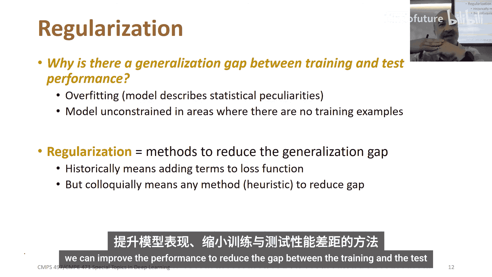
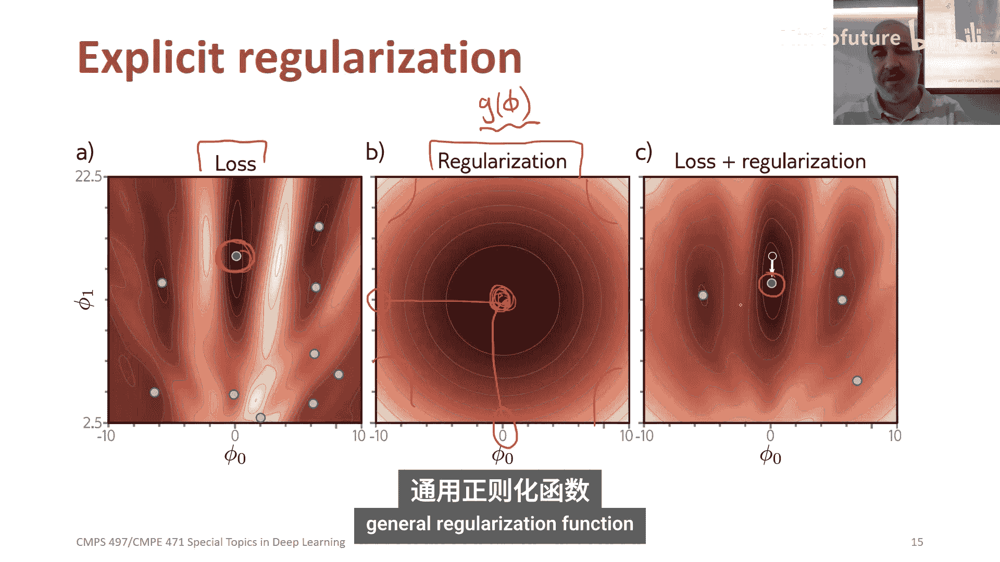
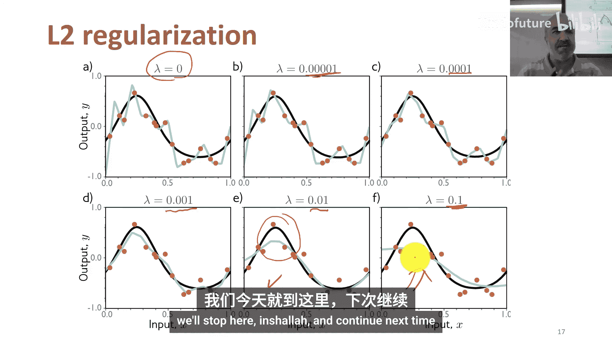

# 016：性能测量 II 与正则化 I

在本节课中，我们将继续探讨如何测量深度学习模型的性能。首先，我们将学习如何正确选择和调整模型的超参数。随后，我们将引入一个新的重要概念——正则化，并探讨它如何帮助我们缩小模型在训练集和测试集上的性能差距，从而提升模型的泛化能力。

## 超参数调优

上一节我们介绍了影响模型性能的三种误差来源：噪声、偏差和方差。本节中，我们来看看如何通过调整超参数来优化模型性能。

超参数是训练开始前设定的参数，例如网络层数、宽度、学习率、批量大小等。我们无法预先知道哪个超参数组合能带来最佳性能，因此需要通过实验来寻找。

一个直接的想法是：尝试不同的超参数值，在训练集上训练模型，然后在测试集上评估性能，选择表现最好的超参数。然而，这种方法存在严重问题。

以下是这种方法的步骤：
1.  使用超参数值 A1 在训练集上训练模型 M1。
2.  在测试集上评估 M1 的性能，得到误差 E1。
3.  重复步骤 1 和 2，尝试超参数值 A2, A3, ..., An，得到对应的模型 M2, M3, ..., Mn 和误差 E2, E3, ..., En。
4.  选择在测试集上误差最小的超参数值（例如 A4）。

**问题在于**：我们根据模型在测试集上的表现来选择超参数，相当于让测试集参与了“训练”过程。这就像在考试前反复查看考卷并调整学习方法，最终在已知的考卷上取得好成绩，但这并不能反映真实的、面对新考题的能力。因此，测试集不再能提供对模型泛化能力的可靠估计。

为了解决这个问题，我们需要引入第三个数据集：**验证集**（或称为开发集）。

## 训练集、验证集与测试集

在实践中，我们通常将标注数据划分为三个独立的部分：
*   **训练集**：用于学习模型的参数（权重和偏置）。
*   **验证集**：用于调整和选择超参数。
*   **测试集**：用于最终评估模型在“未见数据”上的性能。

正确的超参数调优流程如下：
1.  对于每一组候选超参数，在**训练集**上训练模型。
2.  在**验证集**上评估该模型的性能。
3.  遍历所有候选超参数组合后，选择在验证集上性能最佳的那一组。
4.  使用选出的最佳超参数，在**训练集+验证集**上重新训练一个最终模型。
5.  最后，用**测试集**对最终模型进行一次性的性能评估，此结果即为模型泛化能力的可靠估计。

这个流程确保了测试集在整个模型开发和选择过程中是完全“未见”的，从而保证了评估的公正性。

## 交叉验证

上述方法依赖于一次性的数据划分。如果划分不够均匀（例如验证集中恰好都是某一类样本），可能会导致超参数选择不准确。为了获得更稳健的性能估计，我们可以使用**K折交叉验证**。

以下是K折交叉验证用于超参数调优的步骤：
1.  将全部训练数据（训练集+验证集）随机平分为K份（例如K=10）。
2.  对于每一组候选超参数：
    *   进行K次训练与验证。在第i次循环中，使用第i份数据作为验证集，其余K-1份数据作为训练集。
    *   计算该超参数组合在K次验证中的平均性能。
3.  选择平均性能最好的超参数组合。
4.  使用选出的最佳超参数，在**全部训练数据**上重新训练最终模型。
5.  在独立的**测试集**上评估最终模型的性能。

交叉验证通过多次不同的数据划分来评估性能，其平均值通常比单次划分更可靠，但计算成本也更高。

## 正则化简介

在优化了超参数之后，我们常常发现模型在训练集上表现很好，但在测试集上表现不佳，这被称为**泛化差距**。一个常见原因是**过拟合**：模型过于复杂，不仅学到了数据中的潜在规律，也“记住”了训练数据中的噪声和异常值。

正则化是一系列用于**减小泛化差距、防止过拟合**的技术。最初，正则化特指向损失函数中添加额外项的方法，现在其含义已扩展为任何能提升模型泛化能力的方法。

## 显式正则化：L2正则化

最经典的正则化方法之一是**显式正则化**，即在原始的损失函数中添加一个与模型参数相关的惩罚项。

新的损失函数公式为：
`L_new(θ) = L_original(θ) + λ * G(θ)`
其中：
*   `L_original(θ)` 是原始损失（如均方误差、交叉熵）。
*   `G(θ)` 是参数 θ 的函数。
*   `λ` 是一个新的超参数，控制正则化的强度。

通过添加 `G(θ)`，我们在优化时不仅希望最小化训练误差，还希望让参数 `θ` 满足某种性质（例如，数值较小）。这相当于对模型参数施加了一种约束。

最常用的 `G(θ)` 是 **L2正则化**项，也称为**权重衰减**或**岭回归**。其公式为：
`G(θ) = ||θ||_2^2 = Σ (θ_i^2)`
即所有参数（通常是权重，不包括偏置）的平方和。

因此，带有L2正则化的损失函数变为：
`L_new(θ) = L_original(θ) + λ * Σ (θ_i^2)`

## 为什么L2正则化有效？

L2正则化鼓励模型拥有较小的权重。这为什么能提升泛化能力呢？

核心思想是**促进函数的平滑性**。平滑的函数意味着输入发生微小变化时，输出也不会产生剧烈跳跃。考虑神经网络中的某个神经元，其输入是前一层输出的加权和。如果所有权重都很小，那么前一层激活值的微小波动，传递到该神经元时也会被缩小。这种效应在网络中层层传递，使得整个网络函数对输入变化不那么敏感，从而更加平滑。

平滑的模型假设更可能捕捉数据背后的普遍规律，而不是训练数据中的偶然噪声，因此通常具有更好的泛化性能。同时，正则化项的加入也直接抑制了过拟合，因为优化目标不再仅仅是完美拟合训练数据。

参数 `λ` 控制着平滑程度：
*   当 `λ = 0` 时，无正则化，模型可能过拟合，函数曲线崎岖不平。
*   当 `λ` 适中时，模型在拟合数据和平滑性之间取得平衡，泛化性能最佳。
*   当 `λ` 过大时，正则化项主导损失函数，模型会过度追求小权重而忽略训练数据，导致欠拟合，函数过于平滑甚至变成直线。

因此，`λ` 本身也是一个需要仔细调优的超参数。

---

本节课中我们一起学习了如何通过划分验证集和交叉验证来正确地进行超参数调优，以避免对测试集的误用。接着，我们引入了正则化的概念，并详细讲解了L2正则化（权重衰减）的原理和作用——通过惩罚较大的权重值来促使模型学习更平滑的函数，从而减小泛化差距，提升模型在未知数据上的表现。