# 018：正则化 II 🧠

在本节课中，我们将继续探讨正则化技术。上一讲我们介绍了显式正则化，本节我们将深入了解**隐式正则化**，并学习**早停法**、**集成学习**和**Dropout**等实用方法。这些技术旨在提升模型在未见数据（测试集）上的泛化性能。

## 隐式正则化

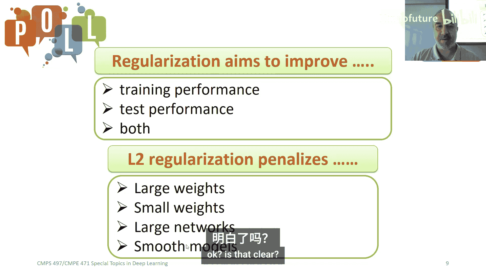

上一节我们介绍了显式正则化，即在损失函数中显式添加惩罚项。本节中我们来看看隐式正则化。它并非通过添加额外项实现，而是由优化算法（如梯度下降）本身引入的一种偏好。

### 梯度下降中的隐式正则化

当我们使用梯度下降法时，实际采用的是**离散**的更新步骤，而非理论上的**连续**梯度流。这两条路径之间存在偏差。研究表明，这种偏差可以等效地视为在原始损失函数上添加了一个正则化项。

以下是其数学表达形式。对于标准梯度下降，等效的损失函数变为：

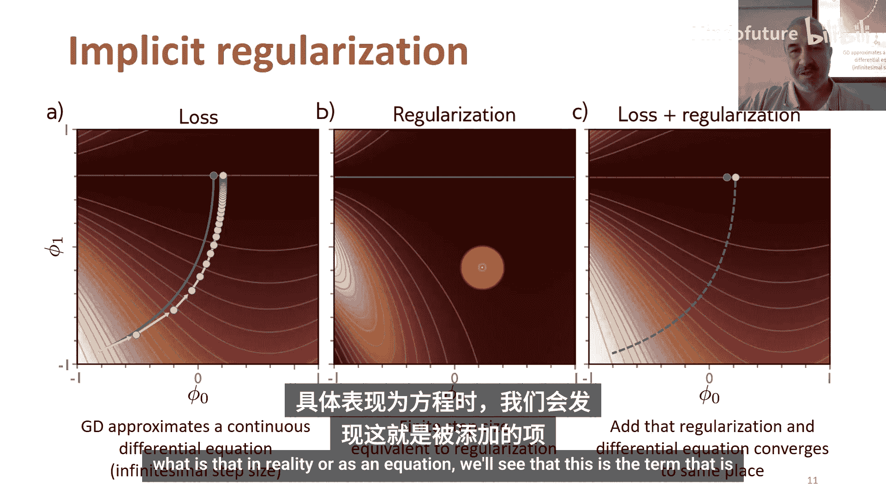

`L_effective = L_original + (α/4) * ||∇L_original||²`

其中，`α` 是学习率，`∇L_original` 是原始损失函数的梯度。

这个额外的项 `||∇L_original||²` 惩罚了**梯度较大**的区域。这意味着梯度下降算法天生倾向于选择损失函数**较为平坦**（梯度小）的区域作为最小值点。平坦的最小值通常被认为具有更好的泛化能力。

### 随机梯度下降中的隐式正则化

对于更常用的随机梯度下降，其隐式正则化项更为复杂，包含两部分：
1.  上述梯度下降的项。
2.  一个额外项，惩罚不同批次之间梯度的差异。

这鼓励模型在所有数据批次上都具有**相似且平缓**的梯度，从而使得训练过程更平滑，可能更快地收敛到泛化性能好的解。

**核心要点**：学习率 `α` 在这里扮演了类似显式正则化中正则化强度 `λ` 的角色。增大学习率（在一定范围内）相当于增强了隐式正则化的效果。

### 学习率与批次大小的影响

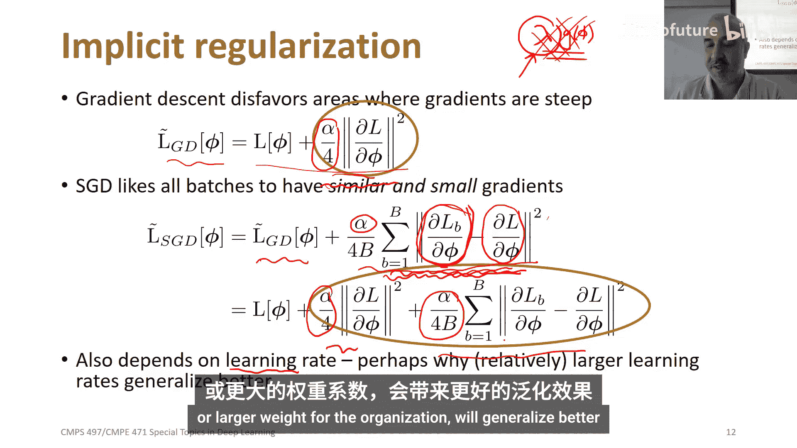

以下是学习率和批次大小对测试误差影响的实验观察：
*   **学习率**：在一定范围内，**增大学习率**可以提升测试性能（降低测试误差）。
*   **批次大小**：在固定学习率下，**减小批次大小**通常能带来更好的测试性能。

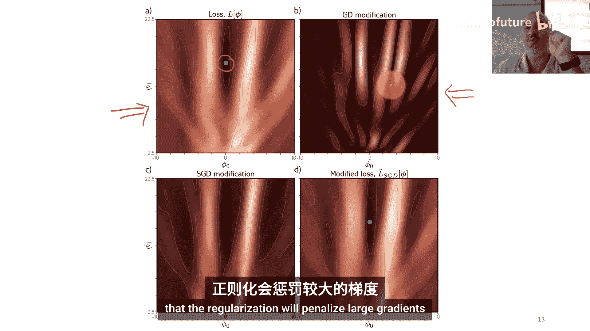

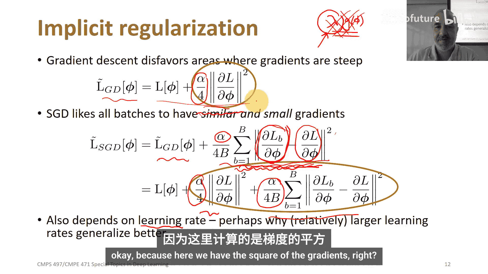

这些现象都与隐式正则化的强度变化有关。

> **注意**：调整超参数（如学习率、批次大小）应在**验证集**上进行，而非最终测试集。上图仅为示意。

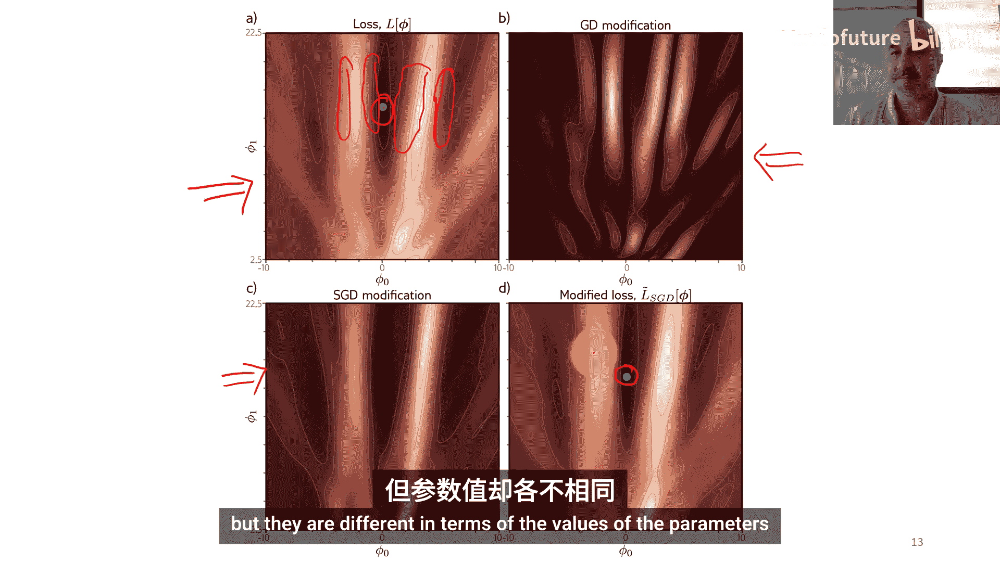

---

## 早停法

早停法是一种简单而有效的正则化策略。其核心思想是：在模型训练过程中，当模型在验证集上的性能不再提升时，就提前终止训练。

### 工作原理

在训练过程中，我们同时监控模型在训练集和验证集上的误差：
*   **训练误差**：随着训练周期增加，通常会持续下降。
*   **验证误差**：初期会随训练误差一同下降，但到达某一点后，验证误差会开始**上升**，而训练误差继续下降。这表明模型开始**过拟合**训练数据。

早停法就是在验证误差达到最低点时停止训练，并回滚到那个时刻的模型参数（检查点）。这相当于限制了模型有效复杂度，防止其过度记忆训练数据。

### 实现方式

1.  在训练过程中，定期（如每N个周期）在验证集上评估模型性能，并保存模型参数（创建检查点）。
2.  训练结束后，选择在验证集上性能最好的那个检查点作为最终模型。
3.  使用该最终模型在测试集上进行最终评估。

这种方法引入了一个新的超参数——“最佳停止周期数”，但调优成本较低，因为只需要一次完整的训练过程并保存中间结果。

---

## 集成学习

集成学习通过结合多个模型的预测结果来提升整体性能。其基本理念是“三个臭皮匠，顶个诸葛亮”。

### 基本概念

我们不再依赖单一模型，而是训练多个模型，并通过某种方式（如平均、投票）汇总它们的预测。这通常能减少方差，提高鲁棒性和泛化能力。

### 如何获得多个模型？

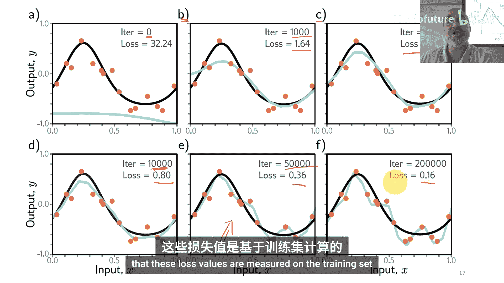

有多种方法可以创建差异化的模型集合：
*   **不同的初始化**：使用不同的随机种子初始化网络权重。
*   **不同的超参数**：改变模型结构或训练设置（如层数、学习率）。
*   **不同的训练数据子集**：这是**Bagging**（自助聚合）的核心思想。
*   **不同的模型架构**：结合不同类型的模型（如神经网络、决策树）。

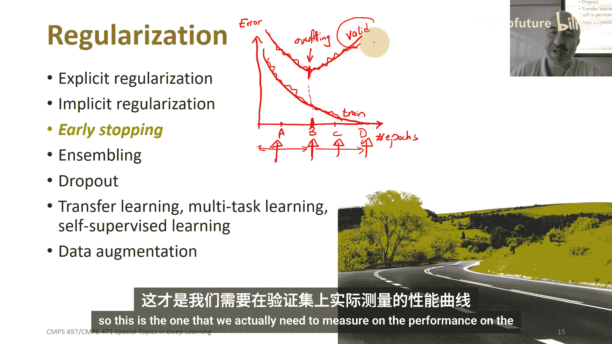

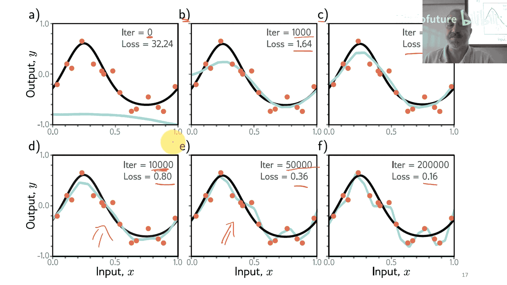

### Bagging 示例

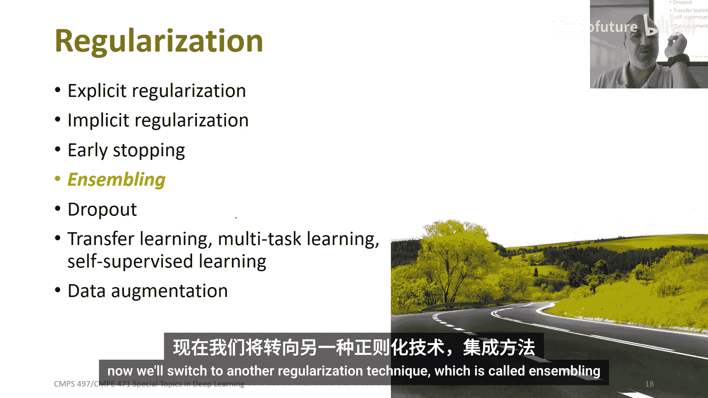

Bagging 是一种具体的集成方法：
1.  从原始训练集中**有放回地**随机采样，生成多个不同的数据子集。
2.  在每个子集上独立训练一个模型。
3.  预测时，对所有模型的输出取平均（回归）或进行多数投票（分类）。

这种方法降低了模型对训练数据中特定噪声的敏感性，从而得到更平滑、泛化更好的“集成模型”。

**缺点**：集成学习需要训练和存储多个模型，在训练和推理阶段都需要更多的计算资源和时间。

---

## Dropout

Dropout 是一种在神经网络训练中使用的强大正则化技术，其操作看似“疯狂”但非常有效。

### 工作原理

在每一次训练迭代（每个批次）中，Dropout 会以一定的概率 `p`（例如50%）随机“丢弃”（即暂时禁用）网络中的一部分神经元节点。被丢弃的节点在前向传播和反向传播中都不起作用。

### 为什么有效？

Dropout 迫使网络不能过度依赖任何一个或一组特定的神经元，因为它们在每次训练时都可能被随机移除。这带来了以下好处：
*   **促进冗余**：网络必须学会在部分神经元缺失的情况下仍能有效工作，这鼓励了特征的分布式、冗余表示。
*   **防止协同适应**：避免某些神经元之间形成复杂的共适应关系，这种关系可能导致对训练数据的过拟合和奇怪的映射行为。
*   **模型平均**：可以近似地将Dropout训练视为同时训练了大量共享参数的“子网络”的集成，并在测试时对这些子网络进行平均。

### 训练与推理

*   **训练时**：以概率 `p` 随机丢弃神经元。
*   **推理时**：使用**全部**神经元，但为了补偿训练时只有 `(1-p)` 比例的神经元被激活的情况，需要将**每一层神经元的激活值乘以 `(1-p)`**，或者等价地将**权重乘以 `(1-p)`**。这确保了推理时神经元的期望激活值与训练时一致。

---

## 总结

本节课我们一起学习了多种提升深度学习模型泛化能力的正则化技术：
1.  **隐式正则化**：认识到梯度下降和随机梯度下降算法本身会引入偏好，倾向于寻找平坦的最小值，这有助于泛化。学习率和批次大小是调节其强度的关键。
2.  **早停法**：通过监控验证集性能，在模型过拟合之前停止训练，是一种高效且简单的正则化手段。
3.  **集成学习**：通过结合多个模型的预测来降低方差、提高准确性，Bagging是其中一种经典方法。
4.  **Dropout**：在训练中随机丢弃神经元，强制网络学习更鲁棒、更不依赖特定节点的特征表示，是神经网络中极其有效的正则化器。

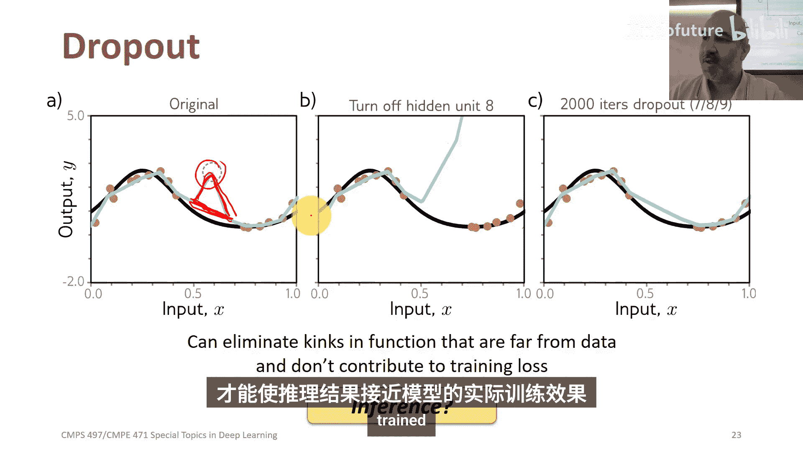

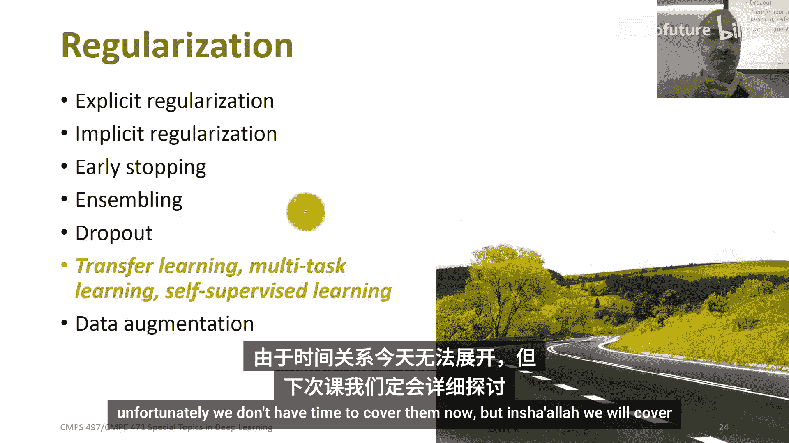

这些技术可以单独使用，也常常组合使用，以构建出强大且泛化性能优异的深度学习模型。