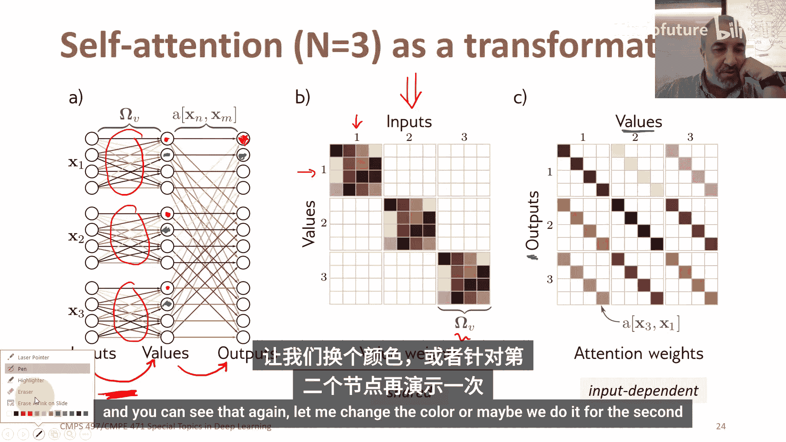
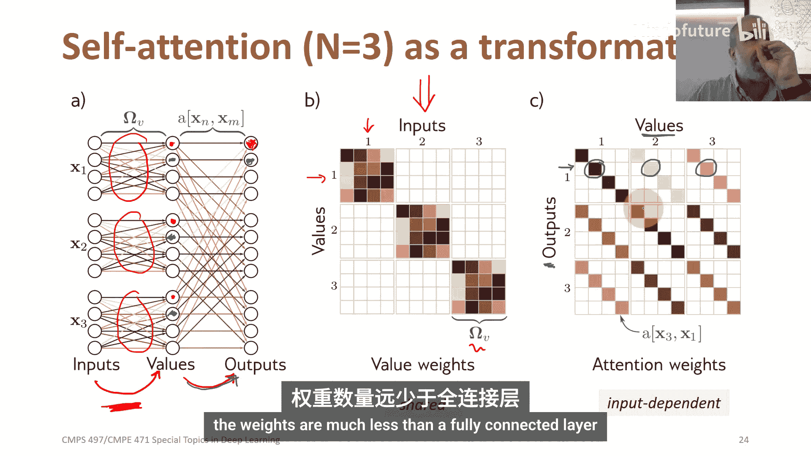
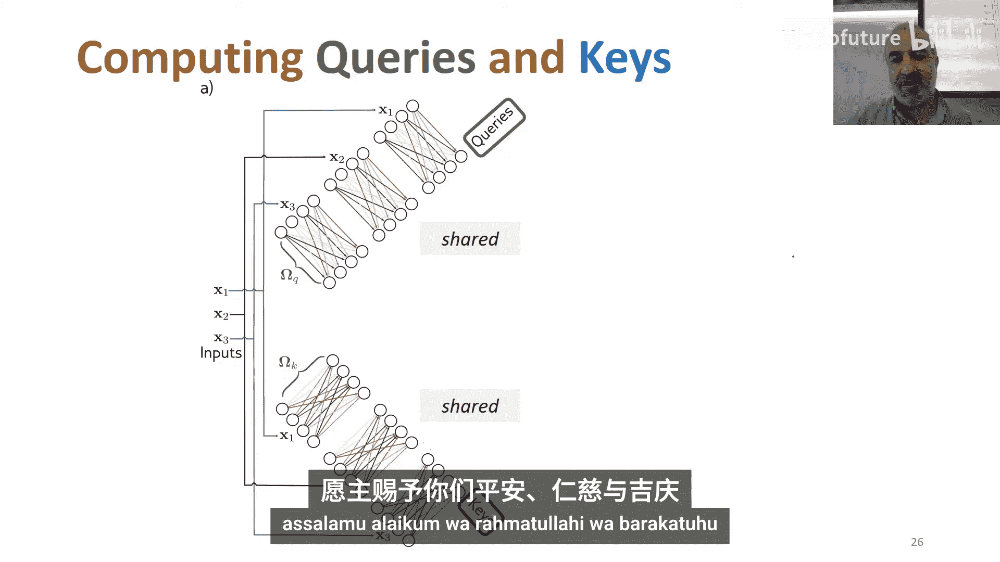

# 020：Transformer I (自注意力机制第1/2部分) 🤖

在本节课中，我们将要学习Transformer架构的核心——自注意力机制。这是当前人工智能革命背后的关键技术，理解其工作原理至关重要。

## 动机 🎯

上一节我们介绍了本课程的重要性，本节中我们来看看为什么需要专门处理文本的架构。

如果我们有一段文本，例如一条评论，并希望对其进行情感分析（判断是正面还是负面）。到目前为止，我们学到的所有知识都围绕神经网络展开。那么，如何使用神经网络处理此类文本？

神经网络总是以数字作为输入。因此，解决方案是将文本转换为数字。每个单词（例如“food”）应表示为一个数字向量。这个向量被称为**嵌入向量**。

如果每个单词都有一个长度为 `D` 的向量，并且有 `N` 个单词，那么我们可以将所有向量拼接起来，形成一个长度为 `N * D` 的长向量，作为神经网络的输入。

然而，这里存在两个主要问题：
1.  **参数过多**：即使对于中等长度的句子，全连接层的参数数量也会爆炸式增长，导致训练时间长且容易过拟合。
2.  **输入长度固定**：网络参数数量会随着输入文本长度的增加而增加，这不够灵活。

因此，我们需要一个**参数数量不随输入长度变化**的模型。这意味着需要在不同单词之间**共享参数**。

此外，考虑以下两个句子：
*   “The animal didn't cross the street because it was too tired.”（“it”指代“animal”）
*   “The animal didn't cross the street because it was too crowded.”（“it”指代“street”）

同一个词“it”在不同的上下文中指代不同的事物。我们希望一个词的表示能根据其与其他词的关系而动态变化。这就是**自注意力**的概念：每个词都应该“关注”句子中与其相关的其他词。

## 自注意力机制 🧠

上一节我们明确了处理文本的需求，本节中我们深入探讨自注意力机制的核心思想。

我们可以将自注意力视为一个处理块：输入是一个嵌入向量序列，输出是另一个相同结构的序列。目标是使输出序列中的向量表示比输入更好，即让语义相关的词具有更相似的向量表示。

自注意力机制主要分为两个步骤。

### 步骤一：计算值向量

第一步是将每个输入向量 `x_n` 转换为一个**值向量** `v_n`。这是通过一个线性变换完成的：

`v_n = W_v * x_n + b_v`

这里，`W_v` 是权重矩阵，`b_v` 是偏置向量。**关键点在于**：对于序列中的所有单词，我们都使用**相同的** `W_v` 和 `b_v`。这就是参数共享，确保了模型参数不随输入序列长度增加。

### 步骤二：加权求和得到输出

第二步是计算每个词的输出向量 `o_n`。它不是直接使用 `v_n`，而是所有值向量的一个**加权和**：

`o_n = Σ_{m=1 to N} (a_{n,m} * v_m)`

其中，`a_{n,m}` 是一个标量，称为**自注意力权重**。它表示第 `n` 个词对第 `m` 个词的“关注”程度。权重越高，表示这两个词在当前上下文中的关系越强。

例如，对于第一个词（n=1），其输出可能是：
`o_1 = 0.1*v_1 + 0.3*v_2 + 0.6*v_3`
这表明在当前上下文中，词1与词3的关系最密切（权重0.6），与词2次之（0.3），与自身关系最弱（0.1）。

### 计算自注意力权重

那么，如何计算这些至关重要的权重 `a_{n,m}` 呢？这引入了另外两个概念：**查询**和**键**。

与生成值向量类似，我们使用另外两组**独立的**权重矩阵，从每个输入向量 `x_n` 生成：
*   **查询向量** `q_n = W_q * x_n + b_q`
*   **键向量** `k_n = W_k * x_n + b_k`

查询和键用于计算两个词之间的相关性。第 `n` 个词和第 `m` 个词之间的注意力权重 `a_{n,m}`，通常通过计算查询向量 `q_n` 和键向量 `k_m` 的**点积**并应用Softmax函数来获得：

`a_{n,m} = softmax( q_n · k_m / sqrt(d_k) )`

这里 `d_k` 是键向量的维度，缩放因子 `sqrt(d_k)` 用于稳定梯度。Softmax函数确保了一个词对所有词的注意力权重之和为1，并且权重均为正数。

## 总结 📝

本节课中我们一起学习了Transformer架构的基石——自注意力机制。我们首先探讨了为文本处理设计专用架构的动机，即解决参数爆炸和捕捉长距离依赖关系的需求。然后，我们深入讲解了自注意力机制的两步核心流程：
1.  使用共享的线性层为每个输入词生成**值向量**。
2.  通过**查询**和**键**向量计算词与词之间的注意力权重，然后使用这些权重对**值向量**进行加权求和，得到每个词的上下文相关输出表示。

自注意力机制使得模型能够动态地关注输入序列中不同位置的信息，从而有效地建模词与词之间的复杂关系。在下一讲中，我们将继续探讨如何将这些组件组合成完整的Transformer层，并了解其在自然语言处理流程中的应用。