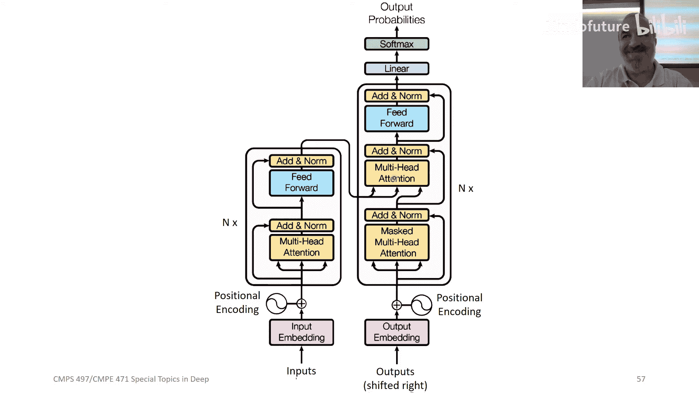

# 022：Transformer III (Transformer 层) 🧠

在本节课中，我们将深入学习Transformer架构的核心组成部分——Transformer层。我们将探讨自注意力子层的扩展细节，了解Transformer层的完整结构，并学习文本如何被处理成Transformer的输入。

---

## 概述

上一节我们介绍了自注意力机制的计算过程。本节中，我们将深入探讨自注意力子层的一些重要扩展，并了解它如何与其它组件共同构成一个完整的Transformer层。我们还将学习文本是如何被转换为模型可以理解的输入向量的。

---

## 自注意力子层的扩展

自注意力机制是Transformer的核心，但为了使其更高效、更稳定，我们引入了一些重要的扩展。

### 缩放点积注意力

在之前的计算中，查询向量（Q）和键向量（K）的点积结果可能非常大。这会导致在应用Softmax函数时，最大的值会主导整个分布，使得其它位置的权重趋近于零。梯度在反向传播时会变得非常小，从而减缓训练速度。

为了解决这个问题，我们在计算点积后、应用Softmax前，对结果进行缩放。缩放因子是嵌入向量维度 `d_k` 的平方根。

**公式**：
`注意力权重 = Softmax( (Q * K^T) / sqrt(d_k) )`

这种缩放操作可以防止点积值过大，确保Softmax后的权重分布更平滑，梯度更稳定，从而加速训练。

### 位置编码

自注意力机制本身不考虑单词的顺序。然而，在自然语言中，单词的顺序至关重要。例如，“男人吃了鱼”和“鱼吃了男人”的含义完全不同。

为了将位置信息注入模型，我们在输入嵌入向量中添加了一个**位置编码向量**。每个位置都有一个唯一的、固定或可学习的编码向量。这些编码向量通常使用正弦和余弦函数生成，以确保它们能捕捉到位置的相对关系。

**过程**：
`输入Transformer的向量 = 词嵌入向量 + 位置编码向量`

这样，模型在处理每个词时，都能知道它在序列中的具体位置。

### 多头自注意力

单一的注意力机制可能只关注一种类型的词语关系。为了让模型能够同时关注来自不同表示子空间的信息，我们引入了**多头自注意力**。

在多头自注意力中，我们并行地运行多个独立的注意力“头”。每个头都有自己的查询、键、值权重矩阵，因此可以学习到输入序列的不同方面的关系。

**过程**：
1.  输入向量通过不同的线性变换，为每个头生成独立的 Q, K, V。
2.  每个头独立计算缩放点积注意力。
3.  所有头的输出被拼接起来。
4.  拼接后的结果通过一个可学习的线性层进行变换，得到最终输出。

为了保持参数效率，每个头的维度通常是总嵌入维度除以头的数量（`d_k = D_model / h`）。这样，拼接后的输出维度与原始输入维度保持一致。

**代码概念**：
```python
# 伪代码示意
def multi_head_attention(x):
    heads = []
    for i in range(num_heads):
        # 为每个头生成独立的 Q, K, V
        Q_i = linear_q_i(x)
        K_i = linear_k_i(x)
        V_i = linear_v_i(x)
        # 计算单头注意力
        head_i = scaled_dot_product_attention(Q_i, K_i, V_i)
        heads.append(head_i)
    # 拼接所有头的输出
    concatenated = concatenate(heads)
    # 最终线性变换
    output = linear_output(concatenated)
    return output
```

**直觉**：
*   **捕捉多种关系**：一个头可能学习指代消解（如代词指向哪个名词），另一个头可能关注句子的主要动词，等等。
*   **避免不良初始化**：多个独立的头增加了模型从不同角度学习有效表示的机会，降低了因随机初始化不佳而陷入局部最优的风险。

---

## Transformer层详解

自注意力子层并不是孤立存在的，它是Transformer层中的一个核心组件。一个完整的Transformer层包含以下几个部分，它们协同工作以处理输入。

以下是Transformer层的结构图，它展示了信息流动的顺序：



### 1. 多头自注意力子层
输入序列首先通过我们刚刚讨论过的**多头自注意力**机制。这一步让序列中的每个词都能关注到序列中所有其它词，并基于这些关系更新自己的表示。

### 2. 残差连接与层归一化
自注意力子层的输出并不会直接传递给下一部分。这里引入了两个关键技术：
*   **残差连接**：将子层的输入（即进入自注意力前的向量）直接加到子层的输出上。公式为：`输出 = 层归一化( x + 子层(x) )`。
*   **层归一化**：对相加后的结果进行标准化处理，使其均值为0，方差为1，然后进行可学习的缩放和偏移。

**作用**：
*   **残差连接**：缓解深度网络中的梯度消失问题，使梯度在反向传播时能够更有效地流向浅层网络，加速训练。
*   **层归一化**：稳定网络的激活值分布，同样有助于加快训练速度并提高模型稳定性。

### 3. 前馈神经网络
经过归一化后的向量会通过一个**前馈神经网络**。这是一个简单的全连接网络，通常包含一个隐藏层和ReLU激活函数。

**关键点**：
*   这个FFN独立地应用于序列中的**每一个位置**（即每一个词的向量）。
*   所有位置共享**同一套FFN参数**。这意味着无论序列多长，FFN的参数数量都是固定的，这符合Transformer设计之初的参数效率原则。

**公式**：
`FFN(x) = max(0, x * W1 + b1) * W2 + b2`
其中 `W1, b1` 和 `W2, b2` 是可学习的参数。

### 4. 再次的残差连接与层归一化
FFN的输出会再次经过一个**残差连接**（加上FFN的输入）和**层归一化**。这一步的输出就是整个Transformer层的最终输出。

---

## 从文本到输入：嵌入与分词

在将文本送入Transformer层之前，我们需要将其转换为数值向量。这个过程分为几个步骤。

### 分词
首先，原始文本需要被分割成模型能处理的基本单元，称为**词元**。常见的策略是**子词分词**（如Byte-Pair Encoding, BPE）。
*   **过程**：从单个字符开始，统计相邻词元对的频率，反复将最高频的配对合并成新的词元，直到达到预设的词表大小。
*   **优点**：能有效处理未登录词（如新名字），并在词表大小和表示效率之间取得平衡。

### 词嵌入查找表
分词后，每个词元被分配一个唯一的ID。初始时，我们用**独热编码**表示每个词元：一个长度等于词表大小的向量，仅在对应ID位置为1，其余为0。
然而，独热编码是稀疏且无意义的。因此，我们引入一个**可学习的嵌入矩阵** `E`。这个矩阵的每一行对应词表中的一个词元的稠密向量表示。
通过将词元的ID（独热向量）与嵌入矩阵 `E` 相乘，我们就得到了该词元的**稠密嵌入向量**。这个嵌入矩阵 `E` 是模型参数的一部分，会在训练过程中被优化。

### 添加位置编码
最后，我们将上一步得到的词嵌入向量与对应的**位置编码向量**相加，形成Transformer编码器的正式输入。

---

## Transformer架构总览

一个完整的Transformer模型（编码器部分）就是多个上述Transformer层的堆叠。


*   **堆叠**：输入依次通过第1层、第2层……第N层。每一层的输出是下一层的输入。
*   **表示学习**：通过这种层层传递和加工，模型为输入文本学习到了越来越抽象、富含上下文信息的**深层表示**。这个过程本身不针对特定任务（如分类），而是学习通用的文本表示，因此称为**表示学习**。

---

## 总结

本节课中，我们一起深入学习了Transformer层的构成与原理：
1.  **自注意力的扩展**：我们学习了**缩放点积注意力**以稳定训练，**位置编码**以注入序列顺序信息，以及**多头自注意力**以从不同角度捕捉词语关系。
2.  **Transformer层结构**：我们剖析了Transformer层的完整流程：**多头自注意力 → 残差连接 & 层归一化 → 前馈网络 → 残差连接 & 层归一化**。理解了残差连接和层归一化对于训练深度网络的关键作用。
3.  **输入处理**：我们了解了文本如何通过**分词**、**嵌入查找**和**添加位置编码**，被转换为Transformer模型可处理的数值输入。
4.  **模型架构**：我们看到了完整的Transformer编码器是如何通过**堆叠多个相同的层**来构建的，从而实现对输入数据深层表示的逐步学习。


下一讲，我们将探讨Transformer的另一半——解码器，并了解编码器-解码器结构如何协同工作以完成序列到序列的任务（如机器翻译）。