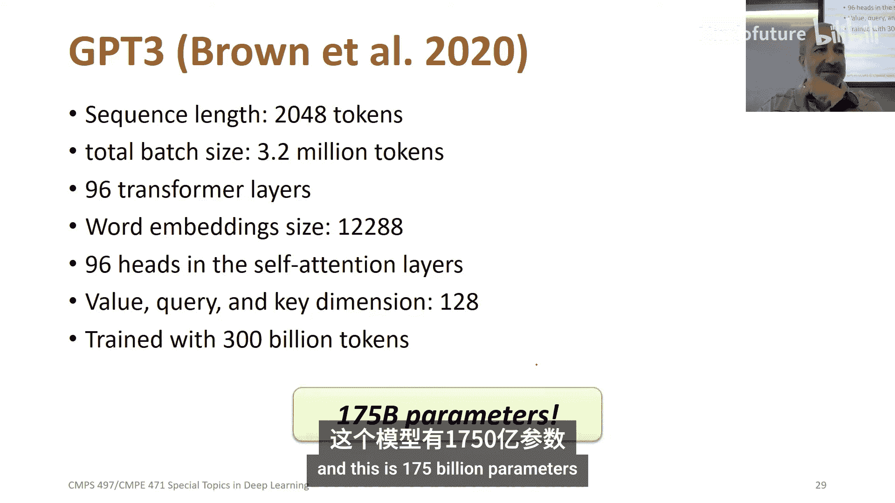
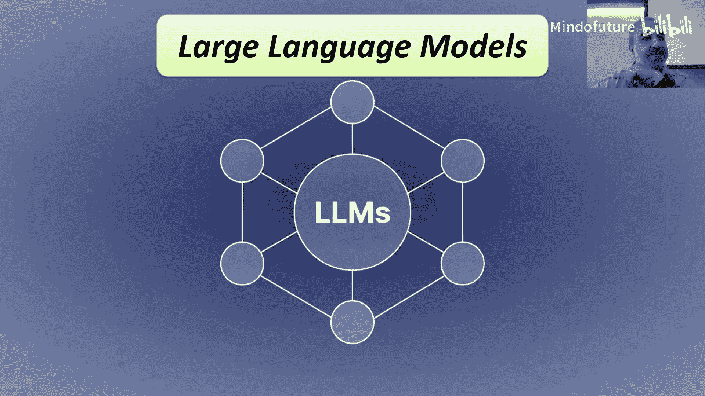

# 023：Transformer IV (仅编码器和仅解码器模型) 🧠

在本节课中，我们将深入学习基于Transformer架构的两种主要模型变体：仅编码器模型和仅解码器模型。我们将探讨它们的设计目标、训练方法以及典型应用，并通过BERT和GPT-3等具体实例来加深理解。

## 模型架构回顾

上一讲我们介绍了完整的Transformer架构。如图所示，Transformer包含左右两侧：左侧称为编码器，右侧称为解码器。今天我们将更详细地讨论这两部分。

从图中可以看出，编码器和解码器在结构上非常相似。如果我们观察单个编码器层和单个解码器层，会发现它们几乎相同，唯一的区别在于解码器多了一个注意力子层，我们稍后会详细讨论。除此之外，它们的架构非常相似。

## 课前问题

在深入探讨不同类型的基于Transformer的模型之前，我们先来回顾两个问题。

**第一个问题：** 一个包含8个头的自注意力子层，与一个只包含1个头的自注意力子层相比，参数数量有何不同？它们参数数量相同吗？8头版本是否需要额外的权重矩阵？或者其参数是单头版本的8倍再加上额外的权重矩阵？

答案是：参数数量相同，但8头版本多了一个额外的权重矩阵。这个额外的矩阵用于在多头注意力机制的最后进行变换（连接后的线性变换）。无论头数是8个还是16个，参数总数都相同，只是多了一个最终的连接权重矩阵。

**第二个问题：** 在Transformer模型中，每一层的参数数量相同吗？所有层的参数是共享的吗？还是部分参数共享？第K层的输出是第K+1层的输入吗？

答案是：
*   每一层的参数数量相同。因为模型是层的堆叠，每层结构相同，所以参数数量也相同。
*   所有层的参数并不共享。它们是不同的参数。
*   第K层的输出确实是第K+1层的输入。这是序列处理的基本方式。

## 基于Transformer的模型类型

今天我们将讨论基于Transformer的三种主要模型类型：仅编码器模型、仅解码器模型以及编码器-解码器模型。我们将以BERT（仅编码器）、GPT-3（仅解码器）和机器翻译模型（编码器-解码器）为例进行详细说明。

以下是基于Transformer模型发展历程的简要总结。一切始于2017年提出的Transformer模型，随后衍生出仅编码器、仅解码器和编码器-解码器三种类型的模型。图中展示了各类模型的一些例子，例如BERT属于仅编码器模型，GPT系列属于仅解码器模型。

## 仅编码器模型

仅编码器模型的目标是为文本构建高质量的表示或嵌入。我们之前学习的概念，本质上就是使用模型来生成输入文本的表示。这种表示本身并不直接完成特定任务，其目标是构建一个通用的表示模型，以便后续用于解决特定的自然语言处理任务。

因此，仅编码器模型能够生成比原始输入更好的文本表示（嵌入）。然后，这些模型可以通过“微调”来适应特定的NLP任务。

### BERT 模型

我们将以BERT模型为例进行更详细的探讨。BERT在当时（约2019年）在多个相关领域取得了突破性进展。

BERT代表“来自Transformer的双向编码器表示”。简单来说，它是一个语言表示模型。它接收由嵌入向量组成的输入序列，并为每个词元生成更好的表示，这些表示可用于特定任务。

BERT是一个训练好的编码器堆栈。在原始BERT中，有24层编码器层。具体参数如下：
*   **词汇表大小：** 30,000个词元。这意味着模型能够理解30,000种不同的子词单元。
*   **注意力头数量：** 16个。
*   **编码器层数：** 24层。
*   **嵌入向量维度：** 1024。
*   **前馈网络隐藏单元数（每层）：** 4096个。
*   **总参数量：** 约3亿个。

### BERT的训练：预训练与微调

我们使用“迁移学习”来训练BERT。在迁移学习中，我们有一个主要任务（可能缺乏大量标注数据），因此我们使用一个次要任务，通过“自监督”方式进行训练。这个次要任务数据量大，且无需人工标注。完成这个“预训练”阶段后，我们再针对特定任务进行“微调”。因此，训练分为两个阶段。

**第一阶段：预训练**
在这个阶段，我们使用大量文本数据，通过自监督任务来训练模型。BERT使用的预训练任务是“掩码语言建模”。

具体过程如下：我们从网络、书籍、博客等来源获取大量文本数据。对于任意一个句子，我们随机掩码一定比例（例如15%）的词元，然后训练模型来预测这些被掩码的词。

例如，对于句子 “The train pulled into the station.”，我们随机掩码一些词，变成 “The [MASK] pulled into the [MASK].”。模型的任务就是预测 `[MASK]` 位置原来的词。

这是一个自监督任务，因为我们有原始文本，只是在训练时隐藏了部分词。模型输入包含特殊的 `[MASK]` 词元。对于每个输入词元，我们都有一个输入嵌入向量。在输出端，对于每个位置（尤其是掩码位置），我们也有一个输出嵌入向量。

从输出嵌入向量，我们想要预测被掩码的词。这是一个从30,000个可能词元（词汇表大小）中选一个的多分类问题。因此，我们需要一个输出层。

具体操作是：对于每个掩码词元的输出嵌入向量（维度为1024），我们添加一个线性层（全连接层），其输出节点数等于词汇表大小（30,000）。然后，我们使用Softmax函数来获得所有词元的概率分布。我们选择概率最高的词元作为预测结果，并据此进行训练。对于每个掩码词元，我们都会添加这样一个“线性层 + Softmax”的输出层。

此外，我们在输入序列的开头添加了一个特殊的 `[CLS]`（分类）词元。这个词元最终产生的嵌入向量，将被视为整个输入序列的表示，在微调阶段会用到。

损失函数是每个掩码位置输出的交叉熵损失的总和。

通过在海量句子（数十亿计）上训练模型预测掩码词，模型学到了什么？它学会了根据上下文来预测缺失的词。这意味着它学习了语言的语法、词与词之间的关系以及语义信息。例如，如果前一个词是“红色”，那么被掩码的词很可能是一个颜色或物体。

**第二阶段：微调**
预训练结束后，我们得到了一个预训练模型。但这个模型是针对掩码语言建模任务训练的，并非直接面向用户应用。微调阶段的目标是使这个模型适应特定的下游任务。

我们假设已经有了预训练模型。微调意味着我们将在特定任务的标注数据上，调整模型的参数。我们来看两个微调的例子。

**例子1：文本分类（如情感分析）**
任务：给定一段评论，判断其情感是积极还是消极。
这是一个二分类问题。我们需要在模型末端添加一个输出层，最终输出一个节点。

具体操作：我们取预训练模型输出的 `[CLS]` 词元的嵌入向量（代表整个句子）。将这个向量输入一个全连接网络（可以是一层或多层）。网络的最后一层是一个输出节点，我们使用Sigmoid函数来获得一个概率值，表示句子为积极的概率。损失函数是二元交叉熵。

关键点：我们是从预训练模型开始，而不是从头开始训练。整个网络的参数已经通过掩码语言建模任务进行了预训练。微调时，我们会在特定任务的标注数据上继续更新这些参数（通常也会更新预训练模型的部分参数，但有时也可以“冻结”它们）。

**例子2：命名实体识别**
任务：给定一个句子，识别出其中的人名、地名、组织名等实体。
这是一个基于词元的分类任务。我们需要对句子中的每个词元进行分类。

具体操作：对于输入句子中的每个词元，我们取其对应的输出嵌入向量。对于每个这样的向量，我们添加一个线性层和Softmax层，输出节点数为实体类别数（例如：人名、地名、组织名、非实体，共4类）。这样，每个词元都会得到一个4类的概率分布。损失函数是多类别交叉熵。

在微调时，我们会移除预训练阶段用于掩码预测的输出层，然后根据新任务添加自己的输出层。通常，微调是针对单个任务进行的。如果想为多个任务微调模型，通常需要分别从原始预训练模型开始，为每个任务独立微调。如果任务相关，也可以进行多任务学习，同时为一个模型微调多个任务。

## 仅解码器模型

仅解码器模型的目标是生成序列中的下一个词元。与仅编码器模型学习表示不同，仅解码器模型的核心是预测。

给定一个输入序列，模型需要预测下一个最可能出现的词元。模型结构同样是多个Transformer层的堆叠。在堆叠层的末端，我们希望预测下一个词。因此，我们需要获得下一个词在所有可能词元上的概率分布。

具体操作是：取最后一个词元的输出嵌入向量，对其应用一个线性层和Softmax层，以获得下一个词的概率分布。这个“预测下一个词”的任务可以重复进行：给定输入，预测第一个词；然后将预测出的词添加到输入中，再次预测第二个词；如此循环。这被称为“自回归语言建模”。

自回归语言模型每次生成一个词元，条件是基于之前所有已生成的词元（以及原始输入）。一个句子的概率可以分解为每个词基于之前所有词的条件概率的乘积。

### 训练细节

为了高效训练，我们不是只让模型预测序列的最后一个词，而是让模型为输入序列中的**每个词元**都预测它的**下一个词**。这样，一个包含N个词元的句子就能提供N个训练样本。

但这会带来一个问题：在训练时，模型在预测某个词的下一个词时，会“看到”它本应预测的那个词（因为整个句子都作为输入提供了）。这相当于“作弊”，模型会简单地学会复制输入中的下一个词，而不是真正学习语言结构。

解决方案是使用“掩码自注意力”。在Transformer的解码器层中，自注意力子层被修改为：每个词元只能关注它自身以及它**之前**的词元，而不能关注它**之后**的词元。通过将未来词元的注意力权重强制设为0，我们防止了模型在训练时“偷看”答案。这是解码器与编码器在架构上的主要区别。

因此，在训练仅解码器模型时，我们使用掩码自注意力。对于序列中的每个词元，我们都添加一个线性层和Softmax层，以获得下一个词的概率分布。损失函数是所有位置的多类别交叉熵损失的总和。

### 文本生成

训练好的仅解码器模型可以直接用于生成文本。给定一个输入（或起始提示），模型可以预测下一个词。然后，将这个生成的词追加到输入中，再次输入模型，预测下一个词，如此循环往复。这就是像ChatGPT这样的模型生成文本的基本原理。

在推理（生成）时，我们只关心最后一个词元位置的下一个词预测概率。我们根据这个概率分布来选择下一个词。选择策略主要有两种：

1.  **贪心搜索：** 总是选择概率最高的词。但这样会导致生成结果单一、缺乏创造性。
2.  **随机采样（如Top-k采样）：** 从概率最高的k个词中随机选择一个，选择概率与这些词的原始概率成正比。这能增加生成文本的多样性，同时保持连贯性。另一种更复杂的方法是**束搜索**，它在生成过程中同时保留多个概率最高的候选序列，最终选择整体概率最高的序列。

### GPT-3 模型

GPT-3是一个著名的仅解码器模型。其规模巨大：
*   参数量：1750亿
*   上下文长度：2048个词元
*   层数：96层Transformer层
*   嵌入大小：12,288
*   注意力头数：96头
*   训练数据量：3000亿个词元

像GPT-3这样参数量达到百亿甚至千亿级别的模型，被称为“大语言模型”。它们的规模仍在不断增长。

## 总结

本节课我们一起学习了基于Transformer架构的两种核心模型变体。

*   **仅编码器模型（如BERT）**：其核心目标是学习文本的通用、高质量的表示（嵌入）。通过掩码语言建模等自监督任务进行预训练，然后可以针对文本分类、命名实体识别等具体任务进行微调。
*   **仅解码器模型（如GPT-3）**：其核心目标是生成文本。通过使用掩码自注意力的自回归语言建模进行训练，能够根据给定的上文，逐词生成连贯的后续文本。其生成过程可以通过贪心搜索、Top-k采样或束搜索等策略进行控制。

理解这两种模型的设计哲学、训练方法和应用场景，是掌握现代大语言模型基础的关键。下一讲，我们将更深入地探讨大语言模型的相关内容。