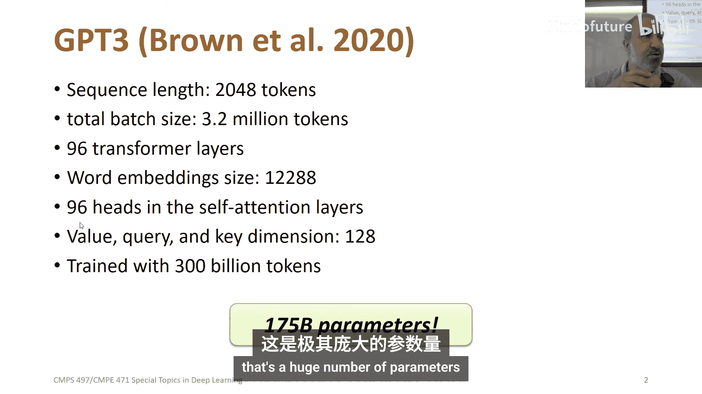
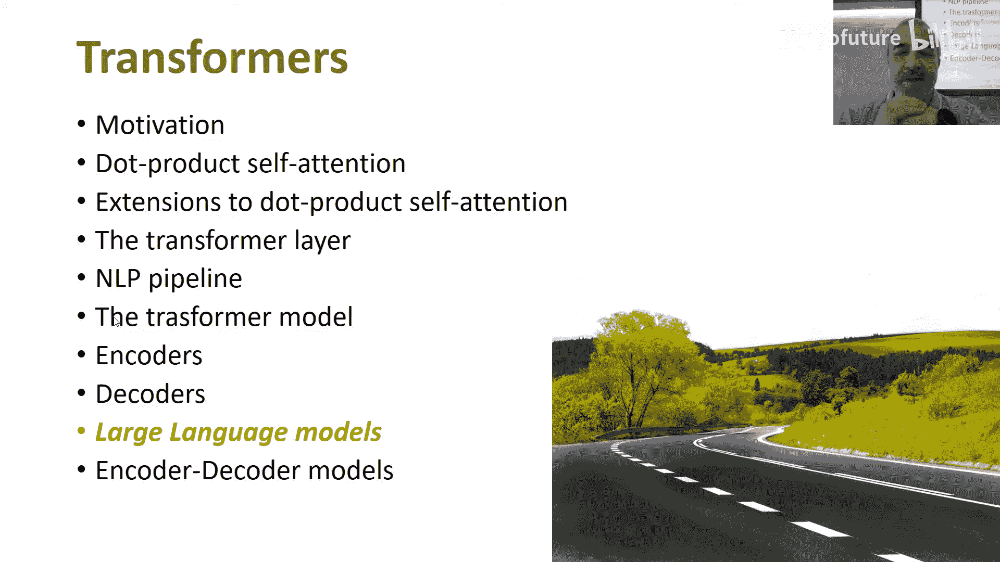
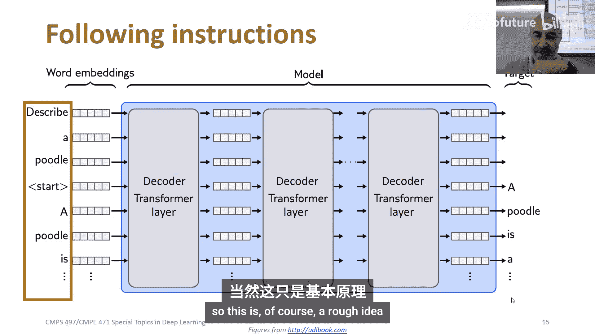
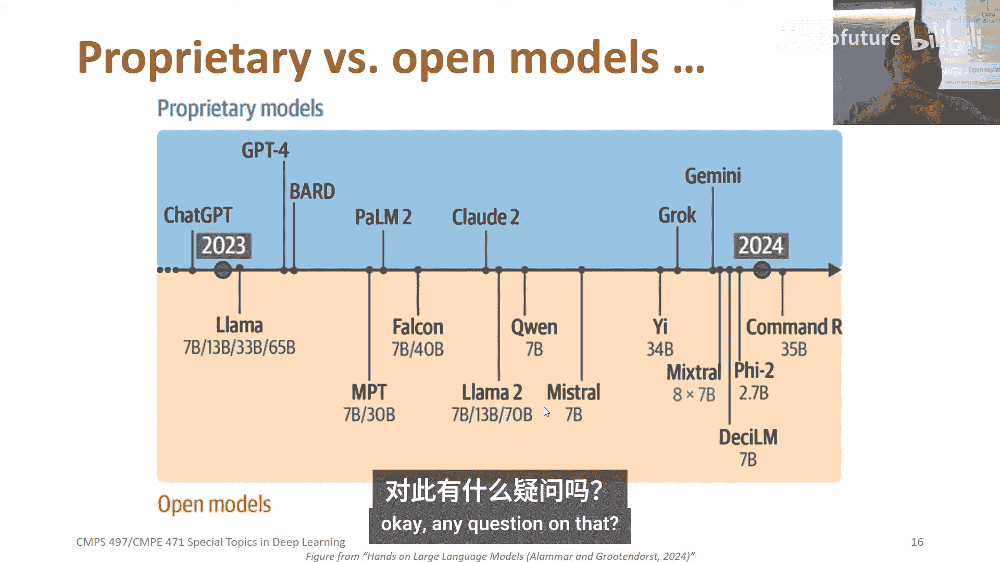
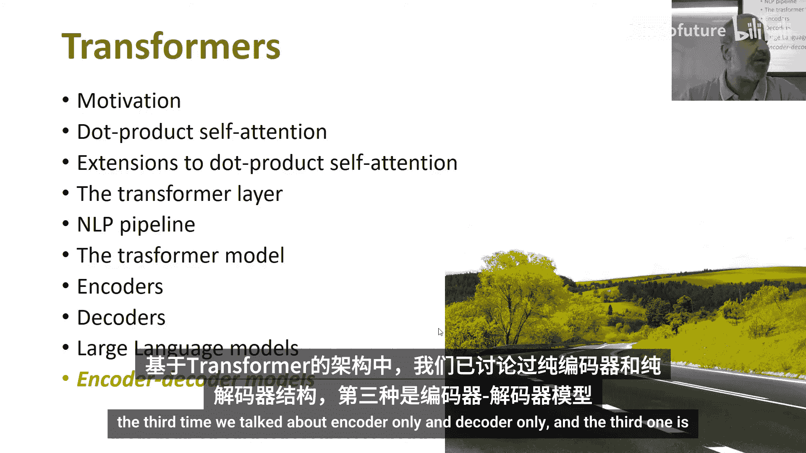
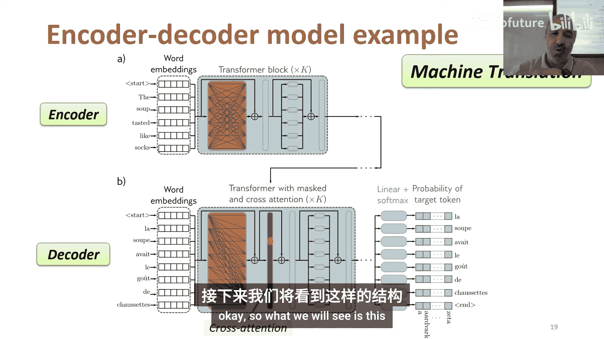
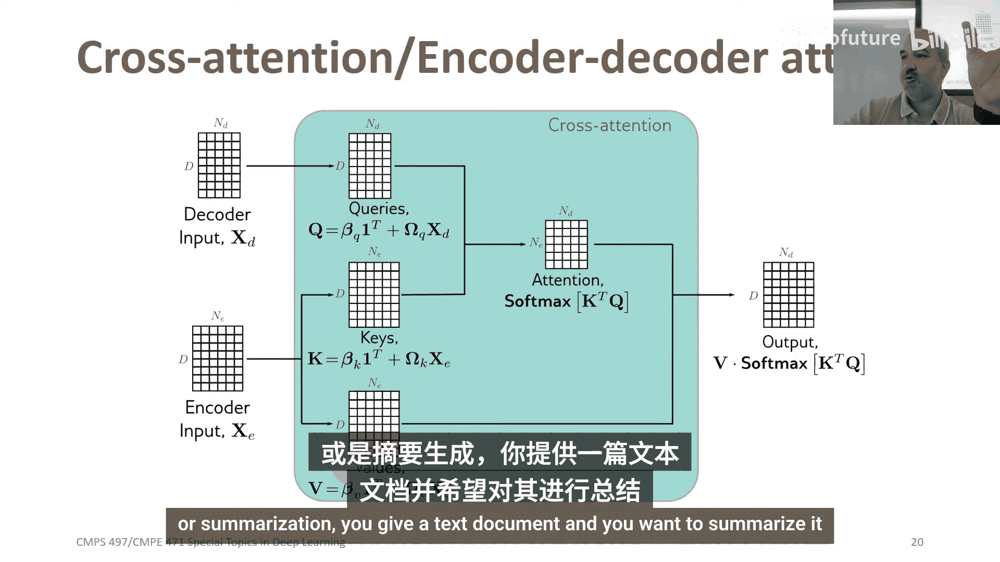
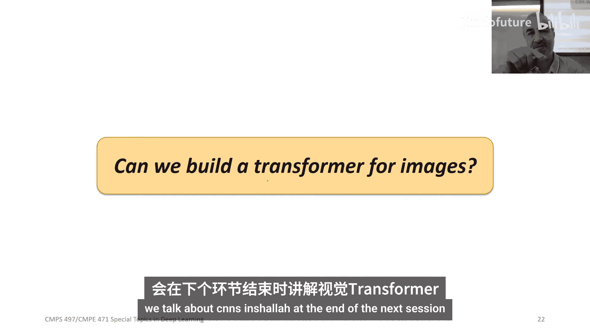

# 024：Transformer V (LLMs 与编码器-解码器模型) 🧠

在本节课中，我们将完成对Transformer架构的讨论。我们将首先快速回顾大型语言模型，然后深入探讨Transformer的第三种主要类型：编码器-解码器模型。最后，我们将开启关于卷积神经网络的新篇章。

## 概述 📋

上一讲我们介绍了仅解码器模型，例如GPT系列。本节我们将首先回顾这些大型语言模型的关键概念，然后探讨编码器-解码器模型，这类模型专为序列到序列任务设计，如机器翻译。

## 大型语言模型回顾 🦾

以下是GPT系列模型的发展历程，展示了模型参数规模的快速增长：
*   **GPT-1**：参数为1.17亿。
*   **GPT-2**：参数增长至15亿。
*   **GPT-3**：参数达到1750亿。
*   **GPT-4**：具体参数未公开，预计规模远超GPT-3。

为了让大家对GPT-3的规模有更具体的认识，以下是其关键架构参数：
*   **发布年份**：2020年。
*   **序列长度**：2048个标记。
*   **批次大小**：320万个标记。
*   **Transformer层数**：96层。
*   **词嵌入维度**：12288。
*   **注意力头数量**：96个。
*   **键/查询/值向量维度**：128。
*   **训练数据总量**：3000亿个标记。
*   **总参数量**：1750亿。

这些庞大的模型引入了“大型语言模型”这一术语，特指规模巨大的语言模型。

## 什么是大型语言模型？ 🤔

“大型”的定义随时间而变化。目前，一种常见的划分是：
*   **小型模型**：参数少于1000亿。
*   **大型模型**：参数超过1000亿。GPT-3是此类模型的基准。

这些模型通过在海量文本数据上训练，不仅学会了语言的**语法**，还掌握了一定的**常识性知识**和**事实**。例如，询问“卡塔尔的首都是哪里？”，模型能够回答“多哈”，因为它从训练数据中见过这个事实。

大型语言模型主要指**仅解码器**的生成式模型。其核心训练任务是**下一个标记预测**，这本质上是一种文本补全任务。例如，给定句子开头，模型能够生成后续文本。

由于在海量数据上进行了预训练，这些大型模型获得了一个重要的副产品：**无需微调**即可在许多任务上表现良好。这被称为**上下文学习**或**少样本学习**。

以下是上下文学习的示例：
*   **输入（提示）**：
    *   差英语：`he no go there.`
    *   好英语：`He does not go there.`
    *   差英语：`I is happy.`
    *   好英语：`I am happy.`
    *   差英语：`you early arrive.`
    *   好英语：`You arrived early.`
    *   差英语：`We wants apples.`
*   **期望模型输出**：`We want apples.`

模型仅通过提示中的几个例子，就能学会将差英语修正为好英语，而**其自身的参数并未被更新**。这与需要更新模型权重的监督学习有本质区别。有时甚至无需示例，仅通过指令就能完成任务，这称为**零样本学习**。

## 以ChatGPT为例 🗣️

ChatGPT基于GPT-3.5。我们通常将预训练模型称为**基础模型**，它们是未经任务特定微调的原始模型。

ChatGPT不仅是一个基础模型，它还经过了专门微调，主要针对两点：
1.  **遵循指令**：通过人类提供的指令和对应回答的示例进行训练，使模型学会理解并响应各种类型的指令。
2.  **提供诚实无害的回答**：训练模型使其输出尽可能符合人类价值观，减少有害或虚假信息的生成。

这种微调使用了一种名为**基于人类反馈的强化学习**的算法。训练数据由人类提供，例如：
*   **指令**：`描述什么是研究型大学。`
*   **人类提供的回答**：`研究型大学是一类将科学研究置于核心地位的高等教育机构...`
*   **指令**：`为在中东学习计算机科学博士推荐三到四所好大学。`
*   **人类提供的回答**：`1. 卡塔尔大学， 2. 贝鲁特美国大学， 3. ...`

训练时，将指令和回答（中间用特殊标记分隔）一起输入模型，并训练模型预测回答部分，类似于下一个词预测任务。

## 封闭模型与开放模型 🔓

在模型部署方面，主要有两种类型：
*   **封闭模型**：也称为专有模型。模型参数和架构不公开，公众只能通过API接口使用。例如GPT-4、Claude。
*   **开放模型**：模型参数（有时包括架构和训练代码）向公众开放。例如Llama 2、Falcon。用户可以下载并在本地运行、微调这些模型，拥有完全的控制权。

开放模型的主要优势在于允许用户进行自定义微调。而对于封闭模型，用户通常无法直接访问模型参数进行微调，尽管有些公司提供付费的微调API服务。

## 编码器-解码器模型 🔄

上一节我们回顾了仅解码器模型，本节我们来看看Transformer的第三种架构：编码器-解码器模型。为什么需要这种模型？它主要用于**序列到序列**的任务。

一个常见的例子是**机器翻译**：输入一个英语句子（序列），输出对应的法语句子（另一个序列）。在这种情况下，我们需要同时处理输入序列和生成输出序列，因此编码器和解码器都需要。

回想一下Transformer原始论文中的彩色架构图，其左侧是编码器堆栈，右侧是解码器堆栈，两者通过某种方式连接。核心思想是：**编码器**学习输入序列的表示，然后将这个表示传递给**解码器**，由解码器生成输出序列。编码器擅长学习表示，解码器擅长生成文本。

与仅编码器或仅解码器模型类似，编码器-解码器模型也由多层Transformer块堆叠而成。但解码器的Transformer层有一个额外的子层。

在解码器中，第一个注意力层是**掩码自注意力**，这是为了防止解码器在生成当前词时“偷看”未来的词。除此之外，解码器层还包含一个**交叉注意力**层（也称为编码器-解码器注意力层）。

## 理解交叉注意力 🤝

我们为什么需要交叉注意力？在机器翻译中，编码器处理英语句子（输入序列），解码器生成法语句子（输出序列）。除了法语词之间的自注意力，一个法语词还应该与它翻译自的英语词建立联系。这种**输入序列和输出序列之间的注意力**就是交叉注意力。

它是如何工作的？回顾注意力的计算需要**键、查询和值**。
*   在交叉注意力中，**查询来自解码器**（当前正在生成的输出序列的表示）。
*   **键和值来自编码器**（输入序列的最终表示）。

具体来说，我们取**编码器最后一层的输出**作为键和值，然后将它们输入到**解码器的每一层**。在解码器的每一层，我们使用该层产生的查询，与来自编码器的键计算注意力权重。这些权重决定了每个法语词（查询）应该关注输入英语句子的哪些部分（键）。最后，用这些权重对编码器提供的值进行加权求和，得到交叉注意力的输出。

这非常符合我们之前对键和查询的直观理解：查询是我们要寻找的东西（法语词在寻找与之相关的英语词），键是我们搜索的索引（英语词的表示）。

## 应用与总结 🎯

编码器-解码器模型适用于任何序列到序列任务，例如：
*   **机器翻译**
*   **文本摘要**（长文本输入，短摘要输出）
*   **问答系统**（问题输入，答案输出）

连接编码器和解码器的就是**交叉注意力机制**，它传递的是编码器最后一层的**键和值**，供解码器每一层使用，从而在每一层都影响输出表示。

至此，我们完成了Transformer核心架构的讲解。Transformer是当前生成式AI爆发背后的关键技术。最后留一个思考题：Transformer只能用于文本吗？**不**。只要能将输入（如图像的像素块）表示为嵌入向量，就可以使用Transformer架构。我们将在后续课程中介绍**视觉Transformer**。

## 本节课总结 📚

在本节课中，我们一起学习了：
1.  回顾了大型语言模型的发展与特点，特别是其通过海量预训练获得的上下文学习能力。
2.  以ChatGPT为例，了解了指令微调和基于人类反馈的强化学习。
3.  区分了封闭模型与开放模型。
4.  深入探讨了Transformer的第三种架构——编码器-解码器模型，及其核心组件**交叉注意力**的工作原理，该机制通过将编码器输出的键和值传递给解码器，实现了输入序列与输出序列之间的信息交互，使其完美适用于机器翻译等序列到序列任务。