# 026：卷积神经网络 II

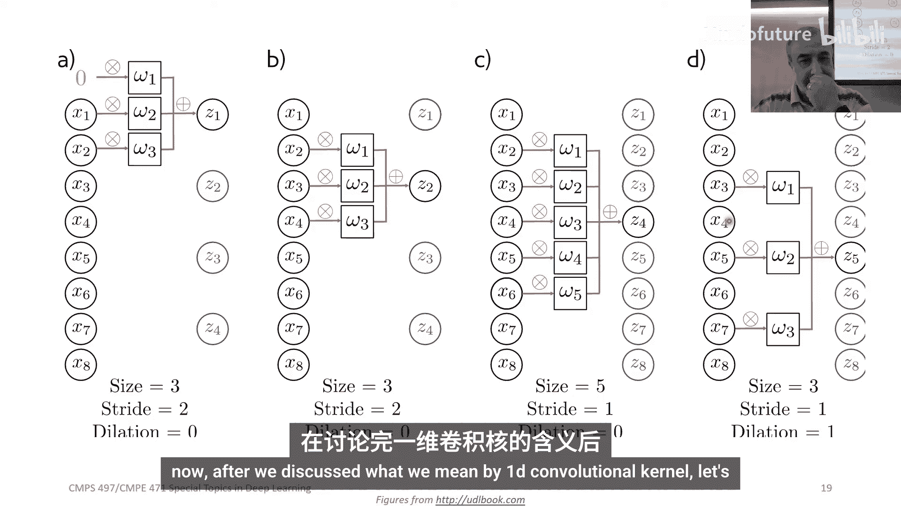

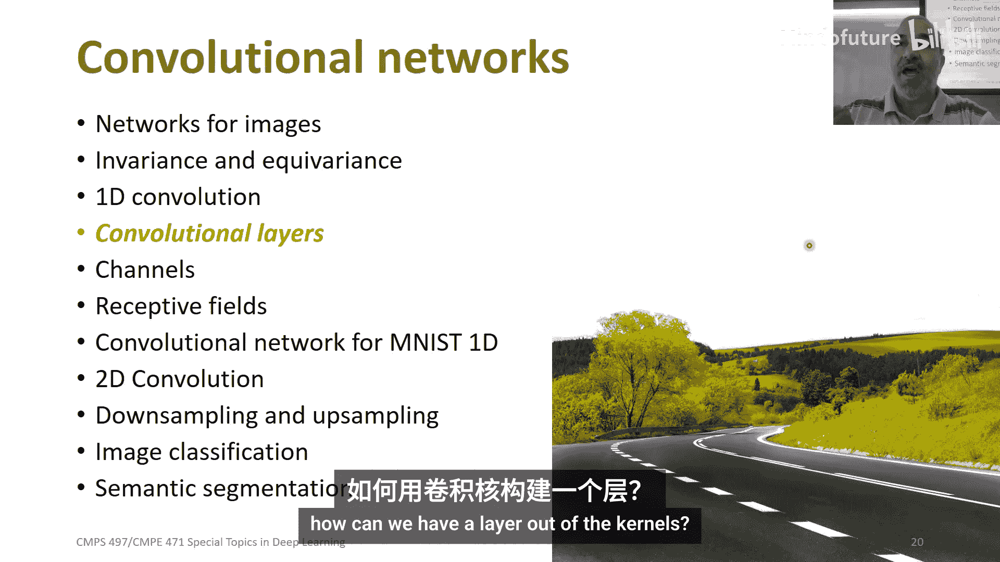

在本节课中，我们将继续学习卷积神经网络。上一节我们介绍了1D卷积的基本概念，本节中我们将深入探讨卷积层、通道、感受野等核心概念，并将其扩展到2D卷积，以理解其在图像处理中的应用。

## 卷积层

上一节我们介绍了1D卷积核及其参数（步长、核大小、膨胀率）。现在，我们来看看如何由卷积核构成一个完整的卷积层。

其核心思想与我们熟悉的标准神经网络层类似。我们将卷积核应用于输入，计算加权和，加上一个偏置项，然后应用激活函数。这个过程会作用在输入的每一个区域上。

用公式表示，对于一个以输入位置 `x_i` 为中心的卷积操作，其输出 `h_i` 的计算如下：
`h_i = activation( (w_1 * x_{i-1} + w_2 * x_i + w_3 * x_{i+1}) + b )`
其中 `w_1, w_2, w_3` 是卷积核的权重，`b` 是偏置，`activation` 通常是ReLU或其他激活函数。

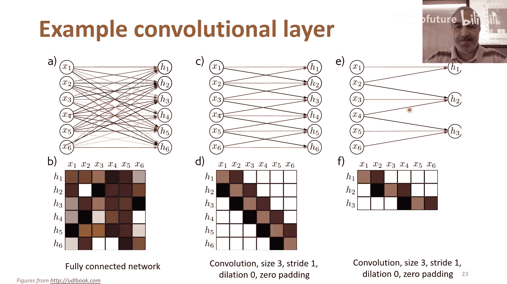

这个操作会产生一列隐藏单元。需要注意的是，计算不同位置的隐藏单元 `h_i` 时，使用的是**同一组**权重 `w_1, w_2, w_3` 和**同一个**偏置 `b`。这意味着参数在整个输入上是共享的。

与全连接网络相比，卷积层是其一个特例。在全连接网络中，每个隐藏单元都有自己独立的一组权重。对于一个有 `D` 个输入和 `D` 个隐藏单元的层，权重数量是 `D * D`。而在卷积层中，权重数量仅取决于卷积核的大小（例如大小为3的核有3个权重），与输入大小无关，因此参数数量要少得多。

以下是卷积层与全连接层在权重矩阵上的直观对比：

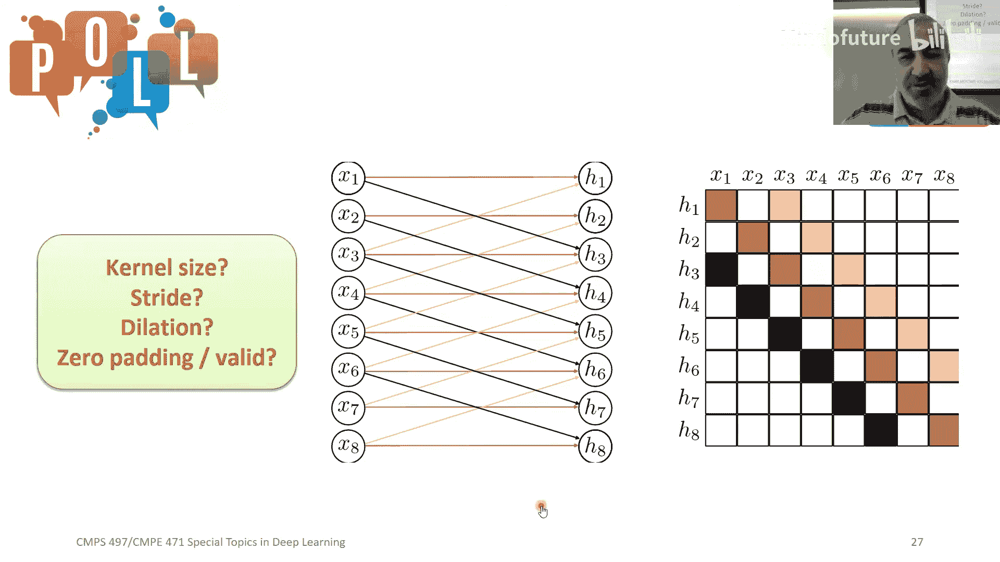

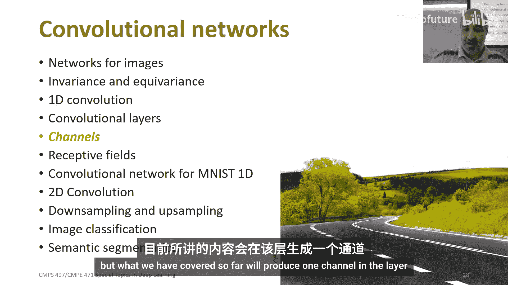

*   **全连接层**：一个6输入、6隐藏单元的层，其权重矩阵是一个6x6的矩阵，所有36个权重都可以不同。
*   **卷积层**：一个使用大小为3、步长为1的卷积核的层，其权重矩阵中，每行（对应一个输出单元）的权重模式是相同的，只是在不同行间平移。整个矩阵只有3个独立的权重值。

因此，卷积层可以看作是一个权重高度稀疏（很多0）且具有权重共享约束的全连接层。

## 通道

到目前为止，一个卷积核只能产生一个输出通道。但为了从输入中学习多种不同的特征或模式，我们需要使用多个卷积核。

每个独立的卷积核并行地处理整个输入，各自产生一个输出通道。这些通道在同一个层内堆叠起来。这类似于Transformer中的多头注意力机制，旨在通过不同的“头”获得不同的特征表示。

所以，**输出通道的数量等于该层中卷积核的数量**。每个卷积核有其独立的权重和偏置。因此，增加输出通道数会增加该层的参数总量。

## 多输入通道的处理

当输入层本身具有多个通道时（例如彩色图像的RGB三通道），卷积核的处理方式也需要扩展。

此时，卷积核不再是一个一维或二维的权重数组，而是具有了“深度”。对于一个大小为 `K` 的核，如果输入有 `C_in` 个通道，那么该卷积核的权重形状就是 `C_in x K`（对于1D）或 `C_in x K x K`（对于2D）。

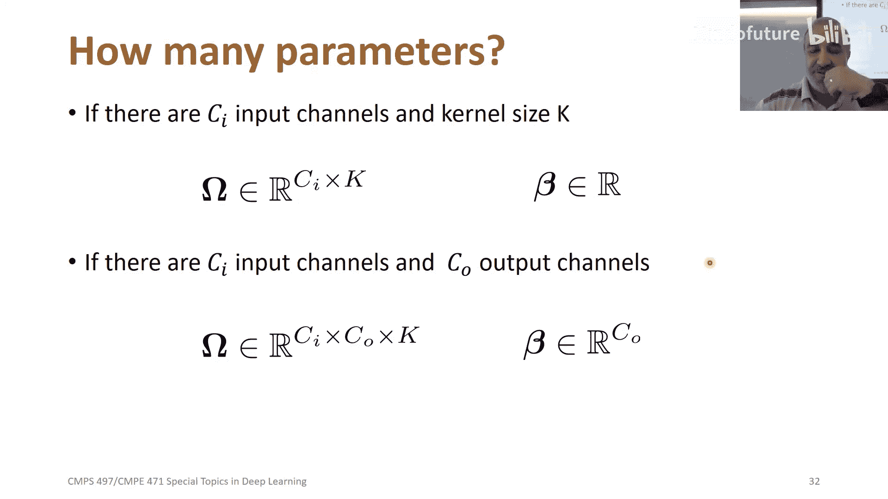

计算一个输出单元时，卷积核会同时作用在**所有输入通道**的对应区域上，进行加权求和，再加上一个偏置，最后通过激活函数。因此，一个卷积核无论输入通道有多少，仍然只产生**一个**输出通道。

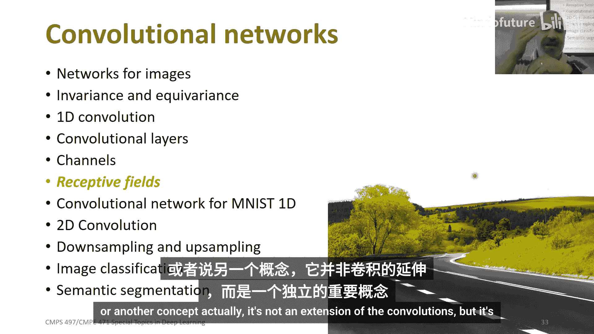

总结一下参数计算：
*   对于一个卷积核：权重数 = `C_in * K` (1D) 或 `C_in * K * K` (2D)，偏置数 = 1。
*   对于一层（有 `C_out` 个输出通道）：总权重数 = `C_out * C_in * K` (1D) 或 `C_out * C_in * K * K` (2D)，总偏置数 = `C_out`。

## 感受野

感受野是卷积神经网络中一个非常重要的概念。**一个隐藏单元的感受野，是指输入层中所有能影响该单元计算的区域。**

在浅层网络中，一个隐藏单元的感受野很小，仅由卷积核大小决定。例如，第一层中一个单元的感受野就是卷积核覆盖的那几个输入像素。

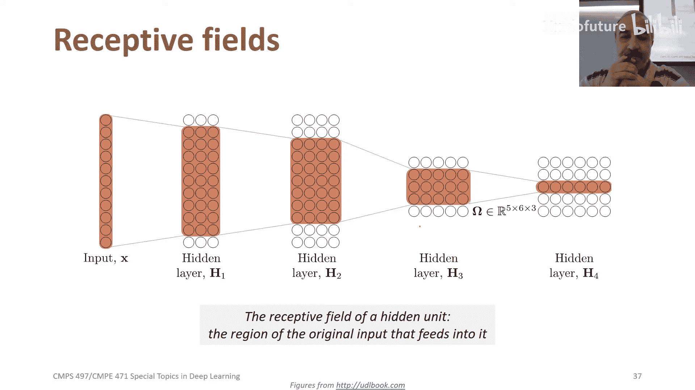

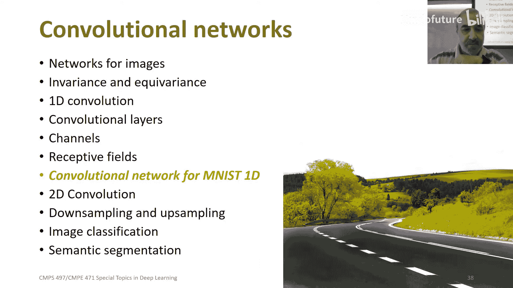

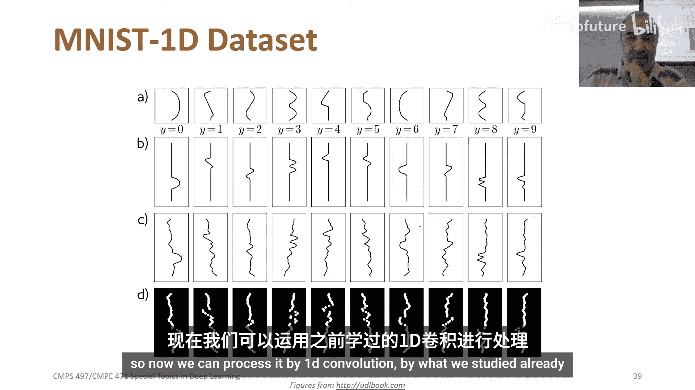

随着网络加深，高层中的隐藏单元是由低层的多个单元计算而来，而低层的这些单元又各自对应输入层的一片区域。因此，**高层隐藏单元的感受野会变得更大**，它整合了输入层中更广阔区域的信息。

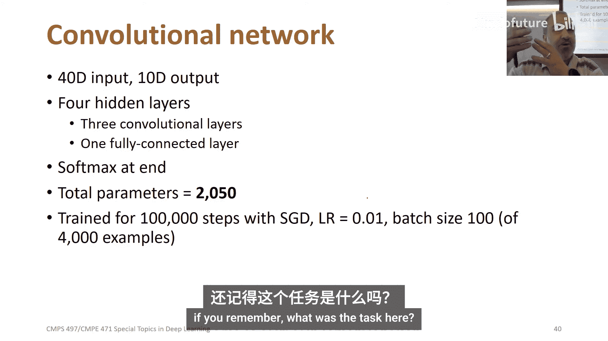

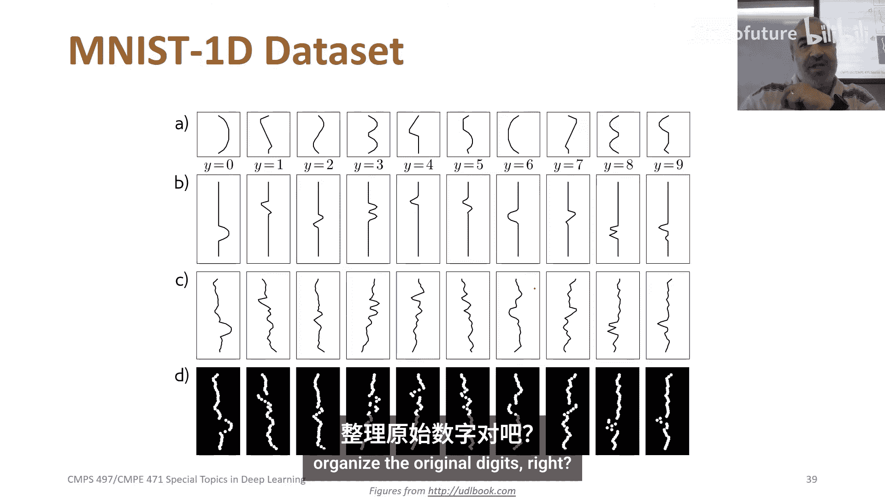

这种结构具有直观的语义：浅层网络学习局部、底层的特征（如边缘、纹理）；中层网络将这些局部特征组合成更复杂的模式（如部件、轮廓）；深层网络则进一步组合，形成高级的、语义化的概念（如物体、场景）。感受野的逐层扩大正是这种特征抽象过程的基础。

## 1D CNN 应用示例

我们来看一个使用1D卷积神经网络处理数据的实际例子。这个任务是对手写数字进行分类（0-9）。原始图像被展平成长度为40的1D向量作为输入。

网络结构如下：
1.  **输入层**：40个单元。
2.  **卷积层1**：15个输出通道，卷积核大小=3，步长=2。输出形状：19x15。
3.  **卷积层2**：15个输出通道，卷积核大小=3，步长=2。输出形状：9x15。
4.  **卷积层3**：15个输出通道，卷积核大小=3，步长=2。输出形状：4x15。
5.  **展平**：将4x15=60个单元展平为1D向量。
6.  **全连接层**：连接60个输入单元到10个输出单元。
7.  **输出层**：10个单元（对应10个数字），使用Softmax激活函数。

该网络总参数量约为2050。作为对比，一个具有相似容量（相同层数和每层单元数）的全连接网络，其参数量高达约59,000。

实验结果表明，参数量少得多的卷积网络在测试集上取得了**更低（更好）的误差**。这是因为：
1.  **参数共享与局部连接**：大幅减少了参数空间，降低了过拟合风险，提升了泛化能力。
2.  **归纳偏置**：卷积结构内置了“平移不变性”和“局部性”的假设，这非常符合图像数据的特性，使得模型更容易找到有效的解决方案。

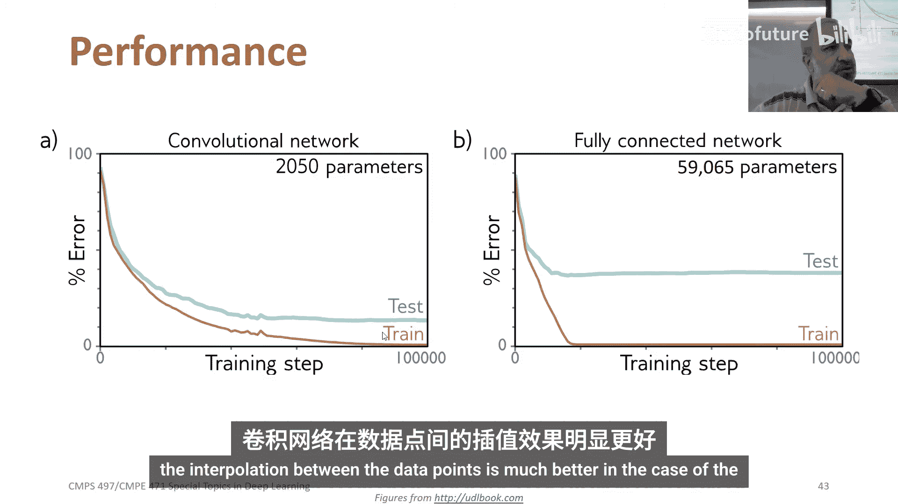

1D卷积不仅可用于处理展平的图像数据，也适用于其他序列数据，如文本（词序列）和音频（时间序列信号）。

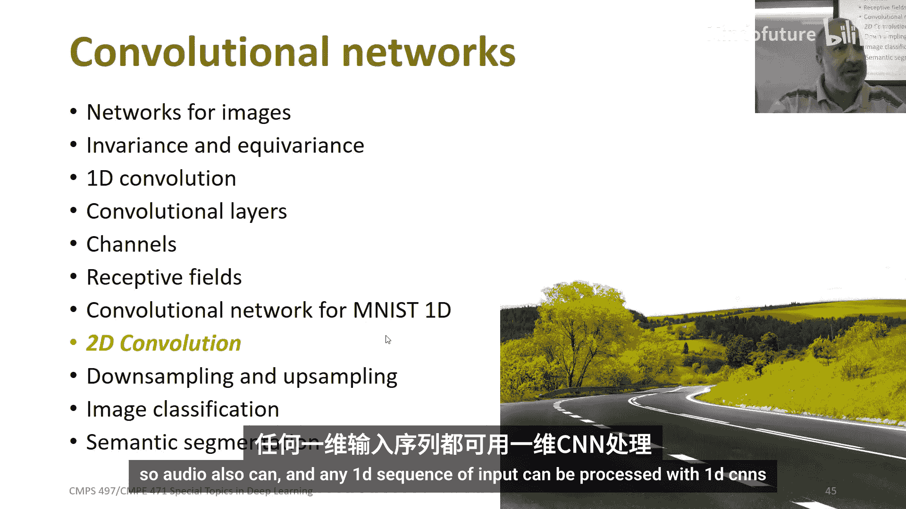

## 扩展到2D卷积

将1D卷积的概念扩展到2D以处理图像等数据是非常直观的。核心变化在于：
*   **输入**：每个输入通道是一个2D矩阵（如图像）。
*   **卷积核**：也是一个2D权重矩阵。
*   **操作**：卷积核在输入通道的**两个维度（高度和宽度）上滑动**。在每个位置，计算核与输入局部区域的逐元素乘积之和，加上偏置，再应用激活函数。
*   **输出**：每个卷积核产生一个2D的输出通道。

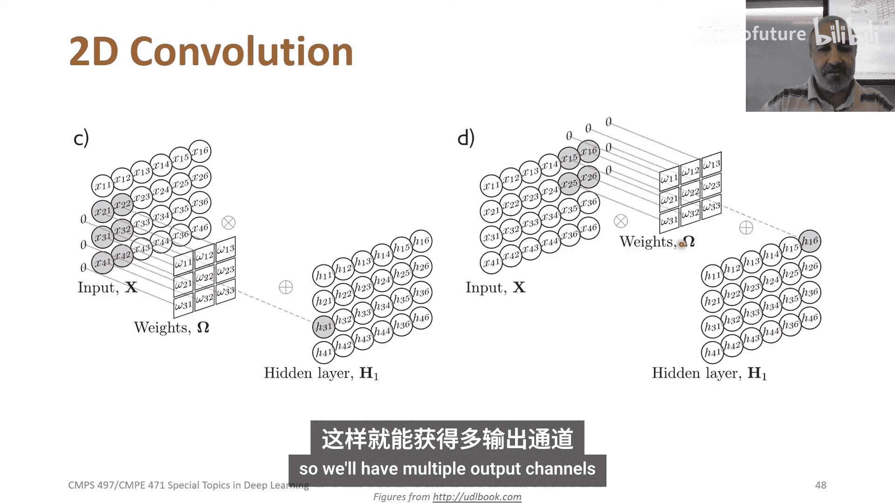

处理多通道2D输入（如RGB图像）时，与1D情况完全对应：每个卷积核的深度与输入通道数 `C_in` 相同（形状为 `C_in x K x K`），它在所有输入通道的对应2D区域上进行卷积操作，最终生成一个2D输出特征图。

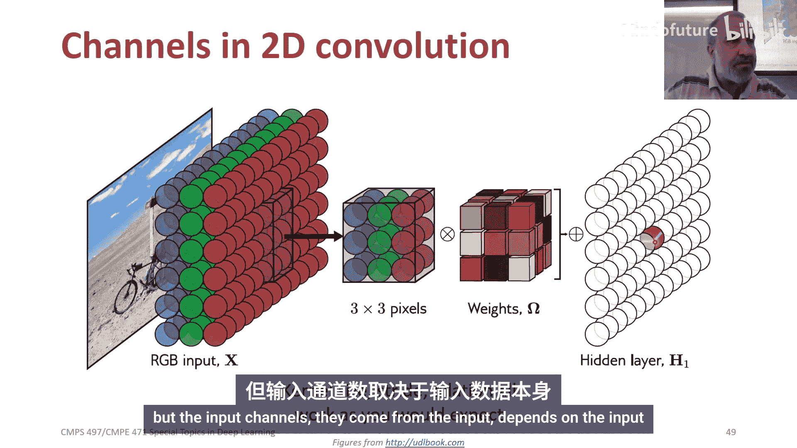

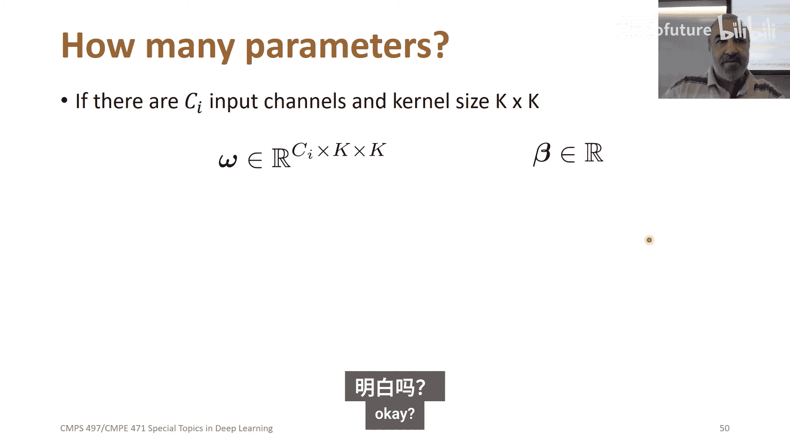

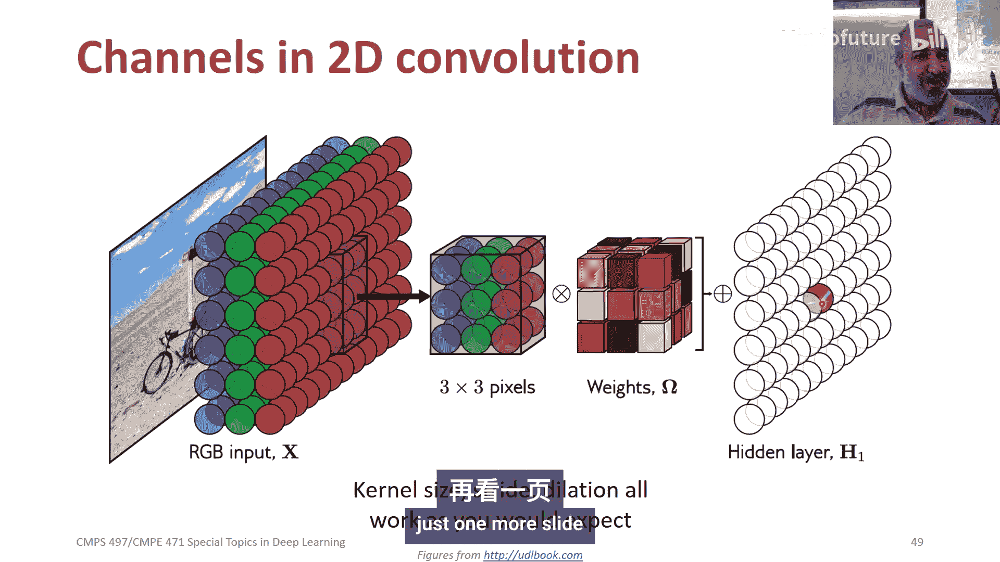

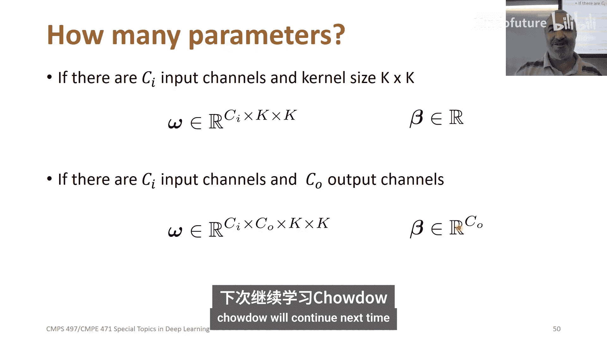

本节课中我们一起学习了卷积层的构成、多输入输出通道的工作机制、感受野的概念及其重要性，并通过实例看到了1D CNN的优势。最后，我们将核心概念自然延伸到了处理图像的2D卷积。理解这些基础是构建和理解复杂CNN模型的关键。