# 【卡塔尔大学】深度学习 CMPS497 ｜ Understanding Deep Learning ｜ Fall 2024 p01 P01_第一讲-欢迎来到深度学习 -BV1vQvNz1EeK_p1-

。先方发表解东 from and him。Welcome to the deep learning course。

Make sure that you are in the right classroom again for those who are just coming。

I usually start with this， along Alinaman Fanabi Litenana wasnman。

 or let us learn what would benefit us， benefit us from what we learn and increase us in knowledge and always this should be our goal。

And this one Mans Sofiia in， whoever follows a path to seek knowledge therein Allah will make easy for him or a path to priorize that this should be our intention。

 again not only from this course， but in any course that you are taking any knowledge that you seek。

And in addition to that， and with what we are seeing maybe right now in RaA。

 I think we should have another intention in addition to what we have just mentioned。嗯。

With the weakness that we are in now and。The feeling that we are not able to even help those people。

I think we have something that we can do， maybe in the long gun。

 but we have some responsibility is to excel in what we are doing in our specialities so that we can draw the long gun。

 make a change。So let this be another intention from now on。Okay， iss not to learn just for the GPA。

 for the degree， for the job， for the certificate。Learn to benefit your own。哎。And。

In addition to that， also， remember that the genocide that is。Being done now in Re。Is unfortunately。

 powered by。Yeah。It's powered by AI。Unfortunately， I don't know if you had this or not。

 but there are many reports that the techniques that are used are actually powered by AI and deep learning techniques。

So I hope that this is another intention for you to learn this course to know how this is done and maybe try to stop it。

And remember also that in a lot of heavy am had and you cleaner。

Allah loves it when one of you does something that he or she masters it or does it in a very well way in the best way。

 possibly。Okay， not just any Amella and new。Okay， with that in mind， welcome to deep learninging。

This is a field that really changes the wallet， and I would explain Shaahh very soon why I think it changes the wallet。

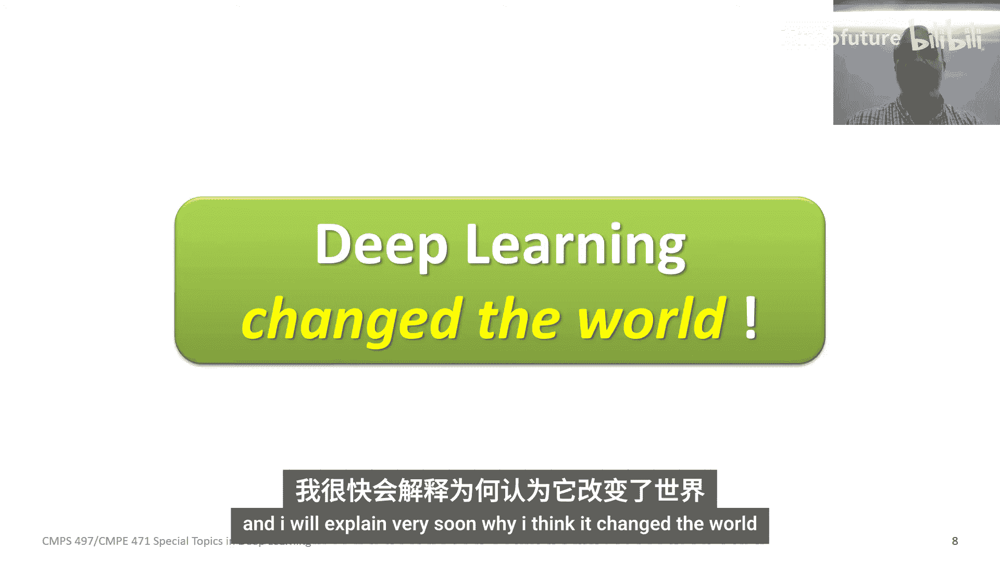

Before doing that let me introduce myself， my name is Emma Said I'm an associate professor of Comp science。

This is where my office is。 I don't know if youll see。这个。

Yeah this is where my office is in B386 in the second floor， this is my email address。

 my phone number， my webage， and I also exist virtually on the web， I exist on Twitter。

 I exist on YouTube and I exist also on LinkedIn。My specialities。

 my major specialty is in field code information at re。

 this is the field behind building search engines。😊。

And I have also minor specialities in sub fields like data science。

 big data analytics and applied machine learning and this is where I came from to teach this course and my interest in deep learning。

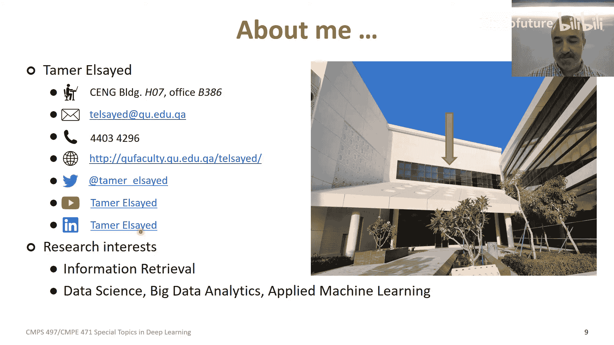

A bit of my history， I'm Egyptian。I graduated from University of Alexander in Egypt in 1997。

And I got my master in 2001 from the same university。

 then I went to get my PhD from the US from University of Maryland College Park in 2009。

I spend one more year after that as a postdoc， postdoc position is like a training position before you apply for professor positions。

While I was doing my PhD， I spent a summer at Google as a software engineering inter in 2007 after I was done with my postdoc in Maryland。

 I had another postdoc at CAt， King Abdullah University of Science and Technology in Saudi Arabia。

 I spent one year there。

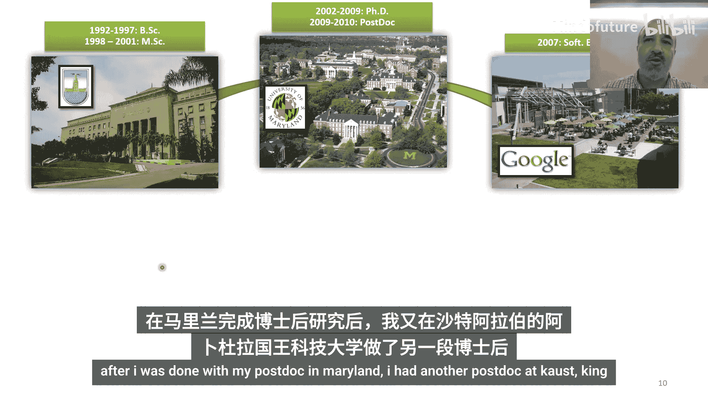

And then in 2011， I moved to Egypt as a researcher in Microsoft in Cao for one more year before I came to Hotel University in 2012 as an assistant professor and in 2018 as an associate professor。

So this is very brief history of mine。if you didn't take any courses with me and I think many of you didn't。

 how many of you can you raise your hand if you took any course， I think only to。

You took a course with me before Oh you and you so you are telling her that reminding her okay yeah。

 so three only so most of you didn't so here's a bit of my teaching style those know me very well I like interaction a lot in class I asked many questions I also like to be asked to get questions from you。

😊，I' like to know and memorize your names， I will try from today to remember your names。

So please before you answer or ask any questions let me know your name so that I can remember it I like also to give practical assignments。

 you will see that controlline in in this course， try to。

Link what we learn to real applications as much as we can。

 and I like to learn whether from the material that I'm teaching or from you from the questions that challenge me。

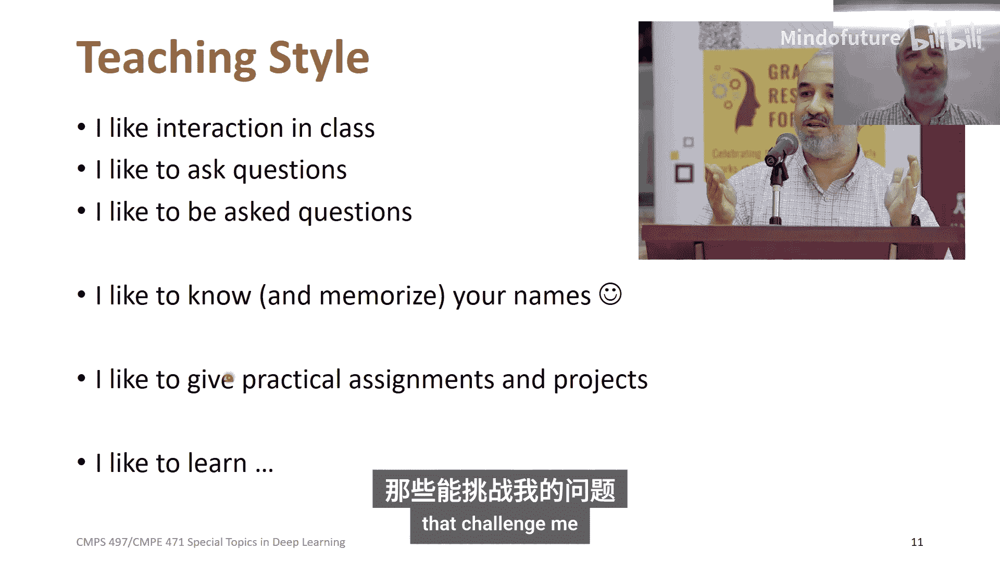

So this is。My side。Now， it's your it。Okay， so I want you to tell me your name， first name for now。

Assuming that there will be no conflict。

And something interesting about you。Welcome back again to deep learning。And here's why I think。

 or let me explain why I think that deep learning has changed a world。 First of all。

 how many of you agree with me that it changes the world。Okay， why？仲有嘢就系来。Why。

 why do you think a changing the world。What mean because the use of AI in what。Everywhere。Okay。

 so you think that AI is now used everywhere， so it is it really changes our daily lives because we use many applications that are powered by AI。

But this is AI， right？But here we are talking about deep learning。Is it the same？HWhat do you think。

 yes。等么看见。No。对。Okay， so that something similar to what we just said right。

 it is used now in how you mean deep learning is the mathematical models。😡，Okay， and how。

Before we have。对O。know。Yes。Okay， very good。 Okay， and， and， and this is related to deep learning。

 right。Not just AI or youre talking about AI again。You多け。Okay， very good， okay。Okay。

 we'll talk about that。对。Yes， so mainly deep learning is behind many of the applications that we use in our daily lives。

Okay， and they actually changed it all the way that we actually did。And all of that， because of the。

The model called neural networks。We can actually say that neural networkss are taking over。

The worded by a tool because it is the model that is used in so many applications and it may actually break those in solving many problems。

We can say that neural networks are becoming one of the main approaches to AI。

 if not the main approach nowadays to AI。Which means that it is just one way of the models or the techniques that are used in AI。

We'll talk about that Angela in detail later。As we said。

 it was successfully applied to many applications and we talk about several of them right right now。

 will give you examples of real word applications that you might have heard of or even used them already。

That are powered by neuraler networks。And they established the state of the art in many problems。

 what do you mean by state of the art， when we say establish the state of the art。

 we mean that they achieved or using neural networks achieved in solving problems。

 achieved the best performance currently in solving many problems。

Even problems that were tried before using other machine learning techniques。

 the annual networks and deep learning establish new performance levels。

Or solving even new problems that we didn't try before。Give you some examples， speech recognition。😊。

Is powered by neural networks and thus deep learning and we'll talk about the relationship between neural networks and deep learning。

 but for now you can think of them as very related。You know what is the speech recognition？

What is speech recognition？Yes， so it's transcription from audio when you say something and the system transcribe says exactly or detects exactly what we said in text。

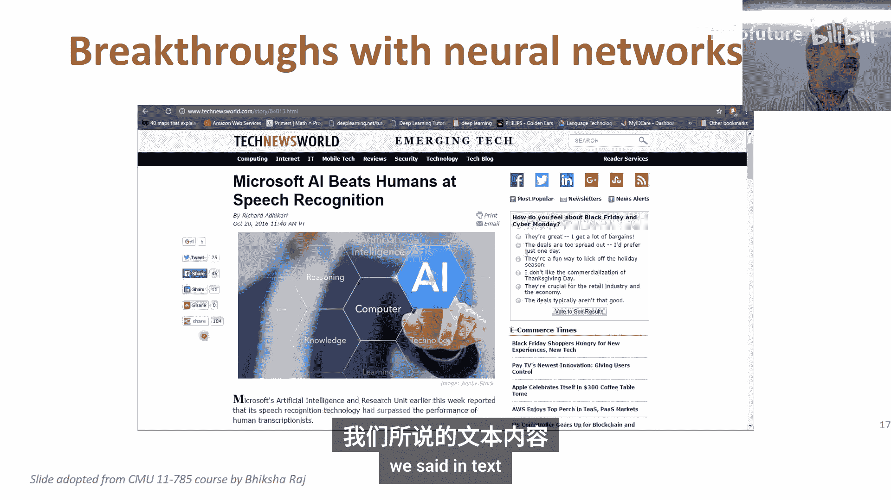

Translation， and I think many of us are using nowadays more and more the machine translation systems like Google Trans。

 It's now much more reliable than before。This is powered by neural networks and deep learning。

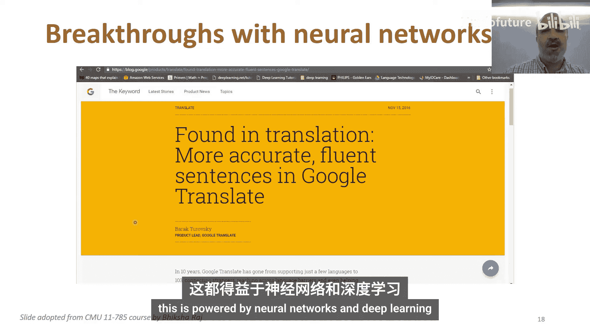

Generating images from description， you can give a description text textual description。

 and you ask the system to generate images that reflects or it presents。These descriptions。

 this is powered by neural networks。And I think the most famous application is。ChagBT okay， ChagBT。

 you can chat with it， give ask questions， get answers， opinions， sometimes suggestions， many things。

That are also powered by neural networks and deep learning。

This is the reverse problem of what we just mentioned about the giving a description and generating the image。

 this is the opposite， giving an image and asking the system to describe it。Also。

 there will breakthroughs in the performance using neural networks。

Even some systems that are powered by。AI techniques and machine learning techniques and deep learning techniques now are beating the best human performance in some problems of course you are familiar with chess right there is a more sophisticated version of chess called go it's much more complex than chess and there was a system that was built that was able to beat the best go player in the world。

At some point。Success of neural networks is seen in many fields。

 even from us to astronomy to healthcare， stock market in so many fields。

 I will give you a few more applications here， finding good social results。

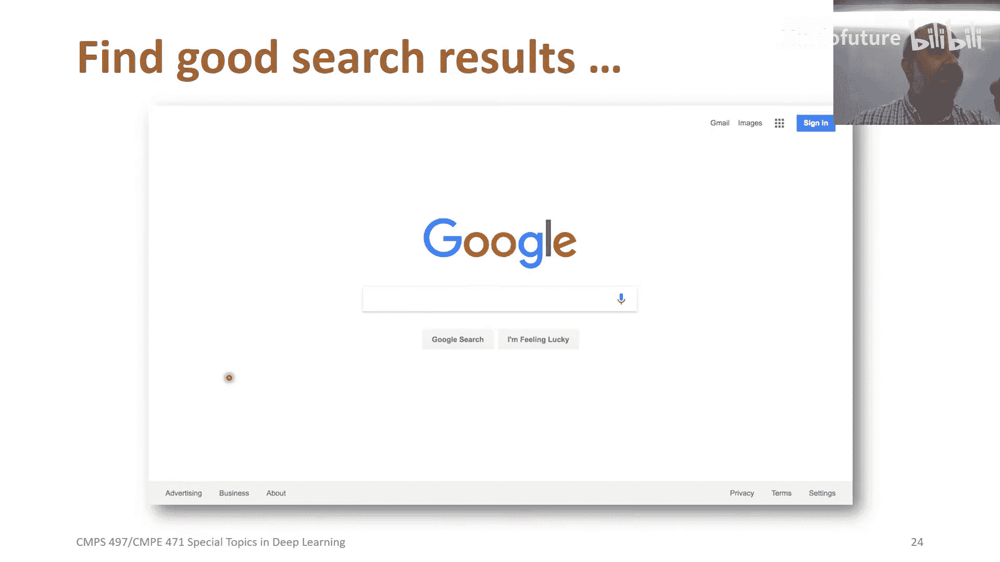

This is powered by deep learning， estimating the price， many of us use Uber to for lights。

 have you thought about how the price is estimated and how the time is estimated and so on。

 this is powered by deep learning。

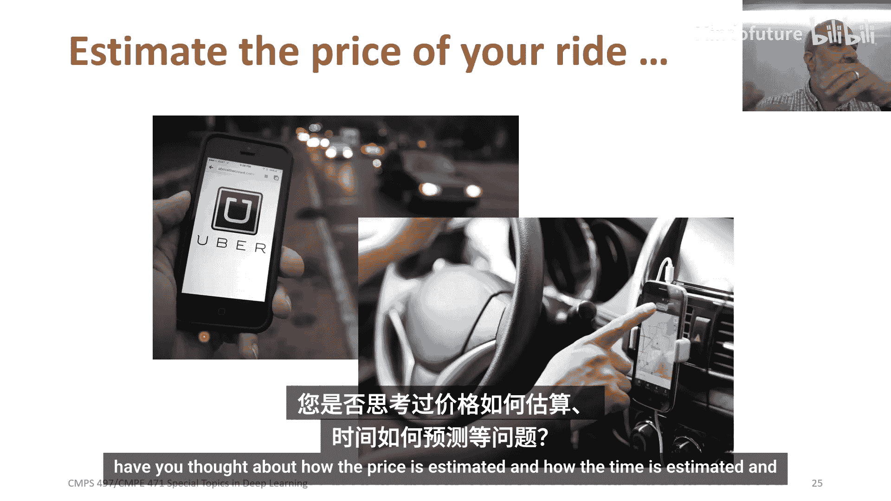

Monitoring the unusual behavior， whether indoor or outdoor through surveillance。

 this is done by deep learning driving self driving cars now are powered by deep learning。

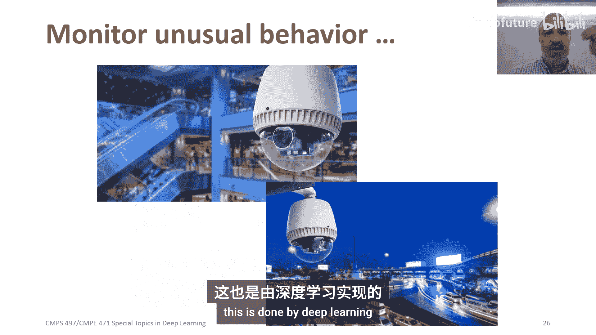

Even teaching robots how to cook。Is also powered by the learning。Okay， with that quick。

 very quick introduction， let me now switch a little bit to talk about some administrative stuff about the course。

First of all， please come on time。😡，Okay， today was exception that we started five minutes late。

 but shall love on next time we will start on time。ok。😊。

This is our schedule we you know the time of the lecture Monday and Wednesday。

 the office hour is not determined yet， I will share with you this week。

What it will be in my office if the time that will be selected is not very convenient for you at any point you can email me and schedule an appointment in a time that is convenient for both of us can just email me and we do that。

Of course， the attendance policy of QU will be enforce and this is very important if you miss the class。

You are responsible for all the material that is covered and all announcements that will be made in the class。

Okay， so make sure that you are aware of what happened in the lectures that you miss。

Class policy ask me， you can ask me at any time， just raise your hand and I will find the time the right time to answer your questions。

 but please don't answer without permission if I ask question and just raise your hand also I would see who can answer。

嗯。In many cases， I can see if you understand the material from your faces。Just by my experience。

 But sometimes I cannot。So it is your responsibility to make sure that you really understand the material。

 ask questions as you wish， don't be shy of asking questions at any time because it's your responsibility really to make sure that you understand。

😊，And don't be like me when I was a student， I was very shy to ask questions。

And I realized after that that was really bad I lost many missed many opportunities to learn by not asking questions in class Okay。

 so whatever the material that you are not sure or you didn't understand。

Stop me raise your hand and ask the question。 and I can。 I can repeat that control。

And try to make sure that you understand it。Okay。While in class， please don't use your phones。

 turn it off， or at least put it on vibration。No texting， No tweet things。

Okay so please just be with me if you feel at any point that you really need to tweet or to post on Facebook or any of the social media or making a phone call。

 you can get outside the class without my permission， don't just don't ask for my permission。

 just go outside the class， do whatever you want and come back。But whenever you are in class。

 be with me。😡，About computers， laptops， tablet and anything like that， it's okay to take notes。

 it's okay to code sometimes when I ask you to do that， but other than that， please turn them off。

 shut them down。Class resources， I think you notice that the Blackboard page now is ready right did you see it？

And I started to put the slides there， I will use it really extensively， everything would be there。

 syllabus， announcements， slides， lecture notes， lectures handouts， if there's any handouts。

 due dates， assignments， everything， all the sources would be in charge on Blackboard notice that you don't get notifications automatically from Blackboard sometimes or actually most of the times。

Okay， or maybe always。 but so don't rely on getting notifications from Blackboard。 Okay。

 you need to regularly check our page。 The sllabus is not there yet。

 I willt rather make it available by the next lecture。Okay， now this is the， I think。

 the most important slide in this lecture。Officially there are no prerequisites for the class on the system because this is a special topic course。

 it changes the topic over time so there is no prerequis that can be specified in advance。

 but in reality there are and this is what we will talk about in this slide。First of all。

 I know that some of you took a Read machine learning course。Okay。

 but the this is not required for the class， so I will not assume that you know machine learning if you already have taken the course。

Okay doesn't matter to me you took it， you didn't， there's no problem Okay。

 so machine learning is not a fire is not a fairrequisite for this class I'm not assuming that you have any machine learning knowledge。

几日几。That being said， there are actually prerequisites， which are。First of all， to gaminging。

 of course。Okay， so I expect that at least you took object toient programming and preferred data structures also。

Okay， so to that level。And of course， we will use Python。I think this is okay with every one of you。

Then I also assume that you have a basic knowledge in calculus。Okay。

 mainlyin how to compute derivatives， gradients， partial derivatives， and all of that。ok。😊。

I also assume that you have basic knowledge of probability and statistics。

The main probabilitybil theory， base role， train and role， the basic things okay and statistics。

 of course， how to compute averages， expectations， variance and all of that。And also， linear algebra。

You know what we mean by linear equation， meta C is， vectors， how to multiply meta C is。

 how to multiply matrix X by vector and so on。So this is the basic requirements for the course。

If you are any of， if you are missing most of these， then I think you should stop here。

 maybe leave the room if you want， and of the course。😡，If you any missing。Most of these。

If you are missing one of these， talk to me。😡，Okay， we'll see how we can manage it if possible。Okay。

Questions。Yes。Okay。On Thursdayday。好的。Okay， I。你过听。前边。Okay。

 I will not be able to do that every lecture and there's no time to do any revision in the lecture。

 but I will do that in advance， ya maybe this week or by the weekend I will try to force some revision material。

Okay， on these topics， just to a refresh， but I don't expect that you don't know anything about this and you use this this material because it's not。

😡，Teaching you the entire material。 It's just a quick tutorials of vision。

So you cannot rely completely on that from 0， from scratch。But it it should be a good decision。Okay。

 so I will。 I will try to do that tomorrow。🤧Okay， here are my two goals from the course and I hope that you will achieve them first to understand the basic principles behind the techniques of deep learning and having while having。

Vracicular experience， applying them to real world applications。So these are the two goals。

Understanding the principles and applying them in real problems。So by the end of the semester。

 I hope that you will be able to give in a problem you understand it， identify or。

Detect if it can be actually solved by deep learning and apply the appropriate deep learning model to it。

This is an important note that this course is not just a survey of models。

 Hal any just going through models and not linking them to real applications。And also。

 it's not a tutorial of specific libraries。And we are not here to learn a library to be used in deep learning。

We will use one of the libraries， actually， which is by thought。

But the main idea is to learn the basic concepts， the basic principles behind deep learning。

 and then you can use any of the libraries actually。

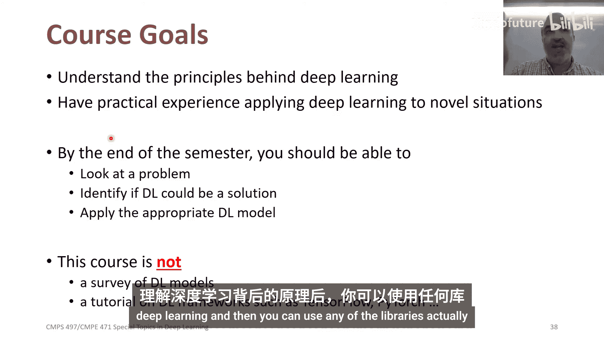

The textbook that we will use， actually this is the book I have a copy。It's a very new book。

Sco understanding deep learning。It's really a great book。 and you read many chapters from it。

Very after date。And easy to follow and date。So I hope that you will。You will actually use it。

Read it and benefit from it， it has very nice figures we will see the figures really very sophisticated and very well designed to make sure that you really understand the concept。

😊，And's the nice thing is that also it's a mix between theoretical and practical， it has no proofs。

 so it's not theoretical that of course has the equations as we will see。

 but there is no extensive proofs there。I not a single proof。And。It's not all about coding。Okay。

 so it's， it's， it's， it's nice。 it's a nice mix。And also most importantly。

 it is available freely by the author。On the website， on that website。

And also actually keeps putting new versions， I think the last version was last week。

 something like that， but we will of course fix specific versions so that we have the same version that we are looking at。

I will share that specific version， I think from May 2024。That we would use。

And that's an important also note that many slides that you will that I'm using are actually adopted from the content by the author Simon F。

 so thanks to him。

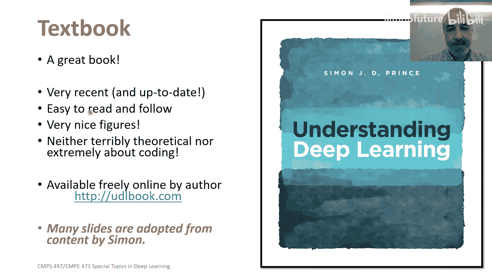

Tpics。These are not the topics of the course as a whole， this is the table of content of the book。

 we are not of course able to cover everything。😊，诶。So in the beginning。

 we will cover the basic material， which is coming to Chapt nine。Okay。

 sosha will cover everything up to chapter 9。And this is mainly about the deep neural networks。

 how to train them， how to measure the performance of it， and so on。

And then we will see more specialized and more complex architectures of deep learning。

We start by convolution and neural networks， CNNNs。

 and these are models that are specialized specially to images。So we will study them chapter 10。

 and then we will study transformers and large language models。

 which are models that are specialized more to process text。Life Gen GT and GT4 and so on。

That's chapterpt 12， and then we will move to unsupervised learning and generative models。

 GNS in chapter 15 and stable diffusion models in Cha 18。And also， finally。If we have time。

 we will go through deep reinforcement learning。That's chapter 19。In reality， the last four chapters。

 those 14， 15， 18 and 19， we will do them as much as time permits。Okay。

 so we will select based on time based on the pace of the course。U。

There will be notebooks also notebooks that are with the book and with the slides。

 sometimes I will show you in the lectures， some of the chs will play with it together。

 change things， see what is the effect and so on that will reassure the understanding of you of some of the concepts。

 and sometimes also we'll use them in the assignments。They are working in Google Coab。

 How many of you are familiar with Goab？Okay， so we'll give you an introduction on that。

 of course we'll share with you a tutorial on that， but that's really pretty easy。

How many you are familiar with Jo notebooks。Okay， much more。 Okay。

 so those notebooks also can be used with Joter。That's that's okay。

 But you need to install the libraries an U mat matro， matro Li and Pon。

But I prefer that you use cool。It's really easy and very similar to Joperter。But to do that。

 you will need a Google account。Okay， so please try to create an account before the next step。Okay。

Okay， maybe this is the slide that you are waiting for in this lecture， the grade distribution。

 we will have homework assignments， this includes problem solving and programming assignments sometimes it can mix any one assignment has both and that will be for 10% we will have like from four to five assignments like that and I will drop the worst of them in terms of grades and these are for individuals we will have quizzes for 20% I'm planning to have five quizzes we also drop the worst of them。

😊，And there will be no makeup quizzes， so if you miss one quiz。

 then consider it the one that is the worst。There will be a project also in the second half of the course and it will be for 20% of the grade and you will be in teams of two。

Will of course， share details at the time Cha and as the homework assignments。

 the project also will be applied。Finally， the exams we will have two exams。

 midterm exam for 20% and final exam for 30%， and both are closed。ok。😊，Any questions about that。

I said here tentative because it's not 100% finalized。

 it will be finalized by Ena next lecture when I post the syllabus。The date for the midterm exam。

 you will see it on the syllabus controller okay， so I will specify exactly the date form now so that you can plan ahead。

Okay， now what I expect from you in the course。First of all， is to work hard。

Let me tell you something that's very important。This topic。

Is nowadays the hottest topic in the field in your field。ok。😊。

So you have to really give a lot of effort and time to understand it。Okay。

 so that you gain really the knowledge that is being used now。In your field。ok。😊。

And if you did it when， I think this would be really a great asset in your CV and in applying for jobs Java in the future。

Okay， so you really need to work hard。In in that course。You need to review your math。

 you will help you on by posting some material， you will do of course a fair amount of programming。

 attend the lectures and by attending the lectures， I mean really attending the lectures。

 not just sitting in the classroom。And I think you understand the difference。

And try to come to class prepared and by being prepared， I mean try to do the reading。

 the required readings in advance in the syllabus I will tell you exactly what are the topic what are the chapters that are corresponding to which topic。

 try to read in advance as much as you can。Okay， that will help you a lot when you come to the lectures。

And of course， complete the homework and assignment and program assignments independently plan your time。

 start from day one， don't wait until they last。Minute or five minutes or day。对。Okay。

 now a quick fall to make sure that you are awake。And by poll here， I mean I will。

Poose questions for you， and some。The answers， potential answers and you think and tell me what the answer that you think is correct。

Okay。And we'll do that to child， I would try to do that all time。

And now we covered a lot of material， right。Yes。😊，No， okay。

 at least we covered something and you will see now questions on that thing first。

 what's the name of our textbook？I不是。说。It's not introduction to deep learning， Okay， very good。

How many quizzes would we have？5 on Shaah。 Okay， not4， not fixed。Okay， you want more。没得最个。Okay。

 can you make up any quiz。No， okay。Or it depends。No。Okay。

 among the needed background for this course。Cals， how about networks？It's neural network sign。

You arenetco networks brothers， brothers。Ha。But， you know。

 the computer image is completely different。 Okay， so it's not a quiet here， of course。Yeah。

 so geometry3 is not required。 I think， yeah， calculus and inner algebra are really needed。

 and of course， computing are。几。たい， pleaseシす。This is very serious。Right。Okay， so it's very serious。

 And I always say that if I would have found a bigger。Symbol。Okay， then that， I would have put it。

Okay， so it's a very similar serious matter， and I would tell you in a couple of slide why I think it's very serious。

 but let me explain。Copying from each other or from external sources is cheating。Okay。

 if it happened in one problem， let's say that we have an assignment 1 10 problems。

 it happened in one problem， it's considered the whole thing okay。

 so you'll get zero in the whole thing。😊，If just one problem is cheated and both the cheat and cheat form will get the same zero this is the。

 but I have to say it assignments for individuals are actually assignments for individuals。

 not teams。Okay， so all the homework assignments should be done by yourself。

 the handed in work must be your own。See that you， you， you put your name on whatever you you submit。

 right。What does that mean it means that this is yours， it's not Google's answers。

 it's not Cha GT's answers， it's not GT4 answers， you not Gemini answers。Whatever。Okay。

 it's not your friends answer says it's yours Okay， so don't copy。

 don't take someone on radio work and so on and of course。

 we will apply the regulations of the university whenever。An incident happens。

And this is why I think is it's very serious， it's serious because of that。明天社会累似，明天。

Whoever deceives he or she is not one of us anymore。 And this is extremely serious， La， Minna。ok。😊。

Extremely serious。So please take it。At that level。Okay， with that。

 I wish that Charla you will learn a lot。I hope， and you will learn while you enjoy it in Sha。

 I hope that the class you will find that class in very fun。U。Okay， ready for the fun。

Do the start China。So this part of the lecture is about introduction to deep learning。Okay。

The previous one was just welcoming。Okay， first thing to talk about。We still half 10 minutes on。喂。

So first thing is what is AI you hear about this word a lot right， AI， what is AI first。

 what does it stand for attroian intelligence very good okay， so that's easy。What do you mean by AI。

 What is it all about？Yes。不安全。It tries to act as human being。You are close。

 but it's not exactly like that。First， does it。吓。😮，Yeah， does it have。

 Does it have to act like human being exactly or。Something。Simulating it。 Okay。

 like simulating it in every aspect。嗯。In what。按呀你那个我们在。way it makes。为什。The the thing that it's doing。

 it's doing it on。So this is， you're talking about autonomous systems in any system that can make decisions by its own。

 but。What exactly about the decisions， what type of decisions？

What are we trying to simulate about humans？Loic。From the name。About intelligence Okay。

 so AI is about building systems that can simulate the human intelligence。Okay， we do things。

By our intelligence， right we do things， we sometimes we do them by default。

 but they are actually intelligent， they are not very trivial。

like we said something like speech recognition， right when you talk。

 I immediately realize well understand what you are saying， right？Do I think about it first？😮，Okay。

 I don't， I don't even know， by the way， how I do it。😡，Okay。

 and that's back to your your comment about mimicking the human being。

It's not about mimicking how the brain works。Because mostly we don't know， by the way。Okay。

 but we see that effect。 We see what the brain is doing。And that's what we want to mimic or simulate。

Not exactly how it works。😡，Okay， and the the great example about that is the is the plane。

 The plane flies the way that birds fly。😊，No， of course， right， it doesn't flip the wings， right。

 has wings now but doesn't flip the wings to fly。But the earth itself is mimicked。

OkayIt's similar here， we are trying to mimic what the human is doing in an intelligent way。

 not exactly how the human is doing it。Okay， so this is AI。 So we can think of AI as a big。

Umbrella or big block of models or techniques。It includes logic scale techniques。

 it includes reasoning techniques， include searching techniques， include learning techniques。

 many things in AI。Now， what is machine learning then？Type， can we say machine learning is AI。Yes。😊。

好的。What do you mean by part， you mean an area of AI or sub area。 Yeah。

 so machine learning is sub area of AI。nowadays， many people confuse both things。

 many people said things that AI is machine learning whenever you say machine learning it's AI yes。

 machine learning is AI always， but not the opposite Okay AI has other techniques than machine learning so AI actually is a bigger umbella than machine learning machine learning is just sub area within AI。

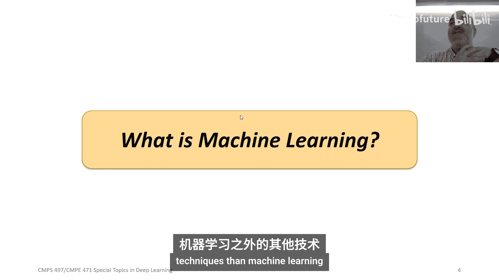

Okay， type what is specific about machine learning it covers the techniques that by which we can learn systems。

We can learn more this from data。We can learn from data， Okay。

 we can build systems that learn from data。That's the specific thing about machine learning。

So if we have observations in our wallet， if we have data in our wallet， we use them to learn。

A systemsystems that can mimic the human intelligence。Okay。

 now machine learning is divided into three sub areas。Superupervised learning。

 unsupervised learning and reinforcement learning we'll talk about each one in our law briefly in the next lecture。

But now you also heard about neuraler networks right or deep neuraler networks。

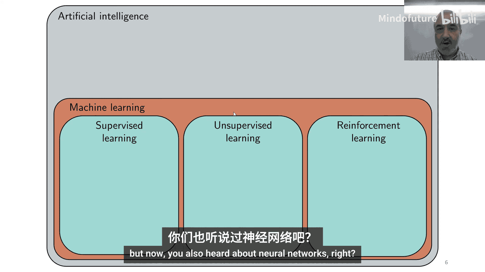

How is that addict to machine learning？Yes。😊，It's uses data to learn， okay， which means。

How is it related to machine learning？It is part of machine learning， okay。

 so there are more specialized techniques within machine learning。Okay。

 so you can expect that deep learning is inside the block of of machine learning。

 it is also a sub area of machine learning。Does that mean it is also sub area of AI？😡，Now， of course。

It is a area of machine learning， which is a area of AI。

Tpe this is deep learning or deep neural neural networks。😡，Are these two different things？Okay。

 so deep neural networks is the technique itself is the model itself is the mathematical mathematical model itself okay。

 but how can we come up with a good mathematical model？😊，This is by deep learning。

 So deep learning is the way that we the techniques that we use to train neuraler networks or deep neuraler networks in particular。

Okay， did you understand that。So we have AI within it。

 we have machine learning within machine learning， we have deep learning。Okay。

 and deep learning is all about cleaning neural networks。

You don't know what Neneos is or are so far right we didn't talk about what are they。

 but they are just specialized models of machine learning。

That may break those now in so many applications yes。嗯。Yes， that's another name。Yeah。

Another name of newer networks in general。Okay， is the relationship between neural networks and deep learning clear now？

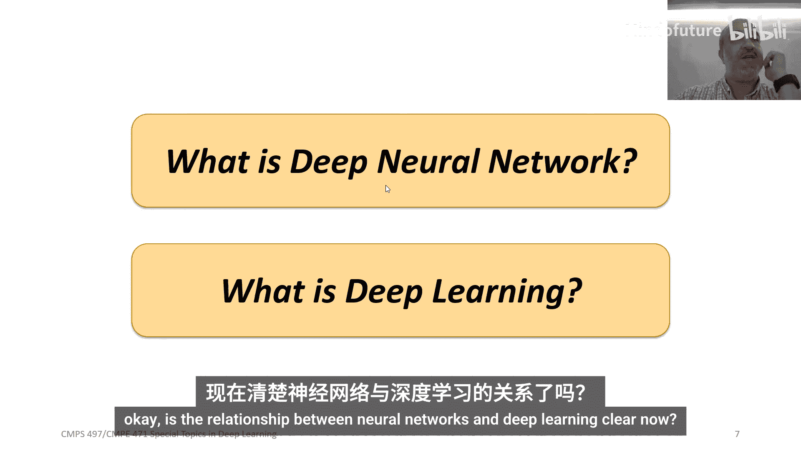

Okay， so。Let me show you this now AI here。So AI here within it， machine learning。😊。

And machine learning has， as we said， three sub areas for all of the three sub areas。

 the techniques are trained or there are techniques that are trained using deep learning。

 so deep neural networks are actually used in both in all of them the three of them and the training is done by deep learning。

😊，ok。😊。

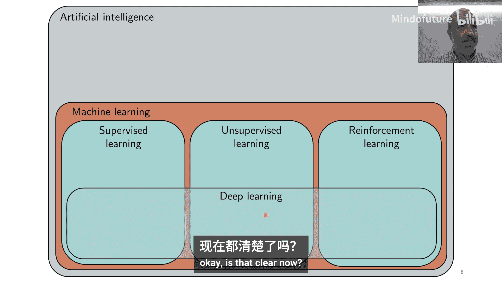

Is that clear now？Let me check。Okay， here's a question for you， AI is all about deep learning。😡，说。

Okay， no， T， what is fitting mathematical and models to observe data？😡，嗯。Is it AI？

Is it machine learning？😮，Did we talk't we say that we learn models from observer data？

This is machine learning， right， so machine learning is about learning or training or building models from data。

😡，Okay， so。Machine learning is correct here。Is that clear or not。So not everything。

 not all the techniques of AI learn from data。😡，Not all of them。

 the ones that actually learn from data。😡，Is。Power body machines。Okay。😊。

Is that clear now how about deep learning， Can we say deep learning is also fitting mathematical models to observe data？

😡，野 so no。Yeah， because it's part of machine learning。Right。

 so which means that these two answers are。Acorect。Yes question。Data that we collect from the wallet。

关。Yeah sorry。What is you here， the system or the human。お that。The person who collects the data。

 sometimes the machine collects the data， by the way， okay， of course， it knows the type of the data。

 but it might be huge data。It can be used for training。Learning training。

 machine learning models or deep learning models。It's the world。Yeah。

 observe it means it's collected or it's seen， it's collected from a real world。😊，ok。Okay。

 one more thing deep learning is equal to machine learning。Why not。Yes。😊，そ。Exactly。

 it's not equal okay， the earth techniques the machine learning that are not deep learning。😊。

How many of you took machine learning course？So I think you know many。

 many models that are not about， for example， decision three。That's not deep learning。

 That's not neural networks。Okay。I do not study this。Okay， last one， what is considered a type？😡。

Of machine learning。And the world type here is， by all any sense， it's a type of machine learning。

 Can we say deep neural networks is a type of machine learning。😡，Yes， of course， right。

 can we say supervised learning is a type of machine learning？😊，Yes。

 we said that Michelin has three divisions， right， supervis is one of them。

ButCan we say deep learning is a type of machine learning？嗯。Why not。Yeah。

 but stuff field means it's a type of？Yes， it is a type of course machine learning。Okay。

 but not everything， and if you remember the previous question。

It's not everything in machine learning， there are many different models of techniques in machine learning than deep learning。

Okay。Is that clear， I hope but these questions， any you understand better the concepts that we covered。

 although we didn't cover much today， it's just。

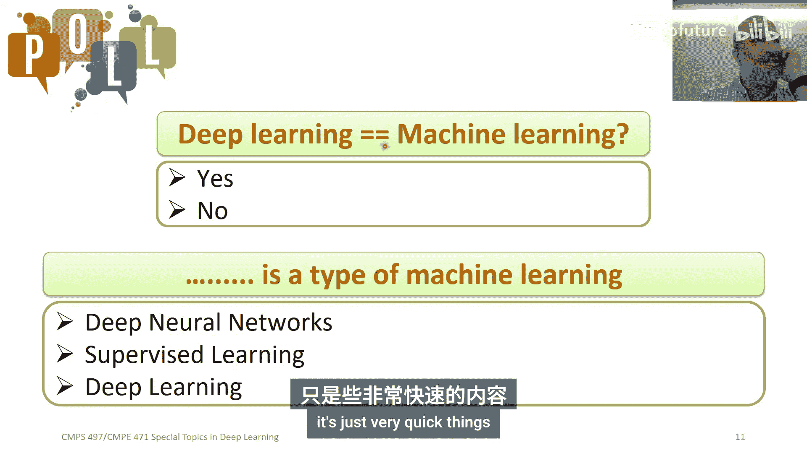

Vavely thingss。Any questions？Okay， I guess we will stop here and Java and continue next time。

 Thank you， Sam。

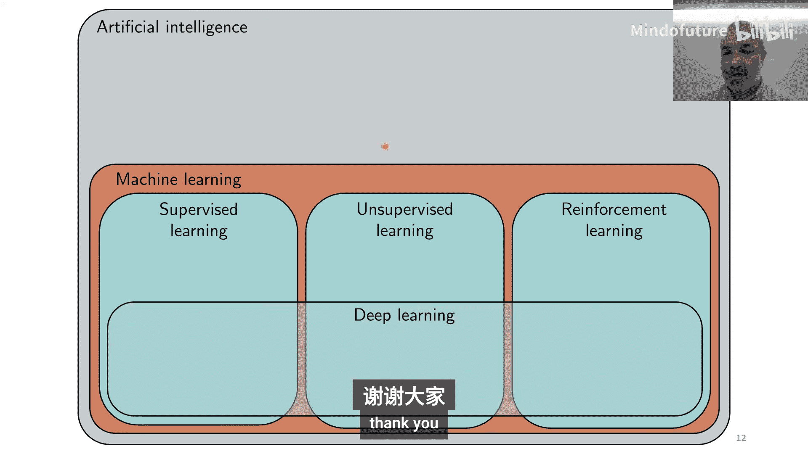