# 【卡塔尔大学】深度学习 CMPS497 ｜ Understanding Deep Learning ｜ Fall 2024 p02 P02_第二讲-介绍 -BV1vQvNz1EeK_p2-

Okay Charlotte today we continue talking about an introduction to deep learning and especially the three types of machine learning that we talked about last time。

vised unsupervised and reinforcement learning。Before that let me get a quick recap of what we have mentioned last time。

 so last time at the end of the lecture we talked about the relationship between AI and machine learning and deep learning。

喂。Can any of you remind me of what are these relationships。Yes。Yes。

 said machine learning is the subject of AI。Yes， okay。 and。

 and how is deep learning related to neural networks。你明咩。嗯。Yeah。

 so the neural networks is the model itself that we build， the system that we would use。谁。

By using to very。好一个。我。Exactly， so this is how we by deployment learning we mean we how we fit that model to data so that we get one model that hopefully will be will be good for our purpose。

Okay， so we went through， I think these questions together。

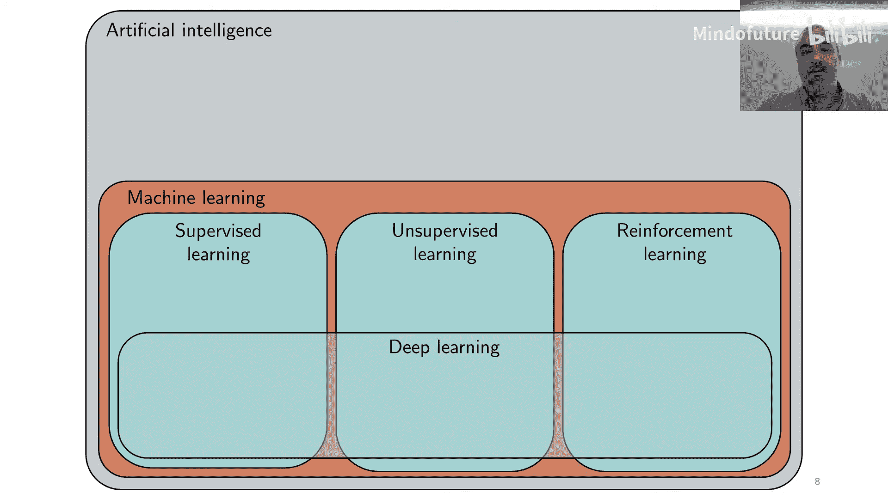

Last time， I think towards the end of that lecture， AI is all about deep learning。

Now what is fitting mathematical models to observe data？I you learning。And deep learning。

 because deep learning is is a soft field， deep learning is equal to machine learning。No， of course。

 not any any machine learning models is deep and what is a type？

Whatever the sense of the type is of machine learning。All of them。 Okay， you remember。Okay。

 why is why is it all of them？First of all， deep neural networks， of course。

 is one of the models of machine learning。So advanced learning is an area within machine learning and deep learning。

Is an area of machine learning also okay or any subfi of machine learning so all of them can be considered as types of machine learning okay and that I think was the last thing we did in the previous lecture Any questions so far Any question from last lecture。

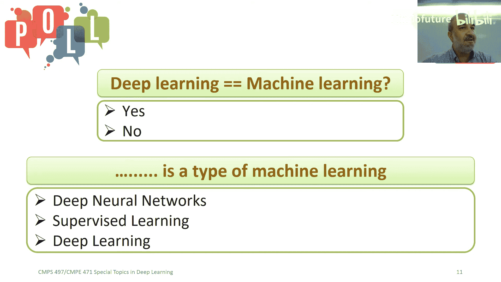

Okay， so let me start back now from where we stopped。

 so this is the picture that we had before and these are the three types me。

These are the three types of machine learning， supervised learning。

 unsupervised learning and reinforce learning and we said that the state of the art solutions in all of these three areas are now powered by deep learning and that's why you focus and on this course on deep learning。

So now let's give very brief introduction in this picture on each of these three areas。

Okay to see how they are different and the way that we will do it is through real examples。

 real wallet examples。 Okay， you will see how these examples actually are mapped into these three areas。

然后就是。哦right。Yes， yes。And deep learning also is helping in each of these three types that's the relationship So as you see here deep learning is all over the place on these three types。

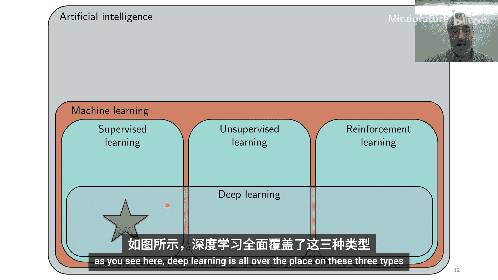

So we'll start with supervised learning。So what is supervised learning？In a very simple definition。

 supervised learning is just a mapping。From input to output。

 so we have some input in the real wallet and we want some output okay and supervis learning can help in mapping between these two from input to the output。

And。In supervised learning， we learn this mapping using examples。Using what we call labeled examples。

 we are given some input。Values， and what should be the output for these input values。

 and by providing these examples， we will learn a model that that provides such relationship。Okay。

 that can help us map from any given input to the corresponding output。So we have a invalid input。

And we won't get awarded output。In between， we will use or we will clean a supervised learning model。

Okay， now the supervised learning model， as you will see， is just a mathematical equation。

Mathematical model。It might not understand their real wallet input。In the form it is in。

So we have to convert that input into a representation that the model can understand。

Mathematical representation。so that will be the model input and on the other side also the real user。

 the user in the real wallet might not understand the output。

EOf the of the supervised learning model， the output of the supervis learning model might be in a specific format。

That has to be also converted into real wallet output so that the user can understand it。

This is very conceptual right， so based on that we will see so many examples in Sha that will make it much more clear。

Here is the first very simple example， let's say that we want to build a model that can map from the age of a child so we will give the age of the child and we want to predict the height of the child。

Yeah。Okay， so how many inputs we have？Just one， the age of the tri and how many output。Just one。

 which is the height of the tribe。几。We， in order to learn that model that maps between from the age to the height。

We will learn a mathematical function or a mathematical equation。This equation。So以。

🤧This equation will take the age as an input。We take the H as an input and provides the height as an L。

And because this is a supervised learning model。😊，It has to learn from labeled examples。

 what we mean by labeled examples， pairs of input and doubt。 So as you see here in the in the figure。

 all of these orange or ground points are real examples that are labeled。

Why they are labeled because they represent an age and corresponding height。 So for example。

 this point， maybe it's like one year and maybe this is 30 centimeters or 40 centimeters okay and each point is like that。

It presents a pair of input and output。An age， and。The corresponding height。

 And from all of these examples， we want to learn a general relationship so that we can apply it on any age。

K， other than the ages that maybe are in the provided label exam， yes。有有的问。

There are of course real data， yes， real data that are provided to train the model to get specific model that can learn the mapping between the input and D。

ok。Yes。I说。你们是该没申。没有我们是。谁。Exactly， okay， I have to learn from data。

 I cannot just write directly a code that convert from the age to the to the height。Okay。😊。

Why couldn't maybe maybe I can think of an equation， right。

 I can say Miss and then I will multiply the age by something to get the height Okay。

 but but that might be different from place to place from time to time。Right。

 from country to country any there are many factors， right， so it would be better to much better。

 much easier even to learn that relationship from given data。From given examples。Okay。

So as you see here， the the green curve is just like。A function。几。

It'sJust like a function that maps from age。To height。Okay， and。

If you if I give you just the orange or the brown points， you can think of multiple many functions。

 right， there are many functions that you can that you can learn from this or you can try on these points。

 right。So we can say generally that any learning model is a family of equations。

Or a family functions。The green curve here is just one of the equations。Okay， but there are many。

 sorry。我。It is learned from the data that we observe。Yeah。

So we try the model represents a family of equations。

 but which equation exactly we will use that depends on the data。

 the data that we will use to train when we say training or fitting the model that means that we are searching through this family of equations to find one that is good enough。

真的。Hopefully the best。He， hopefully the best。Okay， is that clear？对。Sorry。

 now we call this type of problems regression problem。

Why is it irrigation problem because the output is a real number？Its continuous。

So whenever the output is continuous， then this problem is education problem。

Now why is it supervised learning problem？嗯。Why is it supervised？

Because we learn the model in a supervised way， there is supervision。

Where we get that supervision from the label data。From the data that says what is the input and what should be doubt。

 that's the input that should be doubt。切。Now， let's。Connect that to our course in our course。

 we will learn a specific model of machine learning， which is called neuraler networks， right。

So since we said that any supervised learning model or any learning model is a family of equations or family of functions。

Of course， also deep learning sorry， deep neural networks are just a very flexible family of equations。

Okay， which one we should use， we will have to fit。F得 to 내大家图。of course。

 that might not be very clear now with the examples and Shaah would be more clear。Now。

 when we say fitting deep neural networks to the data， this is what we mean by deep learning。

 we are learning a specific deep neural network for for a specific problem from specific data。Okay。

 so whenever we say fitting， that means training， that means finding a good model。

 good specific model for the problem that we are having。Okay。

now we will see by a sequence of examples of real examples。

This example is extending a little bit over the example that we just saw here we have a specification of house and we want to predict the price for that house。

So we can give the area of the house， how many bedrooms we have。

 how much was it sold before if it has a parking spot with it or not and so on。

 so that's the real input right now of course。It has to be given in specific format that the model can understand。

 which is usually a mathematical format， just numbers。Okay， so。

 so we we'll have it as a victim of numbers。Each number present one of the features or information that we are given in name。

Now the output is just also a number because we are talking about predicting the price of the house。

 so the output is just a vector of one number。Okay。Now， why is that regression problem。

YeahBecause the output is。No， not just because the output is a number because the output is。

continuoustinuous is a real number。Okay， because it might be 340。5， for example， right？嗯。So。

 so it's not discretere。And here the conversion from the model output to the real world output is very trivial right。

 we can just say that we expect that the network will provide the number in Toands。

 so when we represent it to the user we just say that this is 340k or 3400。Yes。

It's a number it's a floating point number。K say number。Okay。Its not doesn't have to be inteigger。

 doesn't have to be discre。So that's a regression problem and more specifically we call it univariate regression problem。

NowUnivalue it because it has just one output。Okay。

 so onlyvari regression regression because the output is continuous and the onlyvari because we just have one output。

Here's another， okay， and usually we use fully connected neural network to solve such problems。

Here is another problem， for example。😊，We have the input here is a chemical structure or molecule structure。

Okay， and from that structure。We want to predict two things。

 we want to predict the freezing point and the boiling point。Okay。

So that's the real input and that's the reward output of course again and again and again we have to convert the real input into an input that the model can understand usually it's just a list of numbers regardless of how these numbers we come up with now we will go through that in in different points in the course but we have to have a model input now the output how many output we have。

2 output。 So is that Unival。No。It's called since it's more than one output。

 this is called multivariate or multivariate。Irrigation problem Why is it irrigation problem。

Because it's continuous， right？Right。Okay， so because it's continuous。

 the output values are continuous。Time， if you look at the model output here。

These are numbers usually these are the direct direct values that that we would use it。

 so the conversion here is is simpler is similar to what we saw in the previous one。

 but sometimes the model output might not be。Yes。Simply convert the to the output to the realload output。

 as well see in other examples。And for that， because the input is a graph。

We use a specific type of neural networks called GF neural networks。Okay， here's a third example。😊。

Here we are given text， snippet， text snippet， okay that represent a review of a meal。

 so I went to a restaurant， I had a meal and I write a review of that meal。

And I want the system to predict whether this review is positive。

 which means that I'm happy with the meal or negative， which means that I'm not happy with the。切。But。

Now， is that a regression problem？Why not。Yeah， because because we don't have V number， right。

 Because we don't。 the output is not continuous， right， actually， the output is。Is categories， right。

 And when the output is。From different possible categories， we call this a classification form。

Because we want to classify the input to be either a positive or negative。

And when we have just two categories and we call them actually classes。😊。

When we have just two classes。😮，We call this binary classification。Okay， binary classifications。

rightLet me ask you another question。How many outputs we have here。Is it two or one。It's one output。

😮，It's okay， when， when we talk about the output， we talk about the output that the user is。Getting。

Okay， so the user here is getting just one value， so one output。😡。

But the fact is this output can be of two possible values。Posibleね。

And here specifically in this example， you can see that the model output actually is two outputs。

But these are usually the probabilities of the two classes。So here in this example。

 the probability of being positive is 2% and the probability of being negative is 98%。

 so the output or the output that the user can see is just an interpretation of this。

 which is probably the maximum of them I shouldn't say to the user that the probability of the user might not understand this。

 but the user will understand whether this is positive or negative right so out of this we can say whether it's negative or positive。

Yesす。当时。And this is so。The number。they are by financing in discrete， right？

Because if they are not discreted， then this is aggression。要不是。到2月。两分。But there。当时。就喂。管理的是。In。は好。嗯。

If if these categories， if you can call them categories and they are discrete。

 okay then this is classification， there is a type of classification called original classification because there is an order of the between the classes。

😊，Like， let me give you an example。Like， like the grade。 Yes， ABC， D， E， there's no D here。 F， ABC。

 D， F， Okay， so there is order， right， There are five classes。Or maybe nine， if we add the plus。

 but the other discrete。And there is all between them， so it's a classification problem。

Even if we present each one by a number， by the way。

 this still a classification problem and it is ordinary。ok。The problem itself。

 but you might use argregigation model。To help solving this and convert eventually the number that the model will provide to one of the classes okay。

Was the great。我呢来。怎吧。Yeah， if if， if there are the discrete values， then it's a classification。Okay。

 it's not。The problem okay。You both by the screenな。嗯识。No， here there are not intigs， right。

 positive and negative de are。We will have other even examples that are completely not even ordinary。

Okay， well see that。对。Usually with when we process text nowadays。

 the the state of the art models are called transformer networks and Ch， we will。

To study this in course。Here's another example I don't know。

 fourth or fifth here we have an audio snippet as a real input。

Paroll input and we want to see or we want to predict the type of that audio。Okay， is it jazz。

 Is it classical， Is it metal and so。Okay。Right， how many outputs we have here。One， okay， one output。

 very good， so it's unival right type is it classification motivation。Classification。

 right because we have multiple classes。Okay， multiple discrete classes here the discrete classes are not ordered。

 right？😊，Any post them and negative maybe you can say negative before I post some any maybe okay or better then but here there are there' is no order between them。

T what are these numbers again， probably these numbers are probabilities of the classes and out of that we pick maybe the maximum and we provide that to the user the name of that class to the user。

T， why is it called multiclass？How many， how many possible values that we can have？

More than two if they are just two， it would be binary classification as we saw in the previous example。

 but here we have more than two classes， so this is multi class classification。ok。

And usually because this is a sequential data， we use a specific type again of neural networks that is called the current neural networks RNA。

Here's another one now we have an image。And we want to say， what is this image representing？

Is it Apple， is it B， is it bicycle， is it clown it？Student classroom what。

What is exactly in this image， what is the main object in that image？Again。

 this is a classification problem right， because we have discrete classes， discrete categories。

Is it binary classification？Why not。Yeah because that one output has multiple values。Okay。

 multiple classes。Okay， so it's multiclass classification。Yes。你好。Okay， so this fromware。

 you what do you mean by fromware， this is the output of the model， so the model。

Soolves the problem by predicting probability for each class。But that's not shown to the user。

 that's not the real world output， the real wallet output is just the name of the class。😡，原因呃。Okay。

 remember the very first slide。When we say we have this one。

 when we have we will say we have not this one， this one， the ear input and the ear output， okay？Now。

 the model doesn't have because the model is mathematical model， okay。

 it doesn't have to present its the output or provide its output exactly in the format that the user。

 the real user can understand sometimes。It it does it in a different way。 So in this example。

It is that this one not this one， it estimates the probability for each class。But then。

 the application。Picks the one with the maximum probability to provide to the user。

 And imagine that I will give the user this vector。Would that be， of course。

 we will not be understood。 Okay， so that's the conversion step。系 this machine I be with others。

Of course， of course， this is again， this is supervised learning right we are talking still with supervised learning。

 we said that with any supervised learning problem， we will have to have a set of label data。

Of course， it has it it saw before images for each of these classes。Okay。Yes。嗯，怎么这。还有他的。

I'll talk about that later。 Okay， for now， you can think of this as the， you know。

 the LGB values for each pixel。Intenesis of the colors of the pixel。Okay。

 let's continue so for this because we have the input as an image。

 nowadays images are possessed by a specific type of neural networks called con neural networks Charla we will study in this course。

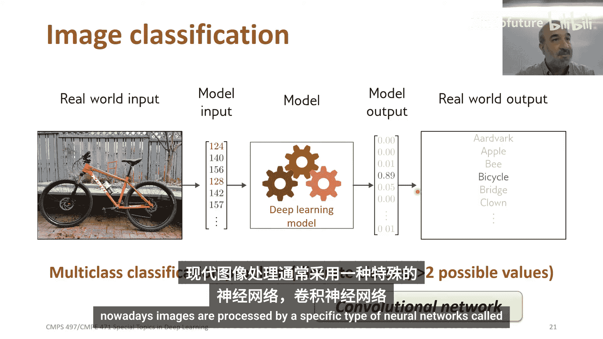

Another example， we have an image。Okay， and we want to segment。The background from that image。

 what do we mean by segmenting the background， it's like detecting the background so that we can remove it。

Okay， so in this case。The output should be whether every single pixel， you know。

 the image is a is a rectangle of pixels， right。Every pixel， I want to。

See if it belongs to the background or not。So imagine this this image， you see this image， okay。

 I can have this output。Which means the， the X color here is just。

The foreground or not the background。 and the black is the background。Okay。

Tpe now how many outputs we have here？2 outputs， only one output。我觉得就。Pos joy。嗯 ok 。

Two possible choices because we have background or not right。

 but how many outputs are many number of pixels， very good because we want a value for every pixel。😡。

Okay， so every pixel in the image， we want to say whether it's background or not。😡。

So it's a multival。Classification。Yeah， yeah， yeah， but for every pixel， there is an output。ok。

There is a value， There is a value for every pixel。Now， so this is multivariate。

 now is it classificationification or regression？Gification， of course， right， because。

Because it its it's categorical， right， it's either background or not its not it's not。诶共叮咗手。

 why is it binary name。Yeah， because every output。Okay， has two possible values。Background or not。

Okay， is that clear。And for that， we use a specific type of CNNs called conal encodeder decoder。

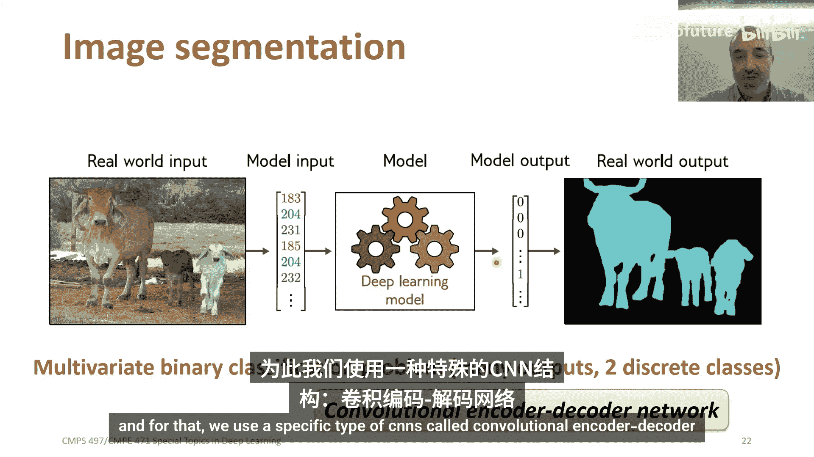

Is there another example called depth destination here we are given an image。ok。So。

We are given an image。And we want to predict for every pixel in the image how far it is from the camera man。

for example， it seems to me that this guy on the bike is very close to the camera man right and the car also is very close but this tree I think if this is a3 is a bit far right so I want to estimate for every pixel I want to estimate that distance。

That's why it's called depth estimation。Okay。Now， is it regression or classification regardless of what is written on the slide？

Is it the regression of classification？Why。Because we are estimating。Continuous values Okay。

 so it's a regression problem Why is it multivalate？Because we need a value for every pixel。

 there are many pixels， there's not just one output， there are many outputs， more than one output。

Okay。Ass it clear now the this。Different types of supervised learning problems。

 Now why are these old core supervised learning problems。Because to learn these models。

 now we are saying just math from the input to the output right， that's easy， easy to say。

 but to learn such models that can do this mapping，We have to have labeled data。

 We have to have labeled pairs of input and out。Okay。

 so I have to have many images like this and the depth okay for the。For these pieces。

But what do we see here on the slide as an output？Now， either model output。

 the model output itself can be of numbers， right that represent the distance。

Now imagine that I give these numbers to the user。It will be very hard to understand right。

 especially this is an image2 d image Okay so this is just like a presentation that is more fy to the user by colors if the color I think if it's a dark color that means that it is close and if it's a bright color it means that it is far so now we can understand can understand that this guy is close。

 this color is close maybe this building is a bit far and so on。Okay。

 so this is more friendly to the user。We use the same type of networks to do that。Okay。

Now this is a recap， quick recap of the terms that we have discussed so far。

 regression means that we have continuous numbers as output。

Classification means that we have discrete classes as output。😊。

Two class and multiclass classification pretty differently。

 I think you saw that when we have just binary classes we can use different type of networks then solutions than the models that we can use for multiclass classification。

Univariate means we have just one output。And multivariate means that we have more than one up。

Any questions on that？No questions。Okay， let me see if you already understand what we we just covered。

Okay， here is a problem， I want you to think about it first before you answer the question。

 given a news article， you know what what mean by news article， right？

I want to predict if it is political。😮，Sportols all economical。That's the definition of the problem。

Now the question is， what type of a problem is that？😡，Okay， think about it first。

 think take some time to think about it and then answer。😮，Montivariate classification，s let's see。

 let's take it step by step Okay， first， is it regressional classification？w。不可。It's not continuous。

 It's just categories， right， Okay， very good。对。So we exclude the regression ones， right？Okay。

 now we have the classification ones now is it。Multivalt， binary， multi class。

 which one how many to say whether it's Uniivariate or multivariate？We check the output。

 the number of outputs here， right， What are the number of outputs here。没有。It's one output。

But with three possible values。That doesn't mean it's three outputs。Okay， so that means that it is。

Univariate， which is not written here， I think， but at least it is not multivariate classification。

 right？now， is it binary or multiclass？Why is it multiclass。By name means too。

 how many classes we have here。3， okay， so it is。Monticlass。Cllaification a。Any question about that。

 is that clear？O。So。now， let me show you。 So we we， we， we went over a good number of examples。

 right， All of them are really examples。I will show you other real examples。

 but they are a bit different。😊，I will show you three examples， little bit different。

 not a little bit different from the examples that we saw。

 and then I want you to think about what is common about them。

How they are actually different from the examples that we saw before。Here's the first one。T利。

We are given text in one language， which is English here。

 and we want to translate it to another language， which is French here。Okay。So again。

 we have to have the model input which is just numbers。

 don't think about how we got these numbers down from the text， we talk about that later。

And also the model will output some numbers and these numbers will be translated into or will be converted into text okay。

喂。You understand this problem now， okay， it's called machine translation station， by the way。

 because this is automatic automatic translation， not human made。Second example。

 we call it image captioning。We are given an image。Like that。

And we want the system or the model to give us a description of that image。坐得上门我来好好点该不动很错。Okay。

So from image to text， the previous one was。Text to text。

A third one is the opposite you are given a description。Okay， of an image。

And you want the system to provide。An image that represents that description。

Whether this can actually happen in a reality or not， of course， as you see here。

 it's very artificial。So this is called image generation from text you are given a text and we want the system to provide the image。

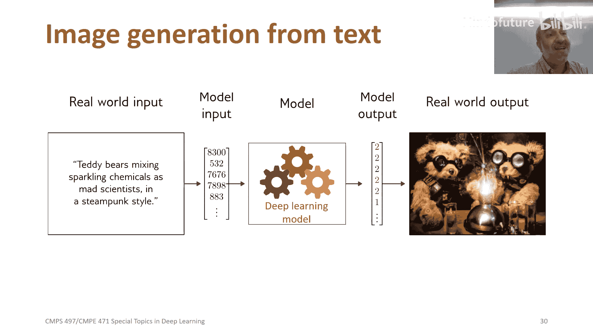

Okay， so， so back now to my question， what do this example have in common， Okay， so what。

One feature that is in common between these example is that we don't have just one possible output。

 one correct output。Okay， so we can generate multiple images that represent the same text。

We can here， we can generate multiple descriptions for the same。imagemage。Even here in translation。

 we can have different translations。A little bit different for the same input right so that's one thing that is different in previous in the previous set of examples。

 we didn't have that right。A one input would have specific output。What else。What is this in common。

That makes this。3 examples， different form。The previous examples， yes。拜啊。Okay。

 so the output is is generated actually， okay， it's not exactly determined before beforehand， okay。

 even in training， we might not see exactly this imaging training。Okay， so the output is generated。

Which makes these problems more much more complex than the problems that we saw before。Right。Okay。

 what else。没有标。没有去。We need lots of data you mean right in order to learn something like that and in order to have a machine that can generate an image that didn't see before。

 it has to see so many images and then some even rules of images。Okay， from lots of data。

 what mean by rules of images here？好吗。Oh yeah something the image has to be logical， right。

 Okay and let me explain that by an extreme example。If you take。

We can say easily that not any random set of pixel can represent。

Logical image or a real image or something that looks a real image。Okay。

 at least an image that I can understand。If you take， for example， if you take an image。

 if you take this image。Or that image， okay， and randomly permute the pixels here。

And then we present it as an image again， would you understand would you will be able even to get the original image。

 maybe not right so pixels here are not random。😡，Nature is not random。Right， so there are load。

There are rules。 And to learn these rules， you have to see lots of data。Lots of it。Same with fixed。

These words are not random， right？And I cannot put just a random list of words。

 and it will be plausible description of of an image or even plausible text snipp。Okay。

 there are rules we call these rules in language。这嘛。There's a grammar for text。

 there's grammar for images， right， and these things are learned from lots of it。

So mainly we capture， I think， the main common features that I have in mind here。

 so very complex relationship。Between the input and output。

Sometimes maybe we have many possible valid answers。

 not just one and the outputs obey rules and sometimes even the input obey so here the language obeys grammatical rules for text for images。

 the natural images also have rules。And usually， and this is Sha what we will see in the course later。

 we learned the grammar of this data from lots of unlabeled examples。I don't need to。

 to learn gammar from labor data。 I can just give。Millions of web pages or billion of web pages and books。

 millions of maybe thousands of books and hundreds of thousands of books and and。

Articles and so on so that the model can learn some statistical features that can represent the gramma of the language。

 similar to images also yes。就是说。对。No， these are not tools。

Features that are common that make these examples a bit different from the others。机会。Also。No。

 image classification I have already determined the set of possible output。Right。

 so it's it's much easier here。如我给。Even if there are so many， I have listed them。Okay。

 and I have the examples for for each。Okay， but still。

 this is more challenging because you are generating something that you didn't see。

 I mean in classification in in in regular classification， Lucersifying among。

Predefined list of categories。Okay， so whatever the output of the system will be will be just one of these。

 it cannot be the system cannot say okay， no， no， no， it's a completely different category。弄。我就是他只。

It can see others， maybe if others， but in this case。

 others will be one of the predetermined classes。 Okay。

 so so it's a difference Here we are just generating something that might not be seen。

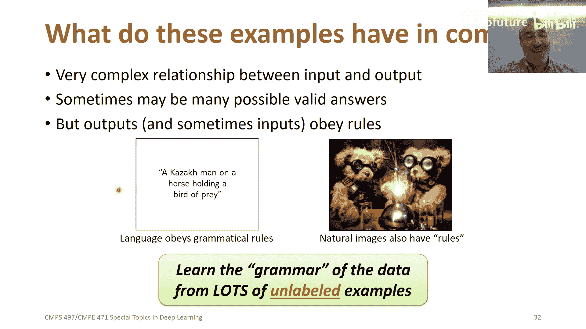

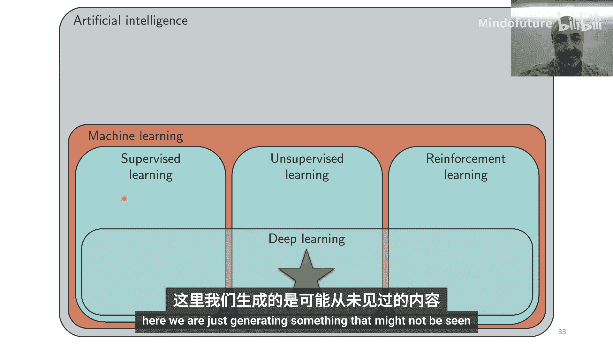

Okay， so with that we are linking to the next type of machine learning。

 which is unsupervised learning。 So in unsupervised learning we learn from data without labels。

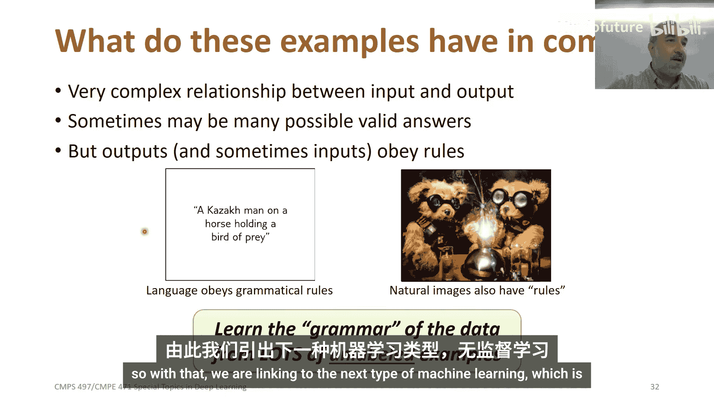

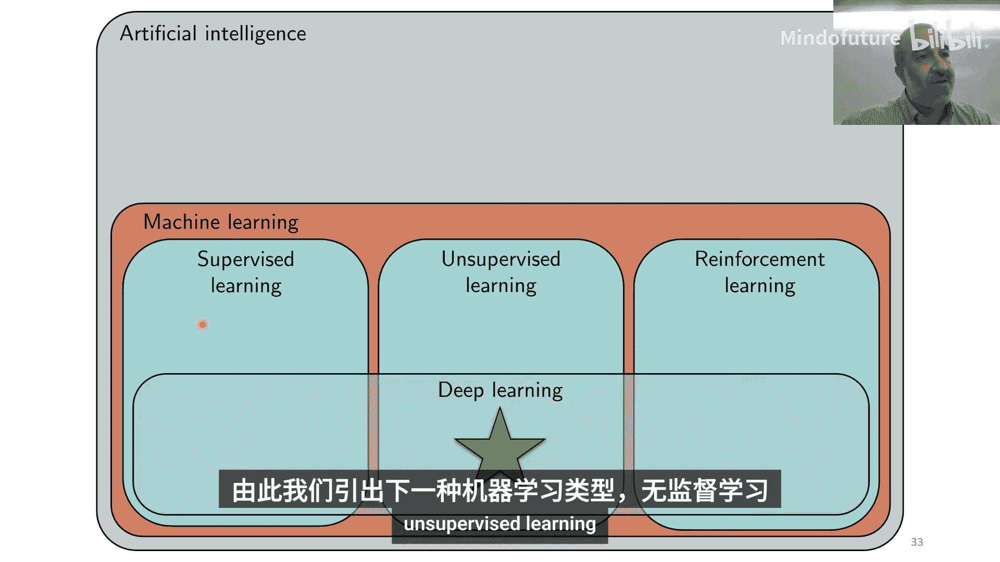

So we don't have limb， but we have it。Okay， but we don't have any depths。

 There are many applications of that。 The famous， the most famous one is clustering。

But there are others like finding outliers you know anything new examples。

 feeling missing data would go through examples of this the first example as as I told you the the most famous example is the clustering example so given this set of images。

I want to cluster them。Into similar。Images， so for example， I want to say these examples are similar。

 So they are in one cluster。 These images are similar。

 So they are in one another cluster and these are similar third the cluster and so on。

This is unsupervised learning because we are not given any labels， we are not given any categories。

 by the way。Sometimes even we don't know how many clusters are in the data。

 So the goal in general from。Unsupervised learning or the objective in unsupervised learning is to learn the structure of the data。

Okay， some structure。Maybe learn similar things and put them together。

Or learn some statistical features of the data。Depending on the structure and the content of the items here。

 which are images。Okay， there is a way to to predict the similarity between images。没有。It doesn't。这个呃。

No， by presenting by okay， so we will not talk about clustering in this course。

 it's in machine learning but the idea is to find a a good representation of the item so that I can compute similarity between different items。

Okay。Okay， so the idea is to try to here we have example images， right， so I can。

Try to find a way features specific specific features in the image。

So that I can convert any image to some features。And then I compare features of that image with that features of that image。

 and can compute similarity between them。OkayI know this is very superficial but that's the idea we don't need to have any label data。

But， sometimes。Just to complete the picture to you。We can learn similarity functions。

 And I told you that we need to get features and features right and then compute the similarity。

 How can we compute the similarity。 There's a function that we use to compute the similarity Sometimes I can think of I come up with a function and sometimes also I can learn a function When I learn a function similarity function。

 This is now supervised or kind of there is some kind of supervision。But in general， cluster rank。

 of course， doesn't need label data。ok。So under unsupervised learning there is what we call generative model under unsupervised learning models。

 there is what we call generative models which are now the state of the art models an example of it is what we call generative adversarial networks。

 GNs and Charlotte will have time to study it。Theres also within then generate models。

 there is another subtype called for ballistic generatedative models。

And one of them is called stable diffusion models， which shall I hope that we will have time to cover。

But generally models now are a very hot area。And for the reason that I think you will see in a couple of minutes。

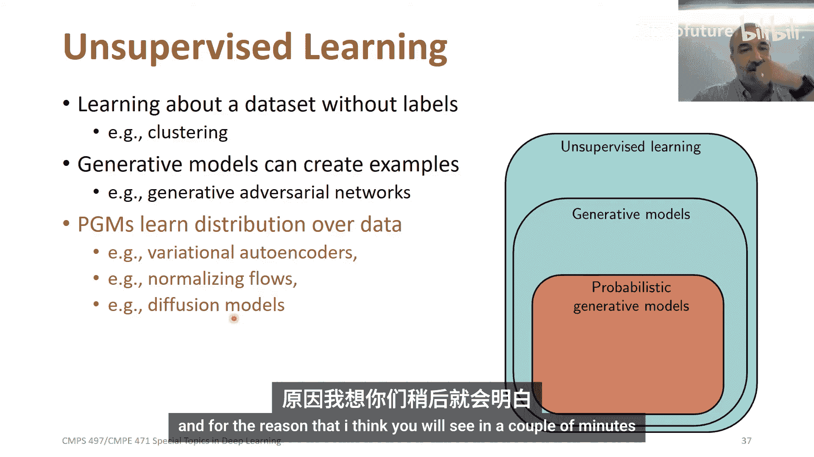

These are all。Photos of cats。But they are all artificial， none of them is real。

They are all generated by gene models。ok。Another example of buildings， maybe touristic buildings。

I don't know。 So that's also automatically generated。Here's the example for text。This is a storyy。

Okay， and it's completely auto generated。And you can eat it， and。It is a meaning。

You might not even detect if it is written by a machine or by a human。

So that's an output of a genetic model。There's also what we call conditional synthesis。

 so on conditional synthesis。It's not that we will ask the model to generate something from scratch。

 but。To fill in the gaps。 Okay， so， for example， this image。

 you see the child and there is like a lob hiding some part of the child。 We might say， okay。

 I want to to change this image so that there is no these ropes I want to remove these ropes。Okay。

 so I would just point。Or label these regions。Go， any。Tag them somehow。 Okay。

 it's like removing them。And then I ask the model to originateate the image。被告。

Fillling in these gaps the white areas here are just gaps that I want them to originate。Based on。

The other the remaining image， the rest of the image， that's why it's called conditional。Okay。

 it's called conditional here because it's conditioned on。じゃあ、コンテツ。The the the。

 the remaining part of damage。 And you can see here。Its might be not 100% perfect， but it's。

It's good enough and you see here the part on the hand。It's really good。 Okay。

 Maybe the face is not very， it's not bad。And you might think that this is a image。

And you see that now in many tools， if there is a person that you want to remove from the photo。

Se that person and then Okay， you like that person so much you want to so that's an example。

Not only in images in text， okay， you can say， okay， this is the start of a story。Completed。So again。

 this is conditional， right？Conditioned on the part that I provided， I want to。To continue， right。

 I want the the system to generate the the remaining of to continue writing that story。

It's not from scratch here， it's given the context， which is the beginning of the story。

Does that sound familiar to you with something that we used nowadays？TgT right tragedygBT Okay。

 so tragedygT， it takes a prompt， right and conditioned on that prompt。Heックンテニス。Okay， January 8。

Whatever is。It thinks that it's good enough。To， to be after that prompt。 Okay。

 it actually tries to find the best， the most likely the most probable word next。

And then most probable word next and probable word next。

 and that's from learning from lots of data and learning statistics of the language from lots of data。

So here I gave a question， I am a C student， how can I succeed in a deep learning course？Okay。

 and it gave me。8 things here。Okay， that's automatically generated conditioned on。

The question that I gave。诶。

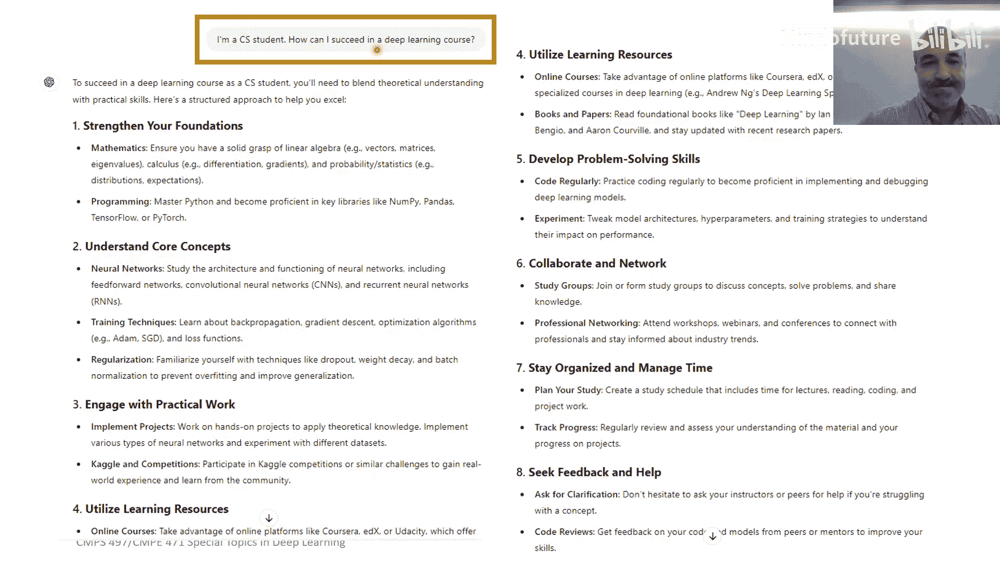

Now let's switch to the third type， which is the enforcement learning。

 do you have any questions before we switch the third？Okay。

 so we see the difference now between supervised and unsupervised。Okay。

 so the third one is really different from the from the other two。 so in reinforcement learning。

 our goal is to build an agent， It's like a program or a system。

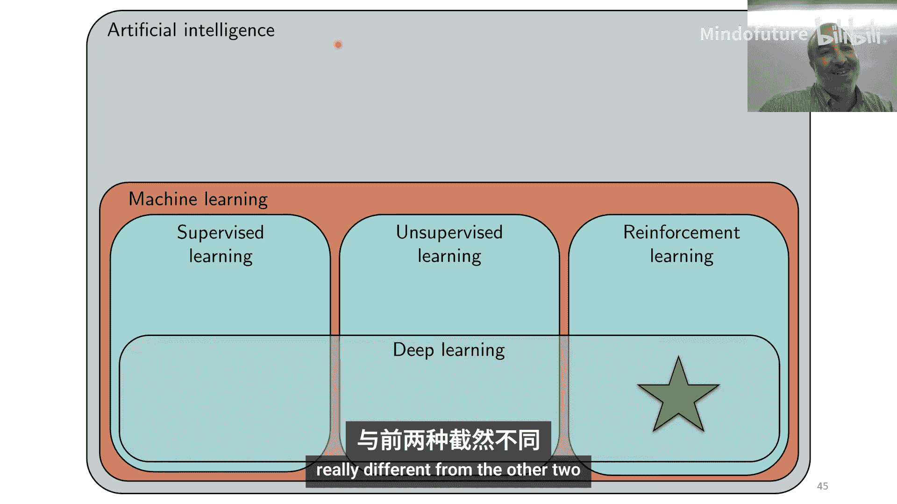

That will take actions in an environment。Step by step so it takes a step okay based on the state of the environment。

 so it tries to observe the some environment， it's like the world to it。

 doesn't have to be real the real world， but specific world to it。

 it observes what in the state of that world and take an action and when it takes an action it gets。

I would。The word might be positive， which means that this action is really good。

What from the environment Okay or negative， which means that maybe the action was not good。

So it learns from these rewards。So it takes an action。

 get a reward sometimes it it might take an action and doesn't get a reward。Thats to continue Okay。

 so it learns by making actions and getting back a reward and with taking the action。

 it changes the state of the world， of course。Okay， let me show you I think。

 an example to understand what I mean。Of course， here we don't receive any data。

 We observe the data through the environment。The classical example of reinforcement learning is chess is playing chess。

 I want to build an agent that plays chess。Okay， so what is the world here？The chessboard。

That's the wallet for that agent Okay， and the state is the position of the pieces。

 which pieces are still there and the position for each piece。And what are the actions？

What are the possible actions。The possible movements。I can move this here。

 I can move this here and so on， and the agent has to take an action in its third。1 edge。

Type what is that you want here。Maybe one action， I will not get any award because there is no pieces that was taken or anything。

Okay， or maybe the it will take a piece from the opponent or my piece will be taken in the next。

 so I might get some reward or penalty。Or I can even get a word that is very delayed at the end of the game。

 I will know whether I will。When or lose， right？It's very delayed reward。

 and that might actually rely on one specific movement that I did good or bad。

 and maybe I did the very bad movement。 And after 20 or 30 steps， I lost game。So I need to learn。

 I need to build the agent so that it can learn that this specific move。

 although it doesn't get the losing penalty immediately， it gets it maybe after after 30 or 40 steps。

 but still learn that this is a bad move。Okay， so this is the enforcement plan。

It's not supervised because there is no labeled data and it's not also unsupervised because there is some observations that the agent is getting some reward that the feedback that the agent is getting from the environment。

T boy is deep learning here。De learning is helping here to map the state。That we are in the input。

Two specific action。So there is to learn。From given state。

 what would be the action that I need to take？Okay。Tpe yes。

It's not easy to know whether this is the best or not， so that's a challenge。啊，Yes yes， we。Exactly。

The agent tries to get the action that is most rewarding。But most voting on， on our long ground。

And it doesn't have to maximize in a short term。给，杨my。

And it has to think about the future think about in some way。

 about the long term reward rather than the short term reward。Okay。

 and that's why actually that's one of the difficulties in in in in reinforcement learning。

 So there are many difficulties in reinforcement learning。 actually。

 one of them is that you might take some action twice， some moved twice， but you get different。

Mos from the opponent so that might be different。Okay。And sometimes even there it was a stochastic。

 and the opponent does or doesn't take you piece。 So you might not get a reward， actually its。It's。

 it's random。Also， there is the temporary credit assignment problem that we we said you might not get that word immediately。

 You might get that word in。50 or 60， or maybe 100 moves when you know that you lost or won the game。

There's also the nice tradeoff between exploit and exploitation。

 should the agent use what it learned already before？Or it should explore。New actions。

This is something like when we think about going to a restaurant。

 should we go to the restaurant that we used to go and like？Or we should explore new ones。

 maybe they will be better than the ones that we saw before。诶。

So that's the exploration is to discover new things。Exploitation is to use what you know already。ok。

Which one we should do？So that's a trade off and that makes reinforcement learning really challenge。

Yeah。嗯。Okay， finally we I just listed here so this that was really very brief introduction to reinforcement planning。

 I hope that Chla we will have time at the end I'm not very sure， but it's the last thing that we。

We might learn in this course and actually nowadays it's complete course and there is a complete course about not not here。

 but in other universities there are complete courses on reinforcement。O。

And deep reinforcement learning in particular， we can use deep learning to do reinforcement learning。

I will close by talking a little bit about history in machine or deep learning。Here's a very short。

 very quick timeline of the landmarks in in the history of machine and deep learning。

 you will find that there are if you look at if you look at the times， the year of each landmark。

 you will find that there are four phases in time or four stages in time。

 The first one is when we start to to do something called neural networks。Aro 1960s。

With what we quote perron， this is the simplest neural model， talk about it in Charr。

And that was not very useful， but then in 1980s and 1990s。

 we started to know how to train larger networks。With with the backrovvocation algorithm。

 but still it was not at scale。It was still very limited and small networks。

The breakthrough happened in the last 10 years or 15 years。

When we started to know how to do the training at scale and how we can train deep networks。

 very large networks with billions of parameters。And we had in these  10 years。

 many breakthroughs in solving many problems。But then another breakthrough happened in 2022。

With moving that from research labs。To the user。And we also saw that happening when we use tragedy now these kind of models can be used easily by humans。

 by users。Okay， so GT and its family by GT for all and the others。

So these are four different stages in the history of machine and deep learning。

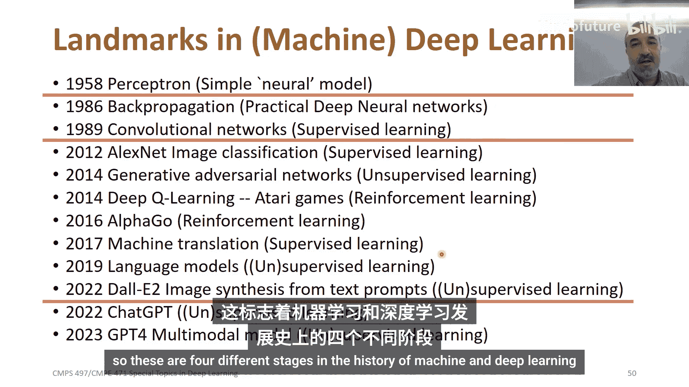

You know， Nobel Prizes。They are in a specific fields。

 unfortunately there is no one in computer science。

But there is another one that is very similar to Nobel price code。

Ting award okay it's also given every year and in 2018 it was given to these three pioneer researchers that actually considered the fathers of deep learning Benji Hton and Decon they made or they were behind big advancements in deep learning in particular。

So， so they got this prestigious award award in 2018 together。For for their work。 Okay。

 so where are we going from here。So that concludes the introduction。Okay。

 so now we have covered chapter one from the textbook。

 I was actually planning to cover also chapter two today， but I don't think we have time now。

So our next lecture， we will talk in a bit more detail about supervised learning。

 We will take one example and show all the aspect of machine learning in general on that。Example。

 and then from the lecture after which I think we'll be on Wednesday。

 well start talking about neural networks。So we'll start with shallow neural networks。

 then deep neural networks， then we talk about how we can train。

 how we can guide the training of neural networks and how we can actually train a network and how we measure the performance of a network that will be up to I think chapter9。

呃。In the next five or six weeks in trauma。

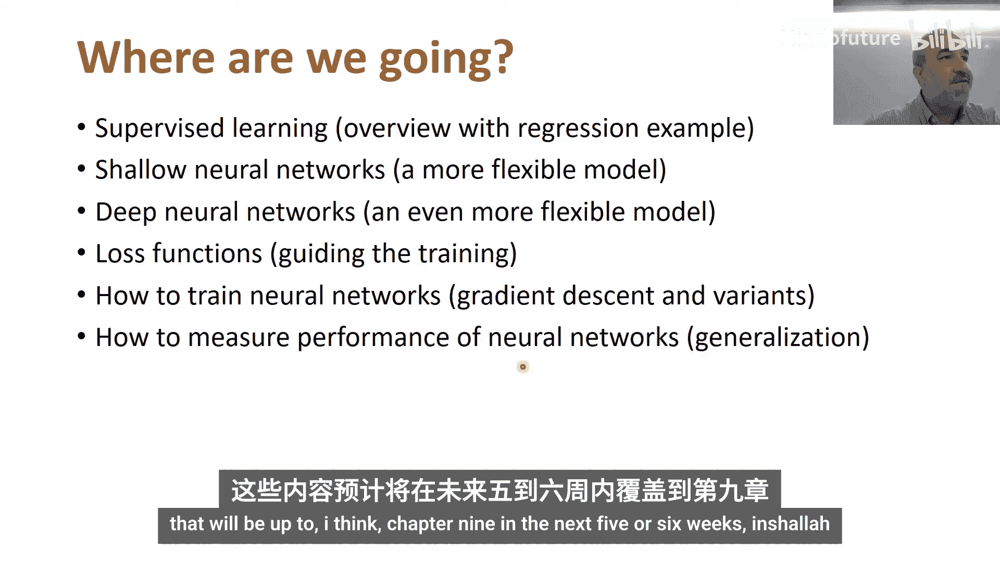